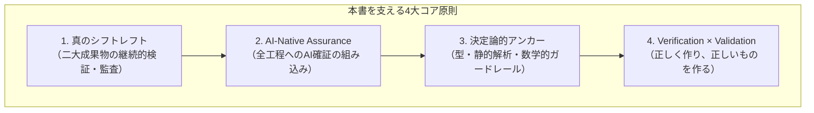

# はじめに

本書『プロダクト品質管理の実践ガイド ―― AI時代のプロダクト・プロセス確証バイブル』を手に取っていただき、誠にありがとうございます。

私たちは今、ソフトウェア工学の歴史上、もっとも劇的な転換点に立っています。生成AI（LLM）や自律型コーディングエージェントの台頭により、「コードを書くコスト」はかつてない速度で暴落しました。数行のプロンプトから数千行の実装コードとテストが数分で生成される時代が、すでに日常となっています。

しかし、開発現場を見渡してみてください。私たちのプロダクトは以前より10倍速く、10倍安全になったでしょうか？

現実に多くの現場で起きているのは、AIが大量生産する「一見もっともらしいコード」による**レビューの目詰まり（Review Fatigue）**であり、誰も細部の挙動を把握していないブラックボックスの蓄積であり、そして**「バグはゼロだが誰にも使われない機能（完璧なゴミ）」の高速量産**です。

コードを生み出す速度が10倍になった時代において、ボトルネックは「実装（Implementation）」から**「確証（Assurance）―― その成果物が本当に正しく、安全で、顧客に価値を届けることをいかに客観的に証明するか」**へと完全に移動しました。

---

## 本書が貫く4つのコア思想

従来の「開発の最終工程で人間が画面を叩いてバグを探す」というテスト観では、AI時代の開発速度と複雑性に立ち向かうことは不可能です。本書では、全7部・25章を通じて以下の4つの工学原則を一貫して提示します。

### 1. 真のシフトレフト ―― 「二大成果物」の継続的検証・監査

シフトレフトとは、単に「単体テストを早く書くこと」ではありません。企画書（PRD）、UI/UXデザイン、機能仕様、アーキテクチャ、ソースコード、インフラ定義（IaC）、テスト資産という**「プロダクト成果物（What）」**のすべてを上流から検証すること。そして同時に、ブランチ戦略、PR規約、DoD（完了の定義）、開発フローといった**「開発プロセス成果物（How）」**そのものを仕様化し、リファクタリングし続けることです。

### 2. AI前提の品質確証（AI-Native Assurance）

AIによって生じた速度の非対称性には、AIを用いた確証で対抗する必要があります。本書では、AIを特定の章だけのトピックとして扱うのではなく、要件定義における敵対的レビュー（反例探索）から、仕様ファジング、Visual AI Diff、自己修復E2Eテスト、AI Opsによる根本原因分析まで、全工程の当たり前のインフラとして組み込む具体策を解説します。

### 3. 決定論的アンカー（Deterministic Anchors）

一方で、「AIが書いたコードをAIがレビューしてヨシとする」だけでは、AI同士の共謀（集団ハルシネーション）やテスト改ざんを防ぐことはできません。非決定論的なAIの出力を最後に繋ぎ止めるのは、型システム、コンパイラ、静的解析（Linter）やSAST（静的アプリケーションセキュリティテスト）、ミューテーションテスト、契約テストといった**「絶対に嘘をつかない物理的・決定論的ガードレール」**です。

### 4. プロセスの多様性と Verification × Validation の統合

ウォーターフォール、スクラム、カンバン、Shape Up、トランクベース開発など、チームが採用するプロセス類型ごとに固有の品質リスクと処方箋が存在します。さらに、仕様通りに正しく作る**検証（Verification）**だけでなく、ISO/IEC 25019（利用時の品質）に基づき「本当にユーザーの課題を解決しているか」を問い直し、不要な機能を勇気をもって削除する**妥当性確認（Validation）**までを品質管理のスコープとして統合します。

---

## 本書の全体構成と読書ナビゲーション

本書は全7部・25章で構成されています。最初から順番に通読いただくことで体系的なメンタルモデルが構築されるよう設計されていますが、現在の課題に応じて以下のナビゲーションから必要なパートを辞書的に参照することも可能です。

| 部 | テーマ | 対象章 | こんな課題を持つ方におすすめ |
| :--- | :--- | :--- | :--- |
| **第I部** | **パラダイムシフトと二大成果物モデル** | 第1章〜第2章 | AI時代のレビュー疲弊を打破したい、品質戦略の全体像を描きたい |
| **第II部** | **プロダクト成果物の検証・レビュー・監査** | 第3章〜第9章 | PRD・UI・仕様・設計・コード・IaC・テスト自体の品質を引き上げたい |
| **第III部** | **開発プロセス成果物のバリエーションと品質保証** | 第10章〜第13章 | 形骸化した開発ルールをコード化し、DORA指標やプロセスを改善したい |
| **第IV部** | **動的検証・シフトライト・セキュリティ品質** | 第14章〜第16章 | FlakyなE2Eテスト、本番障害対応、SBOM・サプライチェーンを防衛したい |
| **第V部** | **AIプロダクトと自律型AIエージェントの品質保証** | 第17章〜第19章 | ML・LLMアプリの評価基盤を作りたい、自律エージェントによるテスト改ざんを防ぎたい |
| **第VI部** | **組織変革・カルチャーと品質の未来** | 第20章〜第21章 | 「QA＝最後の関所」から脱却し、全員品質（Whole-Team）へ移行したい |
| **第VII部** | **品質のトレードオフ・倫理・現場のリアリズム** | 第22章〜第25章 | 品質コスト最適化、メトリクスハック対策、使われない機能の断捨離を行いたい |

第V部では、非決定論的に振る舞うAIを「プロダクトとして作る側」（第17章・第18章）と、「開発の担い手として使う側」（第19章）の両面から扱います。どちらも「確率的な出力を、決定論的な検証でどう囲うか」という同じ問いに答えるものなので、1つの部にまとめました。

### サンプルコードのライセンス

本書の本文は著作権法により保護されています（All rights reserved）。一方、本書に掲載したサンプルコード（コードブロック内のプログラム、設定ファイル、プロンプト）は、**MITライセンス**のもとで自由に利用・改変・再配布していただけます。商用利用も可能です。ライセンス全文はリポジトリの `LICENSE-CODE` に収録しています。

---

## 本書の特徴と実践的な使い方

本書のすべての章には、単なる概念解説にとどまらない**4つの実践パーツ**が標準装備されています。

1. **概念・アーキテクチャ図解（Mermaidダイアグラム）**: 複雑な検証パイプラインや因果関係を視覚的に把握できます。
2. **コピペで動く実践コード・設定・プロンプト**: GitHub Actionsワークフロー、Python監査スクリプト、AI確証プロンプトなど、明日から自チームのリポジトリに導入できる実装例を掲載しています。
3. **現場のアンチパターンとQA合否判定基準（Pass/Fail Criteria）**: 「何を満たせばマージ・リリースしてよいか」の決定論的な閾値を明示しています。
4. **章末セルフワークショップ・演習課題**: 読んだ知識を翌日のスプリント計画やレトロスペクティブで即座に実践するためのワークシートを用意しています。

スピードと品質は、決してトレードオフではありません。強固なブレーキ（確証の仕組み）があるからこそ、レーシングカーは限界までアクセルを踏み込むことができます。

本書が、日々現場で奮闘するすべてのソフトウェアエンジニア、QAエンジニア、テックリード、プロダクトマネージャーの皆様にとって、確かな武器と羅針盤になることを願ってやみません。それでは、新しい品質工学の旅を始めましょう。
