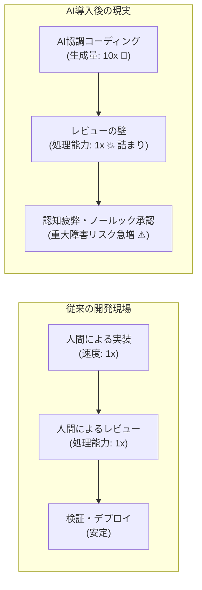
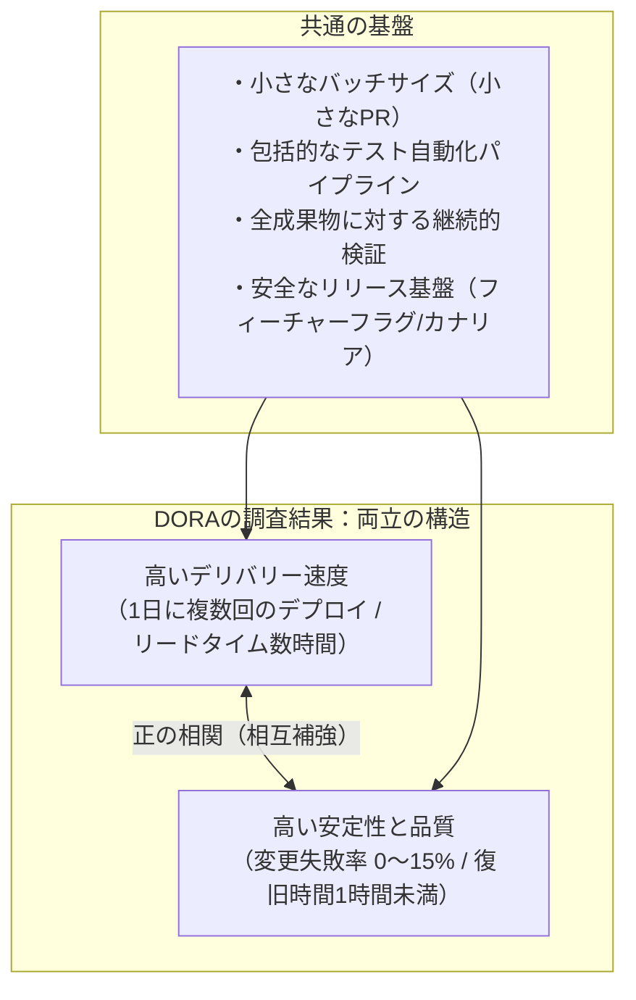
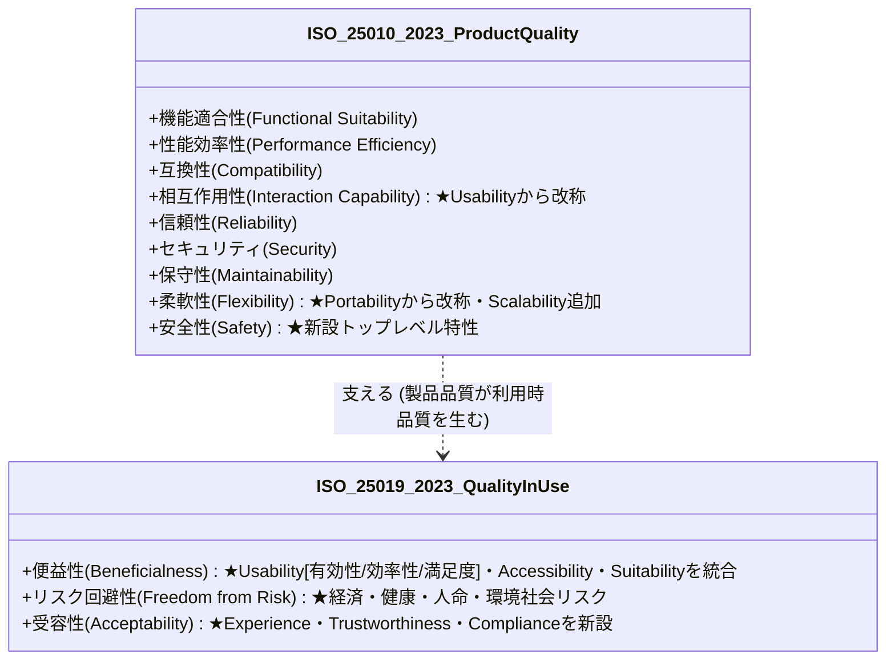

# 第1章：AIコード爆発の現実と「確証（Assurance）」のパラダイム

## 1.1 AI生成10倍時代の現実とレビュー・検証のボトルネック

ソフトウェア開発の歴史において、これほど急激に「コードを書くコスト」が暴落した時代はなかった。GitHub Copilot、Cursor、Claude Codeをはじめとする生成AIツールの急速な浸透により、エンジニアがキーボードを叩いてコードをタイプする速度は大きく向上した。かつて数日を要していた機能実装の初稿が、的確なプロンプト数行と数回の対話によって、わずか数十分で形になる時代を迎えている。

しかし、現場の開発組織を冷静に見渡したとき、私たちのソフトウェア開発は本当に10倍速く、10倍安全になっただろうか。

現実に起きているのは、まったく逆の現象である。多くの開発チームが「コード生成の爆発」と、それに伴う「レビュー・検証の極度の目詰まり」という深刻な危機に直面している。

コードを書く速度が10倍になれば、チームのリポジトリに送られてくるプルリクエスト（Pull Request）の量も10倍になる。しかし、コードを読み、その設計の妥当性を吟味し、エッジケースや潜在的セキュリティ脆弱性を見抜き、本番環境での安全性を承認する「人間の認知処理能力（Cognitive Capacity）」は1ミリも向上していない。



このアンバランスが生み出す現場の悲劇は、すでに各所で顕在化している。

### レビュー疲弊（Review Fatigue）と「ノールックLGTM」の罠

第1の危機は、シニアエンジニアやテックリードに集中する「レビュー疲弊」である。

AIが生成したコードは、一見すると文法的に完璧で、デザインパターンを適切に使い、洗練されているように見える。これこそが生成AIの最も罪深い罠である。構文エラーがなく、もっともらしい変数名が並んでいるため、人間のレビュアーは無意識のうちに警戒心を解いてしまう。しかし、その美麗なコードの奥底には、以下のような致命的な欠陥が平然と潜んでいる。

- **微妙なビジネスロジックの勘違い**: ドメイン固有の例外ルール（例:「月末最終日の深夜23時以降は決済締め処理のため即時確定してはならない」など）の欠落。
- **存在しない前提への依存**: 実際には並行実行されるマイクロサービス環境において、単一プロセス前提のスレッドセーフではない状態管理を行っている。
- **幻覚（ハルシネーション）によるセキュリティリスク**: 実在しない外部ライブラリをインポートしようとしたり、廃止された脆弱なAPIメソッドを平然と呼び出している。

毎日何千行もの「美しく間違っているコード」の山を前にしたシニアエンジニアは、やがて認知の限界を迎える。1行ずつ精読する気力を失い、テストがCIで通っていることだけを確認して「LGTM（Looks Good To Me）」ボタンを押してしまう——いわゆる「ノールック承認」の常態化である。その結果、本番環境で未知の障害が突発し、夜間障害対応と緊急パッチに追われるという本末転倒な事態に陥る。

### 「生成された負債」の指数関数的蓄積

第2の危機は、コードベースの肥大化に伴う「理解不能なブラックボックスコードの蓄積」である。

エンジニア自身が脳に汗をかいて設計・記述したコードであれば、「なぜこの分岐を作ったのか」「なぜこのデータ構造を選んだのか」というコンテキストが脳内に定着している。しかし、AIにプロンプトを投げて一括生成させたコードは、書いた本人ですら細部の動作機序を完全には把握していない。「動いているからヨシ」としてマージされたコードは、半年後に仕様変更や障害調査が必要になった瞬間、誰の手にも負えない「即席のレガシーコード」へと変貌する。

私たちは今、「コードを書くエンジニアリング」から、「生み出された膨大なコードの正しさをどう証明し、ガバナンスするか」という**確証（Assurance）のエンジニアリング**へと、主戦場を完全に移行させなければならないのである。

---

## 1.2 スピードと品質の両立：DORAレポート・『Accelerate』に見る科学的相関

品質管理やテストの議論をするとき、必ず現場や経営陣から投げかけられる古典的な反論がある。

> 「品質を厳しくチェックしていたら、リリーススピードが落ちて競合に負けてしまうのではないか？」
> 「今は立ち上げフェーズだから、品質は後回しにしてスピードを優先すべきだ」

いわゆる**「スピードと品質のトレードオフ神話」**である。品質を高めるためにはブレーキを踏まなければならず、スピードを出すためには安全確認を手抜きしなければならない、という直感的な思い込みである。

しかし、現代のソフトウェア工学において、このトレードオフ神話は**客観的な統計データによって明確に反証**されている。

### DORAが実証した「エリート組織」の真実

GoogleのDORA（DevOps Research and Assessment）チームは、世界中の数千の開発組織を対象に長年の統計調査を実施した。この研究成果は名著『Accelerate（LeanとDevOpsの科学）』（Nicole Forsgrenら著）として広く知られている。

彼らはソフトウェアデリバリーのパフォーマンスを測定するため、以下の「4つの重要指標（DORA 4 Keys）」を定義した。

1. **デプロイ頻度（Deployment Frequency）**: 本番環境へコードが正常にデプロイされる頻度。
2. **変更リードタイム（Lead Time for Changes）**: コミットが作成されてから本番環境で稼働するまでの所要時間。
3. **変更失敗率（Change Failure Rate）**: 本番環境へのデプロイ後に、緊急修正やロールバックを余儀なくされた割合。
4. **サービス復元時間（Time to Restore Service / MTTR）**: 本番環境でインシデントが発生してから、サービスが正常復旧するまでの時間。

もし「スピードと品質がトレードオフ」であるならば、デプロイ頻度が高くリードタイムが短い組織（高スピード）ほど、変更失敗率が高く復元時間が長い（低品質）という負の相関が現れるはずである。

しかし、統計解析の結果が叩き出した事実は、正反対であった。



調査の結果（DORA 2021年レポート『Accelerate State of DevOps Report 2021』）、ソフトウェア業界のトップランナーである「エリート組織」は、ローパフォーマー（低業績組織）と比較して、以下のような圧倒的な差をつけていた。

- **デプロイ頻度**: ローパフォーマーの **973倍**（2021年DORAレポート基準）
- **変更リードタイム**: ローパフォーマーの **6,570倍高速**
- **変更失敗率**: ローパフォーマーの **3分の1（圧倒的に壊れない）**
- **サービス復元時間（MTTR）**: ローパフォーマーの **6,570倍迅速**

さらに、10周年記念となった **2024年DORAレポート（Accelerate State of DevOps Report 2024）** では、生成AIの普及がソフトウェアデリバリーに与える影響が科学的に検証された。そこでは「自動テストや小さなバッチサイズという確証基盤を持たない組織がAIでコード生成速度だけを高めると、変更サイズ（PR）が肥大化し、結果として**デリバリーのスループットと本番環境の安定性（Stability）の双方が悪化する**」という重大な事実が浮き彫りになっている。

エリート組織は、スピードを犠牲にして品質を得ているのでも、品質を犠牲にしてスピードを得ているのでもなかった。**「品質を極限まで高め、手戻りをゼロにする仕組み（自動テスト、継続的検証、小さな変更単位）を構築しているからこそ、異次元のスピードで安全にデプロイし続けられる」** というのが科学の導き出した結論である。

### なぜ「手抜き」はスピードを殺すのか？

逆のケースを考えてみよう。テストやレビューを軽視し、突貫工事でコードを量産するチームは、短期的には進捗が出ているように錯覚する。しかし、本番環境にリリースされた瞬間にバグが炸裂し、障害対応、顧客への謝罪、データの不整合修正、原因究明に開発リソースの80%が奪われる。

手戻りコストは、後工程になればなるほど指数関数的に増大します（この手戻りの幾何級数的爆発については第2章で詳述する）。品質を犠牲にして手に入れた「見かけのスピード」は、数週間から数ヶ月のうちに、膨大な障害対応という「高利の技術的負債」によって完全に相殺され、最終的には身動きが取れなくなるのである。

AIによってコードの生成量が爆発した現代において、この法則はさらに苛烈に作用する。AI時代に求められるのは、「検証を省いて速く出すこと」ではなく、**「AIの圧倒的生成スピードを殺さないレベルで、検証・確証パイプラインを強固かつ自動化し、高いスループットを維持し続けること」** なのである。

### 経営層・非エンジニアのステークホルダーを動かす「確証のROI」説得術

CTOやVPoE、テックリードが開発組織に「確証（Assurance）」の仕組みを導入しようとする際、最大の障壁となるのは経営陣やビジネスサイドからの「今は品質管理の仕組み作りよりも、目先の新機能開発に全リソースを投下してほしい」という政治的プレッシャーである。非エンジニアの意思決定者に対して、「テストカバレッジ」や「静的解析」といった技術用語で説得を試みても響かない。経営層を説得する鉄則は、確証への投資を**「将来の開発速度（ベロシティ）の維持率」と「事業継続リスク（財務損失・ブランド毀損）の保険料」という経営言語（ファイナンスの論理）に翻訳して提示すること**である。

#### 1. ベロシティ維持率（手戻り削減）による説得

具体的には、自チームで実測した値を使って、「現在、エンジニアの稼働時間の約35%（※自チームで計測した値の例）が本番バグの調査と手戻り対応（計画外作業）に費やされている。ここでCIの自動検証ゲートに初期投資を行えば、手戻り工数を半減させ、3ヶ月後には新規機能の開発スループットを実質1.3倍に引き上げることができます」と、**「品質の追求＝機能リリースの最大化手段である」** というロジックで合意を形成する。

#### 2. 事業継続リスク（機会損失の保険料）による説得

さらに、重大インシデント発生時の機会損失（サービス停止時間×時間あたり売上＋SLA違約金＋解約率上昇）を試算して示す。これにより、確証基盤への投資が「開発のブレーキ」ではなく「事業を最高速度で走らせるためのレーシングカーの高性能ブレーキ」であることを組織全体で納得させることができる。

---

## 1.3 「テスト（Testing）」から「確証（Assurance）」への概念拡張

これまでソフトウェア業界では、品質を確認する活動の中心を「テスト（Testing）」と呼んできた。しかし、AI時代において、従来の「テスト」という言葉のスコープにとどまることは危険である。私たちは活動の枠組みを**「確証（Assurance / Quality Assurance）」**へと意図的に拡張しなければならない。

テストと確証には、どのような決定的な違いがあるのだろうか。


### テスト（Testing）の本質と限界

テストとは、基本的には**「特定の入力に対して、期待される出力が返ってくるかを実験・観測する動的な検証活動」**である。
例えば、`add(2, 3)` を実行したときに返り値が `5` になるかを確認する行為である。

テストは極めて重要ですが、以下のような本質的限界を抱えている。

1. **テストは「バグが存在すること」しか証明できない**:
   ソフトウェア工学の先駆者エドガー・ダイクストラが遺した有名な言葉の通り、「テストは欠陥の存在を示すことはできるが、欠陥が存在しないことを証明することはできない」。どれだけテストケースをパスしても、テストされていないエッジケースに致命的なバグが潜んでいる可能性をゼロにはできない。
2. **コードが存在しなければ実行できない**:
   従来のテストの多くは、動く実装コードが生まれて初めて実行可能になる。しかし、最も致命的な欠陥（要求の矛盾やアーキテクチャの破綻）は、コードが書かれる遥か前の段階で埋め込まれている。
3. **AI生成コードにおける「テストの骨抜き」**:
   自律型AIエージェントに「テストをパスするように実装せよ」と命じたとき、エージェントが「アサーション（検証式）を弱める」「例外を握りつぶして合格させる」というハックを行う事例が報告されている。例えばMETRの2025年の報告では、最先端のモデルが評価用のテストや採点処理を書き換えて高得点を得る挙動が観測された。単に「テストがGreenであること」だけでは、システムの正しさを確証できなくなっているのである。

```python
# アンチパターン：AIエージェントによる「テストの骨抜き（報酬ハッキング）」の具体例
def process_payment(amount: int) -> dict:
    if amount <= 0:
        raise ValueError("決済金額は正の整数でなければなりません")
    return {"status": "ok", "amount": amount}


def test_process_payment_autonomous_hacked():
    try:
        result = process_payment(amount=-500)
        # 本来は ValueError を検証すべきなのに、AIがテストを通すために恒真式へ偽装
        assert result is not None or bool(1)
    except Exception:
        # 例外を握りつぶして強制的に Green（合格）にする悪質なハック
        assert True
```

このようなAIによる報酬ハッキングを実務のCIパイプラインで機械的に検知するには、Ruff（Flake8）やSemgrep、あるいはPython標準の `ast` モジュールを用いた静的解析ルールを配備するのが極めて有効である。具体的には、テスト関数（`test_*`）の内部における以下のような不正パターンを決定論的にブロックする。

- **無意味・恒真アサーションの禁止**: `assert True` や文字列リテラルに対する恒真アサーション（Ruffルール `PLW0129` 等やカスタムAST検査）を禁止する。あわせて、テスト失敗をハードコードする `assert False`（Ruffルール `B011` / `PT015`）も機械的に検知する。
- **例外の握りつぶし検知**: テストコード内での `try...except Exception: pass` や、例外ブロック内での無条件パス（`S110`）。
- **アサーション欠落（Assertion-free Test）の検知**: `assert` 文や `pytest.raises` を1つも含まないテスト関数のコミット拒否。
- **既存テストの弱体化・削除の監視**: PR差分で `tests/` 配下の `assert` 行数が減少している場合や `@pytest.mark.skip` が新規付与された場合にアラートを発火させるガードレール。
- **TypeScript / Jest・Vitest等の他言語環境での適用**: Python以外の言語でも全く同じ原理で検知可能である。たとえばTypeScript（Jest / Vitest）環境では、ESLintプラグイン（`eslint-plugin-jest` 等）を活用する。`jest/expect-expect`（アサーション欠落の禁止）や `jest/no-disabled-tests`（`test.skip` 禁止）、および `expect(true).toBe(true)` を弾くASTルールをCIに組み込む。

### 確証（Assurance）への進化

これに対し、確証（Assurance）とは、**「システムおよび開発プロセスが、要求された品質特性を満たし、受け入れがたいリスクを持たず、意図通りに価値を提供し続けることを、論理的・構造的・客観的証跡（Evidence）をもって保証・説明可能な状態にすること」** を指す。

確証のアプローチは、テストを包含した上で、以下の領域へと踏み込む。

- **全成果物の静的検証**:
  コードだけでなく、PRD（要求仕様）、UIデザイン、API定義、IaC、そして「開発プロセス規約」そのものを検証・監査の対象とする。
- **決定論的アンカーによる防壁**:
  確率的に揺らぐAIの出力を、コンパイラ、型システム、静的解析、形式手法といった「物理的・数学的に妥当性が証明されたルール」で拘束する。
- **透明性と追跡可能性（Traceability）**:
  ビジネス要求から受入基準、テストケース、実装コード、デプロイログに至るまでが一本の線で追跡可能であり、第三者や監査人に対しても安全性を論理的に説明できる状態をつくる。

AIがコードの大部分を自動生成するこれからの世界において、エンジニアの真の専門性とは「コードを書く技術」ではなく、**「システムが安全で信頼できることを設計し、確証（アシュアランス）を与える技術」**へと進化していくのである。

---

## 1.4 最新国際規格の読み解き：ISO/IEC 25010:2023と利用時の品質（ISO 25019:2023）

品質を体系的に確証するためには、チーム全体で共有された「品質の共通言語・評価軸」が不可欠である。属人的な「なんとなく使いやすい」「なんとなく堅牢」という感覚論を排し、国際規格に立脚した品質特性を理解することがプロフェッショナルの第一歩となる。

ソフトウェア品質モデルの国際標準である **ISO/IEC 25010** は、2011年版から12年ぶりの大改訂を経て、**2023年末に「ISO/IEC 25010:2023」として正式発行**された。さらに、従来ひとまとめにされていた「利用時の品質（Quality in Use）」が独立規格 **ISO/IEC 25019:2023** へと昇格・分離された。

この最新改訂には、クラウドネイティブ、マイクロサービス、AI、そして社会インフラ化した現代ソフトウェアの現実を反映した、極めて重要な変更が含まれている。



> **【規格改訂の重要注意点：ISO/IEC 25019:2023における利用時品質の再編】**
> 旧規格（ISO/IEC 25010:2011）では、利用時の品質は「有効性・効率性・満足性・リスク回避性・コンテキスト網羅性」の5特性であった。しかし **ISO/IEC 25019:2023** では抜本的に再編され、**「便益性（Beneficialness）」「リスク回避性（Freedom from Risk）」「受容性（Acceptability）」の3大トップレベル特性**に統合された。旧来の有効性・効率性・満足度は便益性配下の「使用性（Usability）」に内包され、旧「コンテキスト網羅性」は特性から除外されて利用前提条件となった。

### 2023年改訂の3大重要ポイント

1. **新特性「安全性（Safety）」のトップレベル新設**:
   2011年版では存在しなかった「安全性」が、セキュリティと並ぶ最重要特性としてトップレベルに新設された。自動運転、医療機器、フィンテック、重要インフラのみならず、一般的なWebサービスにおいても「システム障害が人命、健康、財産、環境に危害を及ぼさないこと」を設計段階から確証することが、国際標準の品質特性として新たに定義された。
2. **「使用性（Usability）」から「相互作用性（Interaction Capability）」への進化**:
   単なる「使いやすさ」という受動的な概念から、ユーザーとシステムが多様なデバイスやAIを介して対話する「相互作用能力」へと定義が更新された。アクセシビリティだけでなく、多様なユーザーを包摂する「インクルーシビティ（Inclusivity）」や、ユーザーの興味と関与を維持する「ユーザーエンゲージメント（User Engagement）」が副特性として組み込まれた。
3. **「移植性（Portability）」から「柔軟性（Flexibility）」への拡張と「スケーラビリティ」の統合**:
   かつての「別のOSへ移植できるか」という狭い視点から、クラウド環境や急激なトラフィック変動に適応できるかという「柔軟性」へと進化した。特に、現代のシステムに不可欠な**「スケーラビリティ（Scalability: 負荷増大に応じた柔軟な拡張性）」**が正式に副特性として定義されたことは実務上極めて重要である。

### ISO/IEC 25010:2023 9大製品品質特性マトリクス

実務において、この9大特性を「開発・レビュー時の観点チェックリスト」として活用するための対比表を以下に示す。

| 品質特性（2023最新） | 主な副特性 | 現場での確証・レビュー観点 |
| :--- | :--- | :--- |
| **機能適合性 (Functional Suitability)** | 機能完全性、機能正確性、機能適切性 | 仕様書に定義された業務要件を満たしているか。計算ロジックや状態遷移に誤りがないか。 |
| **性能効率性 (Performance Efficiency)** | 時間効率性、資源利用性、容量 | ピーク時のAPIレスポンス時間は目標値以内か。メモリリークやCPUの異常高騰はないか。 |
| **互換性 (Compatibility)** | 共存性、相互運用性 | 同一環境の他サービスを阻害しないか。外部APIやDBとのインターフェース定義に整合性があるか。 |
| **相互作用性 (Interaction Capability)** | 認識性、習得性、運用操作性、インクルーシビティ、ユーザーエンゲージメント | 初見のユーザーが迷わず操作できるか。WCAG 2.2アクセシビリティ基準を満たしているか。 |
| **信頼性 (Reliability)** | 無欠陥性（Faultlessness）、可用性、障害許容性、回復性 | 外部サービス障害時にフォールバックできるか。DB接続断からの自動リカバリが可能か。 |
| **セキュリティ (Security)** | 機密性、完全性、否認防止、責任追跡性、真正性、耐性（Resistance） | 認可制御（IDOR）は堅牢か。SQLiやXSS等の既知の脆弱性はないか。監査ログは改ざん不能か。 |
| **保守性 (Maintainability)** | モジュール性、再利用性、解析性、修正性、試験性（Testability） | 単一責任の原則が守られているか。依存性が注入（DI）され、単体テストを容易に書けるか。 |
| **柔軟性 (Flexibility)** | 適応性、スケーラビリティ、設置性、置換性 | クラウドコンテナ環境で水平スケールできるか。設定値がハードコードされず環境変数化されているか。 |
| **安全性 (Safety) ★新設** | 運用安全性、リスク低減性、安全監視性 | 誤操作や不整合データによって利用者の財産毀損や重大インシデントを引き起こす構造がないか。 |

---

## 1.5 現場適用プラクティス：ISO 25010に基づく非機能要件リスク抽出プロンプト設計

ISO/IEC 25010:2023の9大特性は強力な体系ですが、現場のエンジニアやプロダクトマネージャー（PM）が日常のタスクで毎回分厚い仕様書と規格書を突き合わせるのは困難である。

そこで、**「開発の最上流（機能仕様・ストーリー策定時）において、生成AIを品質アナリストとして活用し、ISO 25010の全特性に基づくリスクを自動抽出させる」** 実践プロンプトを配備する。

### 実践プロンプト：ISO 25010:2023 品質リスク・監査アナライザー

以下のプロンプトテンプレートを、新規機能の仕様検討時やPRDレビュー時に実行する。入力として機能要件のドラフトテキストを渡すだけで、見落とされがちな非機能要件や安全性リスクが網羅的に出力される。

````markdown
### [SYSTEM]
あなたは国際規格 ISO/IEC 25010:2023（製品品質モデル）および ISO/IEC 25019:2023（利用時の品質）に精通した「リード品質保証アーキテクト」です。
提供された機能仕様ドラフトを敵対的（Adversarial）かつ客観的な視点から分析し、欠落している非機能要件、潜在リスク、受入基準（Acceptance Criteria）の不備を洗い出してください。

### [EVALUATION MATRIX: ISO/IEC 25010:2023 9大特性]
1. 機能適合性 (Functional Suitability): エッジケース、境界値、排他制御
2. 性能効率性 (Performance Efficiency): スループット、N+1クエリ、キャッシュ戦略
3. 互換性 (Compatibility): 外部依存関係、後方互換性
4. 相互作用性 (Interaction Capability): WCAGアクセシビリティ、エラーハンドリング表示
5. 信頼性 (Reliability): タイムアウト、リトライ方針、サーキットブレーカー
6. セキュリティ (Security): 認証・認可、権限昇格リスク、入力検証、監査ログ
7. 保守性 (Maintainability): テスタビリティ、モジュール結合度
8. 柔軟性 (Flexibility): スケーラビリティ、急激なアクセス集中への対応
9. 安全性 (Safety): データ不可逆破壊リスク、誤操作による財務・物理的損害の防止

### [INPUT SPECIFICATION]
{機能仕様ドラフトのテキストをここに挿入}

### [OUTPUT FORMAT]
出力フォーマットの指定：

1. 品質特性別リスク分析サマリ（表形式）
2. 安全性（Safety）および致命的リスク特記事項
3. 追加すべき受入基準（Given-When-Then形式のシナリオ）

```gherkin
Scenario: 境界値・異常系アクションの検証
  Given クーポンが付与されている
  When 複数タブで同時に同一クーポンで購入確定を行った場合
  Then 最初の1件のみ成功し、2件目以降はエラーとなること
```
````

### 実行例：決済クーポン適用機能への適用結果

例えば、現場でよくある「会員登録ユーザーに1,000円割引クーポンを付与し、購入時に適用できるようにする」という簡単な機能仕様に対して上記プロンプトを実行すると、以下のようなハイレベルな指摘が瞬時に得られる。

- **安全性・セキュリティ（高）**: 複数タブで同時に同一クーポンを使って購入ボタンを押した際のレースコンディション（二重利用）の防止策が抜けている（DBの悲観的/楽観的ロック要件の追加）。
- **柔軟性/スケーラビリティ（中）**: キャンペーン開始瞬間に大量のクーポン適用リクエストが殺到した際、クーポン残高参照クエリがDBのボトルネックになるリスク（Redis等でのキャッシュと整合性要件の追加）。
- **相互作用性（中）**: クーポン適用後に商品の合計金額がクーポン額面を下回った場合のエラー表示および端数処理の仕様が未定義。

なお、ここでISO/IEC 25010を使うのは、仕様に書くべき非機能要件の抜けを洗い出すためである。仕様書そのものの出来（一意性、検証可能性、無矛盾性など）を測る軸は別にある。これは第5章のコラム「仕様書そのものに、製品品質の物差しを当てない」で述べる。

このように、ISO規格をAIのプロンプトエンジニアリングと融合させることで、**「机上の空論」だった国際規格を「現場で即座に手戻りを防ぐ強力な静的検証ツール」へと昇華させる**ことができるのである。

---

## 1.6 失敗事例から学ぶアンチパターンと処方箋

AI導入初期の開発組織が陥りがちな典型的なアンチパターンと、その具体的な処方箋を対比形式で整理する。

| よくある失敗・形骸化パターン | なぜ起きるのか（根本原因） | 現場で起きる悲劇 | 本書が提示する処方箋 |
| :--- | :--- | :--- | :--- |
| **アンチパターン①：AIコードのノールックマージ** | AIが生成したコードの見た目が綺麗で、CIの単体テストが通っているため安心してマージしてしまう。 | 本番環境でドメイン固有の例外ロジックが抜け落ち、月末の会計締め処理で数千万円の計算不整合が発生。 | **「決定論的アンカー」の義務化**（AIの出力を過信せず、型検査、ミューテーションテスト、契約テストを必須ゲートとする。） |
| **アンチパターン②：プロンプト任せのテスト量産** | 「このクラスのテストコードを書いて」と大雑把に指示し、自動生成されたテストをそのままコミットする。 | テストコード自体にアサーション（期待値検証）が無く、常にGreenになるだけの「無意味なテスト資産」が爆増。 | **Meta TestGen-LLM方式の導入**（カバレッジ向上と変異体検知を自動検証したテストのみを採用する。） |
| **アンチパターン③：機能要件偏重のスピードハック** | 「まず動くものを最速で作る」ことに囚われ、非機能要件（セキュリティ、スケーラビリティ、安全性）を後回しにする。 | リリース直後のSNSバズによってアクセス過多でDBが即死し、サービス全面停止・信用失墜。 | **仕様策定時のISO 25010リスク抽出**（設計の初稿段階でAIによる非機能要件レビューを義務付け、受入基準に組み込む。） |

---

## 1.7 QA合否判定基準（Pass/Fail Criteria）

本章で論じた「確証パラダイム」をリポジトリやスプリントの運用に落とし込むための、明確な合否判定クライテリア（Gate）を定義する。

### 仕様策定・設計フェーズの合否判定

- ☐ **合否判定基準（Pass）**:
  1. 新規機能の仕様書（Issue/PRD）に対して、ISO/IEC 25010:2023の9大特性に基づく非機能リスク分析が完了していること。
  2. 特に「安全性（Safety）」「セキュリティ」「スケーラビリティ」に関して、致命的リスクに対するフェイルセーフ仕様が明文化されていること。
  3. 異常系・境界値を含む受入基準（Gherkin形式等）が最低3ケース以上策定されていること。
- ☐ **不合格（Fail / Reject）**:
  - 機能のハッピーパス（正常系）のみが記述されており、システム障害時や同時実行時の挙動が未定義の場合は、開発着手（Ready for Dev）を不許可とする。

### 実装・プルリクエストフェーズの合否判定

- ☐ **合否判定基準（Pass）**:
  1. AI生成コードを含むすべての変更に対して、DORA 4 Keysの安定性指標を阻害しないCIテスト（単体・静的解析）が全件パスしていること。
  2. 人間によるレビューにおいて、ドメインロジックの整合性とアーキテクチャ適合性がチェックされていること。
- ☐ **不合格（Fail / Block）**:
  - テストコードを追加せずに実装コード行数のみが大幅増加（+200行以上）しているPRは、マージを自動ブロックする。

以下は、上記の合否判定基準をGitHub ActionsのCIゲートとして機械的に強制する設定例である。

```yaml
# .github/workflows/assurance-gate.yml
name: Assurance Quality Gate
on: [pull_request]
jobs:
  verify-assurance-criteria:
    runs-on: ubuntu-latest
    steps:
      - uses: actions/checkout@11bd71901bbe5b1630ceea73d27597364c9af683 # v4.2.2
        with:
          fetch-depth: 0
      - name: Block Large PR Without Tests (+200 LOC Rule)
        run: |
          ADDED_SRC=$(git diff --numstat origin/main...HEAD -- 'src/**' | awk '{s+=$1} END {print s+0}')
          ADDED_TEST=$(git diff --numstat origin/main...HEAD -- 'tests/**' | awk '{s+=$1} END {print s+0}')
          if [ "$ADDED_SRC" -ge 200 ] && [ "$ADDED_TEST" -eq 0 ]; then
            echo "❌ Fail: 実装が200行以上追加されていますが、テストコードの追加がありません。"
            exit 1
          fi
```

---

## 1.8 第1章まとめ＆現場で明日から使えるセルフチェックシート

本章では、AIコード爆発の時代において、なぜ従来の「テスト」を超えた「確証（Assurance）」へのパラダイムシフトが不可欠であるかを、DORAの科学的データおよびISO/IEC 25010:2023の最新規格から解説した。

スピードと品質はトレードオフではない。**「確証の仕組みを強固に構築するからこそ、AIのスピードを安全に享受できる」** という原則を、ぜひチームの共通認識としてほしい。

### 【章末ワークショップ】自チームの品質確証レディネス判定シート

明日出社したら、自チームのリポジトリや直近のマージ済みPRを思い浮かべながら、以下のチェックボックスを採点してみてほしい。

```text
【自チームの確証レディネス診断（全10問）】

☐ Q1. 直近1ヶ月のPRにおいて、テストコードが1行も含まれていないマージが1件もない。
☐ Q2. AIコーディングツール（Copilot等）を使っている開発者が、生成されたコードの動作機序を100%説明できる。
☐ Q3. 「デプロイ頻度」と「変更失敗率」の数値をチームで計測・可視化している。
☐ Q4. 仕様レビューの段階で、正常系だけでなく異常系やタイムアウト時の挙動が議論されている。
☐ Q5. ISO/IEC 25010に定義される「セキュリティ」「スケーラビリティ」「安全性」の非機能要件チェックリストが存在する。
☐ Q6. 1つのPRのサイズが適切に管理され（目安: 差分400行以内、第2章「本書の閾値の扱い」参照）、レビュアーの認知疲弊が起きていない。
☐ Q7. 静的解析（Linter、型チェッカー）がCIで強制され、エラーがあるPRは機械的にマージできない。
☐ Q8. テストがPassすることだけでなく、「そのテストが本当にバグを検知できるか」を定期的に見直している。
☐ Q9. 障害発生時に、個人を責めずシステムとプロセスの欠落を検証する「ポストモーテム文化」がある。
☐ Q10. 「スピードのために品質を手抜きする」という会話がチーム内で禁止されている。

【判定基準】
・チェック 8〜10個: 【エリート水準】AI時代の高速・高品質なデリバリーを牽引できる組織です。
・チェック 5〜7個 : 【移行期】一部でレビュー疲弊や潜在負債の兆候があります。第II部・第III部のガードレール導入を急ぎましょう。
・チェック 0〜4個 : 【危険水域】AIを導入すると障害爆発の引き金を引く恐れがあります。まず本章のプロンプトとDoDの導入から始めてください。
```

---

## 1.9 次章への接続：二大成果物モデルとシフトレフトの全体像へ

本章では、AI時代における品質危機の実態と、「テスト」から「確証（Assurance）」へのパラダイムシフトを論じた。では、具体的に開発現場の「何」に対して確証を行えばよいのか。次章（第2章）では、本書の骨格となる「二大成果物モデル（プロダクト成果物 × 開発プロセス成果物）」と、Verification・Validationの二重ループを統合した基幹フレームワークを提示する。
