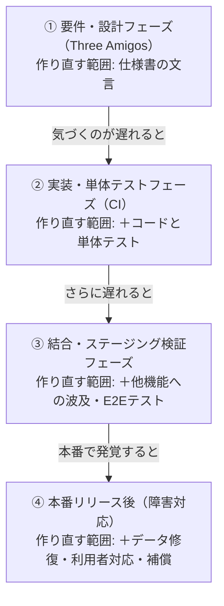
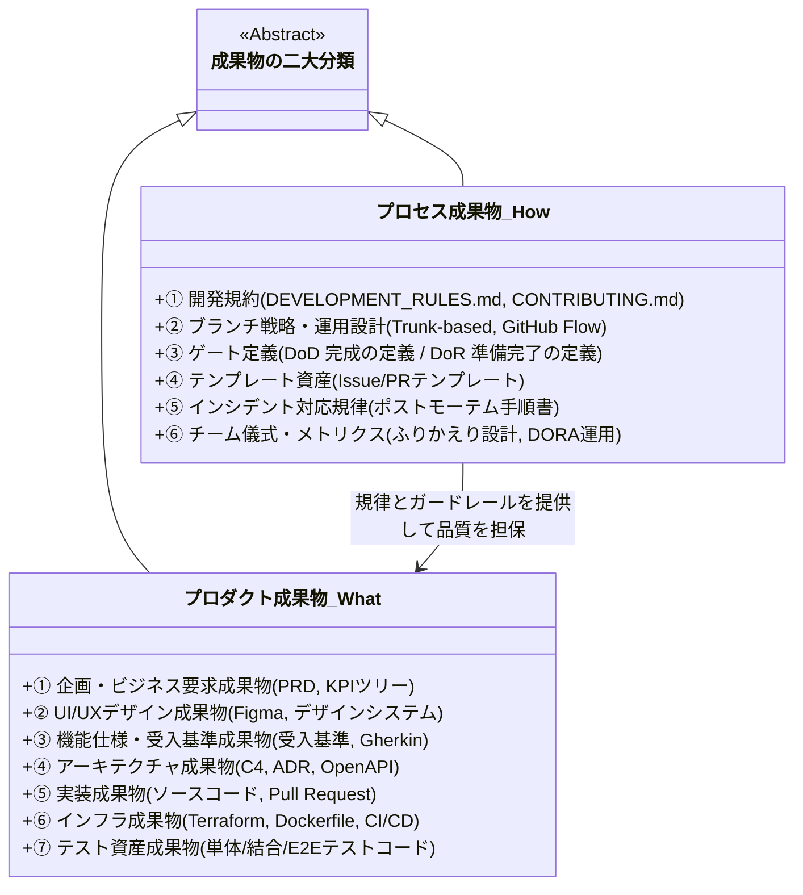
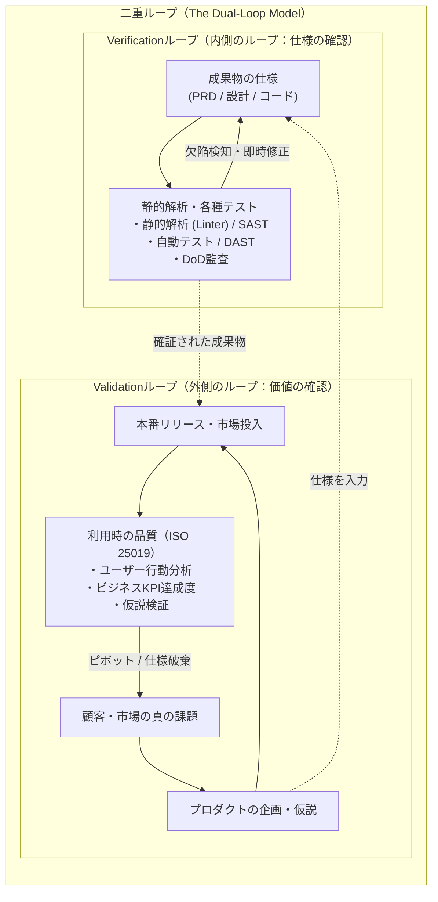

# 第2章：真のシフトレフト思想 ―― 二大成果物（プロダクト ＆ プロセス）の検証・監査

## 2.1 シフトレフトの誤解と真実：「テスト前倒し」から「全成果物の継続的検証・監査」へ

ソフトウェア業界において、「シフトレフト（Shift-Left）」という言葉ほど頻繁に使われ、かつ表層的にしか理解されていないキーワードも珍しくない。

多くの現場で「シフトレフトを進めよう」と号令がかけられたとき、実際に起きるアクションは次のようなものである。

- 「結合テストフェーズを待たずに、開発者が単体テストをもっと早く書くようにする」
- 「QAチームをスプリントの後半ではなく、スプリント開始時から同席させる」
- 「CIパイプラインで自動テストを実行し、テスト結果を早く得る」

これらは確かに有益な取り組みであり、何もしないよりは遥かに優れている。しかし、これらはシフトレフトの本質的な姿ではない。単に「これまで後工程でやっていた動的テストの実行タイミングを、開発者や前工程に押し付けた（シフトした）」に過ぎないからである。

その結果、何が起きるだろうか。開発者は「実装コードを書くだけで手一杯なのに、テストコードのノルマまで課されて時間が足りない」と疲弊し、QAエンジニアは「スプリントの初期から会議に出ているが、仕様が固まっていないため結局テストケースが書けず手持ち無沙汰になる」という、形骸化したシフトレフトの壁に激突する。

```mermaid
flowchart TD
    subgraph Wrong_ShiftLeft ["誤ったシフトレフト（テスト実行の前倒し）"]
        M1["コード実装"] --> M2["単体テストの強制<br>（開発者にテスト負担が集中 💥）"]
        M2 --> M3["後流での仕様変更・手戻り<br>（結局テストコード全書き直し 😭）"]
    end

    subgraph True_ShiftLeft ["真のシフトレフト（全成果物の継続的検証・監査）"]
        T1["成果物①: 企画・要求 (PRD)"] -->|即座に検証・監査| V1["矛盾・暗黙前提の排除"]
        V1 --> T2["成果物②: 仕様・受入基準"] -->|即座に検証・監査| V2["仕様ファジング・境界値網羅"]
        V2 --> T3["成果物③: 設計・アーキテクチャ"] -->|即座に検証・監査| V3["テスタビリティ・後方互換性担保"]
        V3 --> T4["成果物④: 実装コード・プロセス"] -->|即座に検証・監査| V4["ガードレール執行・ゼロ欠陥マージ"]
    end
```



### 真のシフトレフトの再定義

真のシフトレフトとは、「テストの実行時期を早めること」ではない。

> **真のシフトレフト（Continuous Verification & Audit）の定義**：  
> ソフトウェア開発ライフサイクルにおいて生成される**【すべての成果物（Artifacts）】**に対して、それが作成されたその瞬間から、**検証（Verification）、レビュー、および監査（Audit）を決定論的かつ継続的に実施すること**。

コードが書かれる前であっても、企画書（PRD）が作成された瞬間、そのPRDという「成果物」に対する検証が行われなければならない。UIデザインがFigma上に作られた瞬間、そのデザインという「成果物」に対するアクセシビリティ監査と状態遷移の網羅性チェックが行われなければならない。

そして何より、開発チームが日々の作業を律するために定めた「ブランチ戦略」「コミット規約」「DoD（完成の定義）」といった**開発プロセスそのものも一級の成果物**であり、その設計と運用が健全であるかを検証・監査し続けなければならないのである。

動かすべきコードが存在しない段階から、あらゆる成果物の欠陥をその場で炙り出し、後工程への欠陥流出を機械的に遮断すること——これこそが、本書が提唱する「真のシフトレフト」の姿である。

---

## 2.2 手戻りコストの増加とその限界（Boehmの欠陥コスト曲線とIPAの開発データ）

なぜ、ここまで徹底して上流成果物の検証にこだわる必要があるのか。その根拠としてよく挙げられるのが、**「欠陥は発見が遅れるほど修正コストが大きくなる（Cost of Defect Fix）」**という経験則である。

### Boehmの欠陥修正コスト曲線と品質コストの経験則

バリー・ベーム（Barry Boehm）の古典的研究『Software Engineering Economics』（1981年）や米国国立標準技術研究所（NIST Planning Report 02-3, 2002年）は、欠陥の発見が遅れるほど修正コストが大きくなることを報告している。よく引用されるのは「要件定義での修正を1とすると、本番稼働後には100前後になる」という倍率で、品質コスト一般の経験則「1:10:100の法則」と結びつけて語られることも多い。ただし、この倍率には有力な異論がある（本節の後半で扱う）。



具体例で考えてみよう。

- **要件・設計フェーズ**:  
  仕様レビューの段階で「未成年ユーザーの場合は親権者の同意フラグが必要ではないか」という仕様漏れに気づいた場合、修正コストはPRDやチケットのテキストを数行書き換えるだけであり、所要時間はわずか数分で完了する。
- **実装・単体テストフェーズ**:  
  エンジニアが実装を完了した後に気づいた場合、DBスキーマにカラムを追加し、モデルを変更し、バリデーションロジックを書き直す必要があり、数時間〜1日の工数が消費される。
- **結合・ステージング検証フェーズ**:  
  フロントエンド、バックエンド、外部決済連携まで組み上げた後のテストで発覚した場合、APIのインターフェース変更、UI画面の追加、既存の自動E2Eテストの改修が発生し、数日間の手戻りとリリース延期を招く。
- **本番リリース後**:  
  本番で未成年者が同意なしに決済してしまい、法的なコンプライアンス違反や顧客からのクレームに発展した場合、緊急Hotfixの実施、不正取引データのクレンジング、監督官庁への報告、顧客補償など、膨大な工数と財務的損失・ブランド毀損に至る。

### この曲線をどこまで信じてよいか

確証を説く本書として、この曲線の限界にも触れておく。Boehmの曲線は1970〜80年代の大規模なウォーターフォール開発のデータに基づいており、「100倍〜200倍」という倍率がそのまま現代の開発に当てはまるわけではない。Menziesらは、近年の171プロジェクトのデータを分析し、後工程で見つかった欠陥の修正コストが必ずしも大きくならないことを報告している（Menzies et al., 2017）。また、Bossavitは、この曲線が引用を重ねるうちに元データの条件が失われ、根拠の薄い「定説」として広まった経緯を指摘している（Bossavit, *The Leprechauns of Software Engineering*）。

したがって、倍率の数字そのものを経営説得の根拠にするのは避けたほうがよい。本書がこの曲線から引き出す主張は、より控えめなものである。すなわち、**仕様の誤りは、後工程で見つかるほど、作り直す成果物（コード、テスト、データ、利用者への説明）が増える**という構造である。自組織で上流レビューへの投資を説得するときは、倍率を引用するのではなく、自組織の手戻り工数を実測して示してほしい。

### 日本の開発データとの付き合い方

独立行政法人情報処理推進機構（IPA）の『ソフトウェア開発データ白書』（2018-2019年版まで。2020年以降は『ソフトウェア開発分析データ集』に改称）には、国内プロジェクトの工程別の工数や不具合に関するデータが収録されている。自組織のデータと比べる際の参考になるが、収録プロジェクトの規模や業種の偏りがあるため、平均値をそのまま目標にせず、分布と条件を確認したうえで使うこと。

上流の成果物に潜む欠陥を「コードのテスト」で解決しようとすることは、穴の空いたバケツに水を注ぎながら、必死に底から漏れ出る水をモップで拭いているのと同じである。真の品質管理とは、バケツに水を入れる前に、バケツそのものの設計図の穴を塞ぐことなのである。

---

## 2.3 二大成果物モデルの定義：プロダクト成果物（What）とプロセス成果物（How）

すべての成果物を検証・監査するにあたり、本書では開発現場に存在する無数の要素を**「プロダクト成果物」**と**「プロセス成果物」**という二大カテゴリに大別する。

多くのチームが「プロダクト成果物（コードや仕様書）」の品質には目を向けるが、「プロセス成果物（開発の進め方・規約）」を成果物として客観的に検証する視点を欠いている。しかし、**不良なプロセス成果物からは、必然的に不良なプロダクト成果物しか生まれない**。



### 1. プロダクト成果物（What：私たちが何を作っているか）

プロダクト成果物とは、最終的な製品およびそれを構成するために直接生み出される静的・動的資産のすべてを指す。本書では以下の「7大プロダクト成果物」を対象とする。

1. **企画・ビジネス要求成果物**: PRD（製品要求仕様書）、ユーザーストーリーマップ、KPIツリー
2. **UI/UXデザイン成果物**: Figmaデザインコンポーネント、デザイントークン、画面遷移フロー図
3. **機能仕様・受入基準成果物**: 機能仕様書、受入基準（Acceptance Criteria）、ドメインモデル定義
4. **アーキテクチャ・設計成果物**: C4モデルシステム構成図、ADR（意思決定記録）、OpenAPIスキーマ、ERD
5. **ソースコード・実装成果物**: アプリケーションコード、Pull Request差分、コミット履歴
6. **インフラ・構成管理成果物**: Terraform（IaC）、Dockerfile、GitHub Actionsワークフロー
7. **テスト資産成果物**: 単体テストコード、E2Eテストシナリオ、テストデータフィクスチャ

### 2. プロセス成果物（How：私たちがどう作っているか）

プロセス成果物とは、チームが協調して開発を進めるための「ルール」「基準」「フィードバックループ」を明文化・コード化した資産のすべてを指す。

1. **開発運用規律（Development Rules）**: `DEVELOPMENT_RULES.md`、コーディングスタイル規約
2. **ブランチ戦略・リリース規約**: ブランチ保護ルール（Branch Protection）、タグ打ち規約、リリースフロー
3. **品質ゲート基準（Quality Gates）**: DoD（完成の定義）、DoR（準備完了の定義）、マージ条件
4. **構造化テンプレート**: Issueテンプレート、Pull Requestテンプレート、ADRテンプレート
5. **インシデント・学習プロセス**: 障害報告フォーマット、非難のないポストモーテム（再発防止手順書）
6. **プロセス評価メトリクス**: DORA 4 Keys計測設計、レトロスペクティブ（ふりかえり）運用規約

プロセス成果物が曖昧な現場では、「レビューは誰がいつやるのか」「テストをどこまで書けばマージして良いのか」が個人の良心や空気に依存する。結果として、締切間際にルールが骨抜きにされ、低品質なコードが本番へ垂れ流される。**プロセスをコードと同様に「仕様化」し、「静的検証（Lint/Guardrail）」し、「動的検証（メトリクス）」する**ことこそが、現代のエンジニアリング組織に求められる規律である。

### プロセス成果物のコード化・自動執行スニペット

明日から現場のリポジトリでプロセス成果物を機械的に強制するための、`DEVELOPMENT_RULES.md` と GitHub Ruleset（JSON設定）の最小構成例を示す。

```markdown
<!-- DEVELOPMENT_RULES.md : プロセス成果物の明文化 -->
## 1. プルリクエスト・マージ規律（DoD）
- すべてのPRは対応するIssue番号（`Closes #123`）を本文に含めること。
- 変更行数が400行を超える場合は分割を検討し、800行を超える場合は必ず分割すること（自動生成ファイル除く）。
- CIの静的解析・単体テストおよび仕様整合性チェックがすべてGreenであること。
```

```json
{
  "name": "main-branch-assurance-ruleset",
  "target": "branch",
  "enforcement": "active",
  "rules": [
    { "type": "pull_request", "parameters": { "required_approving_review_count": 1, "dismiss_stale_reviews_on_push": true } },
    { "type": "required_status_checks", "parameters": { "strict_required_status_checks_policy": true, "required_status_checks": [{ "context": "assurance-gate" }] } }
  ]
}
```

※なお、GitLab CI環境では「Protected Branches（マージ承認ルール＋Pipelines must succeed）」を設定する。Azure DevOps環境では「Branch Policies（Build Validation＋Minimum number of reviewers）」を使うことで、上記GitHub Rulesetと同等の自動執行ガードレールを構築できる。

### 既存スクラムイベントへの検証ステップの埋め込み（対ゾンビ・アジャイル処方箋）

アジャイルやスクラムを導入しているものの、セレモニーが形骸化している現場（いわゆるゾンビ・アジャイル）では、新しい会議体を増やすのではなく、**既存のスプリントイベントの中に成果物検証を寄生（埋め込み）させる**のが鉄則である。バックログリファインメントの場では「ストーリーのポイント見積もり」に入る前の最初の10分間でPRDと受入基準のVerification（境界値・異常系の有無の確認）を強制する。また、スプリントレトロスペクティブ（ふりかえり）では感想戦を廃止し、「DORAメトリクスとプロセス成果物（DoD逸脱件数）の監査」をアジェンダの第1項目に固定することで、摩擦なく真のシフトレフトを定着させることができる。

特に形骸化しやすい「スプリントプランニング」においては、開発着手直前の**「最初の5分間（Ready Gate Check）」**で以下の5項目を機械的に点検するチェックリストを導入すると、スプリント途中の仕様手戻りを大きく防ぐことができる。

- **[1分目] 非スコープ（Out of Scope）の明示**: 「今回のスプリントで意図的に作らないもの」が1行以上言語化されているか。
- **[2分目] 異常系・境界値の受入基準**: ハッピーパスだけでなく、「0件時・上限超過時・外部APIタイムアウト時」の期待挙動がGiven-When-Then等で定義されているか。
- **[3分目] UI/API契約の確定**: フロントエンドとバックエンド間でOpenAPIスキーマまたはモックJSONが合意され、並行開発が可能になっているか。
- **[4分目] テストデータと検証環境の準備**: 結合確認に必要なテストアカウントやTestcontainers/WireMockのスタブ方針が決まっているか。
- **[5分目] フィーチャーフラグと切り戻し手順**: 万が一本番で不具合が出た際、デプロイをロールバックせずにフラグOFF等で即座に無効化できる設計になっているか。

---

## 2.4 Verification（正しく作っているか）とValidation（正しいものを作っているか）の二重ループ

成果物の検証を議論する上で、ソフトウェア工学において最も重要かつ混同されやすい2つの概念を厳密に区別しなければならない。それが **Verification（検証）** と **Validation（妥当性確認）** である。



### Verification（検証）：「プロダクトを正しく作っているか？」

Verification（検証）とは、**「ある工程で生み出された成果物が、その入力となった前提条件や仕様（Specification）に厳密に合致しているかを判定する活動」** である。

- **問い**: 「私たちは、仕様通りに正しく作っているか？（Are we building the product right?）」
- **対象**: コードが設計書通りか、設計書が要求仕様を満たしているか、テストが網羅されているか、文法エラーやセキュリティホールがないか。
- **担当**: 主にエンジニア、QAエンジニア、静的解析ツール、コンパイラ、自動テスト。

Verificationは客観的かつ論理的に合否を判定できる。「バグがない」「カバレッジが80%ある」「Linterのエラーがゼロである」といった状態は、すべてVerificationが成功している証拠である。

### Validation（妥当性確認）：「正しいプロダクトを作っているか？」

一方、Validation（妥当性確認）とは、**「完成したシステムや仕様が、ユーザーの真のニーズ、意図された利用目的、およびビジネス価値を本当に充足しているかを判定する活動」** である。

- **問い**: 「私たちは、そもそも正しいものを作っているのか？（Are we building the right product?）」
- **対象**: その機能は本当にユーザーの課題を解決しているか、誰も使わない無駄な機能を作っていないか、期待したビジネスKPI（売上・継続率）が向上したか。
- **担当**: プロダクトマネージャー（PM）、デザイナー、ユーザー、本番メトリクス分析。

### なぜ二重ループでなければならないのか？

Verificationだけを追求した組織は、**「バグは1つもないが、市場で誰も使ってくれない完璧なゴミ」** を作り上げる。仕様通りに完璧に動き、テストカバレッジが100%であっても、根本のビジネス仮説が間違っていれば、開発投資は全額ドブに捨てられる。

逆に、Validationだけを追求して「素早く仮説検証しよう」とVerificationを軽視した組織は、**「顧客ニーズはあるが、バグだらけでデータが消え、セキュリティ事故で即座にサービス終了するプロダクト」** を作って自爆する。

AI時代における真の品質保証とは、**内側のループ（Verification：自動化とAIによる瞬間的なゼロ欠陥検証）を極限まで高速に回すことで、外側のループ（Validation：本番環境でのユーザー価値と仮説検証）の回転スピードを最大化する**ことなのである。

---

## 2.5 本書の基幹フレームワーク：全成果物 × 検証・監査 × AI確証マトリクス

第II部以降で展開される各論の羅針盤となる、本書の基幹フレームワーク「全成果物 × 検証・監査 × AI確証マトリクス」をここに提示する。

読者は自身の現場で課題が生じた際、いつでもこのマトリクスに立ち返り、対象とする成果物に対して「人間が何をすべきか」「ツールが何を自動化すべきか」「AIがどう確証を支援すべきか」の引き出しを取り出すことができる。

| 対象成果物分類 | 具体的な成果物 | 人間による検証手法（Manual） | 静的・動的自動検証（Automated） | 実証済みAI確証アーキテクチャ（AI-native） |
| :--- | :--- | :--- | :--- | :--- |
| **① 企画・ビジネス要求** | PRD、KPIツリー、ストーリーマップ | プレモーテム、インセプションデッキ | INVEST原則チェッカー、Markdownlint | AIレッドチーム（敵対的レビューによる暗黙前提・反例探索） |
| **② UI/UXデザイン** | Figma、デザインシステム | ヒューリスティック評価、アクセシビリティ監査 | axe-core、Stark、デザイントークンLint | Visual AI Diff、未定義状態遷移（エラー/溢れ）自動検知 |
| **③ 機能仕様・受入基準** | 受入基準、Gherkin仕様 | Three Amigos、Example Mapping | Gherkin構文Lint、デシジョンテーブル生成 | 仕様ファジング（AI逆質問による境界値シナリオ自動合成） |
| **④ アーキテクチャ設計** | C4モデル、ADR、OpenAPI | ATAM、STRIDE脅威モデリング | Spectral（API Lint）、buf lint、ERD整合性 | 後方互換性破壊（Breaking Changes）AI検知・ADR監査 |
| **⑤ ソースコード・実装** | ソースコード、Pull Request | 観点別コードレビュー、ペアプロ | SonarQube、Semgrep（SAST）、Trivy | Google AutoCommenter規律、ハルシネーションパッケージ検査 |
| **⑥ インフラ・構成管理** | Terraform、Dockerfile、Actions | インフラ設計レビュー、権限棚卸し | tfsec、checkov、Hadolint、Infracost | IAM過剰権限自動是正、コスト増減自然言語レポート |
| **⑦ テスト資産自体** | 単体/結合/E2Eテストコード | テスト計画レビュー、チャーター設計 | ミューテーションテスト（Stryker）、Flaky検知 | Meta TestGen-LLM方式（カバレッジ補完自動フィルター） |
| **⑧ 開発プロセス自体** | 規約、ブランチ戦略、DoD/DoR | プロセス適合性監査、レトロスペクティブ | Branch Protection、commitlint、Danger | PR差分とDoD突合判定Bot、AIプロセスボトルネック診断 |

> **[補足解説] マトリクス内の主要なAI確証キーワード**
>
> - **AIレッドチーム（Adversarial Review）**: 生成AIに「悪意ある攻撃者」等のペルソナを与え、企画書の暗黙の前提や悪用シナリオを実装前に強制抽出する手法である。例えば `「このPRDの決済仕様に対し、二重課金を引き起こす悪用シナリオを5つ挙げよ」` と指示する（第3章で詳述）。
> - **仕様ファジング（Specification Fuzzing）**: ランダムな異常入力でクラッシュを探るFuzzingの概念を「仕様書」に適用する手法である。例えば `「以下の仕様から、境界値・タイムアウト・連打時のGiven-When-Thenシナリオを生成せよ」` と指示して異常系を自動合成させる（第5章で詳述）。
> - **Google AutoCommenter方式**: Google社内で運用されているAIコードレビュー基盤（Vijayvergiya et al., 2024）。コーディングのベストプラクティス違反を検出し、該当する規約文書へのリンクを付けてコメントする。誤検知を抑えるため規約ごとに信頼度の閾値を調整し、開発者からの評価を継続的に集めている。なお、修正案をワンクリックで適用できる形で提示する仕組みは、関連研究であるML-suggested edits（Froemmgen et al., 2024）の成果である（第7章で詳述）。
> - **Meta TestGen-LLM / ACH方式**: Meta社が構築したテスト自動生成の仕組み（TestGen-LLM: Alshahwan et al., FSE 2024／ACH: Foster et al., arXiv:2501.12862, 2025）。TestGen-LLMは、LLMが生成したテストをそのまま信用せず、「①ビルド通過、②繰り返し実行しても安定してPass、③カバレッジ純増」という決定論的フィルターを通過したテストだけを人に提案する。後続のACHは、先に変異体（意図的な欠陥）を作り、それを検出（Kill）できるテストを生成する方式に拡張した（第9章・第24章で詳述）。

### 本書の閾値の扱い：出発点の目安とペアメトリクス

本書の各章には、PRサイズ、カバレッジ、ミューテーションスコア、認知的複雑度などの数値閾値が登場する。これらはすべて、チームが最初の一歩を踏み出すための**出発点の目安**であり、普遍的な正解ではない。

数値は自チームの実測ベースラインに合わせて調整してよい。ただし、章ごとに異なる値を使うと運用が破綻するため、本書では以下の値に統一している。

| 指標 | 警告（Warn） | ブロック（Fail） | 備考 |
| :--- | :--- | :--- | :--- |
| PRサイズ（追加＋削除行） | 400行超 | 800行超 | 自動生成ファイルは除外 |
| ミューテーションスコア | 汎用のドメインロジックで75%未満 | Tier 1領域（第22章）で80%未満 | 対象は変更差分のドメインロジック。汎用領域は警告のみでブロックしない |
| ゾンビ機能の判定 | — | 90日間の機能利用率0.5%未満 | 機能利用率＝機能を使い始めたユーザー数 ÷ 機能に接触したユーザー数。ブロックではなく廃止検討の起点（第25章） |

そして最も重要なのは、**単一の閾値をノルマ化しない**ことである。第23章で詳述するとおり、単一指標を目標に据えた瞬間にメトリクスハックが生まれる。各章の合否判定表は、速度と安定性、量と質といった**ペアメトリクス**で運用し、数値の未達は「人を責める材料」ではなく「プロセスを見直す合図」として扱ってほしい。

### LLMの判定の扱い：ハードブロックは決定論的ツールだけ

本書のコード例には、LLMに差分や成果物を判定させるものが多い。これらの扱いは、本書全体で次のように統一する。

1. **マージやデプロイを機械的に止める（ハードブロック）のは、決定論的なツールだけ**とする。型検査、テスト、Linter、SAST、変異テスト、スキーマ差分ツールなどである。
2. **LLMの判定はソフトブロック**とする。必須ではないステータスチェックとして実行し、指摘があれば `needs-human-review` ラベルを付けて人の判断を求める。
3. **LLMを呼べないとき（APIキーが無い、API障害）は「未実施」として人に戻す**。合格扱いにはしない（fail-closed）。
4. LLM-as-a-Judgeによる評価スコア（第18章）は、プロダクトの品質を測る指標として使う。PRでは傾向を見るための助言とし、リリース判定では人が結果を確認して署名する。

### 外部LLMへのデータ送信ポリシー

本書には、PRの差分、Gitログ、データのサンプル、仕様書などを外部のLLM APIへ送るスクリプトが多数登場する。これらを自組織で使う前に、次の4点を必ず確認してほしい。

1. **送ってよいデータか**：ソースコードや設計書を社外のサービスへ送ることが、顧客との契約、就業規則、情報セキュリティ規程で許されているかを確認する。許されていない場合は、社内でホストするモデルや、データを外部に出さない契約のエンタープライズ版を使う。
2. **学習に使われない設定か**：API利用時に、送信データがモデルの学習に使われない条項・設定になっているかを確認する。
3. **マスキングしたか**：個人情報（氏名、メールアドレス、電話番号など）、認証情報、顧客固有の値は、送信前にマスキングする。第15章15.6節の `sanitize_for_llm()` を共通部品として、送信前に必ず通す。
4. **最小限か**：差分やログは、判断に必要な範囲だけに絞って送る。全文を送らない。

本書でLLM APIへデータを送る節には、冒頭に「データ送信の注意」を置いている。

また、本書のコード例はGoogleのGemini APIを使っているが、特定ベンダーを推奨する意図はない。モデル名は環境変数 `GEMINI_MODEL` で差し替えられるようにしてあり、既定値の `gemini-2.5-flash` は執筆時点の一例である。他社のAPIや社内モデルを使う場合も、呼び出し部分を置き換えるだけで同じ設計が使える。

---

## 2.6 失敗事例から学ぶアンチパターンと処方箋

「シフトレフト」を掲げながら、現場が機能不全に陥る典型的な失敗事例と処方箋を対比する。

| よくある失敗・形骸化パターン | なぜ起きるのか（根本原因） | 現場で起きる悲劇 | 本書が提示する処方箋 |
| :--- | :--- | :--- | :--- |
| **アンチパターン①：「開発者テスター化」の破綻** | シフトレフトを「QAの仕事を開発者にやらせること」と誤解し、単体テスト記述ノルマのみを課す。 | 開発者が疲弊し実装速度が低下。形式的に書かれた中身のないテストが量産され、上流の仕様バグは素通りする。 | **成果物中心シフトレフトへの転換**（コードの前にある「仕様・受入基準」の検証にThree Amigosを導入し、上流でバグを予防する。） |
| **アンチパターン②：Verification過剰の「完璧なゴミ」** | 社内規約やテストカバレッジの数値目標（100%）達成に熱中し、市場やユーザーとの対話を軽視する。 | 1年かけてバグゼロの完璧なシステムを納品したが、市場のニーズが完全に変化しており、全く使われず撤退。 | **二重ループ（Validation統合）の徹底**（フィーチャーフラグによる早期リリースと、利用時の品質に基づく市場仮説の早期検証を義務化する。） |
| **アンチパターン③：プロセスの「空気化・形骸化」** | 「開発ルール」をWikiの奥深くに長文ドキュメントとして作成し、読んだ前提で放置する。 | 新メンバーや業務委託がルールを知らずに違反PRを乱発。シニアが精神論で怒り、チームの心理的安全性が損なわれる。 | **プロセスガードレールの自動執行**（人間が注意するのではなく、GitHub RulesetやDangerなどのCIインフラで機械的にルールを執行する。） |

---

## 2.7 QA合否判定基準（Pass/Fail Criteria）

本章で定義した「全成果物シフトレフト」が機能しているかを評価するための合否判定基準である。

### 成果物レビューの合否判定基準

- **合否判定基準（Pass）**:
  1. すべての機能開発において、コード実装に着手する前に「仕様・受入基準（Gherkin等）」の成果物レビューが完了していること。
  2. 成果物が「プロダクト成果物」のみならず、ブランチ戦略やDoDといった「プロセス成果物」との整合性を満たしていること。
  3. Verification（仕様適合性）の判定基準（静的解析・テスト）が客観的かつ機械的に定義されていること。
- **不合格（Fail / Reject）**:
  - 仕様書や受入基準が存在しないまま、いきなりコードのPull Requestが提出された場合は、レビューを即座に中断（Reject）し、仕様策定フェーズへ差し戻す。

### Validation（妥当性確認）の合否判定基準

- **合否判定基準（Pass）**:
  1. 新規機能のリリース計画に、「どのビジネスKPIやユーザー行動ログをもって成功とみなすか」のValidation指標が定義されていること。
- **不合格（Fail / Block）**:
  - 「作ること自体が目的」化しており、リリース後の効果測定や機能削除の判断基準が存在しない機能は、本番リリースを不許可とする。

---

## 2.8 第2章まとめ＆現場で明日から使えるセルフチェックシート

本章では、シフトレフトの真の意味が「全成果物（プロダクト＆プロセス）の継続的検証・監査」であり、VerificationとValidationの二重ループを回すことであると論じた。

### 【章末ワークショップ】全成果物シフトレフト実践度チェックシート

自チームが「真のシフトレフト」を実践できているか、以下のチェックリストで診断されたい。

```text
【全成果物シフトレフト実践度診断（全8領域）】

☐ 1. 【ビジネス要求】PRDやユーザーストーリーの段階で、エンジニアやQAがプレモーテム等で欠陥を指摘できているか。
☐ 2. 【デザイン】Figmaの段階で、エンジニア・QAによる状態遷移漏れ（エラー、空、多文字）の指摘が行われているか。
☐ 3. 【機能仕様】コードを書く前に、PO・Dev・QAの三本柱（Three Amigos）で受入基準が合意されているか。
☐ 4. 【アーキテクチャ】APIの変更時に、後方互換性破壊（Breaking Changes）が機械的に検知されているか。
☐ 5. 【コード】PRレビューにおいて、定型的なスタイル指摘ではなく、設計とドメインロジックに集中できているか。
☐ 6. 【インフラ】TerraformやDockerfileのセキュリティ・コスト検証がPR作成時に自動実行されているか。
☐ 7. 【テスト資産】テストコード自体の品質（ミューテーションスコアやFlaky対策）が測定されているか。
☐ 8. 【プロセス】開発ルール（DoD、PR作法）が精神論ではなく、CIガードレールによって機械的に強制されているか。

【診断結果】
・チェック 7〜8個: 【真のシフトレフト組織】手戻りコストが極小化され、超高速なデリバリーが実現できています。
・チェック 4〜6個: 【部分シフトレフト】コード周辺のテストはできていますが、上流やプロセスの穴から欠陥が漏れています。
・チェック 0〜3個: 【旧態依然のウォーターフォール】「なんちゃってアジャイル」に陥っており、手戻りコストで組織が圧迫されています。
```

---

## 2.9 第I部の総括と第II部への接続

第I部（第1章・第2章）では、「第I部：パラダイムシフトと二大成果物モデル」として、AIコード爆発時代における「確証（Assurance）」の定義と、プロダクト成果物・開発プロセス成果物の全領域にシフトレフトを適用する全体設計図を確立した。

続く「第II部：プロダクト成果物の検証・レビュー・監査」では、この設計図を具体的なエンジニアリング実践へと落とし込む。まずは最上流の成果物であり、手戻りコストの最大の発生源である「ビジネス要求・企画の検証（第3章）」からスタートする。
