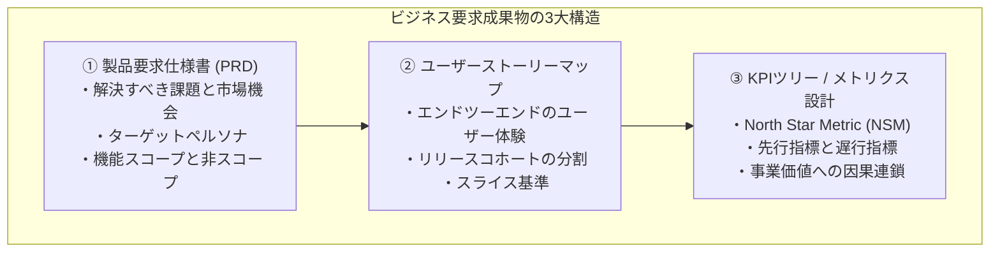
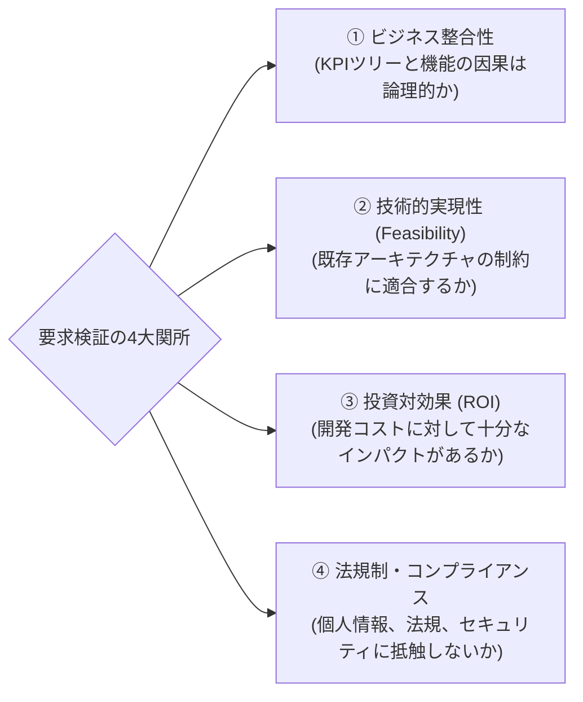

# 第3章：企画・ビジネス要求成果物の検証

## 3.1 企画・ビジネス要求成果物の定義（PRD、ユーザーストーリーマップ、KPIツリー）

ソフトウェア開発における欠陥の過半数は、コードのバグではなく「要求の不備」に起因する。コードをどれほど美しくリファクタリングし、単体テストを100%パスさせても、元となる企画や要求が歪んでいれば、出来上がるのは「高品質に動作する無価値なシステム」である。

本章では、プロダクトの最上流工程で生み出される「企画・ビジネス要求成果物」を客観的に検証・監査するフレームワークを解説する。



### 1. 製品要求仕様書（PRD: Product Requirement Document）

PRDは、「なぜそれを作るのか（Why）」、「誰のために作るのか（Who）」、「何を達成するのか（What）」を定義する中心成果物である。従来の分厚い要件定義書と異なり、現代的なPRDは以下の要素を過不足なく構造化して表現する。

- **課題の定義（Problem Statement）**: 顧客が抱える具体的なペインと、それが解決されていない理由。
- **ターゲットペルソナと利用シーン**: 誰がどのような文脈で利用するのか。
- **仮説と検証指標**: 機能リリースによって何がどう変わると仮定しているのか。
- **スコープの境界線**: 今回のリリースに「含むもの」と「明確に含まないもの（Out of Scope）」。
- **受入基準のドラフト（Acceptance Criteria）**: 開発完了とみなす客観的基準。

PRDを作成する際、最も重要な規律は「ハウ（How: 実装方法）を書かない」ことである。「画面にVue.jsを使ってモーダルを出す」「Redisにキャッシュする」といった技術的解法はエンジニアリングの領域であり、PRDで指定すべきではない。PRDが指定すべきは「ユーザーが達成すべき目的」と「ビジネス制約」であり、手段の自由度を残すことこそが、後工程での優れたアーキテクチャ設計を引き出す鍵となる。

### 2. ユーザーストーリーマップ（User Story Map）

PRDのテキストを、ユーザーの行動時系列に沿って二次元で可視化した成果物である。横軸に「ユーザーのアクティビティ（発見→登録→利用→決済等）」を並べ、縦軸に「優先度（MVP→Release 1→Release 2）」を配置する。これにより、部分最適で使い物にならない機能の切り出しを防ぎ、常にエンドツーエンドで価値が届く最小単位（スライス）を視覚的に検証できる。

ストーリーマッピングにおいて最も陥りがちな罠は、「水平方向（アクティビティ）の網羅」に満足し、「垂直方向（歩行骨格 / Walking Skeleton）のスライス」が粗悪になることである。初回リリース（MVP）では、デザインや細かな利便性を削ぎ落としてでも、最初のステップから最後のステップまで「ユーザーが目的を達成して完結できる極小の体験」を検証可能にしなければならない。

### 3. KPIツリー（ビジネス価値の因果グラフ）

機能のリリースが、企業の最終的な事業価値（売上、継続率、LTV等）にどう繋がっているかを論理的に分解した成果物である。最上位の「North Star Metric（北極星指標）」から、機能利用率や完了率といった先行指標への因果の連鎖を明確にする。

KPIツリーを成果物として定義する最大の目的は、「この機能を作っても、事業のどの数字も動かない」という悲劇を未然に防ぐことにある。機能開発は自己目的ではない。事業価値への因果関係を証明できない要求は、どれほど魅力的であっても「今作るべきではない無価値な成果物」として却下されるべきである。

---

## 3.2 要求フェーズにおける検証観点（整合性、実現性、ROI、法規制・コンプライアンス）

要求成果物をレビューする際、「なんとなく良さそう」という定性的な印象で合意してはならない。以下の4大検証観点に照らし合わせて、厳格な監査を実施する。



### 1. ビジネス整合性（Alignment）

- 要求された機能は、現在のプロダクト戦略および事業目標（OKRs/KPIs）と直結しているか。
- ある指標（例: コンバージョン率）を向上させる代償として、別の重要指標（例: 解約率、サポート負荷）を毀損するトレードオフが見落とされていないか。

### 2. 技術的実現可能性（Feasibility）

- 既存のデータモデルやマイクロサービス構造で無理なく実現可能か。
- サードパーティAPIの利用規約やレートリミット（呼び出し制限）に抵触していないか。

### 3. 投資対効果とオポチュニティコスト（ROI & Opportunity Cost）

- 推定される工数（例: 3ヶ月）に対して、得られるリターンが見合っているか。
- 「この機能を作ることによって、作れなくなる他の重要機能」という機会費用が考慮されているか。

### 4. 法規制・プライバシー・コンプライアンス（Compliance & Safety）

- GDPR、個人情報保護法、資金決済法、業界特有のガイドラインに適合しているか。
- データの保持期間、削除要件（忘れられる権利）、オプトアウトの仕組みが要求に含まれているか。

---

## 3.3 人間による検証手法：インセプションデッキ、プレモーテム（事前検死）セッション

要求成果物の欠陥を人間の知性で炙り出すための、実証された2大コラボレーション手法を紹介する。

### 手法1：インセプションデッキ（Inception Deck）

プロジェクト開始時に、ステークホルダー、開発チーム、QA、デザイナーが一堂に会し、認識のズレを解消するための10の問いに答えるワークショップである。特に以下の問いは、要求の品質を極限まで引き締める。

1. **「我々はなぜここにいるのか？」**: エレベーターピッチを全員で1文に凝縮する。
2. **「夜も眠れないほどの不安は何か？」**: リスクの事前洗い出し。
3. **「トレードオフスライダー」**: スコープ、品質、時間、予算の優先順位を固定する（品質は決して下げてはならないスライダーとして合意する）。

### 手法2：プレモーテム（事前検死: Pre-Mortem）セッション

プロジェクトが完了して失敗した後に「なぜ失敗したのか」を悔やむポストモーテム（事後検死）に対し、**「今、プロジェクトが半年後に大失敗したと仮定しよう。一体何が起きたのか？」** を想像して逆算する認知心理学に基づく手法である。

```text
【プレモーテム・セッションの進行手順】
1. 前提設定（2分）: 「半年後、この機能はリリースされましたが、本番障害が多発し、
   ユーザーから大クレームを受け、ビジネス指標も大暴落して完全に大失敗しました。」
2. 個人ワーク（5分）: なぜ大失敗したのか、思いつく最悪のシナリオを付箋に書き殴る。
   （例:「同時アクセスの排他制御を忘れて残高がマイナスになった」「法律違反で怒られた」等）
3. 共有とクラスタリング（15分）: 出た失敗要因をグルーピングし、深刻度を評価する。
4. 要求へのフィードバック（15分）: 挙がった失敗シナリオを未然に防ぐ要件をPRDに即座に追記する。
```

なお、リモート環境で実施する際は、MiroやFigJam等のオンラインホワイトボードを活用する。個人ワークの5分間は他人の付箋を非表示（Private Mode）にして同調バイアスを防ぎ、終了後に一斉公開してAIクラスタリング機能で分類すると、対面以上に濃密なリスク抽出が可能である。

---

## 3.4 要求のテスタビリティ（検証容易性）評価とINVEST原則

要求が「良い要求」であるための決定的な基準は、**「テスタビリティ（検証容易性）があるか」** である。「使いやすいこと」「高速に動作すること」といった曖昧な記述は、検証不能な不良要求である。

アジャイル開発におけるユーザーストーリーの品質基準である **INVEST原則** を適用して要求を監査する。

| 原則 | 意味 | 要求レビューにおける監査ポイント |
| :--- | :--- | :--- |
| **I (Independent)** | 独立している | 他のストーリーに過度に依存せず、単体でリリース・検証可能か。 |
| **N (Negotiable)** | 交渉可能である | 実装方法が過剰指定（Micro-management）されず、対話の余地があるか。 |
| **V (Valuable)** | 価値がある | 技術的な作業単位ではなく、ユーザー視点での測定可能な価値があるか。 |
| **E (Estimable)** | 見積もり可能である | スコープが明確で、開発チームが規模感を見積もれるか。 |
| **S (Small)** | 小さい | 1スプリント（または数日）で検証・完了できる大きさにスライスされているか。 |
| **T (Testable)** | テスト可能である | **明確な合否判定基準（客観的なPass/Fail）が定義されているか。** |

特に「Testable」を満たすため、PRD内のすべての機能要求には、**「どのログ・どの数値・どの画面挙動をもって完了と判定するか」の受入基準（Acceptance Criteria）** が必須となる。

### PO・PdM不在（または兼務）のレガシー現場における現実的処方箋

「うちの現場には専任のPOやPdMがおらず、営業や受託元の担当者が1行の要望メールを送ってくるだけだ」という組織も少なくない。そのような環境で完璧なPRDの提出を求めても、ビジネス側との対立を生むだけである。PO不在の現場における現実的な妥協点（移行パス）は、**「テックリードとQAがAIを使って『逆提案型ミニマムPRD（A4ペラ1枚）』を15分で代筆し、発注側にYes/Noの承認だけを迫る」**アプローチである。「この仕様で進めますが、非スコープ（今回やらないこと）と異常系挙動はこの通りでよろしいですね？」と決定論的な選択肢を突きつけることで、上流の曖昧さを開発チーム主導で封じ込めることができる。

以下は、営業や顧客からの「管理画面にCSV一括出力ボタンをつけてほしい」という1行の要望から、逆提案型ミニマムPRDを即座に生成するプロンプトと出力断片の例である。

```markdown
<!-- 逆提案型ミニマムPRD生成プロンプトと出力イメージ -->
[指示]: 以下の1行要望から、発注者にYes/Noで確認を取るための「A4ペラ1枚・逆提案型ミニマムPRD」を作成せよ。

[生成された逆提案型ミニマムPRD（抜粋）]:
■ 1. 目的と対象スコープ: 注文一覧画面へのCSVダウンロード機能追加（最大10,000件/回まで同期出力）
■ 2. 今回やらないこと（Out of Scope ※重要）:
  - ☐ 1万件超の非同期バックグラウンド出力およびメール通知（必要ならPhase 2で別見積もり）
  - ☐ 出力カラムのユーザー任意カスタマイズ機能（固定15カラムのみ出力）
■ 3. 異常系・境界値の仮決め（異議がなければこの通り実装します）:
  - 検索結果が0件の場合はボタンを非活性（Disabled）とする。
  - 個人情報保護のため、出力実行者のIDとタイムスタンプを監査ログに記録する。
```

---

## 3.5 AI確証実践：PRDに対する敵対的レビュー（AIレッドチーム）による暗黙前提・矛盾の反例探索

人間によるレビューにはバイアスが伴う。「企画者が役員だからツッコミづらい」「前からの慣習だからスルーした」といった心理的障壁を排除するため、**「冷徹なAIレッドチーム」をPRDのファーストレビュアーとして配備**する。

AIを活用した要求検証は、単なる文章校正ではない。「この仕様に対して悪意を持ったクラッカーが攻撃を仕掛けるとしたらどうするか」「ネットワークが寸断された状態でユーザーが操作を中断したら何が起きるか」といった極限のシナリオをシミュレートさせることに真価がある。

### 実践プロンプト：PRD敵対的監査エージェント

以下のプロンプトは、製品要求仕様書（PRD）を入力として受け取り、仕様の論理的欠陥、悪用可能性、未定義の境界条件を徹底的に暴くために設計されている。

```markdown
### [ROLE]
あなたはPRDの監査を担当するプロダクト監査官兼セキュリティアーキテクトです。
提供された製品要求仕様書（PRD）に対して一切の忖度を排除し、論理矛盾、暗黙の前提、悪意ある利用、エッジケースを徹底的に暴く「敵対的レビュー（Red Team Review）」を実行してください。

### [AUDIT PERSPECTIVES]
1. 隠れた前提（Hidden Assumptions）: ドメイン知識のない新人が読んだときに誤解する曖昧表現。
2. 競合状態・エッジケース（Race Conditions & Edges）: 同時実行、ネットワーク切断、未完了トランザクション。
3. 悪意あるユーザーシナリオ（Abuse Cases）: 不正利用、抜け穴、インセンティブの悪用。
4. 法規制・コンプライアンス（Legal/Compliance）: 個人情報漏洩、消費者保護法、会計・税務上の不整合。

### [INPUT PRD]
{レビュー対象のPRDテキスト}

### [OUTPUT FORMAT]
1. 致命的論理矛盾（Critical Contradictions）
2. 悪意ある利用シナリオ（Abuse Scenarios）
3. 未定義の例外・エッジケース（Undefined Edge Cases）
4. 実装難易度（T-shirt Sizing: S/M/L/XL）と放置時の想定手戻りコスト試算（Cost of Delay / Rework Impact）
5. PRD修正のための具体的追記案（Concrete Actionable Diff）
```

### 実際の監査出力例と仕様のビフォーアフター

このAIレッドチームプロンプトを、実際の「サブスクリプション自動更新機能」のPRDドラフトに適用した具体例を見てみよう。

```text
【入力された元々のPRDドラフト】
「ユーザーは月額980円のプレミアムプランに加入できる。課金日は毎月同日とし、
クレジットカード決済が行われる。解約手続きが行われた場合、即座に一般会員へ戻る。」
```

AI監査エージェントを実行すると、以下のような極めて鋭い「未定義の穴」が即座に指摘される。

1. **31日問題（カレンダーの不整合）**:  
   「1月31日に加入したユーザーの翌月課金日はいつになるのか？ 2月28日か？ 3月3日か？ うるう年の考慮はなされているか？」
2. **決済失敗時の状態不整合（Grace Periodの欠落）**:  
   「カードの限度額オーバーや有効期限切れで決済が失敗した場合、即座にアクセスを遮断するのか？ それとも再試行期間（猶予期間: Grace Period）を設けるのか？ 猶予期間中の課金再試行ポリシーはどうなっているか？」
3. **二重解約・日割り計算の曖昧さ**:  
   「月半ばで解約した場合、すでに支払われた残日数の返金はあるのか？ 即座に一般会員に戻す場合、未利用期間の権利はどう保障されるのか？（消費者保護の観点）」

このように、AIによる敵対的レビューを経ることで、実装フェーズに入る前にPRDの解像度を大きく高め、エンジニアがコードを書き始めてから「これ、どういう仕様ですか？」と開発が止まる事態を防ぎやすくなる。

### AI指摘事項に対する人間のトリアージ（優先順位付け）基準

ただし、AIレッドチームは時に「隕石がデータセンターに直撃した場合のフェイルオーバー」のような過剰に防衛的なエッジケースまで大量に出力するため、すべての指摘を鵜呑みにすると仕様が肥大化して開発が麻痺する。AIの指摘結果に対しては、人間が必ず**「発生確率 × 事業・安全への影響度」の2軸でトリアージ**を行うこと。金銭的損害・データ破壊・法規制違反に直結する指摘は「P0（必須反映：受入基準へ即時追加）」とし、発生確率が極めて低くワークアラウンドが可能な指摘は「Out of Scope（今回は対応しない仕様としてPRDに明記）」へ振り分けることで、AIの網羅性を活かしつつ開発スピードを守り抜くことができる。実務のチケット管理（JiraやGitHub Issues）と連携する際は、P0判定項目に `ai-redteam:p0-blocker` ラベルを付与して子チケットを自動起票する。一方、Out of Scope判定項目には `ai-redteam:wontfix-documented` ラベルを付け、「意図的に対応しない決定記録」としてクローズすると効率的である。

---

## 3.6 失敗事例から学ぶアンチパターンと処方箋

要求フェーズで現場が陥りがちな典型的な失敗と、その処方箋である。

| よくある失敗・形骸化パターン | なぜ起きるのか（根本原因） | 現場で起きる悲劇 | 本書が提示する処方箋 |
| :--- | :--- | :--- | :--- |
| **アンチパターン①：「ポエムPRD」の横行** | ビジョンや熱意ばかりが語られ、具体的なスコープ境界や受入基準が一切書かれていない。 | エンジニアごとに解釈が分裂。出来上がった画面を見て「思ってたのと違う」と全面手戻り。 | **INVEST原則に基づくテスタビリティ監査**（客観的に検証できない形容詞「使いやすい」「素早く」を排除し、数値基準を義務化する。） |
| **アンチパターン②：ハッピーパス症候群** | ユーザーが完璧に正しい操作を行う「正常系シナリオ」しか仕様書に書かれていない。 | 本番環境でユーザーがブラウザバックや連打を行った瞬間にデータ不整合が発生し大炎上。 | **AI敵対的レビューとプレモーテム**（企画段階で最悪の失敗シナリオと悪用ケースを強制的に洗い出す。） |
| **アンチパターン③：機能の肥大化（Feature Creep）** | 関係者全員の要望を「念のため」すべて盛り込み、巨大なスコープで開発をスタートする。 | 納期が遅延し、スプリントが破綻。最も重要なコア価値の検証がいつまでもできない。 | **ユーザーストーリーマッピングによるスライス**（MVPスライスを強制し、不要な要求を「明確な非スコープ」として削ぎ落とす。） |

---

## 3.7 QA合否判定基準（Pass/Fail Criteria）

企画・ビジネス要求成果物が「開発着手可能（Ready for Dev）」と判定されるための確定ゲート基準である。

### 要求成果物の合否判定基準

- **合否判定基準（Pass）**:
  1. PRDに「解決する課題」「ターゲットペルソナ」「非スコープ（やらないこと）」が明記されていること。
  2. INVEST原則に基づき、ストーリーがテスト可能（Testable）な受入基準を保持していること。
  3. プレモーテムまたはAI敵対的レビューによって洗い出された重大リスクに対する回避策が明記されていること。
  4. ビジネスKPIおよびリリース後の効果測定指標（Validationメトリクス）が定義されていること。
- **不合格（Fail / Reject）**:
  - 受入基準が未定義、または「使いやすさ」「高速さ」などの客観測定不能な記述にとどまる要求は、開発への引き渡しを即座にブロック（Reject）する。

---

## 3.8 第3章まとめ＆現場で明日から使えるセルフチェックシート

要求成果物は、ソフトウェア開発のすべての源流である。上流の小さな穴を放置すれば、下流では巨大な洪水となって開発チームを飲み込む。

### 【章末ワークショップ】PRD品質セルフアセスメントシート

```text
【ビジネス要求成果物（PRD）品質診断シート（全8問）】

☐ 1. この機能で「解決しないこと（Out of Scope）」が箇条書きで明確に定義されているか。
☐ 2. 正常系だけでなく、通信エラー・権限不足・データ重複時の挙動が明記されているか。
☐ 3. 「使いやすい」「わかりやすい」といった検証不能な形容詞が全廃されているか。
☐ 4. 機能の成功を判定する定量メトリクス（KPI）と計測ログ要件が定義されているか。
☐ 5. 悪意あるユーザーによる不正操作や悪用（Abuse Case）が検討されているか。
☐ 6. 個人情報やコンプライアンス（法規制）に関する要件が網羅されているか。
☐ 7. エンジニアおよびQAが仕様をレビューし、プレモーテム等でリスクを出し切ったか。
☐ 8. リリース後に「期待した価値が出なかった場合、安全に機能を廃止する基準」があるか。

【判定基準】
・チェック 8個: 【合格】開発チームに引き渡す準備が整っています。
・チェック 5〜7個: 【条件付き合格】不足している受入基準を追記してから着手してください。
・チェック 0〜4個: 【不合格】このまま開発に着手すると手戻りが爆発します。PRDを書き直してください。
```

次章では、本章で策定したビジネス要求を具体的なインターフェースや操作体験へと落とし込む「UI/UXデザイン成果物の検証」について探究していく。
