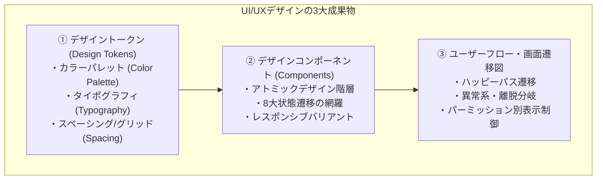
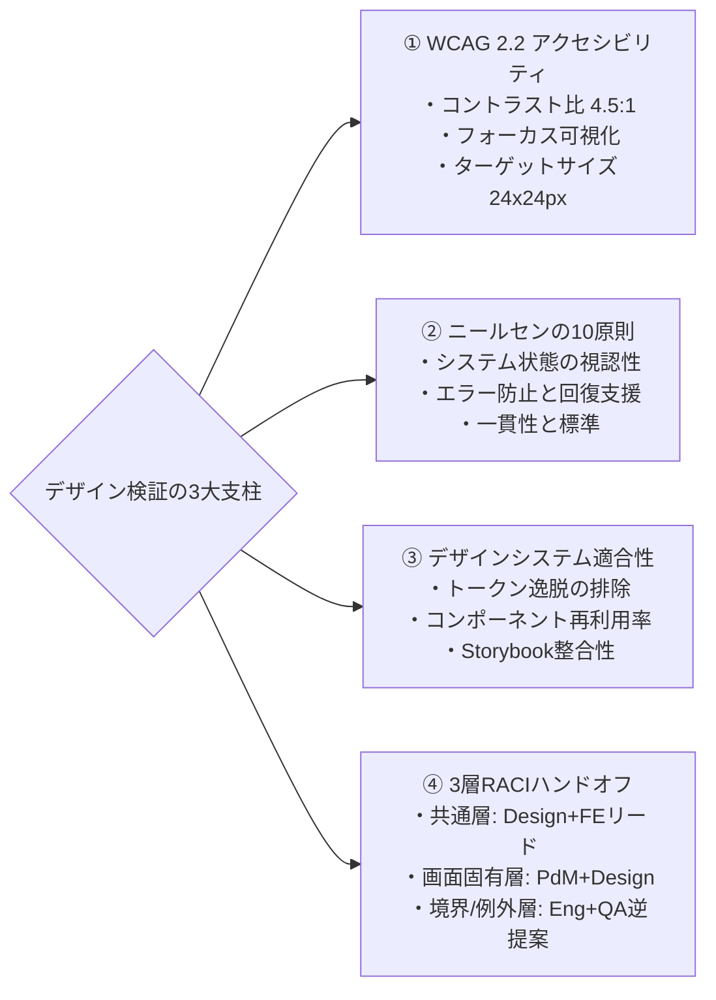
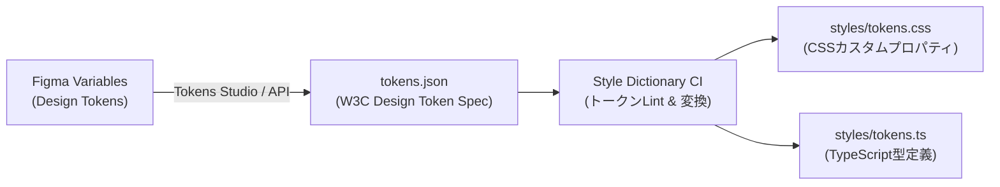

# 第4章：UI/UXデザイン成果物の検証

## 4.1 UI/UXデザイン成果物の定義（Figmaコンポーネント、デザイントークン、ユーザーフロー図）

フロントエンド開発における手戻りの大半は、コードの実装時ではなく「デザイン成果物の不完全さ」に端を発している。デザインツール（Figma等）上に描かれた美しい1枚の静的カンプだけを頼りに開発を進めると、エンジニアは「データが0件の時はどう表示するのか？」「エラーが起きた時は？」「文字数が想定の3倍長かったら？」という無数の未定義仕様に直面し、開発の手が止まる。

本章では、UI/UXデザイン工程で生み出される成果物をエンジニアリング資産として定義し、客観的に検証・監査する手法を扱う。



### 1. デザイントークン（Design Tokens）

デザイントークンとは、色（Color）、余白（Spacing）、フォントサイズ（Font Size）、角丸（Border Radius）、影（Box Shadow）といったUIの最小構成要素を、プラットフォーム非依存の変数（JSON/CSSカスタムプロパティ）として抽象化した成果物である。

デザイントークンが定義されていることで、デザイナーとエンジニアは「`#3B82F6`」や「`16px`」といった生の値ではなく、「`color.brand.primary`」や「`spacing.md`」という共通言語でコミュニケーションできる。トークン自体がリント可能（Lintable）なデータ構造となるため、色や余白の不整合を静的解析で自動検知できるようになる。

### 2. デザインコンポーネント（Figma Components & Variants）

ボタン、入力フィールド、カード、モーダルといった再利用可能なUIパーツの仕様定義である。現代的なデザインコンポーネント検証において最も重要なのは、単一の「完璧な状態」だけでなく、後述する**8大状態遷移（Component States）**がコンポーネントのプロパティ（Variants）として網羅されているかという点である。

### 3. ユーザーフロー・画面遷移図（User Flow Diagram）

画面と画面がどのように繋がり、ユーザーの意思決定やAPIの応答によってどの画面へ分岐するかを定義した構造化図面である。正常系だけでなく、認証エラー、セッションタイムアウト、ネットワーク遮断時の誘導先が明記されている必要がある。

---

## 4.2 デザイン検証の観点：WCAG 2.2アクセシビリティ、ニールセンの10原則、デザインシステムの整合性

UI/UXデザイン成果物に対する検証は、主観的な「好みの問題」ではなく、国際規格と人間中心設計の確立された原則に基づいて行われる。



### 1. WCAG 2.2（Web Content Accessibility Guidelines）適合性検証

アクセシビリティは障害者対応だけのものではない。屋外の強い日差しの下でスマホを見るユーザー、一時的に腕を怪我したユーザーなど、あらゆる状況でプロダクトが利用可能であるための必須品質である。本書では、国際標準である **WCAG 2.2 Level AA** への適合を検証ゲートとする。

- **コントラスト比（Contrast Ratio）**: 通常テキストは背景色に対して **4.5:1 以上**、大きなテキスト（18pt以上または14pt太字以上）は **3:1 以上** のコントラストを死守しているか。
- **ターゲットサイズ（Target Size）**: タッチ操作可能な要素（ボタン、リンク）は、最低でも **24×24 CSSピクセル**（推奨は44×44px以上）のタップ領域を確保しているか。
- **フォーカス表示（Focus Appearance）**: キーボード操作時のフォーカスインジケータ（輪郭線）が非表示にされず、視認可能なコントラストを持っているか。

### 2. ニールセンのユーザビリティ・ヒューリスティクス（10の原則）

ヤコブ・ニールセンが提唱した10原則に基づき、画面の使い勝手を監査する。

- **システム状態の視認性**: 処理中であることがローディングアニメーションやプログレスバーで即座にわかるか。
- **エラーの認識・診断・回復支援**: エラー文言が「エラーが発生しました（コード: 500）」といったシステム目線ではなく、ユーザーが次に何をすべきか（「もう一度お試しいただくか、カード会社にお問い合わせください」）を明示しているか。
- **取り消しとやり直しの自由**: 誤操作時に安全に元に戻せる（Undo/キャンセル）手段が提供されているか。

### 3. デザインシステム整合性検証

Figma上で既存のデザイントークンやコンポーネントを無視して、勝手な「野良フォント」「野良カラー」「野良マージン」が定義されていないかを監査する。デザインの破綻は、常に小さなスタイルの逸脱から始まる。

---

## 4.3 状態遷移の網羅性チェック（UIの8大状態）

フロントエンドエンジニアがデザイナーに対して最も頻繁に行う質問は、「この画面、○○の時はどうなるんですか？」である。この手戻りを減らすため、すべての画面およびUIコンポーネントに対して、以下の**「UIの8大状態」**がFigma上に明示されているかを機械的にチェックする。

| 状態（State） | 状態の定義 | 見落とされがちな欠陥シナリオ | 検証すべき受入基準 |
| :--- | :--- | :--- | :--- |
| **① 初期/通常状態 (Default)** | 何も入力・操作されていない標準の状態 | プレースホルダーの文字色が薄すぎてコントラスト基準を満たさない。 | WCAG 4.5:1を充足するラベル・初期表示。 |
| **② ホバー/フォーカス (Hover/Focus)** | マウスが乗った、またはキーボードで選択された状態 | ホバー時の色変化が微小で視認不能、またはキーボード操作で枠線が消える。 | フォーカスリングが2px以上の明瞭な色で表示される。 |
| **③ アクティブ/押下 (Active/Pressed)** | ボタンやリンクがクリック/タップされている瞬間 | 押されたフィードバックがなく、ユーザーが連打してしまう。 | 押し込みエフェクトや明度の変化。 |
| **④ 無効状態 (Disabled)** | 権限不足や未入力によって操作が許可されない状態 | 無効化されている理由が分からず、ユーザーが戸惑う。 | なぜ押せないのか（未入力項目の存在等）をツールチップ等で補足。 |
| **⑤ ローディング状態 (Loading)** | 非同期通信やデータ取得中の状態 | 画面全体がフリーズしたように見え、離脱される。スケルトンスクリーンがない。 | スケルトンUIまたはスピナーの表示、二重送信防止ロック。 |
| **⑥ 空状態 (Empty State)** | 検索結果や登録データが「0件」の状態 | 白い画面（真っ白なリスト）だけが表示され、壊れていると誤認される。 | 「データがありません」のイラストと、最初の登録を促すCTAボタンの配置。 |
| **⑦ エラー状態 (Error State)** | 入力バリデーションエラーやAPIエラーが発生した状態 | 赤枠がつくだけで、具体的にどう直せばいいのか分からない。色覚異常者に伝わらない。 | アイコン＋明確な修正指示テキストの併用（色だけに依存しない）。 |
| **⑧ 極端状態 (Overflow/Edge)** | 氏名が100文字、金額が10桁など、極端なデータが入った状態 | テキストが枠を突き抜けて隣のボタンと重なり、画面崩れが発生する。 | 文字列の省略表示（三点リーダー `...`）または自動改行の挙動定義。 |

### ハンドオフ（引継ぎ）における「8大状態の定義責任」と組織的合意形成

現場でよくある揉め事が、「この8大状態（特にLoading、Error、Overflow）は、デザイナーがすべてFigmaで作るべきなのか、それともエンジニアが実装時に考えるべきなのか？」という責任の押し付け合いである。全画面・全入力フォームに対してデザイナーが毎回8パターンの画面カンプを手作りしようとすると、デザイン工数がパンクしてしまう。

摩擦のない合意形成（RACI定義）のコツは、以下3層の役割分担をルール化することである。まず**①共通コンポーネント層（デザインシステム）の8大状態はデザイナーとフロントエンドリードが共同で1回だけ定義**する。次に**②個別画面固有のEmpty State（0件時の誘導導線）とビジネスエラー文言はPdMとデザイナーが定義**する。そして**③文字数上限や通信タイムアウト時のフォールバック挙動は、エンジニアとQAがハンドオフ会議（15分のDesign QAセッション）で逆提案して確定**させる。すべての画面で8枚の絵を描くのではなく、FigmaのコンポーネントVariantsと共通トークンで機械的に吸収し、画面固有の例外状態だけをハンドオフ時のチェックリストで合意するのが最も生産的なプラクティスである。

---

## 4.4 自動監査ツールチェイン：axe-core、Stark、デザイントークンLint

デザイン成果物の検証は、人間の目視確認だけに頼るべきではない。コードの静的解析（Linter）と同様に、デザインもツールチェインによってCI上で自動監査できる。

### 1. Figmaプラグインによる静的チェック（Stark / Axe for Designers）

Figmaのキャンバス上で直接動作する自動監査ツールである。デザインのフレームを選択して実行するだけで、コントラスト比の不足、タッチターゲットの狭さ、色覚多様性（P型・D型色覚など）における視認性を自動判定し、違反箇所を特定する。

### 2. Style DictionaryとデザイントークンLint

Figmaで定義されたデザイントークン（Variables）をAPI経由でエクスポートし、Amazonが開発したOSSツール **Style Dictionary** を用いてJSON/CSS/TypeScriptへと自動変換する。この変換パイプラインにおいて、トークンの命名規約や未使用トークンをCIで自動検出（Lint）する。



以下は、W3Cデザイントークン形式の `tokens.json` と、それを検証・変換する Style Dictionary の設定ファイル（`sd.config.json`）のスニペット例である。

```json
{
  "color": {
    "brand": { "primary": { "$value": "#2563EB", "$type": "color", "description": "主要CTAボタン背景色（白文字とのコントラスト比 5.17:1 >= 4.5:1）" } },
    "semantic": { "error": { "$value": "#DC2626", "$type": "color" } }
  },
  "spacing": { "md": { "$value": "16px", "$type": "dimension" } },
  "platforms": {
    "css": { "transformGroup": "css", "buildPath": "dist/css/", "files": [{ "destination": "variables.css", "format": "css/variables" }] }
  }
}
```

```yaml
# .github/workflows/design-tokens-ci.yml（Style Dictionaryビルドと手動編集ブロックのCI結合例）
- name: Build and Verify Design Tokens
  run: |
    npx style-dictionary build --config sd.config.json
    git diff --exit-code dist/css/variables.css
```

### Figma VariablesとStyle Dictionary連携におけるバージョニング・競合解決プラクティス

デザイナーがFigma側でVariables（変数）を更新し、エンジニアがコード側でStyle Dictionaryを運用する際、双方向で勝手な変更が加わると「どちらが正（Single Source of Truth）か分からない」という競合問題が発生する。これを防ぐための実運用プラクティスは以下の3原則である。

1. **片方向データフロー（Unidirectional Sync）の厳守**: トークンの作成・変更は必ずFigma Variables（またはTokens Studio）を起点とする。自動生成された `variables.css` や `tokens.ts` をエンジニアが手動で直接編集することは、CI（`git diff --exit-code dist/`）で厳格に禁止する。
2. **PR駆動のトークン同期とVisual Regression連動**: Figma上でトークンが変更された際、本番ブランチへ直接反映させるのではなく、GitHub Actions経由で `chore(tokens): sync figma variables` というプルリクエストを自動起票する。そのPR上でPlaywrightやStorybookのビジュアルリグレッションテスト（VRT）を自動実行し、意図しない画面崩れが起きていないかを人間が目視承認してからマージする。
3. **セマンティックバージョニングの適用**: 既存トークン名の削除やリネームは「破壊的変更（Major Update）」として扱い、少なくとも1スプリントの間は `@deprecated` メタデータを付与したエイリアストークンを残すことで、フロントエンド実装側のビルド破損を防ぐ。

---

## 4.5 AI確証実践：マルチモーダルLLMによるデザイン画面の欠落状態自動検知とVisual AI Diff

デザインの検証において最も威力を発揮するのが、画像とテキストを同時に高精度で理解できる**マルチモーダル生成AI（Vision LLM）**である。

デザイナーが作成した画面カンプのスクリーンショットをAIに渡すだけで、「UIの8大状態のうちどれが抜け落ちているか」「WCAGのコントラスト違反が疑われる箇所はどこか」を瞬時に特定させることができる。

### 実践プロンプト：デザイン画面・状態遷移監査エージェント

```markdown
### [ROLE]
あなたはデザインシステム監査官兼シニアフロントエンドアーキテクトです。
提供されたデザイン画面（スクリーンショットまたはFigmaフレーム）を厳格に分析し、実装時に手戻りとなる「状態遷移の欠落」「アクセシビリティの欠陥」「極端なデータ入力時の破綻リスク」を網羅的に指摘してください。

### [AUDIT CHECKLIST: UI 8 STATES]
1. 通常 (Default)
2. ホバー/フォーカス (Hover/Focus)
3. 押下 (Active)
4. 無効 (Disabled)
5. 読込中 (Loading / Skeleton)
6. 0件・空 (Empty State)
7. エラー (Error State - フィールド単位および画面全体)
8. 文字溢れ・極端値 (Overflow / Multi-line / Edge Cases)

### [ACCESSIBILITY AUDIT]
- 背景色と文字色のコントラスト比（推視判定）
- 色だけに依存した情報伝達の有無（エラー時に赤色だけでなくアイコンがあるか）
- タップターゲットのサイズ感（密集しすぎていないか）

### [INPUT DATA]
{デザイン画面の画像ファイルを添付}

### [OUTPUT FORMAT]
1. 欠落している状態（Missing States）のリストと推奨されるデザイン仕様
2. アクセシビリティ・視認性の潜在的違反箇所
3. フロントエンドエンジニアが実装前にデザイナーへ確認すべき質問リスト（Q&A形式）
```

### マルチモーダルLLMによる監査出力例（モックアウトプット）

上記のプロンプトに「ECサイトの注文履歴一覧画面」のカンプ画像を入力した際の実際の出力イメージは以下の通りである。

```text
【AIデザイン監査レポート：注文履歴一覧画面】
1. 欠落している状態（Missing States）:
   - [Empty State 欠落]: 注文履歴が0件の新規ユーザー向けの画面が未定義です。「まだ注文履歴がありません。おすすめ商品を見る」等のCTA配置を推奨します。
   - [Overflow State 欠落]: 商品名が40文字を超えた場合の省略（line-clamp: 2等）が定義されておらず、金額表示カラムが画面外へ押し出されるリスクがあります。
2. アクセシビリティ違反の疑い:
   - 「キャンセル申請」リンクのサイズが 18x14px と推定され、WCAG 2.2 Target Size (24x24px以上) に違反しています。paddingの拡大が必要です。
3. 実装前確認事項（Q&A）:
   - Q: 配送ステータス取得APIがタイムアウトした際、一覧全体をエラーにするか、該当行のみ「取得失敗（再試行）」を表示するか？
```

---

## 4.6 失敗事例から学ぶアンチパターンと処方箋

デザイン検証を軽視した結果、フロントエンド開発が泥沼化する典型的な失敗事例と処方箋である。

| よくある失敗・形骸化パターン | なぜ起きるのか（根本原因） | 現場で起きる悲劇 | 本書が提示する処方箋 |
| :--- | :--- | :--- | :--- |
| **アンチパターン①：「ベストケース」カンプ納品** | デザイナーが「最も見栄えの良い理想のデータ」だけを当てはめて1枚のデザインを作成する。 | 本番環境で実際のユーザー名（漢字15文字）や長い商品名が入った瞬間に改行が崩れ、ボタンが押し出されて消える。 | **極端状態（Overflow）の事前提示義務化**（最大文字数・最小文字数のバリアントをFigma上で必ず定義させる。） |
| **アンチパターン②：スタイルガイドの無視（野良デザイントークン）** | スピードを優先して、既存のデザインシステムにない独自の色や余白をアドホックに作成する。 | CSSのコードベースが肥大化・複雑化し、ダークモード対応やリブランディング時に数千行の修正が必要になる。 | **トークンLintとFigmaコンポーネント強制**（未登録トークンの使用をCIでブロックし、再利用を徹底する。） |
| **アンチパターン③：アクセシビリティの後付け** | リリース直前になって「アクセシビリティ対応」を指示し、既存デザインの上から無理やり修正しようとする。 | 配色の大幅な見直しが必要になり、ブランドイメージが崩れたり、全画面の再デザイン・再テストが発生する。 | **Figma段階でのaxe-core自動監査**（デザイン作成中にコントラストとターゲットサイズを合格させる。） |

---

## 4.7 QA合否判定基準（Pass/Fail Criteria）

UI/UXデザイン成果物が「フロントエンド実装着手可能（Ready for Implementation）」と判定されるための確定ゲート基準である。

### デザイン成果物の合否判定基準

- **合否判定基準（Pass）**:
  1. 対象画面の全コンポーネントにおいて、UIの8大状態（特にLoading、Empty、Error、Overflow）のデザインがFigma上で定義されていること。
  2. WCAG 2.2 AA基準（コントラスト比4.5:1以上、ターゲットサイズ24px以上）をクリアしていること（Stark等による自動監査レポート提出）。
  3. 使用されている色・余白・フォントがすべて公式デザイントークンを参照しており、アドホックな生の値が存在しないこと。
  4. フロントエンドエンジニアによるデザインレビュー（実装実現性と状態遷移の確認）が完了していること。
- **不合格（Fail / Reject）**:
  - 通常状態（Default）のデザインしか存在せず、エラー時や0件時の画面が未定義の成果物は、開発着手を即座に拒否（Reject）する。

---

## 4.8 第4章まとめ＆現場で明日から使えるセルフチェックシート

UI/UXデザイン成果物の品質は、フロントエンド開発の生産性と最終的なプロダクトの品質を左右する決定的な設計図である。

### 【章末ワークショップ】デザイン成果物品質セルフアセスメントシート

```text
【デザイン成果物（Figma）ハンドオフ前チェックシート（全8問）】

☐ 1. 画面内に「データが0件（Empty State）」の時のイラスト・文言・CTAが定義されているか。
☐ 2. ネットワーク通信中（Loading State）のスケルトンスクリーンまたはスピナーが定義されているか。
☐ 3. フォーム入力エラー時（Error State）のエラーメッセージと視覚フィードバックがあるか。
☐ 4. 通常想定される最大文字数が入った際（Overflow State）の折り返し・省略挙動が明記されているか。
☐ 5. すべてのテキストのコントラスト比が背景色に対して 4.5:1 以上を満たしているか。
☐ 6. タップ可能なボタンやアイコンの領域が 24×24px 以上確保されているか。
☐ 7. デザインシステムに定義されていない独自の「野良カラー」「野良マージン」がゼロであるか。
☐ 8. エンジニアがデザインを確認し、APIのレスポンス構造と画面状態の整合性を合意したか。

【判定基準】
・チェック 8個: 【合格】フロントエンドエンジニアへ即座に引き渡せます。
・チェック 5〜7個: 【条件付き合格】不足している状態（Empty/Error/Overflow等）をFigmaに追加してください。
・チェック 0〜4個: 【不合格】このまま実装すると膨大な質問と手戻りが発生します。デザインを補完してください。
```

次章では、デザインされたユーザー体験の背後にある「機能仕様と受入基準の形式化」について見ていく。
