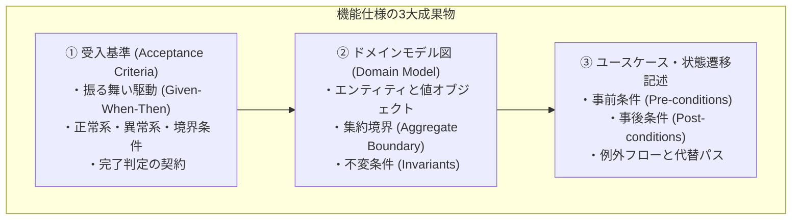
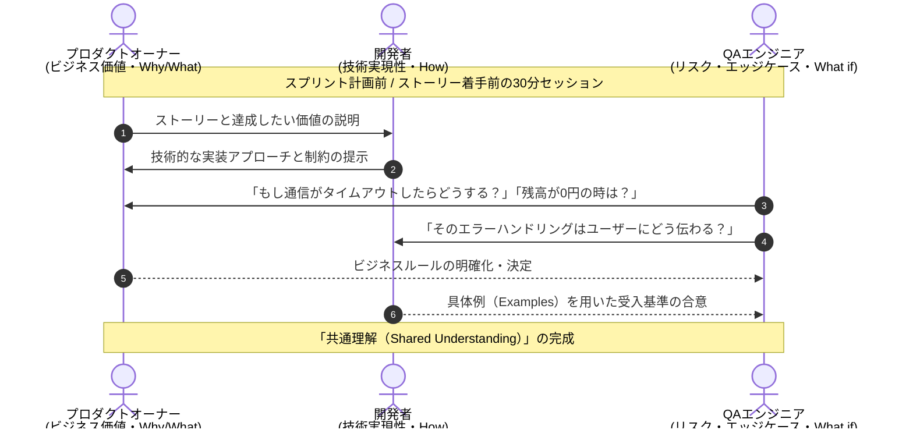
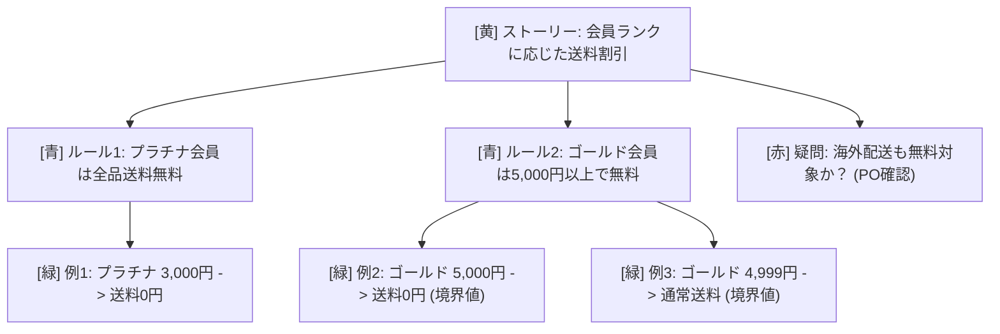
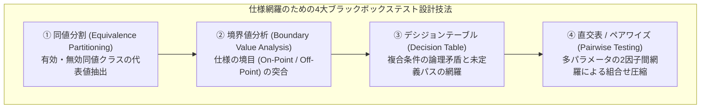

# 第5章：機能仕様・受入基準成果物の検証

## 5.1 機能仕様成果物の定義（受入基準、ユースケース記述、ドメインモデル図）

ソフトウェア開発において「要求（Why/What）」が定まった後、エンジニアが実際にコードへと落とし込むための架け橋となるのが「機能仕様成果物」である。要求が抽象的な目的を示すのに対し、機能仕様は「システムがどのような入力に対し、いかなる内部状態遷移を経て、どのような出力を返すか」という具体的な振る舞いを定義する。

本章では、曖昧になりがちな自然言語仕様を「実行可能な仕様（Executable Specifications）」へと昇華させ、検証・監査可能にする体系を解説する。



### 1. 受入基準（Acceptance Criteria）

受入基準は、ユーザーストーリーやタスクが「完成した」とみなされるための客観的な合否判定基準（契約）である。開発者とQA、プロダクトオーナー（PO）が合意すべき境界線を定義する。受入基準が曖昧なプロジェクトでは、「仕様通りに作りました」「いや、そんな動作は意図していない」という不毛な対立が日常茶飯事となる。

### 2. ドメインモデル図（Domain Model Diagram）

ドメイン駆動設計（DDD）の思想に基づき、ビジネスの核となる概念（Entity）、計測・識別不要な値（Value Object）、そして整合性を保つ境界（Aggregate）を可視化した成果物である。クラス図やERDを書く前に、業務の「不変条件（どんな操作を行っても絶対に破られてはならないビジネスルール）」を明文化する。

### 3. ユースケース・状態遷移記述（Use Case & State Machine）

注文の「未決済 → 決済完了 → 発送準備中 → 発送済 → キャンセル」といった、システムのライフサイクルに伴う状態遷移を定義した仕様書である。特に「どの状態からどの状態への遷移が許可され、どの遷移が絶対に禁止されるか（不正遷移）」を厳密に定義する。

---

## 5.2 三本柱（Three Amigos: PO × Dev × QA）対話による仕様の共同検証

仕様書の欠陥をゼロにする最も強力なプラクティスが、**「三本柱（Three Amigos）」**と呼ばれる対話モデルである。

従来の開発では、POが仕様書を書き、それを開発者に「丸投げ」し、開発者がコードを書いた後にQAへ「丸投げ」するという伝言ゲームが行われていた。この伝言ゲームこそが、仕様の誤解と手戻りの最大の温床である。



### 三本柱の役割分担と視点の衝突

Three Amigosセッションは、単なる進捗報告会議ではない。3つの全く異なる視点を意図的に衝突させ、仕様の死角を徹底的に潰す場である。

1. **プロダクトオーナー（PO）**: 「どのようなビジネス課題を解決したいか」「ユーザーにどんな価値を提供したいか」（価値の番人）
2. **開発者（Dev）**: 「どのように技術的に実現するか」「アーキテクチャや既存コードとの整合性はどうか」「工数はどれくらいか」（実現性の番人）
3. **QAエンジニア（QA）**: 「何が壊れうるか（What could go wrong?）」「エッジケースや例外的な入力はどうなるか」「システム全体への波及リスクは何か」（リスクの番人）

この3者がストーリー着手前に30分〜1時間集まり、後述するExample Mapping（Wynne, 2015）を実施することで、コードを1行も書く前に仕様の解釈違いや境界値の抜け漏れの大半を未然に解消できる。

### 多忙なビジネスサイドやウォーターフォール環境での非同期代替アプローチ

「レガシーなウォーターフォール開発で上流工程が別部署に分断されている」「ビジネスサイドが多忙でThree Amigosの会議時間を30分も確保してくれない」という現場では、同期会議に固執する必要はない。代替アプローチとして極めて有効なのが、**「GitHub IssueやSlackスレッドを用いた非同期Three Amigos（逆質問レビュー）」**である。開発者とQAだけで先に15分間のExample Mappingを行い、「疑問点（赤付箋）」と「境界値の仮決め（緑付箋）」を以下のような構造化コメントとしてビジネス担当者にメンションする。白紙の状態から会議に呼ぶのではなく、「金曜17時までに異議がなければこの具体例を正として実装します」と非同期の合意形成プロトコルを回すことで、多忙なステークホルダーからも最小コストで確実な仕様確証を引き出すことができる。

---

## 5.3 Example Mapping（具体例マッピング）を用いたルールと具体例の網羅的洗い出し

仕様の曖昧さを排除するための最高の実践ツールが、マット・ウィン（Matt Wynne）が考案した **Example Mapping（具体例マッピング）** である。

抽象的な「ルール」だけを議論していると、人によって脳内のイメージがズレてしまう。Example Mappingでは、カラー付箋（またはオンラインホワイトボード）を用いて、「ルール」とそれを実証する「具体的な具体例（Example）」を1対1で視覚化する。

```text
【Example Mappingの4つの要素と付箋の色】

1. [黄色の付箋] ユーザーストーリー（Story）
   - 対象となる機能ストーリー（1回のセッションで1枚を扱う）。
   
2. [青色の付箋] ビジネスルール（Rule）
   - システムが満たすべき規約・制約（受入基準の元となるもの）。

3. [緑色の付箋] 具体的な例（Example）
   - そのルールを説明・検証する「入力値と期待される結果」の具体例。
   - 正常系だけでなく、境界値や異常系の例を必ずぶら下げる。

4. [赤色の付箋] 疑問・未決定事項（Question）
   - 会議中にその場で即答できない不明点、POの確認が必要な宿題事項。
```



### Example Mappingによる「危険信号（アンチパターン）」の早期検知

Example Mappingの素晴らしい点は、付箋の配置を見るだけで仕様の健全性が一目瞭然になることである。

- **赤色（疑問）の付箋が多すぎる場合**:  
  仕様が全く固まっていない。このストーリーは「開発着手不可（Not Ready）」と判定し、スプリントバックログから外す。
- **青色（ルール）の付箋が多すぎる場合**:  
  ストーリーが巨大すぐ。複数の小さなストーリーに分割（スライス）する必要がある。
- **青色に対して緑色（具体例）が少なすぎる場合**:  
  エッジケースや例外パターンの検討が不足している。Three Amigosで具体例を追加で出し合う。

---

## 5.4 Gherkin構文（Given-When-Then）による「実行可能な仕様書」の形式化

Example Mappingで洗い出した具体例は、ビヘイビア駆動開発（BDD）の標準構文である **Gherkin構文** を用いて「実行可能な仕様（Executable Specification）」へと変換する。

Gherkin構文は、「自然言語でありながら、そのままCucumberやPlaywrightなどの自動テストスクリプトとして直接実行できる」という決定的な利点を持っている。

```gherkin
Feature: 会員ランク別送料計算ロジック
  ECサイトのチェックアウトにおいて、顧客満足度を高めるため
  会員ランクと注文金額に応じた最適な送料を正確に計算する。

  Scenario: プラチナ会員は購入金額に関わらず送料無料となる
    Given ユーザーの会員ランクが "PLATINUM" である
    And カートに合計金額 1500 円の商品が入っている
    When チェックアウト画面で送料を計算する
    Then 配送料金として 0 円が請求されること

  Scenario Outline: ゴールド会員の購入金額による送料境界値判定
    Given ユーザーの会員ランクが "GOLD" である
    And カートに合計金額 <order_amount> 円の商品が入っている
    When チェックアウト画面で送料を計算する
    Then 配送料金として <shipping_fee> 円が請求されること

    Examples:
      | order_amount | shipping_fee | 説明 |
      | 4999         | 500          | 閾値直下（送料発生） |
      | 5000         | 0            | 境界値（送料無料適用） |
      | 5001         | 0            | 閾値直上（送料無料適用） |
```

この `.feature` ファイルは、ビジネスサイドが読めば「機能の正確な仕様書」となり、エンジニアが読めば「満たすべき受入基準」となり、CIツールが読めば「パスすべき回帰テストコード」となる。ドキュメントとテストコードの乖離を構造的に防止できるのである。

---

## 5.5 古典的テスト設計技法の適用：同値分割・境界値分析・デシジョンテーブル・直交表による仕様網羅

受入基準やGherkinシナリオを作成する際、テスターの勘や思いつきに頼っていては網羅性を担保できない。ソフトウェアテストの歴史の中で磨き抜かれてきた**「古典的ブラックボックステスト設計技法」**を仕様策定フェーズに適用する。



### 1. 同値分割（Equivalence Partitioning）と境界値分析（Boundary Value Analysis）

- **同値分割**: 同じ処理結果となる入力値のグループ（クラス）に分割し、各グループから代表値を1つ選定する。
- **境界値分析**: バグが最も頻発するのは、グループとグループの「境目（境界）」である。境界値（On値）とその直前・直後の値（Off値）を受入基準に必ず含める。
  - 例: 「18歳以上」の場合、`17歳（無効）`、`18歳（有効）`、`19歳（有効）` の3点を検証する。

### 2. デシジョンテーブル（意思決定表）

複数の条件が複雑に絡み合うビジネスロジック（例: クーポン、会員ランク、初回購入、配送地域）を検証する場合、デシジョンテーブルを作成してマトリクスで検証する。

| 区分 | 条件・アクション項目 | ルール1 (VIP大口) | ルール2 (VIP少額) | ルール3 (一般大口) | ルール4 (一般少額) |
| :---: | :--- | :---: | :---: | :---: | :---: |
| **条件1** | **会員ランクがゴールド以上か？** | **Y** (Yes) | **Y** (Yes) | **N** (No) | **N** (No) |
| **条件2** | **カート金額が5,000円以上か？** | **Y** (Yes) | **N** (No) | **Y** (Yes) | **N** (No) |
| **結果1** | **送料無料（0円）を適用する** | **X** (実行) | `-` | `-` | `-` |
| **結果2** | **通常送料（500円）を請求する** | `-` | **X** (実行) | **X** (実行) | **X** (実行) |

※表中の記号の凡例：**`Y`** は条件を満たす（Yes/True）、**`N`** は条件を満たさない（No/False）を表す。また **`X`** は該当アクションの実行（Execute）、**`-`** は不実行・非該当（Do Not Execute / N/A）または条件の真偽を問わない「無関係（Don't Care）」を表す。

このようにテーブルを作成することで、「全条件がFalseの時どうなるか？」「あり得ない組み合わせはないか？」という仕様の空白地帯が強制的に可視化される。

---

## 5.6 AI確証実践：仕様ファジング（Specification Fuzzing）による異常系・境界値シナリオ自動合成

仕様書の抜け漏れを人間だけで洗い出すのは限界がある。ここで威力を発揮するのが、**AIを用いた「仕様ファジング（Specification Fuzzing）」**である。

ドラフトの仕様テキストを渡し、AIに「このシステムを壊すつもりのエッジケース、悪意ある順序、境界条件を突く反例シナリオをGherkin構文で自動合成せよ」と命じることで、人間の盲点を瞬時に補完する。

### 実践プロンプト：仕様ファジング＆Gherkinシナリオ生成エージェント

```markdown
### [ROLE]
あなたは世界有数のテスト設計スペシャリスト兼BDDアーキテクトです。
提供された機能仕様ドラフトに対し、同値分割・境界値分析・デシジョンテーブルの理論を極限まで適用し、システムをクラッシュさせうる「仕様ファジングシナリオ」をGherkin形式で出力してください。

### [FUZZING PERSPECTIVES]
1. 境界値の極限（Boundary Extremes）: 最大値+1、最小値-1、0、負数、空文字、NULL。
2. 同時実行と順序性（Concurrency & Ordering）: 連打、逆順操作、セッション中断後の再開。
3. リソース枯渇・タイムアウト（Timeouts & Failures）: 外部API通信断、DBデッドロック。
4. ドメイン固有の矛盾（Domain Clashes）: 有効期限切れ直前の操作、重複適用。

### [INPUT SPECIFICATION]
{機能仕様ドラフトのテキスト}
（※入力スニペット例：「ポイント利用機能：ユーザーは1ポイント＝1円として決済時に利用できる。1回の利用上限は10,000ポイントまで。注文キャンセル時は利用ポイントを即時返還する。」のように、箇条書きの簡潔な仕様メモやチケット本文をそのまま貼り付けるだけで十分に機能します）

### [OUTPUT FORMAT]
出力フォーマットの指定：

Feature: 仕様ファジングによる潜在エッジケース検証

Scenario: (具体的な異常系・境界値のシナリオ名)
  Given (前提条件)
  When (極限のアクション)
  Then (システムが安全にエラーハンドリングまたは回復すること)
```

出力されたGherkinシナリオ（`.feature` ファイル）は、リポジトリ内の `tests/features/points_redemption.feature` のように配置する。これをPlaywright（`playwright-bdd`）やCucumber（`pytest-bdd`）のステップ定義（`tests/steps/`）と1対1で紐付けることで、仕様書と自動テストを完全に一体化できる。

---

## 5.7 失敗事例から学ぶアンチパターンと処方箋

機能仕様の策定において現場が陥りがちな典型的なアンチパターンと処方箋である。

| よくある失敗・形骸化パターン | なぜ起きるのか（根本原因） | 現場で起きる悲劇 | 本書が提示する処方箋 |
| :--- | :--- | :--- | :--- |
| **アンチパターン①：伝言ゲーム仕様** | POがドキュメントを書き、開発者とQAがそれを個別に読んで解釈する。 | 実装完了後の受入テストで「解釈の食い違い」が発覚し、コードの全面破棄と手戻りが発生。 | **Three Amigosの対面/同期実施**（スプリント計画前に3者で具体例を直接合意する。） |
| **アンチパターン②：境界値の無視（正常系バイアス）** | 仕様書に「5,000円以上で無料」とだけ書き、「ちょうど5,000円の時」を誰も確認しない。 | 実装が `>=` ではなく `>` で書かれ、5,000円ちょうどのユーザーに送料が請求されクレーム頻発。 | **境界値分析とGherkin Examplesの義務化**（On値・Off値のシナリオを必須成果物とする。） |
| **アンチパターン③：仕様書の陳腐化（腐ったドキュメント）** | 開発途中で仕様が変わった際、コードだけ修正して仕様書（Wiki）を更新しない。 | 1年後、誰も正しい仕様が分からなくなり、リファクタリングも機能追加も不可能なブラックボックス化。 | **Gherkinによる実行可能な仕様書化**（仕様書自体をCIで自動テストとして常時実行し、乖離を検知する。） |

---

## 5.8 QA合否判定基準（Pass/Fail Criteria）

機能仕様・受入基準成果物が「実装着手可能（Ready for Implementation）」と判定されるための確定ゲート基準である。

### 仕様・受入基準の合否判定基準

- ☐ **合否判定基準（Pass）**:
  1. PO、開発者、QAの三本柱によるExample Mappingまたは仕様レビューが完了していること。
  2. 受入基準がGherkin形式（または曖昧さのない明確なGiven-When-Then構造）で記述されていること。
  3. 境界値分析（境界の直上・直下）および異常系（エラーハンドリング）のテストシナリオが含まれていること。
  4. 複数条件の組み合わせがある場合、デシジョンテーブルによって論理矛盾がないことが証明されていること。
  5. 不明点（赤色の付箋）がすべて解消され、未決定の仕様が残っていないこと。
- ☐ **不合格（Fail / Reject）**:
  - 正常系のハッピーパスしか定義されていないストーリー、または「適切にエラー処理すること」といった具体的振る舞いが未定義の仕様は、開発着手を即座に拒否（Reject）する。

---

### コラム「現場から」：仕様書そのものに、製品品質の物差しを当てない

筆者のチームは、外部の基幹システム多数と連携する業務システムを開発している。仕様書のレビュー観点を整備したとき、最初はISO/IEC 25010の品質特性に沿って観点を並べた。ところが、運用を始めるとすぐに行き詰まった。

仕様書は製品品質を「規定する側」であって、「測られる側」ではないからである。「性能効率性」の観点で仕様書をレビューしても、確かめられるのは「性能要件が書いてあるか」までである。それは仕様書の完全性の問題であり、性能効率性の問題ではない。

そこで、仕様書を測る軸を要求工学の規格であるISO/IEC/IEEE 29148から取り直した。軸は2層に分けた。

- **1つの要件を測る軸**：一意性、単一性、実装非依存、検証可能性など
- **要件の集合を測る軸**：完全性、無矛盾性、追跡可能性など

製品を測る物差しと成果物を測る物差しを分けたことで、レビュー指摘を「どの軸の欠陥か」で分類できるようになった。同じ軸の欠陥が繰り返し出れば、指摘を返すだけでなく、仕様書の作成手順の側を直すという手が打てる。

第1章のプロンプトでISO/IEC 25010を使っているのは、仕様に書くべき非機能要件の抜けを洗い出すためである。仕様書そのものの出来を測るときは、29148の軸を使うとよい。

---

## 5.9 第5章まとめ＆現場で明日から使えるセルフチェックシート

仕様は、システム品質のDNAである。仕様が正しく記述され、テスト可能になっていれば、その後に続くコード生成や自動テストの品質も自動的に跳ね上がる。

### 【章末ワークショップ】機能仕様・受入基準レディネス診断シート

```text
【機能仕様・受入基準ハンドオフ前チェックシート（全8問）】

☐ 1. PO、開発者、QAの3者が同席して、具体例（Examples）を出し合って議論したか。
☐ 2. 受入基準が「Given-When-Then」形式で、誰が読んでも客観的に判定可能になっているか。
☐ 3. 金額や年齢、数量などの数値条件において、境界値（ちょうどその値、直前、直後）が定義されているか。
☐ 4. ネットワーク切断、タイムアウト、外部APIエラー時のシステムの期待挙動が明記されているか。
☐ 5. 複数ユーザーによる同時操作や連打時の排他制御仕様が考慮されているか。
☐ 6. 仕様書の中に「適切に」「よしなに」「使いやすく」といった曖昧な単語が1つも残っていないか。
☐ 7. AI仕様ファジングを実行し、想定外のエッジケースや悪用シナリオを洗い出したか。
☐ 8. この受入基準をそのまま自動テスト（E2Eや結合テスト）のコードに落とし込める解像度があるか。

【判定基準】
・チェック 8個: 【合格】エンジニアが迷わずテスト駆動開発（TDD）を開始できる理想の仕様です。
・チェック 5〜7個: 【条件付き合格】境界値やエラーハンドリングの具体例を追記してください。
・チェック 0〜4個: 【不合格】このまま実装すると仕様の解釈違いで手戻りが発生します。Three Amigosを再開催してください。
```
