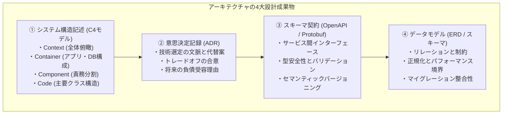
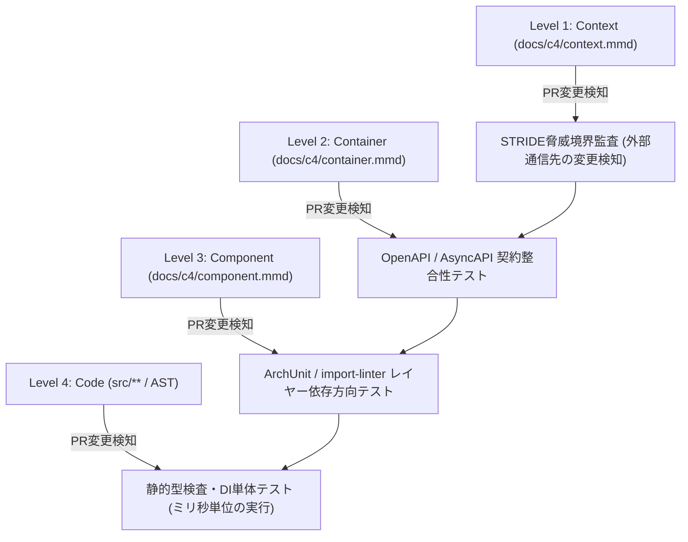
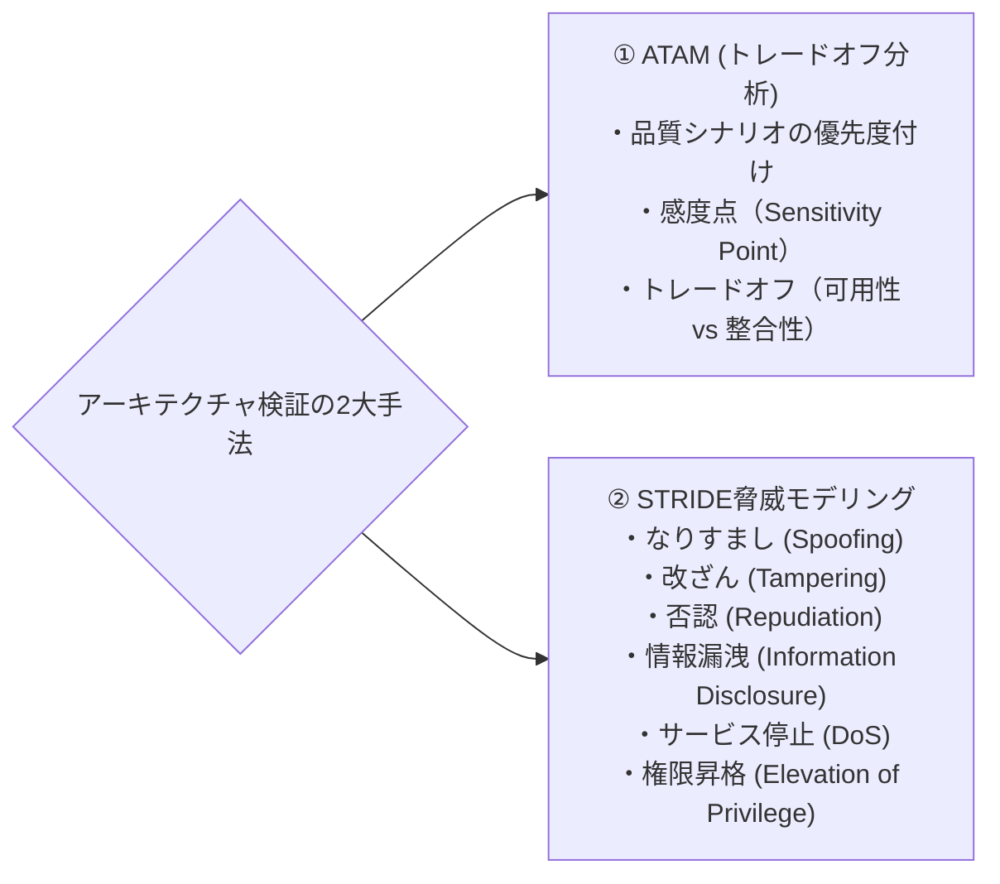

# 第6章：アーキテクチャ・設計成果物の検証

## 6.1 アーキテクチャ成果物の定義（C4モデル、ADR、ERD、OpenAPI / Protobuf仕様）

ソフトウェアの寿命と保守性を決定づけるのは、個々の関数の実装コードではなく「アーキテクチャ設計」である。アーキテクチャの欠陥（密結合、不適切な責務分割、単一障害点、後方互換性の破壊）は、後からリファクタリングで修正しようとするとシステム全体の書き直しを迫られる、最も高利な技術的負債となる。

本章では、アーキテクチャ設計成果物を客観的に検証・監査し、システムが破綻する前に設計の健全性を確証するプラクティスを解説する。



### 1. C4モデル（C4 Model for Software Architecture）

サイモン・ブラウン（Simon Brown）が提唱したC4モデルは、Google Mapsのようにズームイン・ズームアウトしながらアーキテクチャを4つの抽象度で可視化する業界標準のフレームワークである。

1. **Context（文脈）**: 自システムと外部ユーザー、外部連携サービスとの境界。
2. **Container（コンテナ）**: Webアプリ、モバイルアプリ、データベース、キューなどの実行単位。
3. **Component（コンポーネント）**: コンテナ内部のモジュール責務と依存関係。
4. **Code（コード）**: 主要なクラス構造やインターフェース設計。

C4モデルの4階層は静的なお絵描きで終わらせず、以下のようにGitによるバージョン管理とCIパイプラインに直結させることで「Assurance-Driven Development（確証駆動開発）」の防護壁として機能する。



上図のLevel 3（Component）やLevel 4（Code）のCIマッピングでは、言語別のアーキテクチャ検証ツールを活用する。代表例としてJava/Kotlinの **ArchUnit**、Pythonの **import-linter（または pytest-archon）**、TypeScriptの **dependency-cruiser** が挙げられる。これにより、「Domain層のクラスがInfrastructure層のDBドライバを直接インポートしてはならない」といった依存方向ルールを、単体テストとして数ミリ秒で自動検証できる。さらにDI（依存性注入）コンテナ（Goの `wire`、Pythonの `dependency-injector`、TypeScriptの `tsyringe` 等）を導入する。これと静的型検査（`mypy --strict` / `tsc --noEmit`）を組み合わせることで、設計図と実装コードの乖離をコンパイル時点で物理的に阻止できる。

### 2. ADR（Architecture Decision Record：アーキテクチャ意思決定記録）

「なぜそのデータベースを選んだのか」「なぜGraphQLではなくgRPCを採用したのか」といった重要な設計判断を、Gitリポジトリ内にMarkdownとして記録する成果物である。後から参画したエンジニアが「なぜこうなっているのか」を理解し、不毛な再議論を防ぐための必須ドキュメントである。

ADRは以下の標準構造（Michael Nygardフォーマット）で記述される。

```markdown
# ADR-014: 注文トランザクション管理におけるSagaパターンの採用

## ステータス
承認済み (Accepted) - 2026-11-08

## コンテキスト（背景・課題）
マイクロサービス分割に伴い、注文・決済・在庫引当の各サービス間で2相コミット（2PC）が困難になった。
可用性を維持しつつ、最終的一貫性を担保する分散トランザクション手法が必要である。

## 決定事項 (Decision)
オーケストレーション型のSagaパターンを採用する。
注文サービスがオーケストレーターとなり、Kafkaイベントを介して各サービスのローカルトランザクションと補償トランザクション（Rollback）を制御する。

## 結果と影響 (Consequences)
- メリット: サービス間の疎結合が保たれ、単一サービス障害時も注文受付が継続できる。
- デメリット: 補償トランザクションの設計が複雑化し、結果整合性の遅延をUI側で考慮する必要がある。
```

### 3. API仕様・スキーマ定義（OpenAPI / Protocol Buffers）

マイクロサービスやフロントエンド・バックエンド間の契約（Contract）を定義する機械可読な仕様書である。スキーマファースト開発の基盤となり、後述する静的検証やモック生成、後方互換性監査の起点となる。

### 4. ERDとデータベーススキーマ（ER Diagram & Migrations）

データの永続化構造、外部キー制約、インデックス設計を表現した成果物である。パフォーマンスボトルネックやデータ不整合の9割は、このデータモデル設計の不備から生まれる。

データベース設計を検証する際は、以下の「3大アンチパターン」が潜んでいないかを監査する。

1. **暗黙のポリモーフィック関連**: 1つの外部キーが複数のテーブルを動的に指す設計（外部キー制約が効かず整合性が崩壊する）。
2. **過剰な非正規化と不整合キャッシュ**: パフォーマンスを理由に集計値を別カラムに持たせた結果、更新漏れでデータがズレる。
3. **インデックス不在のスキャン爆弾**: 検索条件やソートキーにインデックスがなく、データ量増加に伴い突然スロークエリ化する。

---

## 6.2 評価手法：ATAM（アーキテクチャトレードオフ分析法）とSTRIDE脅威モデリング

アーキテクチャ設計成果物に対する検証は、主観的な議論ではなく、定評ある工学的分析手法を用いて実施する。



### 1. ATAM（Architecture Tradeoff Analysis Method）

カーネギーメロン大学ソフトウェア工学研究所（SEI）が開発した、アーキテクチャ評価の世界的スタンダードである。アーキテクチャには「完璧な解」は存在せず、「トレードオフ」しか存在しない。

- **感度点（Sensitivity Point）**: アーキテクチャの特定パラメータ（例: キャッシュのTTL値）が、ある品質特性（例: 応答速度）に劇的な影響を与える箇所。
- **トレードオフ点（Tradeoff Point）**: ある品質特性を向上させると、別の品質特性が低下する箇所（例: データベースのレプリケーションを非同期にすると「可用性・書込速度」は向上するが「データ整合性」が犠牲になる）。

ATAMセッションを通じて、ビジネス優先度に基づくトレードオフの妥当性をステークホルダー間で客観的に検証する。

### 2. STRIDEモデルによる脅威モデリング

マイクロソフトが提唱したセキュリティ脅威分析フレームワークである。アーキテクチャ図（データフロー図）の各コンポーネントおよび境界線（Trust Boundary）に対して、以下の6大脅威を機械的に問いかける。

- **S (Spoofing)**: 他人の認証情報を偽装できないか？
- **T (Tampering)**: 通信経路やDB内のデータを改ざんできないか？
- **R (Repudiation)**: 重要な操作（送金や削除）を行っておきながら「自分はやっていない」と否認できないか？（監査ログの改ざん耐性）
- **I (Information Disclosure)**: エラーメッセージやログに個人情報やトークンが漏洩しないか？
- **D (Denial of Service)**: リクエスト集中や巨大ペイロードでシステムを窒息させられないか？
- **E (Elevation of Privilege)**: 一般ユーザーが管理者権限に昇格できないか？

---

## 6.3 テスタビリティ（Testability）の設計：依存性注入（DI）とインターフェース隔離

アーキテクチャ設計の段階で最も検証すべき特性の一つが、**「テスタビリティ（テスト容易性）」**である。「テストが書きにくいコード」は、例外なく「テスタビリティを欠いたアーキテクチャ」から生まれる。

テスタビリティを保証するための3大設計原則：

1. **依存性逆転の原則（DIP: Dependency Inversion Principle）**:  
   上位モジュールが下位モジュール（DBや外部API）に直接依存してはならない。抽象（インターフェース）に依存させ、外部依存をモックやスタブに差し替え可能にする。
2. **クリーンアーキテクチャ / ヘキサゴナルアーキテクチャ**:  
   ビジネスロジック（Domain）をフレームワークやデータベースから完全に隔離する。単体テストをDB接続なしでミリ秒単位で実行できるように設計する。
3. **副作用の局所化**:  
   現在時刻、乱数生成、UUID、外部通信といった「非決定的な処理」をコアロジックから排除し、境界（Adapter）に追いやる。

### 具体的なテスタビリティ検証コード（Go言語によるDI設計例）

テスタビリティの低いコードと、テスタビリティを確保したコードの違いを具体例で示す。

```go
package order

import (
    "context"
    "database/sql"
    "time"
)

type Order struct {
    UserID    int
    Amount    int
    CreatedAt time.Time
}

var globalDB *sql.DB

// [アンチパターン] テスタビリティが破綻したコード（グローバルDBと現在時刻に直接依存）
func PlaceOrderLegacy(userID int, amount int) error {
    now := time.Now() // 非決定的な副作用
    _, err := globalDB.Exec("INSERT INTO orders (user_id, amount, created_at) VALUES (?, ?, ?)", userID, amount, now)
    return err
}

// [クリーンパターン] インターフェース注入による高テスタビリティ設計
type OrderRepository interface {
    SaveOrder(ctx context.Context, order *Order) error
}

type TimeProvider interface {
    Now() time.Time
}

type OrderService struct {
    repo  OrderRepository
    clock TimeProvider
}

func (s *OrderService) PlaceOrder(ctx context.Context, userID int, amount int) error {
    order := &Order{
        UserID:    userID,
        Amount:    amount,
        CreatedAt: s.clock.Now(),
    }
    return s.repo.SaveOrder(ctx, order)
}
```

このように設計することで、単体テスト実行時に本物のデータベースや実時刻を用意することなく、メモリ上のモックを用いて全エッジケース（DBタイムアウト、うるう秒等）を1ミリ秒で完全に自動検証できるようになる。この「コンストラクタ経由でのインターフェース注入（Constructor Injection）」はGo言語に限らずあらゆる言語で共通である。TypeScriptでは `interface` を `constructor(private repo: OrderRepository)` に渡し、Pythonでは `typing.Protocol` や `ABC` を `__init__` に渡すことで全く同じ構造を適用できる。

---

## 6.4 スキーマファースト開発と静的検証（Spectral、buf lint、スキーマ互換性チェック）

APIの変更によってクライアントアプリがクラッシュする「後方互換性破壊（Breaking Changes）」は、アーキテクチャにおける重大インシデントの主因である。

コードからAPI仕様を生成するのではなく、**まずスキーマ（OpenAPIやProtobuf）を先に定義・検証する「スキーマファースト開発」**を導入し、CIで自動監査する。

### SpectralによるOpenAPI静的監査

OpenAPIの定義ファイル（`openapi.yaml`）に対し、リントツール **Spectral** をCIで実行し、API設計規約違反を強制ブロックする。

### スピード重視の現場における「1行ADR」と軽量スキーマ運用ハック

「アジャイルでスピード重視の現場では、重厚なADRやスキーマファーストを書いている暇がない」という反発がよく聞かれる。そのような現場では、最初から完璧なドキュメントを書く必要はない。まずはPRの概要欄（または `docs/adr/LOG.md`）に **「【決定】○○を採用 / 【理由】××のため / 【捨てた選択肢】△△は運用コスト高のため却下」というMarkdown 1行（One-Line ADR）を書くだけ** で十分である。スキーマも最初から手書きせず、TypeScriptのZodやPythonのPydanticモデルからOpenAPIを自動生成してCIで差分比較する「コードファースト・スキーマロック」から始めることで、開発速度を1ミリも落とさずに後方互換性のガードレールを手に入れることができる。

```yaml
# .spectral.yaml (API設計規約ルールセット)
extends: ["spectral:oas"]
rules:
  # [spectral:oas 組込ルール] 全オペレーションにタグ分類が定義されているか
  operation-tags: error
  # [カスタムルール] URLパスがケバブケース（/v1/user-orders 等）に統一されているか
  paths-kebab-case:
    description: URLパスはkebab-caseで記述すること
    severity: error
    given: $.paths[*]~
    then:
      function: pattern
      functionOptions: { match: '^(/[a-z0-9-]+|/\{[a-zA-Z0-9_]+\})+$' }
  # [カスタムルール] 全オペレーションに4xx系クライアントエラー応答が定義されているか
  operation-4xx-response:
    description: 各エンドポイントには400/401等の4xxエラーレスポンスを定義すること
    severity: error
    given: $.paths[*][get,post,put,patch,delete].responses
    then:
      function: schema
      functionOptions: { schema: { type: object, patternProperties: { "^4[0-9]{2}$": { type: object } }, minProperties: 1 } }
```

---

## 6.5 AI確証実践：OpenAPI差分からの後方互換性破壊（Breaking Changes）検知とADRリスク監査

AIを活用することで、人間が見落としやすい「微妙な破壊的変更」や「設計判断の矛盾」をGitのプルリクエスト時点で自動監査する。

### 実践プロンプト：APIスキーマ後方互換性＆ADR監査エージェント

````markdown
### [ROLE]
あなたは世界有数の分散システムアーキテクト兼APIガバナンス責任者です。
提供されたOpenAPI定義のGit差分、または新規作成されたADR（意思決定記録）を厳格に監査し、既存システムへの影響と破壊的リスクを特定してください。

### [AUDIT CHECKLIST: BREAKING CHANGES]
1. 既存フィールドの削除または名前変更（即死リスク）
2. 既存のレスポンス型の変更（例: 文字列から数値への変更）
3. 既存エンドポイントへの「必須（required）」リクエストパラメータの追加
4. HTTPステータスコードの変更
5. 列挙型（Enum）の値の削除

### [INPUT DATA]
{OpenAPIの差分テキストまたはADR本文}
（※入力例：`+ required: [user_id, billing_postal_code]` のような `git diff openapi.yaml` の出力結果、または新規作成したADRのMarkdownテキストをそのまま挿入します）

### [OUTPUT FORMAT]
```json
{
  "has_breaking_changes": true,
  "breaking_points": [
    {
      "path": "/api/v1/orders",
      "method": "POST",
      "reason": "リクエストボディに必須フィールド 'billing_postal_code' が追加されており、旧バージョンのモバイルアプリがクラッシュします。",
      "severity": "CRITICAL"
    }
  ],
  "remediation": "後方互換性を保つため、新フィールドはオプショナルとし、段階的移行期間を設けてください。"
}
```
````

### GitHub ActionsパイプラインへのOpenAPI互換性＆AI監査の組み込み例

上記のSpectralリントおよびAI後方互換性監査エージェントを、PR作成時に自動実行して破壊的変更をブロックするGitHub Actionsワークフロー（`.github/workflows/architecture-audit.yml`）の実装例は以下の通りである。

```yaml
# .github/workflows/architecture-audit.yml
name: Architecture & API Contract Gate
on:
  pull_request:
    paths:
      - 'openapi/**'
      - 'docs/adr/**'

jobs:
  api-and-adr-audit:
    runs-on: ubuntu-latest
    steps:
      - uses: actions/checkout@11bd71901bbe5b1630ceea73d27597364c9af683 # v4.2.2
        with:
          fetch-depth: 0

      - name: Run Spectral OpenAPI Linter
        run: npx @stoplight/spectral-cli lint openapi/*.yaml

      - name: Run AI Breaking Change & ADR Auditor
        env:
          GEMINI_API_KEY: ${{ secrets.GEMINI_API_KEY }}
        run: |
          git diff origin/main...HEAD -- openapi/ docs/adr/ > arch_diff.patch
          python3 tools/audit_architecture_diff.py arch_diff.patch
```

---

## 6.6 失敗事例から学ぶアンチパターンと処方箋

アーキテクチャ設計を軽視した結果、組織が陥る典型的な失敗と処方箋である。

| よくある失敗・形骸化パターン | なぜ起きるのか（根本原因） | 現場で起きる悲劇 | 本書が提示する処方箋 |
| :--- | :--- | :--- | :--- |
| **アンチパターン①：暗黙の設計（ADR不在）** | 設計判断の理由を記録せず、Slackの会話や個人の頭の中だけに留めて開発を進める。 | 1年後に「なぜこの変なテーブル構造なのか」誰も分からず、誰もリファクタリングできない聖域化。 | **ADRのGitリポジトリ管理義務化**（重要な技術選定・アーキテクチャ変更はADRのPRマージを必須とする。） |
| **アンチパターン②：サイレント破壊的変更** | APIのレスポンス型や必須パラメータを事前告知なしに変更して本番デプロイする。 | 古いバージョンのモバイルアプリや外部連携先が即死し、サービス全面停止・緊急ロールバック。 | **スキーマ差分のCI自動互換性チェック**（Breaking Changes検知ツールをマージブロック条件にする。） |
| **アンチパターン③：密結合モノリスの肥大化** | 依存性の制御を行わず、モデル同士が互いに直接参照し合うコードを放置する。 | 単体テストを書くために全DBのモックが必要になり、テスト実行時間が2時間に肥大化・破綻。 | **ヘキサゴナルアーキテクチャとテスタビリティ監査**（ドメインロジックの外部依存を完全排除する。） |

---

## 6.7 QA合否判定基準（Pass/Fail Criteria）

アーキテクチャ・設計成果物が「詳細設計・実装着手可能（Ready for Implementation）」と判定されるための確定ゲート基準である。

### アーキテクチャ成果物の合否判定基準

- ☐ **合否判定基準（Pass）**:
  1. 新規システムまたは大規模機能において、C4モデル（少なくともContextとContainer）が定義されていること。
  2. 重要な技術選定およびトレードオフ判断に対し、ADRが起票されレビュー承認されていること。
  3. APIスキーマ（OpenAPI等）が定義され、Spectral等のLinterによる規約違反がゼロであること。
  4. 既存APIの変更がある場合、後方互換性破壊（Breaking Changes）が存在しない、またはバージョン更新プロトコルが定義されていること。
  5. STRIDEモデルに基づくセキュリティ脅威分析が行われ、主要なリスクへの対策が明記されていること。
- ☐ **不合格（Fail / Reject）**:
  - APIスキーマが未定義のまま実装を開始しようとするPR、または後方互換性を破壊するスキーマ変更を含むPRは即座にブロック（Reject）する。

---

## 6.8 第6章まとめ＆現場で明日から使えるセルフチェックシート

アーキテクチャ設計は、システムの長期的な存続と品質を決定づける礎石である。コードを書く前に設計の妥当性を客観的に監査する文化を定着させよう。

### 【章末ワークショップ】アーキテクチャ設計品質診断シート

```text
【アーキテクチャ設計成果物チェックシート（全8問）】

☐ 1. システムの全体構成（C4モデル）が可視化され、コンポーネント間の責務が明確か。
☐ 2. 重要な設計判断に対して、代替案とトレードオフを記録したADRが存在するか。
☐ 3. APIスキーマ（OpenAPI/Protobuf）が先行定義され、スキーマファーストで開発が進んでいるか。
☐ 4. API変更時に、既存のクライアントや外部連携を破壊する変更が含まれていないか。
☐ 5. ビジネスロジックがフレームワークやDBから隔離され、単体テストが容易な構造か。
☐ 6. 外部通信やDB障害時に、システム全体が連鎖倒壊しないフォールバック設計があるか。
☐ 7. STRIDEモデルに基づき、認証・認可の漏れやデータ改ざんの脅威が検証されているか。
☐ 8. 急激なアクセス集中に耐えうるスケーラビリティ境界（キャッシュ、キュー）が設計されているか。

【判定基準】
・チェック 8個: 【合格】堅牢で長寿命なアーキテクチャです。実装へ進んでください。
・チェック 5〜7個: 【条件付き合格】不足しているADRやAPIスキーマを追記・レビューしてください。
・チェック 0〜4個: 【不合格】このまま実装すると巨大な技術負債と障害を引き起こします。再設計してください。
```
