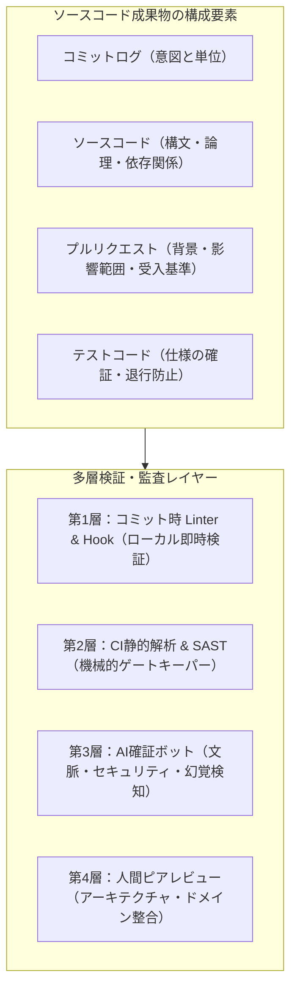
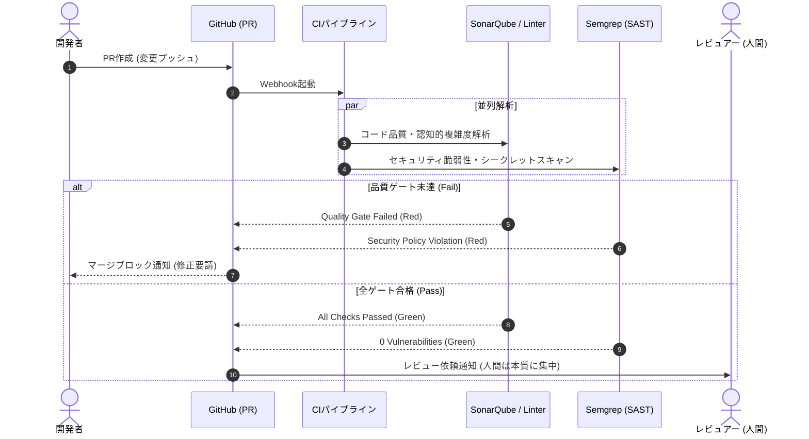
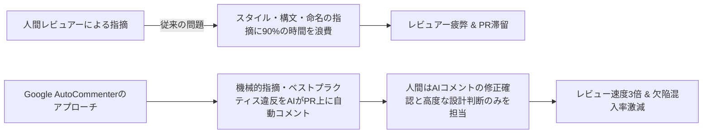
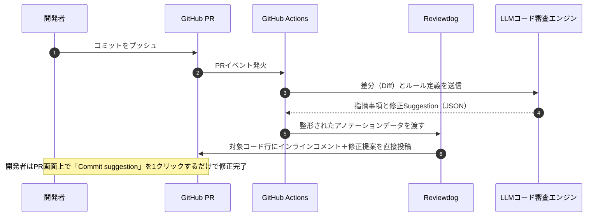

# 第7章 ソースコード・成果物の検証と多層監査

現代のソフトウェア開発において、ソースコードは開発者が一文字ずつキーボードで打ち込むものから、Copilot等の生成AIやLLMエージェントが大量に生成・提案するものへと急速に変容しつつあります。生成速度が10倍に加速した開発現場において、人間のコードレビューだけに頼る品質保証は完全に破綻をきたしています。
レビュー担当者の疲弊（Reviewer Fatigue）、チェックの見落とし、スタイルや好みの議論によるPR（プルリクエスト）の長期滞留が日常化しています。さらに、AIがもたらす幻覚（Hallucination）やタイポスクワッティング攻撃への懸念も増大しています。これらに対処するためには、コードを「機械による静的解析・SAST」「AI確証パイプライン」「人間による本質的設計レビュー」の多層防壁で検証・監査するアーキテクチャが不可欠です。
本章では、ソースコード成果物に対する多層検証パイプラインの設計、Googleの大規模コードレビュー研究「AutoCommenter」に学ぶ人間と自動化の境界設計、そしてAI生成コード時代に必須となる厳格な監査基準を詳解します。

---

## 7.1 成果物の定義：ソースコード、プルリクエスト、コミットログ

品質保証における「コード」とは、単にコンパイルが通るテキストファイル群を指すのではありません。コミットログ、差分（Diff）、プルリクエスト（PR）の文脈、そしてテストコードまでを含めた「変更の履歴と意図の全体」が検証対象となる成果物です。



### 1. コミットログの品質（意図の透明性）

Gitコミットログは、将来のデバッグや障害調査（`git bisect` や `git blame`）における唯一の確証証跡です。「fix bug」「update」「WIP」といった無意味なログは品質追跡性を完全に破壊します。
コミットログの品質検証では、以下の3つの原則を自動フックおよびCIで検証します。

- **Conventional Commitsへの準拠**: コミットメッセージの先頭に `feat:`, `fix:`, `refactor:`, `test:`, `docs:`, `chore:` などのタイプを強制し、セマンティックバージョニングやリリースノート自動生成と連携させます。
- **アトミックコミット（Atomic Commit）の遵守**: 1つのコミットには「1つの論理的変更」のみを含めます。リファクタリングと機能追加を同一コミットに混在させることを禁止します。混在があると、バグ発生時の切り戻し（`git revert`）が極めて困難になるためです。
- **Issueとのトレーサビリティ**: チケット管理システム（GitHub IssuesやJira）のIDをコミットメッセージまたはPRタイトルに紐づけることを義務付けます。

### 2. ソースコード本体の品質（保守性と信頼性）

国際標準規格 ISO/IEC 25010 のソフトウェア製品品質モデルにおいて、ソースコードの内部品質は以下のサブ特性と密接に結びついています。

- **解析性（Analysability）**: 欠陥や障害原因、修正箇所を特定することがどれだけ容易か。命名規則の統一や不要な抽象化の排除が影響します。
- **変更性（Modifiability）**: コードの変更が他のモジュールに予期せぬ副作用を与えず、安全に行えるか。認知的複雑度の低さや凝集度の高さが決定的な要素となります。
- **テスト容易性（Testability）**: コードに対する自動テストを容易に作成・実行できるか。密結合な静的シングルトン参照や大域変数が排除され、依存性の注入（DI）が実現されているかを検証します。
- **再利用性（Reusability）**: 重複コード（Clone Code）が適切に共通化・ライブラリ化されているか。SonarQubeの解析基準に基づき、新規差分コードにおける重複率が3%未満であることを必須条件とします。

### 3. プルリクエスト（PR）の品質（文脈の完全性）

PRは変更をチーム全体および将来のメンテナーと統合するための「契約書」です。なぜこの変更が必要なのか（Why）、何を変更したのか（What）、どのように動作確認したのか（How to Test）が記述されていなければ、レビュアーは正確な合否判断を下せません。
PRの品質を客観的に検証するために、以下の受入条件を設けます。

- **PRテンプレートの全項目記入**: テンプレートのチェックボックスや見出しが空欄のまま放置されていないか。
- **変更理由（Why）の明記**: コードの差分だけでは読み取れない、ビジネス要件や背景トレードオフが記載されているか。
- **テストエビデンスの添付**: 単体テストのパス結果だけでなく、ローカルまたは検証環境での動作確認ログやスクリーンショットが貼付されているか。

---

## 7.2 静的コード解析（SonarQube、Linter）とセキュリティSAST（Semgrep）のCIゲート化

ソースコード検証の鉄則は、「機械が判定できることは、絶対に人間に判断させない」ことです。インデント、命名規則、未使用インポート、単純なバグパターン、セキュリティ脆弱性のパターンマッチングをすべてCIパイプラインのブロッキングゲートとして構築します。



### 1. 認知的複雑度（Cognitive Complexity）の制限

従来の循環的複雑度（McCabe Cyclomatic Complexity）は、関数内の線形独立な実行可能パスの数を数えるアルゴリズムでした。しかし、単純な`switch-case`文が連続する場合でもスコアが高騰する一方、三項演算子の複雑なネストや再帰呼び出しといった「人間が頭の中で状態を保持する負荷」を正しく計測できない欠点がありました。

SonarSource社が策定した「認知的複雑度（Cognitive Complexity）」は、この人間のメンタルモデルへの負荷を数値化するために設計されています。具体的には、以下の3つの基本原則に基づいて計算されます。

1. **構文の短縮表現（Brevity）を無視せず、理解の難しさに応じて加点する**: 単純な条件分岐よりも、論理演算子（`&&` や `||`）が混在する複雑なブール式を重く評価します。
2. **制御フローのネスト（Nesting）ごとにペナルティを累進的に加算する**: `if`文の中にさらに`for`ループがあり、その中に`try-catch`があるような入れ子構造では、内側に行くほど加点幅が「+1, +2, +3...」と幾何級数的に増加します。
3. **人間にとって直感的な制御構造（単純な一連の処理）には過剰に加点しない**: 直列に並んだ手続き型のステップにはペナルティを与えません。

一般に、1つのメソッドにおける認知的複雑度の許容上限は**15点以下**（極めてクリティカルな決済や認証ドメインでは**10点以下**）と設定し、これを超える変更を含むPRはCIで自動的にマージブロックします。複雑度が15を超えたコードは、ドメインロジックが肥大化しているか、単一責任の原則（SRP）に違反している確実な兆候です。

### 2. 静的解析ルールセットの最適化：SonarQubeとESLint/Ruffの統合

CIにおける静的コード解析では、ツールの重複や競合を排除し、階層化された検査マトリクスを設計することが極めて重要です。

- **第1層：ローカル事前検査（pre-commit hook / Ruff / ESLint）**: フォーマットや未定義変数、インポート順序など、数ミリ秒で完結する検査。
- **第2層：CI並列検査（SonarQube / SonarCloud）**: リポジトリ全体の依存グラフを解析し、コードの重複率、認知的複雑度、デッドコード（到達不能コード）、テストカバレッジの不足を総合判定。

### 3. セキュリティSAST（Semgrep）によるガードレール

Semgrepは、構文木（AST）レベルでパターンを検索・検証できる軽量かつ強力なSASTツールです。正規表現によるgrepと異なり、コメントや変数名の違いを吸収し、セマンティックな脆弱性を確実に検知します。
以下は、CIパイプラインでSQLインジェクションや機密情報のハードコードをブロックするためのSemgrepルールセット例です。

```yaml
# .semgrep/security-rules.yaml
rules:
  - id: sql-injection-string-concat
    message: "SQLクエリを文字列連結またはf-stringで構築しています。プレースホルダ（バインド変数）を使用してください。"
    severity: ERROR
    languages: [python]
    pattern-either:
      - pattern: db.execute(f"... {$VAR} ...")
      - pattern: db.execute("..." + $VAR + "...")
    metadata:
      cwe: "CWE-89: Improper Neutralization of Special Elements used in an SQL Command"
      category: security

  - id: hardcoded-secrets-detection
    message: "APIキーや秘密鍵がハードコードされている疑いがあります。環境変数またはシークレットマネージャから取得してください。"
    severity: ERROR
    languages: [python, javascript, typescript]
    patterns:
      - pattern-regex: '(?i)(api[_-]?key|secret|password|bearer)\s*[:=]\s*["''][A-Za-z0-9_\-]{20,}["'']'
    metadata:
      cwe: "CWE-798: Use of Hard-coded Credentials"
      category: security
```

---

## 7.3 人間によるPRレビューの設計：観点別チェックリストとサイズ制限（Danger活用）

静的解析とSASTがグリーンになった後、初めて人間のピアレビューが開始されます。しかし、巨大なPR（1,000行以上の差分）が提出されると、レビュアーは圧倒され、結局「LGTM（Looks Good To Me）」と表面的な確認だけで承認してしまう「レビュー疲弊（Reviewer Fatigue）」に陥ります。

### 1. PRの「認知可能サイズ」制限（Dangerの導入）

SmartBear社の有名な研究によると、レビュアーが一度に集中して検証できるコード差分の上限は**200〜400行**であり、600行を超えると欠陥検出率は急落します。
これを強制するために、Danger（CI上でPRメタデータを自動監査するツール）を導入し、差分サイズが閾値を超えた場合に自動で警告またはブロックします。

```javascript
// Dangerfile.js
import { danger, warn, fail } from 'danger'

const pr = danger.github.pr;
const modifiedLines = pr.additions + pr.deletions;

// 1. PRサイズ制限：400行超で警告、800行超で差し戻し（Fail）
if (modifiedLines > 800) {
  fail(`🛑 PRの変更行数が大きすぎます（${modifiedLines}行）。PRを複数の小さな関心事に分割してください（推奨: 400行以下）。`);
} else if (modifiedLines > 400) {
  warn(`⚠️ PRの変更行数がやや大きめです（${modifiedLines}行）。入念なレビューが必要です。`);
}

// 2. PR説明文の充足度チェック
if (pr.body.length < 50) {
  fail('📝 PRの概要・背景説明が短すぎます。変更理由、影響範囲、テスト手順を詳細に記載してください。');
}

// 3. テストコードの同封チェック
const hasAppChanges = danger.git.modified_files.some(path => path.startsWith('src/'));
const hasTestChanges = danger.git.modified_files.some(path => path.startsWith('tests/'));

if (hasAppChanges && !hasTestChanges) {
  warn('🧪 アプリケーションコードが変更されていますが、テストコード（tests/）の変更が含まれていません。テストの追加を検討してください。');
}
```

### 2. 人間が注力すべき3大レビュー観点

スタイルや構文の指摘を自動ツールに委ねた人間レビュアーは、以下の3点に集中します。

1. **ドメインモデルとの整合性**:
   ビジネス要求の文脈において、エンティティの振る舞いや境界づけられたコンテキスト（Bounded Context）が正しく保たれているか。ユビキタス言語が不自然に歪められていないか。ドメインロジックがコントローラーやUI層に漏れ出していないかを徹底的に検証します。
2. **非機能要件と副作用**:
   排他制御、デッドロックの可能性、N+1クエリの発生、キャッシュの無効化漏れなど、動的な負荷下で生じる問題がないか。分散トランザクションや非同期メッセージングにおける冪等性（Idempotency）が保証されているかを検証します。
3. **テスタビリティと可観測性**:
   将来の機能追加に耐えうる疎結合設計になっているか。障害発生時にトラブルシューティング可能な構造化ログやメトリクスが出力されているかを精査します。

### 3. レビュー観点別チェックシートの実装（GitHub PRテンプレート）

人間レビュアーの主観ブレを排除するため、PR作成時およびレビュー時に用いる標準チェックリストをリポジトリ内に定義します。

```markdown
<!-- .github/pull_request_template.md -->
## 変更の背景と目的 (Why & What)
- 解決するIssue番号: Closes #
- 変更理由の要約: 

## 設計・ドメイン検証 (Author & Reviewer)
- [ ] ドメインモデルの境界が破壊されていないか
- [ ] 認知的複雑度がSonarQube / Linterの基準（15以下）を満たしているか
- [ ] 外部依存の注入（DI）が適切に行われ、単体テスト容易性が確保されているか

## 非機能要件・安全性検証
- [ ] DBマイグレーションはダウンタイムなし（Zero-downtime）で実行可能か
- [ ] N+1クエリや不要な大量データ全件取得が発生していないか
- [ ] 秘密情報（APIキー・クレデンシャル）のハードコードがないか（Semgrep検証済）

## 動作確認・テスト確証
- [ ] 正常系・異常系・境界値の自動テストコードが含まれているか
- [ ] ステージング環境での実機・API動作確認ログを貼付したか
```

---

## 7.4 Google「AutoCommenter」に学ぶ：機械的指摘の完全自動化と「レビュー疲弊」の防護

Googleは数万人のエンジニアが日々膨大なコードを生産する中で、コードレビューの品質向上と速度向上を両立させるため、社内AI支援システム「AutoCommenter」を開発・運用しています。Googleのエンジニアリングチームが発表した論文（*Resolving Code Review Comments with Machine Learning* 等）から得られる教訓は、あらゆる組織のレビュー改革に極めて有益です。



### Googleの知見：自動化ボット設計の3原則

1. **高い確信度（High Precision）の担保**:
   誤検知（False Positive）が多いボットは、開発者に無視されるようになり、最終的にCI通知を切られます。AutoCommenterは「99%以上の確信度がある指摘のみ」をインラインコメントとして投稿し、迷うものはあえて発言しません。ノイズを徹底的に排除することが、開発者の信頼獲得の第一条件です。
2. **指摘だけでなく修正パッチ（Fix Suggestion）を提示する**:
   「ここが間違っています」と指摘するだけのボットは開発者の認知負荷を高めます。GitHubのSuggestion記法のように、「このように変更してください」というワンクリックで適用可能なコードパッチを提示することが、受容率（Click-through rate）を飛躍的に高めます。
3. **人間関係の摩擦ゼロ化**:
   同僚からスタイルの細かな指摘を受けると心理的抵抗（「重箱の隅をつつかれている」感覚）が生じがちですが、ボットによる自動指摘であれば開発者は素直に受け入れます。人間の感情を消耗させないことこそが、自動化の最大の価値です。

### オープンソース技術によるAutoCommenterパイプラインの再現

Googleの社内基盤を持たない一般的な開発チームでも、現代のOSSツール（GitHub Actions、Reviewdog、Semgrep、LLM CLI）を組み合わせることで、AutoCommenterと同等のパイプラインを即座に構築できます。



---

## 7.5 AI確証工程：AI生成コード特有のリスク（幻覚・タイポスクワッティング・非推奨API）の多層監査

GitHub CopilotやChatGPT、Claude等のLLMによるコード生成が一般化した現在、従来の人手開発ではあり得なかった新しい形態の不具合やセキュリティリスクが発生しています。これらを検知・遮断するための専用の「AI確証プロンプト＆パイプライン」を構築します。

### 1. AI生成コードが抱える4大リスクの詳細分析

- **存在しない架空パッケージのインポート（Package Hallucination）**:
  LLMは時に、実在しないライブラリ名を幻覚（ハルシネーション）で出力します。攻撃者はこれを利用し、LLMがよく出力する架空パッケージ名と同名の悪意あるマルウェアをnpmやPyPIに事前登録しておく「AIパッケージ・タイポスクワッティング攻撃」を仕掛けています。開発者が気づかずに `npm install` や `pip install` を実行した瞬間、開発環境や本番サーバーが乗っ取られます。
- **非推奨・脆弱な古いAPIの学習バイアス（Stale Code Bias）**:
  学習データに含まれる古いコード例に引きずられ、すでに非推奨（Deprecated）となった暗号化アルゴリズム（MD5、SHA1）や、メモリリークを起こしやすい古い非同期記法を出力する傾向があります。
- **文脈無視の局所最適コード（Context Blindness）**:
  プロンプトで指示された狭い関数の実装は正しくても、リポジトリ全体の共通エラーハンドリング規則やロギング規約を無視した、浮いたコードを生成します。例外が適切に上位層へ伝播されず、障害調査が極めて困難になります。
- **ライセンス汚染（License Contamination）**:
  オープンソースのGPLコードや著作権保護されたスニペットをそのまま暗記して出力してしまうリスクです。商用プロダクトに混入した場合、重大な法的紛争に発展する恐れがあります。

### 2. CI連動型AI監査パイプラインの実装例

以下は、PRで提出されたコード変更（Diff）に対し、上記のAI特有リスクを徹底的に洗い出して監査判定を下すためのプロンプト定義です。

```json
{
  "system_instruction": "あなたは極めて厳格なシニアセキュリティ・品質監査アーキテクトです。PRのDiffと依存関係定義を精査し、AI生成コード特有のリスクを監査してください。",
  "audit_rules": [
    {
      "rule_id": "AI-AUDIT-001",
      "target": "dependencies",
      "description": "新規に追加されたライブラリ・パッケージが、npm/PyPIの公式レジストリに実在し、十分なダウンロード実績とメンテナーが存在するか検証せよ（架空パッケージ幻覚の遮断）。"
    },
    {
      "rule_id": "AI-AUDIT-002",
      "target": "security_primitives",
      "description": "暗号化、ハッシュ生成、乱数生成において、非推奨のプリミティブ（MD5, SHA1, Math.random）が使われていないか検証せよ。"
    },
    {
      "rule_id": "AI-AUDIT-003",
      "target": "error_handling",
      "description": "catchブロックで例外をもみ消す（pass / empty block）、または文脈情報を破棄した大雑把なエラーハンドリングになっていないか検証せよ。"
    }
  ],
  "output_format": {
    "audit_status": "APPROVED | REQUEST_CHANGES | BLOCKED",
    "findings": [
      {
        "file": "path/to/file",
        "line": 123,
        "rule_id": "AI-AUDIT-001",
        "reason": "指摘の具体的理由",
        "suggested_patch": "修正コード差分"
      }
    ]
  }
}
```

### 3. 実践：Pythonによる新規依存パッケージ自動検証スクリプト

CI環境で実行し、PR差分から新規追加されたパッケージを抽出し、PyPI公式APIと照合して安全性を即座に判定する確証スクリプトです。

```python
# tools/verify_package_authenticity.py
import sys
import json
import urllib.request
import urllib.error

def verify_pypi_package(package_name: str) -> bool:
    url = f"https://pypi.org/pypi/{package_name}/json"
    req = urllib.request.Request(url, headers={"User-Agent": "Book-QA-Verifier/1.0"})
    try:
        with urllib.request.urlopen(req) as response:
            if response.status == 200:
                data = json.loads(response.read().decode("utf-8"))
                downloads_info = data.get("info", {})
                print(f"[OK] 実在確認: {package_name} (最新版: {downloads_info.get('version')})")
                return True
    except urllib.error.HTTPError as e:
        if e.code == 404:
            print(f"[CRITICAL FAIL] 架空または未登録パッケージ検知: {package_name}")
            return False
        print(f"[WARN] APIエラー ({e.code}): {package_name}")
        return False
    return False

if __name__ == "__main__":
    test_packages = sys.argv[1:]
    if not test_packages:
        print("検証対象パッケージを指定してください。")
        sys.exit(0)

    failed = False
    for pkg in test_packages:
        if not verify_pypi_package(pkg):
            failed = True

    if failed:
        print("\nCIブロック: 安全性が確認できない、または実在しないパッケージが含まれています。")
        sys.exit(1)
    print("\nすべてのパッケージが実在し、検証を通過しました。")
```

### 4. 組織におけるAIコードレビューのガイドライン策定

開発組織が生成AIや自律型エージェントを本格的に導入する際、開発者とAI、そしてレビュー担当者の間で合意形成しておくべき基本方針（AIレビュー憲章）を定めます。

1. **説明責任（Accountability）の所在**:
   AIが生成したコードであっても、PRを作成した開発者本人がすべてのコード行に対して100%の説明責任を負います。「AIが出力したから」という理由は一切の言い訳として認められません。コードの挙動を完全に理解していない場合は、PRを提出してはなりません。
2. **AIレビューコメントへの真摯な向き合い方**:
   CIで自動投稿されるAIの指摘事項（Reviewdog等）を単に無視して手動マージする行為（Bypass）を禁止します。AIの指摘が誤検知（False Positive）であると判断した場合は、該当するルールIDを指定してリポジトリの除外設定（Ignore list）を更新するか、理由をPRコメントに明記する運用を義務付けます。
3. **継続的なプロンプトとルールセットの改善サイクル**:
   本番障害が発生した際、ポストレモート（Post-mortem）の一環として「なぜ既存の静的解析やAIレビューパイプラインをすり抜けたのか」を必ず検証します。検知漏れとなったパターンをSemgrepのカスタムルールやAI確証プロンプトに即座に追加し、同一パターンの再発を二度と許さない自動化防護壁を強化し続けます。

---

## 7.6 失敗事例から学ぶアンチパターンと処方箋

| よくある失敗・形骸化パターン | なぜ起きるのか（根本原因） | 現場で起きる悲劇 | 本書が提示する処方箋 |
| :--- | :--- | :--- | :--- |
| **アンチパターン①：巨大PRとLGTM承認** | タスクの分解を行わず、2週間分の全作業（2,000行差分）を1つのPRで一括提出する。 | レビュアーは読む気を失い、「たぶん動くでしょう」とLGTMを出して本番障害・障害多発。 | **Dangerによる差分サイズ強制制限**（400行超で警告、800行超でCI即時差し戻し。） |
| **アンチパターン②：スタイル論争によるPR滞留** | インデント、改行位置、変数命名の好みを人間レビュアー同士がコメント欄で議論する。 | 些細な指摘の応酬でPRマージに1週間以上かかり、チームの心理的安全性が崩壊。 | **フォーマッタとLinterの完全自動化**（Prettier/Black等をpre-commitとCIで強制し、人間の議論を禁止する。） |
| **アンチパターン③：AIコードの無批判なマージ** | AIが生成した見かけ上綺麗なコードを信じ込み、エッジケースや依存ライブラリの検証を怠る。 | 架空パッケージ経由でサプライチェーン攻撃を受けたり、高負荷時にメモリリークで全滅。 | **AI特有監査ボットとパッケージ存在検証**（CI上で新規パッケージの健全性・レジストリ登録歴を自動照合。） |

---

## 7.7 本章のまとめと商業出版水準のQA合否判定基準

ソースコードの検証は、属人的な「注意深さ」に依存する時代から、多層防御パイプラインによる「再現可能な確証（Assurance）」へと進化しました。本章で提示したチェックリストをチームのブランチ保護ルール（Branch Protection Rule）に適用してください。

### ソースコード成果物・QA合否判定チェックリスト（Gate Criteria）

| 検証カテゴリ | 検査項目 | 合格基準（Pass） | 不合格基準（Fail / ブロック） |
| :--- | :--- | :--- | :--- |
| **コード静的品質** | 認知的複雑度（Cognitive Complexity） | すべてのメソッドで15点以下（推奨10点以下） | 16点以上のメソッドが1箇所でも存在する |
| **コード静的品質** | コード重複率（Duplicated Lines） | 新規変更コードにおいて重複率3%未満 | 新規コード重複率が3%以上 |
| **セキュリティ** | SASTスキャン（Semgrep） | Critical / Highの既知脆弱性 0件 | 1件でもHigh以上の指摘がある |
| **プロセス品質** | PR差分サイズ（変更行数） | 差分400行以内（最大でも800行以内） | 800行を超える巨大PR（即時分割差し戻し） |
| **AI特有リスク** | 外部パッケージ存在監査 | 新規依存パッケージが公式レジストリで検証済 | 架空パッケージ、または不審な新規登録パッケージの検出 |
| **自動化テスト** | 単体テスト同封とカバレッジ | ロジック変更に対応するテストが存在しパス | テストコードが存在しない、または既存テスト失敗 |

---

## 7.8 章末演習課題

読者が自身の開発環境で実践するための実践的ワークショップ課題です。

- **課題1（静的解析と複雑度ゲートの導入）**:
  プロジェクトにLinterと認知的複雑度計測ツール（SonarQube、ESLintの`sonarjs/cognitive-complexity`等）を導入してください。その上で、複雑度15超の関数を検知したらPRをブロックするGitHub Actionsワークフローを構築してください。
- **課題2（DangerによるPRガードレール構築）**:
  差分行数が500行を超えた場合、およびPR説明文が100文字未満の場合に自動で「PR分割・詳細追記」を要求するDangerスクリプトを作成し、テストPRで実際に警告が発火することを確認してください。
- **課題3（AI生成コードのセキュリティ監査シミュレーション）**:
  LLMに「安全なトークン生成ユーティリティ」のコードを出力させてください。そこに意図しない脆弱な乱数（`Math.random()` 等）や架空のライブラリ参照が含まれていないかを検証するSemgrepルールを作成し、正しく検出できるか動作テストを行ってください。
- **課題4（コミットメッセージのリント自動化）**:
  Gitフック（commitlint / husky等）をローカル環境およびCIに導入し、`feat:`, `fix:` 等のプレフィックスを持たない無効なコミットメッセージを自動で拒否する仕組みを構築してください。
