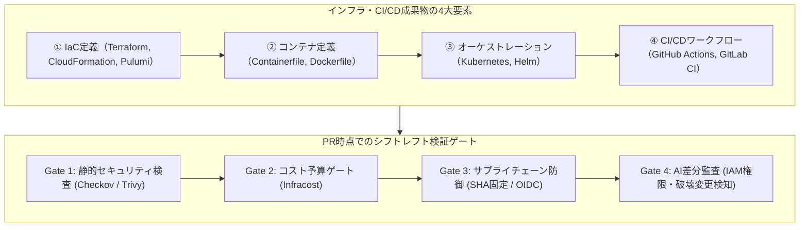
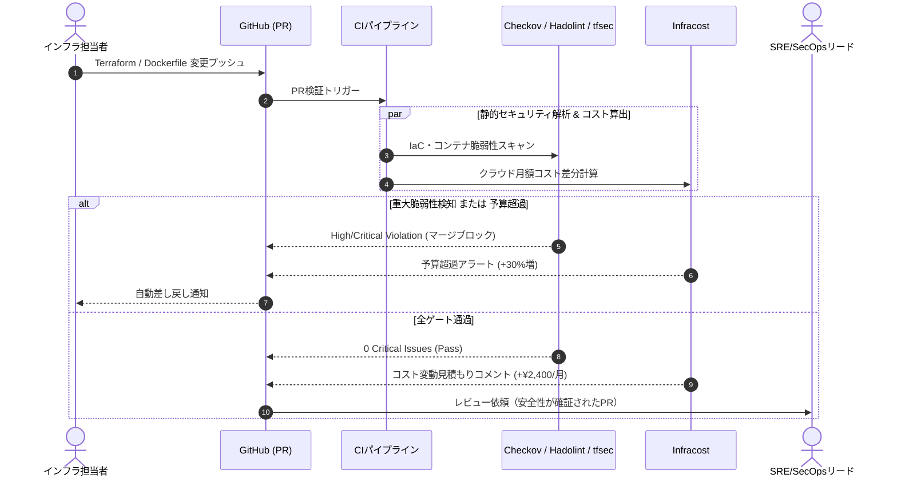
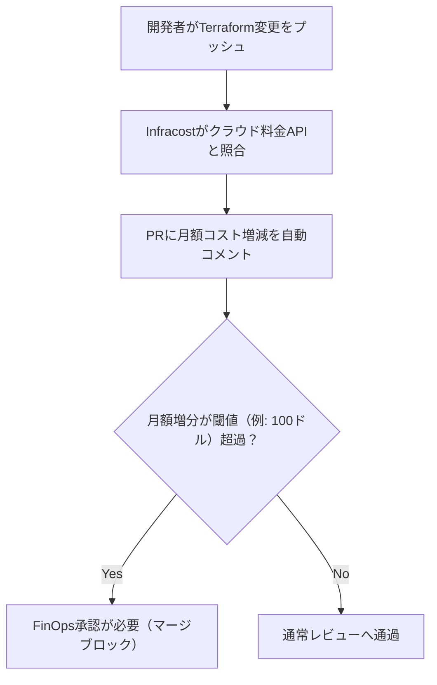

# 第8章：インフラ・CI/CD成果物の検証（Shift-Left Infrastructure）

クラウドネイティブ時代において、インフラストラクチャはデータセンターの物理ラックから、Gitリポジトリ上で管理されるテキストコード（Infrastructure as Code: IaC）へと完全に移行した。Terraform、Dockerコンテナ、Kubernetesマニフェスト、そしてCI/CDパイプライン定義（GitHub Actions等）そのものが、現代のシステムにおける極めてクリティカルな「成果物」である。
インフラのコード化は、インフラの欠陥やセキュリティホール、過剰スペックによる予算爆発、そしてサプライチェーン攻撃の侵入経路までもが「コードとして混入する」ことを意味する。本番環境に適用（`terraform apply`）した後に発覚する構成ミスは、数千万円規模のクラウド請求書や全社的セキュリティインシデントに直結する。
本章では、インフラ成果物をPR作成時点で徹底的に検証する「シフトレフト・インフラストラクチャ（Shift-Left Infrastructure）」の体系、セキュリティ・コスト・サプライチェーンの多層防御ゲート、そして生成AIを活用したIaC変更監査のアーキテクチャを詳解する。

---

## 8.1 インフラ成果物の定義：IaC・コンテナ・K8s・パイプライン

品質検証の対象となる「インフラ成果物」は、単一のコードではなく、アプリケーションのライフサイクル全体を支える4つの構成層から成り立っている。



### 1. IaC定義（Terraform等）の品質検証

クラウド上のVPC、サブネット、IAMロール、ストレージバケット、DBインスタンスを宣言するコードである。
IaCの品質検証においては、以下の観点を網羅的に監査する。

- **セキュリティ境界の厳格性**:
  セキュリティグループの全開放（`0.0.0.0/0`）やパブリックS3バケット、保存時・転送時の暗号化（KMS/TLS）の未設定を機械的に排除する。意図しないインターネット公開をゼロにする。
- **破壊的変更（Destructive Changes）の抑止**:
  予期せぬリソースの破棄・再作成（`forces replacement`）によるデータベースやストレージの消失リスクを未然に防ぐ。
- **モジュール性とDRY原則**:
  同一設定の重複を排除し、組織全体で検証・承認された公式Terraformモジュールとして抽象化されているかを検証する。
- **ステートファイル整合性とロック**:
  複数人での同時実行による競合を防ぐため、S3とDynamoDBによる分散排他ロック（State Locking）が正しく構成されているかを確証する。

### 2. コンテナイメージ定義（Dockerfile等）の品質検証

コンテナは本番実行環境の最小単位であり、そのセキュリティと最適化はシステムの信頼性に直結する。

- **最小権限実行（Non-root）**:
  コンテナ内プロセスをrootユーザーで実行することを厳禁とし、専用ユーザー（`USER appuser`）を明示する。コンテナ脱獄（Container Escape）攻撃のリスクを極小化する。
- **攻撃面の極小化（Minimal Base Image）**:
  汎用Ubuntuイメージ等を避け、AlpineやDistrolessイメージを採用して不要なシェルやパッケージを排除する。
- **ビルド再現性とマルチステージ**:
  依存関係のキャッシュ効率を最大化し、成果物イメージにコンパイラやビルドツールを残さないマルチステージビルドを義務付ける。
- **イメージ脆弱性スキャン**:
  ベースイメージおよび組み込まれたライブラリに対してTrivyを実行し、Critical/Highの既知脆弱性（CVE）が存在しないことを検証する。

### 3. Kubernetesマニフェスト（Helm等）の品質検証

Kubernetesはクラスタ全体のリソース共有と自律回復を担うため、マニフェストの不備はノード枯渇やサービス停止を引き起こす。

- **リソース制限（Requests / Limits）の明記**:
  CPUおよびメモリの要求値と上限値を必須とし、 noisy neighbor（近隣の迷惑なプロセス）によるクラスタ全体の障害を防止する。
- **ヘルスチェックプローブ（Liveness / Readiness）**:
  アプリケーションの起動完了と正常稼働を判定するプローブを確実に定義する。不正なリクエストが起動途中のPodに流れるのを防ぐ。
- **Pod Security Standardsへの準拠**:
  特権モード（`privileged: true`）やホストネットワークの直接利用を禁止する。
- **アフィニティと分散配置**:
  PodAntiAffinityを設定し、複数アベイラビリティゾーン（AZ）への分散配置を保証して可用性を担保する。

### 4. CI/CDワークフロー定義（GitHub Actions等）の品質検証

パイプライン自体が侵害されるサプライチェーン攻撃を防ぐため、以下のガードレールを検証する。

- **サードパーティ製Actionの完全コミットハッシュ固定**:
  タグ書き換えによる悪意あるコードの混入を遮断する。
- **OIDC（OpenID Connect）による一時的認証**:
  永続的な長寿命クレデンシャル（AWSアクセスキー等）のSecrets保存を構造的に排除する。
- **最小実行権限スコープ**:
  GITHUB_TOKENのデフォルト権限を厳格に制限する。
- **ブランチ保護と環境承認（Environments Approval）**:
  本番環境への自動デプロイには、保護された環境設定と承認者のサインオフを強制する。

---

## 8.2 IaC・コンテナの静的セキュリティ解析とLinter（tfsec、Checkov、Hadolint、kube-linter）

インフラの検証において最も重要な原則は、「本番デプロイ前に静的解析で99%の構成ミスを遮断する」ことである。各種ツールをCIパイプラインのブロッキングゲートとして統合する。



### 1. Containerfileの静的解析（Hadolint）

Dockerfileの記述ルールをAST解析し、ベストプラクティス違反を検知する。
Hadolintは、Docker公式およびCISベンチマークが推奨するセキュリティガイドラインを厳密にチェックする。主な検知項目には以下が含まれる。

- **DL3002（ユーザー権限）**: コンテナがデフォルトのrootユーザーで実行されていないか。
- **DL3007（タグ指定）**: ベースイメージに `:latest` タグが使われていないか（バージョン不変性の欠如）。
- **DL3018（パッケージ固定）**: `apk add` や `apt-get install` 時にパッケージバージョンが固定されているか。
- **SC2086（シェルスクリプト引用符）**: `RUN` 命令内のシェルスクリプトで変数展開がダブルクォートで保護されているか。

以下は、典型的なアンチパターンと、Hadolint準拠のセキュアなDockerfileの対比例である。

```dockerfile
# 悪い例（アンチパターン）
FROM node:latest
COPY . /app
WORKDIR /app
RUN npm install
CMD ["node", "server.js"]

# 改善例（Hadolint準拠・マルチステージビルド）
FROM node:20.11-alpine AS builder
WORKDIR /app
COPY package*.json ./
RUN npm ci --only=production

FROM node:20.11-alpine
WORKDIR /app
# 非rootユーザーの作成と切り替え (DL3002対策)
USER node
COPY --chown=node:node --from=builder /app/node_modules ./node_modules
COPY --chown=node:node . .
EXPOSE 3000
CMD ["node", "server.js"]
```

### 2. Kubernetesマニフェストの静的解析・ポリシー検査（kube-linter / Conftest）

Kubernetesクラスタにデプロイする前に、YAMLマニフェストの構成ミスを静的に遮断する。
kube-linterやOpen Policy Agent（OPA / Conftest）を用いることで、以下の本番稼働リスクをCIで未然に排除する。

- **リソースクォータ枯渇の防止**: `resources.limits.cpu` および `resources.limits.memory` が設定されていないPodを拒否。
- **セキュリティコンテキストの強制**: `runAsNonRoot: true` や `readOnlyRootFilesystem: true` が設定されているかを検証。
- **サービスディスカバリと高可用性**: 単一障害点（SPOF）を排除するため、本番向けDeploymentにおいて `replicas` が2以上で設定されているかを監査。

### 3. Terraformのセキュリティポリシー監査（Checkov / tfsec）

Checkovを利用して、CISベンチマークやSOC2、PCI-DSSなどのコンプライアンス基準に抵触するリソース定義を機械的に弾く。以下は、S3バケットの暗号化とパブリックアクセス遮断を義務付けるCIステップ例である。

```yaml
# .github/workflows/iac-security.yml
name: IaC Security Scan
on: [pull_request]

jobs:
  checkov:
    runs-on: ubuntu-latest
    steps:
      - uses: actions/checkout@b4ffde65f46336ab88eb53be808477a3936bae11 # v4.1.1
      - name: Run Checkov
        uses: bridgecrewio/checkov-action@c123980c248c32a99923d1eb6b9f113d8c69f619 # v12.2991.0 (SHA固定)
        with:
          framework: terraform
          output_format: cli
          soft_fail: false # 違反があればビルド失敗
          check: CKV_AWS_19,CKV_AWS_144 # 暗号化・レプリケーション必須
```

---

## 8.3 CI/CDパイプライン自体のセキュリティ検証：Actionピン留め、OIDC、最小権限設計

近年、開発組織を最も震撼させているのが「パイプラインを標的としたサプライチェーン攻撃」である。CI/CD環境は本番インフラへのフルアクセス権限を保持していることが多く、一度パイプラインが乗っ取られると、悪意あるバックドアが本番コンテナに直接注入される。

### 1. サードパーティActionのコミットSHA固定（Action Pinning）

GitHub Actionsで `uses: actions/checkout@v4` のようにタグを指定する運用は危険である。タグは後から作成者が参照先コミットを変更（改ざん）できるため、悪意あるコードに差し替えられるリスクがある。
本番リポジトリでは、必ず不変な完全コミットハッシュ（40桁のSHA-1）で固定し、RenovateやDependabotで安全に自動更新する。

```yaml
# アンチパターン: ミュータブルなタグ指定（例: some-vendor/action@v1）はタグ書き換え攻撃のリスクがある
# 安全な設定（不変の40桁フルコミットSHA指定＋コメントでバージョン明記）
- uses: actions/checkout@b4ffde65f46336ab88eb53be808477a3936bae11 # v4.1.1
```

### 2. 長期保存APIキーの全廃とOIDCフェデレーションの導入

AWSのアクセスキー（`AWS_ACCESS_KEY_ID`、`AWS_SECRET_ACCESS_KEY`）をGitHub Secretsに登録する運用は厳禁である。流出リスクが高く、ローテーションも困難だからである。
GitHub Actionsとクラウドプロバイダ間を**OIDC（OpenID Connect）**で連携させ、パイプライン実行時にのみ有効な数分間の一時トークンを発行するアーキテクチャを標準とする。

以下は、AWS IAMロールをOIDCで一時取得するセキュアなGitHub Actions設定の実装例である。

```yaml
# .github/workflows/deploy-infra.yml
name: Deploy Infrastructure
on:
  push:
    branches: [main]

permissions:
  id-token: write # OIDCトークン発行に必須
  contents: read

jobs:
  terraform:
    runs-on: ubuntu-latest
    steps:
      - uses: actions/checkout@b4ffde65f46336ab88eb53be808477a3936bae11 # v4.1.1
      - name: Configure AWS Credentials via OIDC
        uses: aws-actions/configure-aws-credentials@e3dd14a369e911a61421a84f968cb82600c0618f # v4.0.2
        with:
          role-to-assume: arn:aws:iam::123456789012:role/GitHubActionsWorkflowRole
          aws-region: ap-northeast-1
      - name: Terraform Apply
        run: terraform apply -auto-approve
```

### 3. GITHUB_TOKENの最小権限原則

ワークフローの最上位に `permissions: read-all` または空設定を明示し、不要な書き込み権限（イシューへの書き込み、パッケージの公開権限など）をデフォルトで剥奪する。ジョブごとに必要な権限のみをホワイトリスト形式で付与する。

### 4. パイプライン実行環境の分離とセキュアランナー

CI/CDパイプラインにおけるセキュリティの死角となりやすいのが、「共有ランナー（Shared Runner）の汚染」と「プルリクエストからの悪意あるコード実行（`pull_request_target`の悪用）」である。

- **ForkリポジトリからのPRにおけるSecrets遮断**:
  オープンソースや外部コントリビューターからのPRにおいて、クラウドアカウントへのアクセス権を持つSecretsを絶対に参照できないように設定する。`pull_request_target` イベントを不用意に使用し、フォーク元の変更コードを特権コンテキストでチェックアウト・実行する脆弱性を厳密に排除する。
- **エフェメラル（使い捨て）自己ホストランナー**:
  自社インフラ内にセキュアな自己ホストランナー（Self-hosted Runner）を構築する場合、ジョブ終了ごとにVMやコンテナインスタンスを完全に破棄・再起動する「エフェメラル運用」を徹底する。前のジョブが残したファイルやプロセスによる環境汚染を防ぐ。

---

## 8.4 コスト・性能のシフトレフト検証：InfracostによるPR時点でのコスト見積もり

インフラの品質は、セキュリティや可用性だけでなく「コスト効率性（Cost Efficiency: ISO 25010 資源利用性）」も包含する。クラウド破産（Cloud Bill Shock）の多くは、開発者がテスト用に作成した高性能インスタンスやNATゲートウェイ、冗長化ストレージの設定ミスに起因する。



### 1. Infracostによる自動算出とマージガード

PRの差分（`terraform plan`）を解析し、月額コストがどのように変動するかをPRコメントとして自動可視化する。急激なコスト増加（例: 月額500ドル以上の増加、または前月比30%以上の増大）を検知した場合は、FinOps担当者またはエンジニアリングマネージャーの明示的承認がない限りマージを禁止する。

```yaml
# Infracost GitHub Action設定例
name: Infracost FinOps Gate
on: [pull_request]

jobs:
  infracost:
    runs-on: ubuntu-latest
    steps:
      - uses: actions/checkout@b4ffde65f46336ab88eb53be808477a3936bae11
      - name: Setup Infracost
        uses: infracost/actions/setup@6326cb5d2bb6fb29aa7da6cbb7f6b6c2c38f214f # v2.3.0 (SHA固定)
        with:
          api-key: ${{ secrets.INFRACOST_API_KEY }}
      - name: Generate Cost Diff
        run: |
          infracost breakdown --path=terraform/ --format=json --out-file=/tmp/infracost.json
          infracost diff --path=/tmp/infracost.json --format=json --out-file=/tmp/diff.json
      - name: Post Infracost Comment & Check Threshold
        run: |
          infracost comment github --path=/tmp/diff.json --repo=$GITHUB_REPOSITORY --github-token=${{ secrets.GITHUB_TOKEN }} --pull-request=${{ github.event.pull_request.number }} --behavior=update
```

### 2. クラウドコスト急増を防ぐ3大FinOps原則

開発現場においてコスト意識をシフトレフトさせるためには、以下の3原則を組織として確立する。

1. **コミット時・PR時のコスト可視化**: 請求書が届く月末まで誰もコストを知らない状態を全廃し、変更を加えたその場で「この変更で月額いくら増えるか」を開発者自身に意識させる。
2. **TTL（Time-to-Live）の自動設定**: 検証用ステージング環境やブランチプレビュー環境は、作成から一定時間（例: 8時間後、またはPRクローズ時）で自動破棄（`terraform destroy`）されるライフサイクルポリシーを徹底する。
3. **過剰スペックプロビジョニングの静的検知**: 開発環境において本番用ハイエンドインスタンス（例: `c6i.16xlarge`）やプロビジョンドIOPSストレージの利用をCheckovカスタムルールで禁止する。

---

## 8.5 AI確証工程：IaC変更のIAM過剰権限・セキュリティホール・破壊的変更の自動監査

> **データ送信の注意**：この節のスクリプトは、Terraformの変更計画（plan）を外部のLLM APIへ送信する。実行前に、第2章「外部LLMへのデータ送信ポリシー」に沿って、送信してよいデータか、個人情報や秘密情報をマスキングしたかを確認すること。

Terraformのコードレビューにおいて人間が最も見落としやすいのが、「IAMポリシーの過剰権限（Privilege Creep）」と「ステート破壊（リソースの不用意な再作成によるデータ消失）」である。これらを検知するための専用AI監査プロンプトを構築する。

### 1. IAM過剰権限・セキュリティホールのAI自動監査

インフラストラクチャにおけるIAM権限の最小化は、クラウドセキュリティにおける最大の難関である。開発者は利便性のために `Action: "*"` や `Resource: "*"` を設定しがちであり、人間のレビュアーも依存リソースの多さに圧倒されて見落とす傾向がある。
LLMを用いたAI確証エージェントは、Terraformの差分と既存のインフラ環境モデルを照合し、過剰な権限スコープや露出したポート番号、暗号化欠落を瞬時に指摘する。

```json
{
  "system_instruction": "あなたはクラウドアカウントの全権を統括するチーフクラウドセキュリティアーキテクトです。Terraformの変更差分から、セキュリティリスクと破壊的変更を検知してください。",
  "rules": [
    {
      "id": "SEC-IAM-001",
      "check": "IAMポリシーで Action: '*' または Resource: '*' のワイルドカード指定が存在しないか検証せよ（最小権限の原則違反）。"
    },
    {
      "id": "SEC-NET-002",
      "check": "セキュリティグループの ingress ルールで 0.0.0.0/0 かつポート 22(SSH) または 3389(RDP) が開かれていないか検証せよ。"
    },
    {
      "id": "OPS-DESTRUCT-003",
      "check": "terraform planの出力において、データベース（RDS, DynamoDB）やストレージ（S3）が『forces replacement（再作成）』となっていないか検証せよ。再作成によるデータ消失の危険がある場合は即座にBLOCKEDを出力せよ。"
    }
  ],
  "output_format": {
    "status": "APPROVED | WARNING | BLOCKED",
    "destructive_actions_detected": true,
    "security_risks": [
      {
        "resource": "aws_iam_role_policy.lambda_exec",
        "risk_level": "CRITICAL",
        "description": "AdministratorAccessポリシーがLambda実行ロールにアタッチされています。"
      }
    ],
    "remediation_hcl": "修正後の安全なHCLコードスニペット"
  }
}
```

上記のJSON監査プロンプトをGitHub Actionsから実行する際は、まず `terraform show -json tfplan.binary > plan.json` で差分を出力する。これをPythonスクリプトや `anthropics/claude-code-action` 等でLLMへ渡し、応答の `.status == "BLOCKED"` を `jq -e` で判定してCIの終了コードに連動させる。

### 2. 実践：PythonによるTerraform Plan破壊的変更検知スクリプト

CIパイプラインにおいて、`terraform show -json tfplan.binary` の出力JSONを解析し、データベースや永続ストレージの再作成（Delete & Create）を検知してビルドを即座にブロックする自動化スクリプトである。

```python
# tools/verify_destructive_changes.py
import json
import sys

# データを保持するリソース型（完全一致で判定する。前方一致にすると
# aws_s3_bucket_policy のようなデータを持たない付随リソースまで止めてしまう）
STATEFUL_RESOURCE_TYPES = {
    "aws_db_instance",
    "aws_rds_cluster",
    "aws_s3_bucket",
    "aws_dynamodb_table",
    "aws_ebs_volume",
}


def analyze_terraform_plan(plan_data: dict) -> list[dict]:
    violations = []
    for change in plan_data.get("resource_changes", []):
        if change.get("type") not in STATEFUL_RESOURCE_TYPES:
            continue
        actions = change.get("change", {}).get("actions", [])
        # 削除を含む計画（再作成 ["delete","create"] / ["create","delete"]、単純削除 ["delete"]）
        if "delete" in actions:
            violations.append({"address": change.get("address", ""), "actions": actions})
    return violations


if __name__ == "__main__":
    if len(sys.argv) < 2:
        print("Terraform plan JSONファイルのパスを指定してください。")
        sys.exit(1)

    with open(sys.argv[1], encoding="utf-8") as f:
        detected = analyze_terraform_plan(json.load(f))

    if detected:
        print("🛑 CIマージブロック: データを保持するリソースの削除・再作成を検知しました。")
        for v in detected:
            print(f"- {v['address']} (アクション: {v['actions']})")
        print("\nデータ消失を防ぐため、lifecycle { prevent_destroy = true } の付与、moved ブロック、またはインポート対応を検討してください。")
        sys.exit(1)

    print("✅ 破壊的変更の検査を通過しました。")
```

※実装上の注意点：`terraform show -json` の出力スキーマ（`format_version`）は将来のバージョンアップで変更される可能性があるため、CI内では `plan_data.get("format_version")` の確認を推奨する。また、ネストされたサードパーティモジュール（`module.vpc.aws_db_instance.main` 等）配下のリソースであっても、`resource_changes` 配列にはフラットに展開されて格納される。各要素の `address` フィールドにはモジュール階層を含むフルパスが入り、`change.before` / `change.after`（または `root_module.child_modules[].resources[].values`）に変更前後の属性値が記録される。

### 3. 生成AIを活用したインフラ障害シミュレーション監査

近年の自律型AIエージェントを活用することで、インフラ構成変更がシステム全体の耐障害性（Resilience）に及ぼす影響を予測・検証することが可能になった。

- **カオスエンジニアリングの事前シミュレーション**:
  Terraform定義でアベイラビリティゾーン（AZ）を1つ削減する変更が行われた場合、AIが「AZ障害発生時のトラフィックフェイルオーバー先キャパシティが不足する」リスクを自動指摘する。
- **DR（Disaster Recovery）目標値（RPO/RTO）の整合性検証**:
  DBバックアップの保持期間やリージョン間レプリケーション間隔が、事業継続計画（BCP）で定められた目標復旧地点（RPO）を満たしているかを照合・判定する。
- **キャパシティ計画とスケーリングボトルネックの予測**:
  過去のアクセススパイクデータとインフラ定義を照合し、オートスケーリングの最大台数やDBコネクションプールの上限がトラフィック急増時に耐えられるかを自動検証する。

### 4. AI誤検知（ハルシネーション）時のフォールバックと人間による緊急オーバーライド手順

LLMによるインフラ監査は強力ですが、確率的モデルである以上、正当な構成変更を「危険」と誤判定（False Positive）して緊急リリースを不当にブロックしてしまうリスクがある。実運用では、決定論的ツール（Checkovや `verify_destructive_changes.py`）の判定のみを絶対ブロックとする。一方、LLMによる文脈監査の指摘はデフォルトで「WARNING（またはOverride可能なソフトブロック）」とする二段構えのフォールバック設計を推奨する。万が一AI監査が誤検知でPRをブロックした場合は、PRに `override-ai-audit` ラベルを付与する。その上で、SREリードまたはセキュリティ責任者1名の明示的な承認（Approve）と「バイパス理由のコメント記載」を条件にCIゲートを強制突破できるエスケープハッチ（Break-Glass手順）を組み込んでおけば、安全性と運用の柔軟性を両立できる。

---

## 8.6 失敗事例から学ぶアンチパターンと処方箋

| よくある失敗・形骸化パターン | なぜ起きるのか（根本原因） | 現場で起きる悲劇 | 本書が提示する処方箋 |
| :--- | :--- | :--- | :--- |
| **アンチパターン①：手動コンソール変更（ClickOps）** | 緊急対応を理由に、AWSコンソール等から手動で設定変更を行い、コードに反映しない。 | 次回の `terraform apply` で手動変更が上書き・巻き戻され、本番障害が再発。 | **インフラ変更の手動禁止・GitOpsの徹底**（IAMでコンソールの直接書込権限を剥奪し、PR経由のみ許可。） |
| **アンチパターン②：パイプラインシークレットの漏洩** | `.env` やリポジトリSecretsに恒久的なクラウドアカウントの管理者キーを登録する。 | 悪意ある依存関係やPRビルド経由でシークレットが外部流出し、マイニングに不正利用。 | **OIDC認証の完全導入とシークレットレスCI**（一時的な短命クレデンシャルのみを使用。） |
| **アンチパターン③：サイレント破壊的更新** | インスタンスタイプや暗号化設定の変更で、DBやディスクの「再作成」が起きることに気づかずマージ。 | 本番DBがDROP＆CREATEされ、顧客データが完全消失。数日間のサービス停止。 | **PR時点でのDestructive Plan検知ガード**（Forces Replacement検知時の二重承認ブロック。） |
| **アンチパターン④：野良コンテナの肥大化** | 開発者が適当なUbuntuベースイメージに全ツールを詰め込み、イメージサイズが3GBに達する。 | デプロイやオートスケーリングの起動に15分以上かかり、スパイク負荷でシステムがダウン。 | **Hadolintとサイズ制限CI**（Alpine/Distroless必須、イメージサイズ上限300MB設定。） |
| **アンチパターン⑤：野良Actionによるサプライチェーン侵害** | スター数の少ないサードパーティ製GitHub Actionをタグ指定で組み込み、認証情報を流出させる。 | 攻撃者がメンテナー権限を奪取した悪意ある更新により、全AWS認証情報が窃取される。 | **ActionのフルコミットSHAピン留め**（不変ハッシュ指定とRenovateによる自動追跡の徹底。） |

### ブラウンフィールド（既存の大量の野良リソース）からの段階的移行戦略

すでに手動（ClickOps）で作られた大量のクラウドリソースが存在する現場（ブラウンフィールド）で、いきなり「今日から全リソースをTerraform化し、Checkovのエラーをゼロにせよ」と命じても現場はパニックに陥る。既存環境からの移行は以下の3ステップで段階的に進める。

1. **出血を止める（New Resources First）**: 過去の野良リソースは一旦そのままにし、「本日以降に新規作成・変更するリソース」に対してのみIaC化とCIゲート（`checkov --quiet --compact` の差分検査）を強制する。
2. **クリティカル層の優先インポート**: Terraform v1.5以降の `import` ブロック（Config-driven Import）や `terraformer` を活用し、まずは本番DB（RDS）、S3バケット、IAMロールの3領域だけを優先的にコード管理下へ吸い上げる。
3. **ベースライン除外と計画的返済（負債の塩漬け防止ガバナンス）**: 既存リソースのセキュリティ違反は `.checkov.baseline` ファイルに記録してCIのブロッキング対象から一時隔離し、毎スプリント2件ずつベースラインから消込していくことで、業務を止めずに負債を完済できる。その際、ベースラインに登録した古い脆弱性が永遠に放置される「負債の塩漬け」を防ぐため、`.checkov.baseline` への新規追加（ファイル行数の増加）をCIでブロックする。さらに週次バッチで未解消のベースライン項目から自動的にGitHub Issue（期限付きチケット）を起票し、スプリントバックログへ強制注入するガバナンスを敷くことが極めて有効である。

---

## 8.7 本章のまとめとQA合否判定基準

インフラの品質管理は、手動の運用手順書（Runbook）から、Gitを信頼の唯一の情報源（Single Source of Truth）とする「Shift-Left Infrastructure」へと変革を遂げた。
インフラのコード化によって得られる最大のメリットは、「インフラ変更をアプリケーションコードとまったく同じ厳格さでCIテスト・AI監査できる」点にある。本章で提示した検証マトリクスをブランチ保護ルールおよびデプロイパイプラインの必須条件（Required Status Checks）に設定し、運用事故ゼロの堅牢なインフラデリバリーを実現する。

### インフラ・CI/CD成果物・QA合否判定チェックリスト（Gate Criteria）

| 検証カテゴリ | 検査項目 | 合格基準（Pass） | 不合格基準（Fail / ブロック） |
| :--- | :--- | :--- | :--- |
| **IaC静的セキュリティ** | Checkov / tfsec スキャン | Critical / High 脆弱性 0件 | 1件でもHigh以上の指摘がある |
| **コンテナ品質** | Hadolint / Trivy スキャン | root実行なし、Critical CVE 0件 | rootでのプロセス実行、致命的CVE存在 |
| **サプライチェーン** | GitHub Actions ピン留め | 全サードパーティActionがコミットSHA固定 | `@v1` 等の可変タグ指定が存在する |
| **クラウド認証** | CI/CD認証方式 | OIDCによる一時クレデンシャル利用 | 静的なAWSアクセスキーのSecrets保存 |
| **FinOpsコスト** | Infracost 差分見積もり | 許容予算内（増加率20%未満） | 予算枠超過、または異常なリソース急増 |
| **運用安全性** | 破壊的変更（Forces Replacement） | データストアの再作成が含まれない | DB/ストレージの再作成検知（即時ブロック） |

---

## 8.8 章末演習課題

読者が自身のクラウドインフラ基盤で実践するためのワークショップ課題である。

- **課題1（HadolintによるコンテナDockerfileのリント）**:
  現在プロジェクトで使用しているDockerfileに対してHadolintを実行し、非rootユーザーでの実行設定とマルチステージビルドを導入して警告ゼロを達成する。
- **課題2（Checkovを用いたTerraform CIパイプラインの構築）**:
  GitHub ActionsにCheckovを組み込み、パブリックアクセスが許可されたS3バケットやセキュリティグループの変更を含むPRを自動でマージ拒否するパイプラインを構築する。
- **課題3（OIDCによるシークレットレスCI/CDの検証）**:
  AWS IAMまたはGCP Workload IdentityとGitHub Actions間のOIDCフェデレーションを設定し、永続的なアクセスキーを一切保持せずにインフラ更新を実行できる環境を構築する。
- **課題4（InfracostによるFinOpsコストガードレールの設定）**:
  TerraformプロジェクトにInfracostを導入し、月額コストが一定額以上増加するPRに対して自動で警告コメントを投稿する仕組みを構築する。
- **課題5（破壊的変更検知スクリプトのパイプライン組み込み）**:
  本章で解説した `verify_destructive_changes.py` をGitHub Actionsワークフローに組み込み、RDSインスタンスの再作成を伴うプルリクエストを提出して、正しくマージブロックされることをテスト環境で検証する。
- **課題6（コンテナサプライチェーンSBOM生成パイプライン）**:
  SyftやTrivyを用いてコンテナビルド時にSBOM（Software Bill of Materials: ソフトウェア部品構成表）をSPDX/CycloneDX形式で自動出力し、GitHub Releasesに自動添付するワークフローを構築する。
