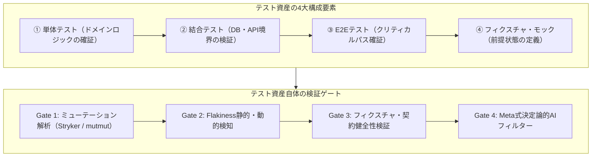
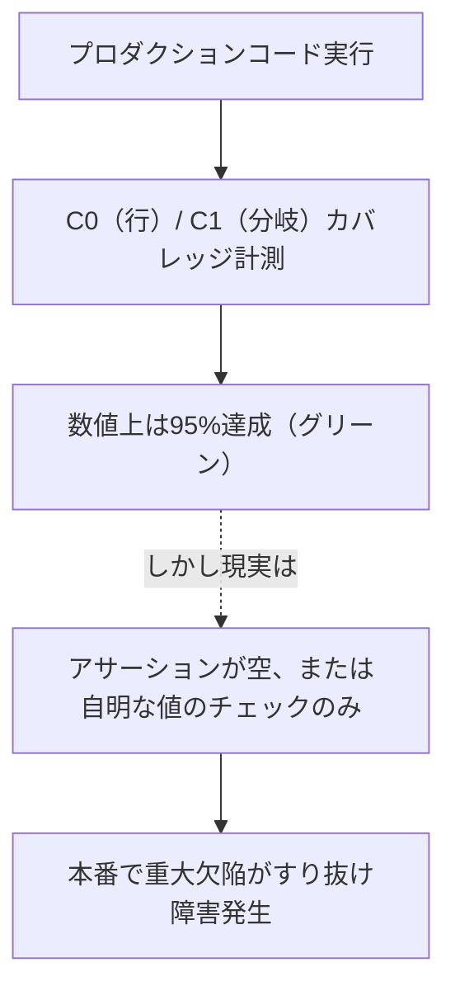
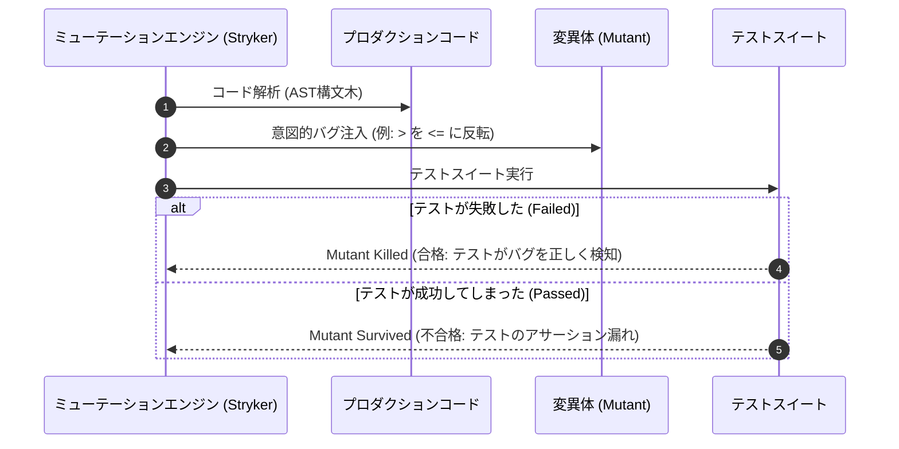
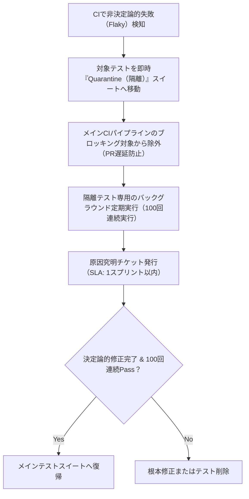
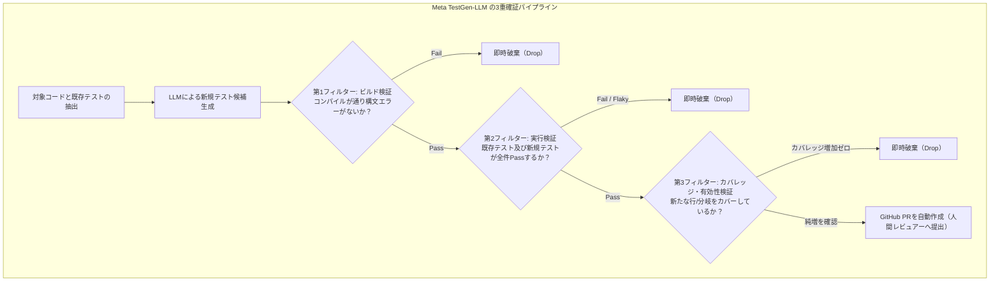

# 第9章：テスト資産自体の品質検証（Meta TestGen-LLMの実践）

多くの開発組織において、「テストコードが存在し、CIでグリーン（成功）になっていること」は無条件の安心材料として受け入れられている。しかし、ソフトウェア工学の現実はそれほど単純ではない。
「そのテストコード自体の品質は、いったい誰が保証しているのか？」
アサーション（検証文）のないテスト、特定条件下でしか通らないFlakyテスト、単にカバレッジの数値を稼ぐためだけに内部ロジックを無視して通過させた無効なテストスイート——これらは「テストが存在する」という偽りの安心感を与え、重大なバグの本番流出を招く最大の要因である。
本章では、コードカバレッジの虚構を解体する。変異体（Mutant）を注入してテストの真の検出力を測る「ミューテーションテスト（Mutation Testing）」の理論と実践を学ぶ。さらに、CIを麻痺させるFlakyテストの排除プロトコル、そしてMeta社が実稼働させている世界最先端のAI自動テスト生成基盤「TestGen-LLM」のアーキテクチャを詳解する。

---

## 9.1 テスト成果物の定義：単体・結合・E2Eテストコードとフィクスチャ

テストコードは、プロダクションコードの「オマケ」ではない。システムの要求仕様を機械的に実行可能な形で表現した、最重要の「仕様化資産（Executable Specifications）」である。



### 1. 単体テストコードの検証観点

ビジネスロジックの純粋な関数やドメインモデルを検証する。
単体テストの資産価値を測るためには、以下の品質要件を満たしているかを監査する。

- **決定論的実行（Determinism）**:
  外部I/O（ネットワーク、ファイルシステム、DB）を完全に遮断し、何度実行しても同一の結果が得られること。
- **高速性（Sub-millisecond Execution）**:
  1テストケースあたり数ミリ秒で完了し、数千件のスイート全体でも数秒以内で終了すること。開発者の思考ループ（Red-Green-Refactor）を阻害しないことが維持される。
- **アサーションの明確性と単一関心事**:
  1つのテストケースで検証する観点を明確にし、失敗時に「何が期待と異なっていたのか」がエラーメッセージから即座に判読できること。
- **テスト名の仕様表現力（BDD形式）**:
  `test1` や `test_calc` のような無意味な名前を排除し、「Given_注文金額が1万円以上_When_クーポン適用時_Then_10パーセント割引される」のように仕様文として読める命名規則を強制する。

### 2. 結合・コンポーネントテストコードの検証観点

リポジトリ層と実データベース（Testcontainers等）、または外部APIクライアントとモックサーバーの境界を検証する。

- **境界条件と接続リーク**:
  DBコネクションの解放漏れや、トランザクションのロールバックが確実に実行されているかを検証する。
- **スキーマ整合性の担保**:
  マイグレーションスクリプトが適用された本物のDBコンテナに対してテストを実行し、O/Rマッパーの定義齟齬を早期検知する。
- **非同期イベント配送の確証**:
  KafkaやRabbitMQなどのメッセージブローカーをコンテナで起動し、メッセージのシリアライズ・デシリアライズおよびデッドレターキュー（DLQ）の挙動を検証する。

### 3. E2Eテストコードの検証観点

PlaywrightやCypressを用いてユーザーのブラウザ操作を忠実に再現する。

- **堅牢なセレクタ戦略**:
  CSSクラス名やDOM構造の変更ですぐに壊れるXPathを排除し、ユーザーに見えるテキストやアクセシビリティ属性（`getByRole`、`getByLabel`）に基づくセレクタを義務付ける。
- **クリティカルジャーニーの絞り込み**:
  E2Eテストは実行コストが高いため、決済や会員登録など、事業に致命的打撃を与えるコア導線に集中して配置する。
- **視覚的回帰テスト（Visual Regression Testing）**:
  デザインシステムの崩れやCSSの意図せぬ影響を検知するため、ピクセル差分比較（PercyやPlaywright screenshot）を主要ブレークポイントで実施する。

### 4. テストデータ・フィクスチャの検証観点

モックが本物の振る舞いから乖離する「モックの嘘（Mock Drift）」を防ぎ、テストデータのセットアップが各テストケース間で完全に独立しているかを検証する。

- **Object Mother / Test Data Builderパターンの適用**:
  テストデータの生成ロジックを一元管理し、仕様変更時の修正箇所を局所化する。
- **状態の独立性**:
  各テストケースが実行前にクリーンな前提状態を構築し、テストの実行順序に依存しない設計を徹底する。
- **契約テスト（Contract Testing）との連携**:
  外部マイクロサービスとの境界ではPact等の契約テストを導入し、モックがプロバイダの最新API仕様と同期していることをCIで自動検証する。

---

## 9.2 コードカバレッジの虚構：C0/C1が高くてもバグがすり抜ける理由

開発現場で最も広く使われている品質メトリクスが「コードカバレッジ（網羅率）」である。しかし、高カバレッジ（例: 行カバレッジ90%）は、「コードの90%が実行されたこと」を示すだけであり、「コードの90%が正しく検証されたこと」を意味しない。



### 1. 虚構の典型例：アサーションのないテスト（Smoke Testの偽装）

以下のテストは、実行すれば対象関数を100%通過するため行カバレッジ100%を記録する。しかし、計算結果が正しいかどうかの検証（`assert`）が一切存在しないため、関数が常に誤った値を返していてもCIはグリーンになる。

```python
# 悪い例：カバレッジ100%だが何も検証していないテスト
def calculate_discount(price: int, user_type: str) -> int:
    return int(price * 0.8) if user_type == "VIP" else price


def test_calculate_discount():
    # 関数を呼ぶだけでアサーションがない
    calculate_discount(price=1000, user_type="VIP")
    # 例外が起きなければPassし、カバレッジ100%となる
```

### 2. 境界値と異常系ロジックの盲点

C0（行網羅）やC1（分岐網羅）では、「入力値がNULLの場合」「数値オーバーフローが起きた場合」「外部APIが500エラーを返した場合」といった状態空間の組み合わせ爆発を捕捉できない。カバレッジという数値目標を盲信することは、組織に極めて危険な集団的盲目をもたらする。

- **グッドハートの法則の罠**: 「測定値が目標になると、それはもはや良い測定値ではなくなる」。カバレッジを評価指標にしたチームは、検証の本質ではなく「いかに楽に行を通過させるか」に知恵を絞るようになる。
- **真の網羅性（Path/Condition Coverage）への昇華**: 重要なドメインモデルでは、MC/DC（Modified Condition/Decision Coverage: 改良条件/決定網羅）や変異解析を導入し、論理式の各条件が独立して結果に影響を与えているかを検証する。

---

## 9.3 ミューテーションテスト（Mutation Testing）：テストの真の有効性を測る

コードカバレッジの限界を根本から打破する手法が「ミューテーションテスト（Mutation Testing: 変異テスト）」である。
ミューテーションテストは、プロダクションコードの構文木（AST）を意図的に少しだけ書き換えた「変異体（Mutant: わざとバグを埋め込んだコード）」を数百〜数千パターン自動生成する。そして、既存のテストスイートを実行し、テストがその変異体を検知して失敗（Kill）できるかを検証する。



### 1. 変異体（Mutant）の生成パターン

ミューテーションエンジン（TypeScriptではStryker、Pythonではmutmut）は、以下のような人為的バグを自動注入する。

- **演算子の反転**: `if (a > b)` を `if (a <= b)` に置換。
- **境界値の変更**: `index + 1` を `index - 1` に置換。
- **ブール値の固定**: `return isValid;` を `return true;` に強制置換。
- **メソッド呼び出しの除去**: `saveToDatabase();` を削除（Void Call Removal）。

もし変異体を注入したにもかかわらずテストが成功（Pass）してしまった場合、その変異体は「生存（Survived）」と判定される。これは、その行のロジックが変更されてもテストが検知できない「無効なテスト」であることを客観的に証明する。

### 2. CI環境における実行負荷と「差分ミューテーションテスト」

ミューテーションテストの最大の課題は「実行時間の長さ」である。1,000個のMutantに対してテストスイート全体を1,000回実行すると、数時間のCI遅延が発生する。
実務で持続可能な運用を実現するためには、以下の高速化テクニックをCIに組み込む。

- **差分解析（Incremental / PR-based Mutation）**: PRで変更された行およびその影響範囲にのみMutantを生成して実行。
- **カバレッジ連動（Coverage Analysis: Per-Test）**: 対象コード行を通過しない無関係なテストケースの実行をスキップ。
- **タイムアウト早期遮断**: 無限ループ変異（`while(true)` 化など）を検知した場合、数秒で強制終了して「Timed Out（実質Kill）」と判定。

### 3. Strykerによるミューテーションスコア（Kill率）の測定

ミューテーションテストの品質指標は「ミューテーションスコア（Mutation Score）」である。

> **計算式**: `ミューテーションスコア (%) = (Killed Mutants [殺害された変異体数] ÷ Total Mutants [生成された全変異体数]) × 100`

高い信頼性が求められる開発現場では、コアなドメインロジックにおいて**ミューテーションスコア75%以上（決済・認証・金融・医療などTier 1領域では80%以上、第22章参照）**を出発点の目安とする。

```json
{
  "$schema": "./node_modules/@stryker-mutator/core/schema/stryker-schema.json",
  "packageManager": "npm",
  "reporters": ["html", "clear-text", "progress", "dashboard"],
  "testRunner": "jest",
  "coverageAnalysis": "perTest",
  "mutate": [
    "src/domain/**/*.ts",
    "!src/**/*.spec.ts"
  ],
  "thresholds": {
    "high": 80,
    "low": 65,
    "break": 70
  }
}
```

Pythonプロジェクト（pytest環境）で同様にミューテーションテストを実施する場合は、`mutmut`（安定版の `mutmut>=2.4,<3.0` 系）を用いて `pyproject.toml` に設定を記述する。なお `mutmut 3.x` 系では設定キーや実行体系が異なるため、CIで `--paths-to-mutate` による差分指定を行う場合は `2.x` 系にバージョン固定することを推奨する。

```toml
# pyproject.toml (Python mutmutの設定例)
[tool.mutmut]
paths_to_mutate = "src/domain/"
tests_dir = "tests/unit/"
runner = "python -m pytest -x --assert=plain"
```

```bash
# mutmutの実行と生存変異体（Survived Mutants）の確認コマンド
mutmut run --paths-to-mutate=src/domain/order_service.py
mutmut results  # 生き残った変異体IDの一覧を表示し、mutmut show <id> で差分を確認
```

さらに、CIパイプラインでPRごとに「変更されたPythonファイルのみ」を対象に差分ミューテーションテスト（Incremental Mutation Testing）を実行するGitHub Actionsワークフロースニペットは以下の通りである。これにより、10万行規模のリポジトリ（フルスキャンでは約2〜3時間・CIランナー費用にして1回あたり数ドルを要する規模）であっても、PRごとの実行時間をわずか1〜2分（コスト数セント未満）に抑え込むことができる。

```yaml
# .github/workflows/mutation-diff-gate.yml（PR変更ファイル限定の高速ミューテーションゲート）
- name: Run Incremental Mutation Testing on Changed Domain Files
  run: |
    CHANGED_PY=$(git diff --name-only origin/main...HEAD -- 'src/domain/**/*.py' | tr '\n' ',' | sed 's/,$//')
    if [ -n "$CHANGED_PY" ]; then
      echo "Mutating changed files: $CHANGED_PY"
      mutmut run --paths-to-mutate="$CHANGED_PY"
    else
      echo "No domain files changed. Skipping mutation test."
    fi
```

---

## 9.4 Flakyテスト（不安定なテスト）の静的検出と排除プロトコル

Flakyテストとは、「コードを一切変更していないにもかかわらず、ある時はPassし、ある時はFailする非決定論的（Non-deterministic）なテスト」を指する。
FlakyテストがCIに1つでも混入すると、開発者はCIがRedになっても「またいつものFlakyだろう」と無視して再実行（Re-run）を連打するようになる。これにより、本物のバグによるCI失敗が見逃され、品質ゲートは完全に崩壊する。

### 1. Flakyテストを生み出す3大要因

Flakyテストの根本原因は、テストが実行環境の暗黙的な前提条件に依存していることにある。

1. **非同期処理のタイミング依存（Race Conditions）**:
   `sleep(1000)` 等の固定時間スリープに依存した待機。CIランナーの負荷によって処理時間が1秒を超えた瞬間にFailする。常に条件成立を能動的にポーリング監視する動的待機（`waitFor` / `eventually`）へ書き換える必要がある。
2. **共有状態の汚染（Shared State & Order Dependency）**:
   テスト間でグローバル変数、シングルトンインスタンス、DBテーブルのデータを共有し、テストの実行順序によって合否が変わる現象である。テストランナーの実行順序をランダム化（Shuffle mode）することで潜在的な依存を炙り出する。
3. **外部リソース・環境依存（Time/Network/TimeZone）**:
   テスト実行時のシステム時刻（`Date.now()`）やタイムゾーン、外部インターネット接続に依存しているケースである。時刻モック（Timecop / Jest fakeTimers）とネットワーク仮想化（WireMock / MSW）の適用を義務付ける。

### 2. Flakyテストの静的検出手法

Flakyテストは動的実行だけでなく、静的コード解析によっても高精度に事前検知できる。

- **スリープ呼び出しの検知**: AST解析でテストコード内の `Thread.sleep()` や `time.sleep()`、`setTimeout()` を禁止ルールとしてSemgrepやESLintで検知。
- **ハードコードされたポート・ファイルパス**: ローカル固有のパス（`/tmp/...`）や固定ポート（`8080`）の使用を検知し、エフェメラルな動的バインドを強制。

### 3. Flakyテストの隔離プロトコル（Quarantine Policy）

Flakyテストが検知された場合、チームは以下の厳格な運用プロトコルを即座に適用する。



この隔離プロトコルを人手で行うと形骸化するため、実務ではGitHub Actions上で `pytest --reruns 2 --junitxml=report.xml` 等を実行して自動化する。具体的には、「初回Fail・リトライ時Pass」となったテストケースを検出した瞬間に、自動で `@pytest.mark.quarantine` 対象リストへ追加する。さらに、修正用GitHub Issueを自動起票するワークフロー（章末の演習課題4参照）としてパイプラインに直結させる。

---

## 9.5 AI確証実践：Meta「TestGen-LLM / Assured Offline LLMSE」の完全再現

2024年、Meta社の研究チーム（Alshahwan et al.）は国際会議FSE 2024にて画期的な論文（*Automated Unit Test Improvement using Large Language Models at Meta*）を発表した。さらに2025年には、変異テスト（Mutation Testing）とLLMを融合させた後続システム「ACH」（*Mutation-Guided LLM-based Test Generation at Meta*）へと発展させている。
Metaが開発した「TestGen-LLM」は、人間がレビューする前に**3重の厳格な検証フィルター（Assured LLM-based Software Engineering）**を適用する。これにより、ノイズや幻覚を完全に排除した高品質なPRのみを自動生成する。



### 1. Meta式3重フィルターの神髄

Metaが採用した3重フィルターは、以下の段階的ゲートウェイで構成される。

- **第1フィルター（Build Filter）**:
  生成されたテストがコンパイル可能か、未定義シンボルや構文エラーがないかを検証。Metaの報告では約25%がここで脱落する。
- **第2フィルター（Execution & Regression Filter）**:
  テストを実行し、テストがPassするかを検証。もしFailした場合は「AIが誤った仕様解釈をした（幻覚）」か「既存の振る舞いを壊した」とみなし、即座に破棄する。
- **第3フィルター（Coverage Enhancement Filter）**:
  テストがPassしても、既存テストがカバーしていない新しい行や分岐を1行も追加カバーしていなければ破棄します（無意味なテストの排除）。

### 2. 実践：PythonによるMeta式TestGen-LLMパイプラインの実装

以下は、このMeta方式をオープンソース環境（pytest / coverage.py）上で完全再現した自律型テスト生成・確証スクリプトである。

```python
# tools/assured_testgen.py
import subprocess
import json
import sys

def run_cmd(cmd):
    p = subprocess.run(cmd, shell=True, capture_output=True, text=True, check=False)
    return p.returncode, p.stdout, p.stderr

def get_baseline_coverage():
    run_cmd("pytest --cov=src --cov-report=json:coverage_base.json")
    with open("coverage_base.json") as f:
        data = json.load(f)
    return data["totals"]["percent_covered"]

def run_meta_three_filters(candidate_test_file: str, base_coverage: float) -> bool:
    print(f"\n[Meta TestGen Pipeline] テスト候補の検証開始: {candidate_test_file}")

    # 第1フィルター: ビルド/構文検証
    code, _out, err = run_cmd(f"python -m py_compile {candidate_test_file}")
    if code != 0:
        print(f"❌ Filter 1 (Build) Failed: 構文エラーまたはコンパイル失敗: {err.strip()}")
        return False
    print("✅ Filter 1 (Build) Passed.")

    # 第2フィルター: 実行・リグレッション検証
    code, out, err = run_cmd(f"pytest {candidate_test_file}")
    if code != 0:
        print(f"❌ Filter 2 (Execution) Failed: テスト実行が失敗しました:\n{out}{err}")
        return False
    print("✅ Filter 2 (Execution) Passed: 全テストがグリーン。")

    # 第3フィルター: カバレッジ純増検証
    run_cmd("pytest --cov=src --cov-report=json:coverage_new.json")
    with open("coverage_new.json") as f:
        new_data = json.load(f)
    new_coverage = new_data["totals"]["percent_covered"]

    if new_coverage <= base_coverage:
        print(f"❌ Filter 3 (Coverage) Failed: カバレッジ純増なし ({base_coverage}% -> {new_coverage}%)。")
        return False

    print(f"🎉 Filter 3 (Coverage) Passed! カバレッジが向上しました: {base_coverage:.2f}% -> {new_coverage:.2f}%")
    return True

if __name__ == "__main__":
    if len(sys.argv) < 2:
        print("テストファイル候補を指定してください。")
        sys.exit(1)

    candidate = sys.argv[1]
    base_cov = get_baseline_coverage()
    success = run_meta_three_filters(candidate, base_cov)

    if not success:
        print("\n判定: 破棄（PRを作成しません）。")
        sys.exit(1)
    print("\n判定: 合格（人間へのPR作成を承認します）。")
    sys.exit(0)
```

※実運用における堅牢性への補足：上記のサンプルスクリプトでは理解しやすさのため例外処理を簡略化していますが、本番CIで稼働させる際は以下の2点を組み込むとより堅牢になる。第1に、LLMが生成した無限ループコードによるハングアップを防ぐため、`subprocess.run(..., timeout=30)` でタイムアウト遮断を設ける。第2に、テストランナーの異常終了（Exit Code 2以上）により `coverage_new.json` が生成されないケースへの対策である。`FileNotFoundError` や `JSONDecodeError` を `try...except` で捕捉し、安全に候補破棄（False返却）へ倒する。

### 3. 人間レビュアーとAI生成テストの協調ワークフロー

Metaの現場知見において最も示唆に富んでいるのは、「AIが生成したPRに対する人間の受容率」である。
Metaの研究では、TestGen-LLMが提出したPRのうち、実に**73%が人間のエンジニアによって修正なしで承認・マージ**された。この高い採択率を実現した鍵は以下の3点である。

- **差分の小ささ（Focused Small Diffs）**: 1つのPRで何十個ものテストを一気に追加するのではなく、特定の未カバー行を狙い撃ちした「1〜2個の簡潔なテストケース」のみをPR化する。
- **PR説明文へのエビデンス明記**: 「このテストによって、`src/order.py` の行45-52の例外処理分岐が新たにカバーされました」という具体的理由をPR本文に自動記載する。
- **既存スタイルへの同調**: リポジトリ内の既存テストコードをfew-shot例としてプロンプトに注入し、プロジェクト固有の命名規則やアサーションライブラリを完全踏襲する。

---

## 9.6 失敗事例から学ぶアンチパターンと処方箋

| よくある失敗・形骸化パターン | なぜ起きるのか（根本原因） | 現場で起きる悲劇 | 本書が提示する処方箋 |
| :--- | :--- | :--- | :--- |
| **アンチパターン①：カバレッジ至上主義** | 経営層や管理者が「カバレッジ80%必達」という数値ノルマだけを押し付ける。 | アサーションのない無意味なテストが大量生産され、カバレッジ90%なのにバグ頻発。 | **ミューテーションテストの導入**（数値目標をカバレッジからKill率・ミューテーションスコアへ移行。） |
| **アンチパターン②：Flakyテストの放置とリラン連打** | タイミング依存のテストを直す工数が取れず、「失敗したらもう1回実行」で誤魔化す。 | CIの信頼が失墜し、本物の重大バグによるCI失敗を見落として本番大障害へ。 | **隔離プロトコルの強制適用**（Flaky判定されたテストは即座に隔離スイートへ移動し隔離。） |
| **アンチパターン③：AI生成テストのノーチェックマージ** | AIが生成したテストコードを見かけが整っているからと無条件にPRマージする。 | 既存の誤った挙動（バグ）を「仕様」として固定化するテストが混入し、負債化。 | **Meta式3重フィルターの自動実行**（ビルド・実行・カバレッジ純増の全自動確証。） |
| **アンチパターン④：モック過剰による結合崩壊** | 単体テストの速度を追求するあまり、すべての依存オブジェクトをモック化する。 | 単体テストは全件グリーンなのに、本番デプロイ時にSQL構文エラーや型不一致でクラッシュ。 | **Testcontainersによる実境界検証**（モックの多用を戒め、実コンテナを用いた結合テストを配置。） |
| **アンチパターン⑤：テストの巨大神クラス（God Test Class）** | 1つのテストクラスに数千行のテストが記述され、ヘルパーメソッドが複雑に絡み合う。 | 仕様変更時にテスト修正だけで数日を要し、開発者がテストを書くことを忌避する。 | **テストコードのリファクタリング基準**（テストコードにもLinterと認知的複雑度制限を適用。） |

---

## 9.7 本章のまとめとQA合否判定基準

テストコードは、ソフトウェアが仕様どおりに動作することを証明する「第一級の成果物」である。テスト自体の品質を検証しない品質保証は、砂上の楼閣にすぎない。
カバレッジの数値目標に惑わされず、ミューテーションテストによる変異体Kill率の測定、Flakyテストの徹底隔離、そしてMeta TestGen-LLMに学ぶ「機械的3重確証フィルター」を導入することで、チームのテスト資産を「本物の信頼の砦」へと進化させてほしい。

### テスト資産成果物・QA合否判定チェックリスト（Gate Criteria）

| 検証カテゴリ | 検査項目 | 合格基準（Pass） | 不合格基準（Fail / ブロック） |
| :--- | :--- | :--- | :--- |
| **テスト有効性** | ミューテーションスコア（Kill率） | コアドメインで75%以上（Tier 1領域は80%以上） | コアドメインで75%未満、Tier 1領域で80%未満 |
| **テスト安定性** | Flakiness発生率 | CI連続実行（10回）で合否反転ゼロ | 1回でも非決定論的失敗が観測されたテスト |
| **テスト構造** | アサーション密度 | すべてのテストケースに具体的な検証文が存在 | assertが存在しない、または例外非発生のみの確認 |
| **保守性** | 実行時間（テストスイート速度） | 単体テスト全件実行が3分以内 | 10分以上を要する肥大化したテストスイート |
| **AI生成テスト** | Meta式3重フィルター通過 | ビルド・Pass・カバレッジ純増をすべて達成 | フィルターのいずれか1つでも脱落したコード |

---

## 9.8 章末演習課題

読者が自身のプロジェクトで「テスト資産の品質」を定量的に測定・改善するための実践的ワークショップ課題である。独習やチーム導入の「最初の1歩」としては、まず手元のリポジトリに `src/domain/` と `tests/unit/`、および `tools/assured_testgen.py` を配置する。その上で、**課題1（ミューテーションテストの体験）と課題5（アサーション欠落リント）の2つからスタート**するのが最も効果的である。

- **課題1（Strykerまたはmutmutによるミューテーションテスト実践）**:
  あなたのプロジェクトのコアビジネスロジックに対してミューテーションテストツールを実行し、ミューテーションスコアを算出する。生き残った変異体（Survived Mutants）を特定し、不足していた境界値アサーションを追加してスコアを10%以上改善する。
- **課題2（Flakyテスト検出のストレステスト実行）**:
  最も不安定と思われるテストケースを抽出し、テストランナーのシャッフル実行モードまたはループ実行オプションを用いて100回連続実行する。失敗が発生した場合は、非同期待機や共有状態のモック化を行って決定論的テストへ改修する。
- **課題3（Meta式TestGen-LLMスクリプトのローカル運用）**:
  本章で提示した `assured_testgen.py` を自身のプロジェクト構成に合わせて調整し、LLMに単体テストを生成させ、3重フィルターを通過したテストのみが残るプロセスを検証する。
- **課題4（Flakyテスト自動隔離ワークフローの構築）**:
  GitHub Actionsにおいて、失敗したテストを自動的に特定して別個のIssueを自動作成し、一時的に除外リスト（Skip list）に登録して隔離するスクリプトを構築する。
- **課題5（アサーション密度リントのCI導入）**:
  テストコード内において `assert` や `expect` を含まない「偽装テスト」を検知してPRをブロックするカスタムルール（ESLintの`jest/expect-expect`等）をCIパイプラインに設定する。
- **課題6（契約テストPactのミニマム検証）**:
  マイクロサービス間のAPI通信を模したコンシューマテストとプロバイダ検証をPactフレームワークで記述し、APIレスポンスの型変更が検知されて双方向のPRが正しく失敗することを確認する。
- **課題7（ビジュアルリグレッションテストの自動化）**:
  Playwrightのスクリーンショット比較機能を用いて、主要コンポーネントのUIビジュアル回帰テストを構築し、1ピクセルの色ズレやレイアウト崩れを自動検知する仕組みを検証する。

---

## 9.9 第II部の総括と第III部への接続

第3章から本章（第9章）にわたる「第II部：プロダクト成果物の検証・レビュー・監査」では、ビジネス要求、UI/UXデザイン、機能仕様、アーキテクチャ・API、ソースコード、インフラ・CI/CD、そしてテスト資産という7大プロダクト成果物すべてに対する静的検証・人間レビュー・AI確証の技術を体系化した。

しかし、どれほど個々のプロダクト成果物に検査ゲートを設けても、それを作り出す「チームの働き方・開発プロセス」自体が曖昧で形骸化していれば、品質は再び崩壊する。続く「第III部：開発プロセス成果物のバリエーションと品質保証」では、アジャイルの3本柱・スクラムイベント（第10章）、DoDや開発規約（第11章）、プロセス静的検証（第12章）、そしてDORA指標によるプロセス動的検証（第13章）へと歩を進める。
