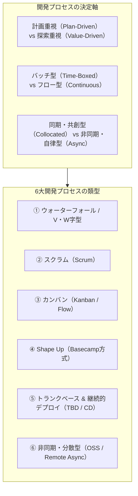
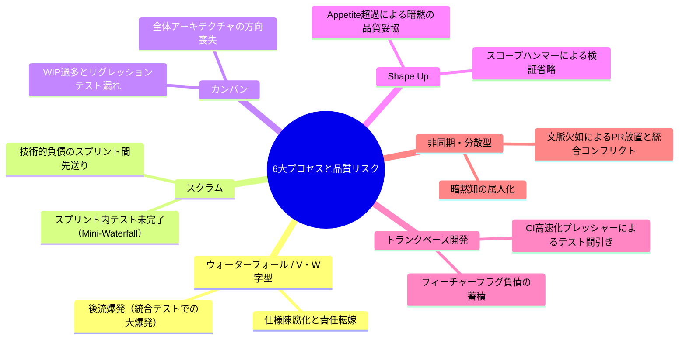
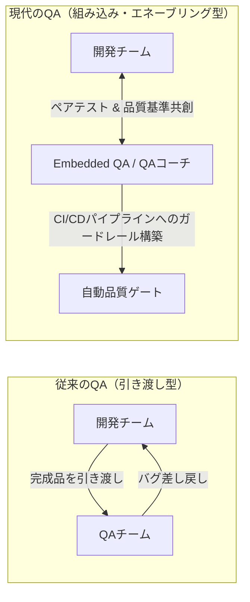

# 第10章：開発プロセスの類型学（Typology）と固有の品質リスク

ソフトウェアエンジニアリングの現場において、最も不毛かつ危険な誤解の1つが「アジャイルを導入すれば品質が上がる」、あるいは逆に「ウォーターフォールで厳格に管理すれば完璧な品質が手に入る」というプロセス単一至上主義です。
どのような開発モデルであっても、銀の弾丸（Silver Bullet）は存在しません。ウォーターフォール、スクラム、カンバン、Shape Up、トランクベース開発、非同期オープンソース型開発——チームが採用する開発プロセスの「構造とリズム」によって、品質上の急所（ボトルネック）と潜む欠陥リスクは180度異なります。
プロセスの特性を無視した画一的なQA（品質保証）アプローチは、あるチームでは開発速度を窒息させ、別のチームではテストの形骸化と品質崩壊を招きます。
本章では、現代のソフトウェア産業で採用されている代表的「6大開発プロセス」を類型化し、それぞれのプロセス構造が生み出す固有の品質リスクを解剖します。さらに、各プロセスに適合したQA関与モデルのマトリクスと、チームの活動ログからプロセスの機能不全を自動診断するAIアーキテクチャを提示します。

---

## 10.1 開発プロセスの類型化：なぜ「一律のアジャイル」では品質が崩壊するのか

開発プロセスとは、ビジネス要求を動くソフトウェアへと変換するための「合意されたコミュニケーションとデリバリーのプロトコル」です。このプロトコルは、プロジェクトが置かれた「不確実性（Uncertainty）」と「変更容易性（Changeability）」のバランスによって最適解が決まります。



### 「一律アジャイル」が引き起こす悲劇

多くの組織が「世の中で流行しているから」という理由だけで、ミッションクリティカルな基幹刷新や、不確実性の極めて高い新規事業にスクラムを一律導入し、手痛い失敗を経験しています。

- **基幹システム刷新での失敗**:
  外部インターフェース仕様が固定されている大規模刷新で無理にスクラムを回し、2週間のスプリントごとに設計変更を繰り返した結果、全体のアーキテクチャ整合性が破綻します。
- **スタートアップでの失敗**:
  顧客要求の検証が最優先のフェーズで、スプリントプランニングやレトロスペクティブのセレモニー（儀式）に忙殺され、出荷速度が低下します。
- **規制産業（医療・金融・車載）での失敗**:
  法規制や認証（FDA、ISO 26262）で厳格な文書証跡が要求される現場において、文書化を軽視したアジャイルを強行し、監査で不適合となってプロジェクト凍結に追い込まれます。

### プロセス選定の決定要因マトリクス（ステイシー・マトリクスとの連動）

チームが採用すべき開発プロセスは、要求の明確度と技術の不確実性の度合いによって論理的に決定されるべきです。

- **シンプル領域（要求明瞭・技術既知）**: ウォーターフォールや定常フロー（カンバン）が最も効率的。
- **繁雑領域（専門的分析が必要）**: V字・W字モデルによる入念な事前検証とアーキテクチャ監査が必須。
- **複雑領域（要求不明瞭・技術新規）**: スクラムやShape Upによる反復的仮説検証が唯一の解。
- **カオス領域（緊急事態・障害復旧）**: トランクベースと即時ホットフィックスパイプラインが求められる。

品質保証の役割は、「特定のプロセスを布教すること」ではありません。「チームが選択したプロセスモデルに内在する固有の品質リスクを特定し、それを相殺するガードレールを敷くこと」です。

---

## 10.2 6大開発プロセスの特徴と品質リスクの解剖

各プロセスモデルの構造的特徴、デリバリーのリズム、そしてそこに潜む致命的な品質リスクを詳解します。



### 1. ウォーターフォール / V・W字型開発

要求定義、基本設計、詳細設計、実装、単体テスト、結合テスト、総合テストを直線的・直列的に進めるモデルです。

- **固有の品質リスク：後流爆発（Big Bang Integration）**:
  プロジェクト開始から数ヶ月〜数年後に初めて全モジュールが結合されるため、設計の誤解やインターフェース不一致が結合テスト工程で一気に爆発します。修正コストが初期フェーズの100倍以上に跳ね上がります。
- **仕様陳腐化と形骸化**:
  初期に作成した要件定義書が神聖化され、現実に合わなくなっても「仕様書通りに作ることが品質」と錯覚され、誰も使わない高品質なゴミが完成します。
- **処方箋（W字型アプローチの徹底）**:
  要件定義フェーズと同時に「総合テストシナリオ」、基本設計フェーズと同時に「結合テスト仕様」を策定する「W字モデル（V-Model with Early Testing）」を義務付け、設計ドキュメントの欠陥を前工程で叩き潰します。

### 2. スクラム（Scrum）

1〜4週間の固定タイムボックス（スプリント）ごとに、動くインクリメントを出荷するバッチ型アジャイル開発です。

- **固有の品質リスク：スプリント内ミニ・ウォーターフォール**:
  2週間のスプリントの中で、「最初の8日は開発、最後の2日でテスト」という分担を行い、テスト期間が圧迫されて未検証のままスプリントレビューに出す事態が常態化します。スプリント終了日に開発者が「あとはテストよろしく」とQAに丸投げする構図が再現されます。
- **技術的負債の先送り（Debt Snowball）**:
  「スプリントバックログのベロシティ（消化ストーリーポイント）」がチーム評価の指標になると、テスト自動化やリファクタリングなどの品質投資が後回しにされ、負債が雪だるま式に膨張します。ベロシティは維持されているのに、機能追加のたびにリグレッション不具合が増加する悪循環に陥ります。
- **処方箋（垂直スライスとIn-Sprint QA）**:
  ユーザーストーリーをフロントエンドからDBまで貫通する極小の垂直スライス（Vertical Slice）に細分化し、開発開始と同時にテスト自動化を着手させる「In-Sprint Test Automation」を徹底します。スプリント開始時にQAと開発者がペアを組み、受入テスト（Given-When-Then）を合意してから実装に入ります。
- **ミニ・ウォーターフォールから抜け出せない現場の「最初の一歩（移行パス）」**:
  ステークホルダーからの強いプレッシャーやレガシーな組織構造により、どうしても全ストーリーの垂直スライス化が難しい場合は、**「スプリント内のたった1つのストーリーだけを『先行スライス（パイロット枠）』に指定し、スプリント3日目までに実装からQAテスト完了までを通し切る」** ことから始めてください。プロセス全体を一度に変えようとせず、「水曜日に1件テストが完了した」という小さな成功体験を作ることが、最終日の大渋滞を解消する最も現実的な突破口になります。
- **組織・政治的制約でプロセス変更が一切許可されない場合の「次善の策（Workaround）」**:
  大企業の稟議規定や受託契約の制約により、公式な開発プロセス（ウォーターフォールの工程ゲートや外注QAへの引き渡し時期）を1ミリも変更できない現場であっても、開発チーム内部で自衛する次善の策は存在します。それは**「公式の結合テスト工程の前段に、開発チーム内部だけの『シャドー受入ゲート（Feature Flag裏での日次自動E2E＆内部ドッグフーディング）』を密かに構築すること」**です。対外的には従来の分厚い試験成績書やマイルストーンを維持しつつ、実質的なバグ摘出はコミット単位の自動テストと日次ビルドで事前に9割完了させておくことで、公式テストフェーズでの手戻り爆発を無力化できます。

### 3. カンバン / 継続的フロー（Kanban）

タイムボックスを持たず、WIP（仕掛品: Work in Progress）の制限によって作業のフロー効率を最大化するモデルです。

- **固有の品質リスク：リグレッションテストの漏れ**:
  タスクが個別に次々と完了してリリースされるため、「システム全体の総合的な退行テスト」を実行するタイミングを見失い、個々の変更の相互作用による不具合が本番流出します。チケット単位の局所的検証に終始しがちです。
- **WIPリミットの形骸化**:
  ボトルネックが発生した際にWIP制限を解除してタスクを詰め込み、全タスクのリードタイムが無限に悪化します。マルチタスクによる認知的過負荷で、コードレビューの質が極端に低下します。
- **処方箋（継続的リグレッションとAndonコード）**:
  各PRのマージごとに自動で実行される軽量リグレッションテストスイートを確立し、テスト失敗時には新しいチケットの着手を全員で停止して修正にあたる「アンドン（Andon）」文化を徹底します。また、カンバンボード上で「QA検証待ち」のカラムにも厳格なWIPリミットを設けます。

### 4. Shape Up（Basecamp方式）

6週間の固定サイクル（Cycle）と2週間の冷却期間（Cooldown）を組み合わせ、確定した予算（Appetite）の中で開発チームがスコープを自律調整するモデルです。

- **固有の品質リスク：Appetite超過による暗黙の品質妥協**:
  6週間の期限が絶対であるため、時間切れが近づいた際に「スコープを削る（Scope Hammering）」名目で、テストケースやエラーハンドリング、非機能要件（セキュリティや負荷対策）が闇討ちのように削られるリスクがあります。
- **処方箋（Shaping時の非機能境界確定とQAサインオフ）**:
  プロジェクト着手前のShaping（構想化）段階で、削ってはならない「品質の非交渉境界（Non-negotiable Boundaries）」をピッチ文書に明記し、QAアーキテクトの承認を必須とします。サイクル第5週には統合ストレステストの期間を固定枠として確保します。

### 5. トランクベース開発 / 継続的デプロイ（TBD / CD）

開発者全員が `main` ブランチに毎日コミットをマージし、フィーチャーフラグ（Feature Flags）を用いて本番環境へ即時デプロイする極限の高速モデルです。

- **固有の品質リスク：フィーチャーフラグの負債化（Flag Debt）**:
  コードベース内に数百個の古いトグル条件分岐が放置され、フラグの組み合わせ爆発（組み合わせテスト不能状態）を引き起こします。Knight Capitalの4億ドル消失事件のように、古い死にフラグが誤って再活性化し、本番を破壊する惨事を招きます。
- **CI高速化プレッシャーによるテスト間引き**:
  デプロイ頻度を保つためにCIの実行時間短縮が叫ばれ、重いE2Eテストやセキュリティスキャンが除外される誘惑に駆られます。
- **処方箋（フラグのライフサイクル自動化とテスト階層化）**:
  フラグの有効期限（TTL）をコード内で宣言し、期限超過フラグをCIで自動エラーにします。また、CIを「即時コミット時（5分以内）」と「夜間フルスイート」に明確に分離し、カナリアリリースとリアルタイムエラー監視を結合します。

### 6. 非同期・分散型 / オープンソース型開発

世界中に分散したメンバーが、プルリクエストとIssue、議論スレッドを介して完全非同期で進める開発モデルです。

- **固有の品質リスク：コンテキスト欠如とPR放置**:
  背景や前提知識がドキュメント化されていないPRは放置（Reviewer Stall）され、長期間放置されたブランチが大量のコンフリクトを起こしてマージ不能になります。また、口頭でのすり合わせができないため、アーキテクチャ方針の食い違いが長期化します。
- **処方箋（Docs as Codeと自動化ボットによる文脈確証）**:
  PRテンプレートに入力不足がある場合はボットが自動で追記を要求し、DangerやReviewdogによって機械的チェックを非同期で完結させます。RFC（Request for Comments）プロセスを導入し、実装着手前に非同期で合意形成を行います。

---

## 10.3 プロセス類型ごとのQA関与モデルマトリクス

プロセスのリズムが異なれば、QAエンジニアや品質管理担当者が関与すべきタイミングと介入手段も完全に変化します。
従来のように「開発がすべて終わった後にQAチームへ引き渡す（投げっぱなし）」モデルは、ウォーターフォール以外のすべての現代的プロセスで破綻します。



### プロセス類型別・詳細QA活動マトリクス

| 開発プロセス類型 | デリバリーのリズム | 主な成果物の形態 | QAの主たる関与タイミング | 推奨される品質ゲートウェイ |
| :--- | :--- | :--- | :--- | :--- |
| **ウォーターフォール** | 数ヶ月〜年のマイルストーン | 要件定義書、詳細設計書、試験成績書 | 各フェーズ境界のゲート審査（Shift-Left検証） | 静的仕様監査、トレーサビリティマトリクス |
| **スクラム** | 1〜2週間のスプリント | ユーザーストーリー、スプリントインクリメント | プランニング時（DoD策定）＆開発と並行検証 | スプリント完了基準（DoD）、自動受入テスト |
| **カンバン** | 継続的・チケット単位 | 個別タスク、プルリクエスト | タスクのステータス遷移時（In Review / Testing） | WIPリミット厳守、差分ミューテーションテスト |
| **Shape Up** | 6週間のサイクル | ピッチ（Pitch）、完成スコープ | Shaping段階（賭けの前）＆第5週の統合テスト | Appetite対比の非機能要件監査、スコープ境界検証 |
| **トランクベース** | 1日に複数回のデプロイ | 極小PR、フィーチャーフラグ | コミット時＆カナリアリリース時 | 自動CIパイプライン全パス、フラグ寿命監視 |
| **非同期・分散型** | PRごとの自律的マージ | RFC、Pull Request、CIステータス | PR提出時の非同期レビュー＆CI自動フィードバック | Reviewdog自動アノテーション、CIマージブロック |

### 組み込み型QA（Embedded QA）とエネーブリングチームの二重構造

アジャイルや継続的デリバリーにおいて、QA担当者が各チームに1人ずつ配置される「Embedded QA」モデルが普及しています。しかし、単に配置しただけでは「チーム専属のテスター（手動テスト代行者）」に堕ちてしまいます。
持続可能な品質文化を築くためには、以下の二重構造（Two-tier Enabling Architecture）を設計します。

1. **プロダクトチーム組み込み（Embedded QA）**:
   開発チームの一員として、スプリントプランニングでのストーリー細分化、受入基準（Acceptance Criteria）の策定、ペアプロ・ペアテストを支援し、品質を「後から検査するもの」から「最初から作り込むもの」へと転換します。
2. **横断品質イネーブルメント（Enabling QA Team）**:
   全社共通のCI/CD品質パイプライン、ミューテーションテスト基盤、Flakyテスト隔離基盤、そしてAI監査ツールの開発と標準化を担い、開発者自身が自律的に高品質なテストを書ける環境を整備（Enable）します。

---

## 10.4 AI確証実践：開発ログからチームのプロセス病理を診断するAIプロンプト

開発組織は往々にして、「自分たちはアジャイルスクラムを実践している」と自称しながら、実際には「スプリントの最後2日に全テストを詰め込むミニ・ウォーターフォール」や「WIPが20件以上放置された破綻カンバン」に陥っています。
チームのGitリポジトリコミット履歴、PR作成からマージまでのリードタイム、チケットステータス推移をAIに入力し、潜んでいるプロセスの病理（アンチパターン）と品質リスクを科学的に診断・可視化するAIプロンプトを構築します。

```json
{
  "system_instruction": "あなたは世界トップクラスのソフトウェア工学アジャイル/品質プロセス監査アナリストです。チームの開発メタデータ（Gitログ、PR所要時間、チケット推移）を分析し、開発プロセスの類型適合度と隠れた品質崩壊リスクを診断してください。",
  "analysis_dimensions": [
    {
      "dimension": "sprint_health",
      "check": "スプリント終了直前の2日間にコミットやPR作成の80%が集中していないか（スプリント内ミニ・ウォーターフォールの検知）。"
    },
    {
      "dimension": "flow_efficiency",
      "check": "PRの平均オープン期間が3日を超えて滞留していないか、仕掛中（In Progress）チケット数が開発者数×1.5を超えていないか（カンバンWIP過多の検知）。"
    },
    {
      "dimension": "branch_longevity",
      "check": "トランクベース開発を標榜しながら、ブランチの生存期間が48時間を超えるロングランブランチが存在しないか。"
    }
  ],
  "output_format": {
    "diagnosed_process_pattern": "SCRUM_WITH_MINI_WATERFALL | STALLED_KANBAN | HEALTHY_TRUNK_BASED",
    "risk_score": 85,
    "pathologies_detected": [
      {
        "issue": "スプリント終了日におけるPR駆け込みマージ",
        "evidence": "金曜日の夕方にPRの70%が作成され、レビュー時間平均8分でLGTM承認されている。",
        "severity": "CRITICAL",
        "quality_impact": "レビュー形骸化による結合不具合の多発、週末の本番アラート急増。"
      }
    ],
    "corrective_actions": [
      "ストーリーの分割粒度を『0.5〜1日で完了する単位』に細分化せよ。",
      "スプリント最終日の新規マージを禁止し、バッファ日（安定化日）を設けるか、WIPリミットを厳格化せよ。"
    ]
  }
}
```

### 2. 実践：PythonによるGitリポジトリ健全性メトリクス収集スクリプト

チームのローカルGitリポジトリからコミット履歴とブランチ寿命を自動抽出し、プロセスの不健全度を判定するアナライザースクリプトです。なお本スクリプトは、`pip install pandas` 等の環境構築コストを完全に排除しています。どんなCIランナーや制限された社内端末でもコピペ1つで即座に動かせる実用性を最優先し、あえてPython標準ライブラリ（`subprocess`, `datetime`）のみで完結する設計としました。

```python
# tools/diagnose_process_health.py
import subprocess
import datetime

def get_git_commit_stats(days=30):
    since_date = (datetime.datetime.now() - datetime.timedelta(days=days)).strftime("%Y-%m-%d")
    cmd = f'git log --since="{since_date}" --pretty=format:"%h|%an|%ad|%s" --date=iso'
    result = subprocess.run(cmd, shell=True, capture_output=True, text=True, encoding="utf-8", check=False)

    lines = result.stdout.strip().split("\n")
    if not lines or lines == ['']:
        return []

    commits = []
    for line in lines:
        parts = line.split("|")
        if len(parts) >= 4:
            commits.append({
                "hash": parts[0],
                "author": parts[1],
                "date": parts[2],
                "subject": parts[3]
            })
    return commits

def analyze_friday_commit_bias(commits):
    friday_commits = 0
    weekend_commits = 0
    total = len(commits)
    if total == 0:
        return 0, 0

    for c in commits:
        try:
            dt = datetime.datetime.fromisoformat(c["date"].strip())
            if dt.weekday() == 4:  # 金曜日
                friday_commits += 1
            elif dt.weekday() in (5, 6):  # 土日
                weekend_commits += 1
        except ValueError:
            continue

    return (friday_commits / total) * 100, (weekend_commits / total) * 100


if __name__ == "__main__":
    commits = get_git_commit_stats(30)
    print(f"直近30日間の総コミット数: {len(commits)}")

    friday_pct, weekend_pct = analyze_friday_commit_bias(commits)
    print(f"金曜日のコミット集中率: {friday_pct:.1f}%")
    print(f"週末コミット率: {weekend_pct:.1f}%")

    if friday_pct > 40.0:
        print("⚠️ 警告: 金曜日に極端なコミット集中が検知されました（スプリント終了前の駆け込みリスク）。")
    if weekend_pct > 15.0:
        print("🛑 警告: 週末作業が常態化しています（デリバリースケジュールの破綻と品質低下リスク）。")
    if friday_pct <= 40.0 and weekend_pct <= 15.0:
        print("✅ プロセスの時間的分散は健全です。")
```

※実行環境（Windows/macOS/CI）に関する補足事項：

1. **CI環境でのShallow Clone（浅いクローン）対策**: GitHub Actions等のCI環境では、デフォルトで最新1コミットのみを取得する `fetch-depth: 1`（Shallow Clone）が有効になっています。そのまま実行すると直近30日分の `git log` が取得できず、総コミット数が1件になってしまうため注意が必要です。CI上で本スクリプトを実行する際は、必ず `actions/checkout@v4` のオプションに `fetch-depth: 0` を指定するか、実行前に `git fetch --unshallow` を呼び出してください。
2. **OS間のクォート・文字コード差異**: WindowsのPowerShellやコマンドプロンプト環境で日本語コミットメッセージを扱う場合、標準出力のエンコーディングが `cp932` となって文字化けや `UnicodeDecodeError` が起きることがあります。環境変数 `PYTHONUTF8=1` を設定するか、`git -c i18n.logOutputEncoding=utf-8 log ...` を指定することで、Windows・macOS・Linuxを問わず完全に同一の動作を保証できます。

---

## 10.5 失敗事例から学ぶアンチパターンと処方箋

| よくある失敗・形骸化パターン | なぜ起きるのか（根本原因） | 現場で起きる悲劇 | 本書が提示する処方箋 |
| :--- | :--- | :--- | :--- |
| **アンチパターン①：名ばかりスクラム（ゾンビスクラム）** | スプリントセレモニーだけを真似て、タスクの垂直分割（スライス）ができていない。 | スプリント最終日に巨大PRが一斉に提出され、レビュー不能となり翌スプリントへキャリーオーバー。 | **ストーリーの垂直スライス教育とWIP制限**（1スプリント内に全レイヤーのテスト完了をDoD化。） |
| **アンチパターン②：際限なきカンバンWIPの肥大化** | 優先順位の意思決定を恐れ、降ってきた要求をすべて「進行中」のボードに入れる。 | どのタスクも完了せず、リードタイムが3倍に悪化。コンテキストスイッチで品質低下。 | **WIPリミットの物理的強制**（ボード上の仕掛上限を超えた場合、新規タスク着手を禁止する。） |
| **アンチパターン③：フィーチャーフラグの無法地帯** | 本番反映の手軽さからフラグを作成し、リリース後のフラグ削除タスクを起票・実行しない。 | フラグのON/OFF組み合わせが複雑化し、特定条件下でのみ発生する原因不明の怪奇バグが発生。 | **フラグの賞味期限管理とCI警告**（作成から30日を経過した未削除フラグの検知と自動Issue起票。） |
| **アンチパターン④：Shape Upの闇討ちスコープカット** | 6週間のサイクル終了直前に焦り、品質担当者への相談なしに自動テストや負荷検証を削る。 | 機能は期限内に動いて見えるが、本番の高負荷でデータベースが即時デッドロックを起こす。 | **品質非交渉境界の事前合意**（Shaping段階でセキュリティ・テスト受入基準を不可侵に設定。） |
| **アンチパターン⑤：ウォーターフォールの仕様変更恐怖症** | 後戻り工数を恐れるあまり、仕様変更管理委員会（CCB）を厳格化し、現場の変更を一切拒否。 | ビジネス要求と完全に乖離した旧式システムが完成し、顧客満足度がゼロになる。 | **段階的リリースとフィードバックループ**（マイルストーンごとに検証可能な動く成果物を提示。） |

---

## 10.6 本章のまとめと商業出版水準のQA合否判定基準

開発プロセスは目的ではなく手段です。重要なのは、採用しているプロセスがどのような「品質上の弱点」を孕んでいるかをチーム全員が自覚し、その弱点を補う自動化ゲートと品質プラクティスを正しく配置することです。
アジャイルであれウォーターフォールであれ、「成果物に対する客観的な確証（Assurance）」をプロセスの節目に埋め込むことこそが、予測可能で持続可能な高品質デリバリーを実現する唯一の道です。

### 開発プロセス健全性・QA合否判定チェックリスト（Gate Criteria）

| 評価カテゴリ | 検査項目 | 合格基準（Pass） | 不合格基準（Fail / ブロック） |
| :--- | :--- | :--- | :--- |
| **スプリント品質** | スプリント内完了率（DoD達成） | スプリント内全タスクのテスト完了率90%以上 | 30%以上のタスクがテスト未完了で持ち越し |
| **フロー効率** | PR滞留リードタイム | PR作成からマージまで平均24時間以内 | 平均72時間以上の滞留が慢性化 |
| **仕掛品制御** | WIPリミット遵守度 | 開発者1人あたりの仕掛タスク1.5個以内 | 1人あたり3個以上のタスクが同時進行 |
| **ブランチ寿命** | ブランチ生存期間 | ブランチ作成からマージまで48時間以内 | 1週間以上マージされない隔離ブランチの存在 |
| **フラグ健全性** | フィーチャーフラグ滞留日数 | 全フラグがリリース後14日以内に削除 | 作成後60日を超えて放置されたフラグの存在 |

---

## 10.7 章末演習課題

読者が自チームの開発プロセス健全性を客観的に診断するための、3段階（Step 1〜3）の厳選ワークショップ課題です。まずはStep 1から着手してください。

- **Step 1：現状の可視化（Gitコミット集中度とプロセス病理の診断）**:
  本章で提示した `diagnose_process_health.py` を自身のプロジェクトで実行し、過去3ヶ月間のPRデータ（作成日時、マージ日時、変更行数）と照合してください。金曜日やスプリント最終日にPR提出が偏っていないか（ミニ・ウォーターフォール度合い）を数値化し、ふりかえりの場で共有してください。
  - *最初の5日間（Day 1〜5）の導入ステップ*: `[Day 1]` スクリプトを実行して金曜コミット率を算出する。`[Day 2]` 結果をふりかえりで共有する。`[Day 3]` カンバン上のWIP上限を「メンバー数」に設定する。`[Day 4]` ストーリーを「2日以内の粒度」へ分割する。`[Day 5]` 金曜夕方の駆け込みPR減少を確認する。
- **Step 2：フローの制御（WIPリミットとブランチ寿命ガードの導入）**:
  現在運用しているカンバンボードに「WIP制限（メンバー数と同数）」を設定し、作成から48時間を経過してもマージされていないオープンPRにアラートを出すGitHub Actionsを導入して1スプリント運用してください。リードタイムの短縮とレビュー品質の変化を比較検証してください。
- **Step 3：品質ゲートの定着（プロセス類型に合わせたDoD改定とフラグ棚卸し）**:
  自チームの採用プロセス（スクラム、トランクベース、Shape Up等）に合わせて、本章のQA合否判定チェックリストをベースにした「Definition of Done（完成の定義）」と「不要フィーチャーフラグの定期廃棄ルール」を策定し、チームメンバー全員で合意を形成してください。
