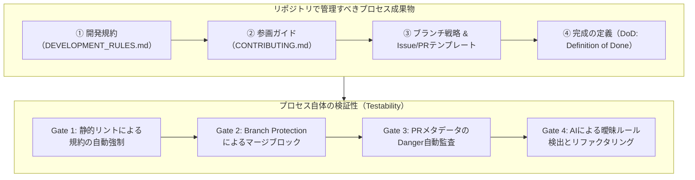
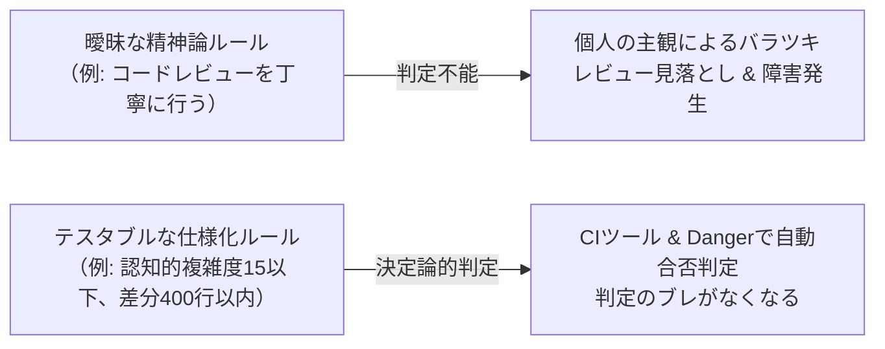
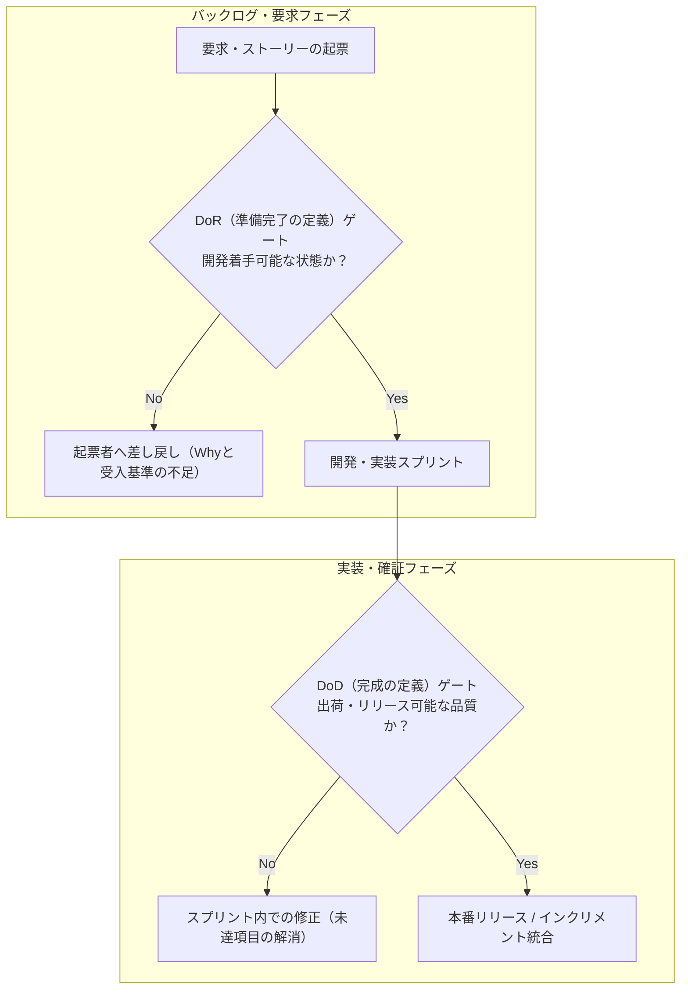

# 第11章：プロセス成果物の「仕様化」と「設計」

ソフトウェアエンジニアリングにおいて、「ソースコードやアーキテクチャは設計するが、開発プロセスは成り行き（空気）に任せる」という組織が後を絶たない。
「各自、注意深く作業すること」「PRレビューは丁寧に行うこと」「テストは十分に実施すること」——このような精神論のスローガンは、品質保証の世界では役に立たない。なぜなら、「注意深く」「十分に」という曖昧な形容詞には客観的な合否判定基準（Pass/Fail Criteria）が存在せず、機械的に検証することも、チーム間で一貫した水準を保つことも不可能だからである。
開発プロセスとは、自然発生する空気ではなく、チームが意図的に設計・合意し、Gitリポジトリ上でコードと同じ厳格さでバージョン管理すべき「第一級の成果物（First-Class Artifacts）」である。
本章では、開発規約やブランチ戦略、完成の定義（DoD）、準備完了の定義（DoR）を「仕様化（Formal Specification）」する手法を体系化する。さらに、曖昧な精神論をテスト可能な決定論的ルールへとリファクタリングする技法、および散らばった暗黙知からプロセス仕様書を自動合成するAI確証アーキテクチャを詳解する。

---

## 11.1 プロセス成果物の定義：規約・ブランチ戦略・コントリビューションガイド

ソフトウェア開発の品質を決定づける「プロセス成果物」は、リポジトリのルートや `.github/` ディレクトリに配備され、すべての開発者の行動を規定する「実行可能な契約書」である。



### 1. 開発規約（DEVELOPMENT_RULES.md）の役割

チームのアーキテクチャ原則、コーディング標準、テスト基準、例外処理のルールを定める。単なる読み物ではなく、Linterや静的解析ツール（SonarQube、Semgrep）のルールセットと1対1で対応している必要がある。

- **アーキテクチャ境界の遵守**:
  レイヤードアーキテクチャやクリーンアーキテクチャにおける依存方向の違反を禁止し、ArchUnitやPackwerk等のツールで機械検証する。ドメインロジックから外部インフラ層への直接参照を許容しない。
- **命名規約とディレクトリ構造**:
  ファイル名、クラス名、APIエンドポイントの命名規則を統一し、例外を許容しない。新規モジュール追加時の配置ミスを静的チェックで即時検出する。
- **エラーハンドリングとロギング標準**:
  例外のもみ消し（Empty catch block）を禁止し、構造化ログ（JSON形式）でのコンテキスト出力を義務付ける。障害発生時のトラブルシューティングに必要なトレースIDの伝播を強制する。
- **セキュリティ・ガードレール**:
  SQLクエリの文字列連結禁止、安全な暗号化アルゴリズムの利用、外部入力値のバリデーション方式を厳格に規定する。

### 2. コントリビューションガイド（CONTRIBUTING.md）の役割

新規参画者やオープンソースのコントリビューターが、迷うことなく開発環境を立ち上げ、ローカル検証をパスしてPRを提出するための手順書である。

- **One-Command Setup**:
  `make setup` や `docker compose up` の単一コマンドで完全な開発・テスト環境が再現できることを保証する。ローカル環境差異による「私のPCでは動く」問題を防ぐ。
- **コミットメッセージ規約（Conventional Commits）**:
  `feat:`, `fix:`, `docs:`, `refactor:` 等のプレフィックスを強制し、コミットログのリント（commitlint）を通過させる。リリースノート自動生成の入力データとしての整合性を担保する。
- **ローカルセルフチェック手順**:
  PR作成前に実行すべきテスト・リントコマンドの完全な一覧を提示する。pre-commitフックの設定方法や、テスト実行オプションを明記する。
- **IssueとPRのライフサイクル**:
  どのような議論を経てPRを作成すべきか、ドラフトPRの活用方針、レビュー依頼のメンション先選定ルールを規定する。

### 3. ブランチ戦略の選定と厳格な仕様化

チームのデプロイ頻度とリスク許容度に応じて、ブランチ戦略を明文化する。

| ブランチ戦略 | 特徴と適用領域 | 品質ゲートの配置場所 | メリットとトレードオフ |
| :--- | :--- | :--- | :--- |
| **トランクベース（TBD）** | 全員が `main` に直接または極小PRで日次統合。 | PRマージ前の超高速CIパイプライン。 | 統合コンフリクトの抑止。フラグ管理が必須。 |
| **GitHub Flow** | 機能ブランチから `main` へのPRのみのシンプル構成。 | PR作成時のCI＋ピアレビュー。 | 軽量で理解が容易。定期リリースの管理は工夫が必要。 |
| **GitFlow** | `develop`, `release`, `hotfix`, `master` の多層運用。 | 各ブランチ合流時のステージング統合試験。 | 厳格なバージョン管理が可能。ブランチ統合コストが極大。 |

### 4. ブランチ保護ルール（Branch Protection Rules）によるプロセスの物理的強制

どれほど美しくブランチ戦略を文書化しても、人間の善意に頼る運用では必ず事故が起く。GitHub等のリポジトリ設定において、以下の保護ルールを機械的に強制（Enforce）する。

- **直接プッシュの全面禁止**:
  `main` ブランチへの直接コミット・プッシュを管理者を含めて完全遮断。すべての変更はPRを経由することを不可侵の鉄則とする。
- **必須ステータスチェック（Required Status Checks）**:
  CIパイプライン（静的解析、セキュリティSAST、テスト、ビルド）がすべて成功しなければマージボタンを非活性化。
- **プルリクエスト承認の必須化（Required Reviews）**:
  少なくとも1名以上のCODEOWNERSによる承認を必須化。自己承認（Self-approval）は禁止する。
- **ブランチの最新化強制（Require branches to be up to date）**:
  ベースブランチの最新コミットが取り込まれていないPRのマージを禁止し、統合時の不整合や競合を防止。
- **履歴の直線化（Linear History）の強制**:
  マージコミットによる履歴の乱雑化を防ぎ、Squash MergeまたはRebase Mergeを強制して `git bisect` によるデバッグ追跡性を最大化する。

---

## 11.2 プロセスのテスタビリティ（検証容易性）：精神論からの脱却

プロセスの品質管理において最も重要な原則は、「機械的または決定論的に検証できないルールは、ルールとして存在しないものとみなす」ことである。



### 曖昧な精神論から「テスタブルな仕様」へのリファクタリング実例

チーム内に存在する代表的な精神論ルールを、決定論的かつ機械検証可能な仕様へとリファクタリングする対比マトリクスである。

| 現場に蔓延するダメなルール（精神論） | なぜ破綻するのか（検証不能の理由） | テスタブルにリファクタリングされたプロセス仕様 | 自動検証手段 |
| :--- | :--- | :--- | :--- |
| 「テストは十分に書くこと」 | 「十分」の基準が人によって異なる。 | **「新規追加されたドメインロジックの行カバレッジ85%以上、かつミューテーションKill率75%以上を達成すること」** | pytest-cov / Stryker CIゲート |
| 「PRは小さく保つこと」 | どのサイズが「小さい」のか定義がない。 | **「PRの変更行数（Additions + Deletions）を400行以内とし、800行を超えた場合はCIで自動マージブロックする」** | Danger / GitHub Actions |
| 「コミットメッセージはわかりやすく書く」 | わかりやすさの主観ブレ。 | **「Conventional Commits規格に準拠し、コミットヘッダーを `feat:`, `fix:` 等で開始し、Issue番号を末尾に明記する」** | commitlint / husky pre-commit |
| 「セキュリティに配慮して実装すること」 | 配慮したつもりで見落とす。 | **「SemgrepおよびCheckovのCritical/High脆弱性スキャンを0件とし、暗号化とSQLプレースホルダを強制する」** | Semgrep / Checkov CIゲート |
| 「ドキュメントを最新に保つこと」 | 更新を忘れ放置される。 | **「コード変更に対応するAPIスキーマ（OpenAPI）の差分が含まれないPRはCIで警告またはブロックする」** | Spectral / openapi-diff |
| 「エラーハンドリングを丁寧に行うこと」 | catchで握りつぶす。 | **「空のcatchブロック（pass）や大雑把なException捕捉を静的解析で禁止し、構造化ログ出力を必須化する」** | ESLint / Ruff no-empty rule |
| 「パフォーマンスを意識すること」 | リリース後に遅延発覚。 | **「主要APIエンドポイントのレスポンスタイムがp95で200ms以内であることをk6負荷試験CIで検証する」** | k6 / GitHub Actions |
| 「アクセシビリティに配慮すること」 | スクリーンリーダー無視。 | **「axe-coreを用いた静的・動的検査でWCAG 2.2 AA違反が0件であることをCIで保証する」** | axe-playwright |
| 「依存関係を安全に保つこと」 | 脆弱性放置。 | **「Dependabot / Renovateのセキュリティアップデートを週次で自動適用し、High以上を72時間以内に解消する」** | Dependabot alerts |

---

## 11.3 ゲート条件の形式言語化：DoD（完成の定義）とDoR（準備完了の定義）

アジャイルや継続的フローにおいて、品質の門番となるのが「DoD（Definition of Done: 完成の定義）」と「DoR（Definition of Ready: 準備完了の定義）」である。これらはチーム全員が遵守すべき「品質ゲートの形式仕様」である。



### 1. エンタープライズ水準のDoD（Definition of Done）仕様例

```markdown
<!-- .github/DEFINITION_OF_DONE.md -->
# チーム共通「完成の定義（Definition of Done: DoD）」

以下のすべての条件を機械的または客観的に満たしていないタスクは、いかなる理由があっても「完了（Done）」としてはならない。

## 1. コード品質と静的解析
- [ ] 認知的複雑度（Cognitive Complexity）が全メソッドで15以下であること（SonarQube合格）。
- [ ] 重複コード率が新規差分において3%未満であること。
- [ ] Linterおよびフォーマッタ（Prettier / Ruff等）がエラーゼロでパスしていること。

## 2. セキュリティとインフラ確証
- [ ] SAST（Semgrep）スキャンで High 以上の未解決脆弱性が 0件 であること。
- [ ] クラウドインフラ（Terraform）の変更がある場合、Checkovスキャンで重大違反が 0件 であること。
- [ ] 破壊的変更（Forces Replacement）によるデータ消失リスクがないこと。

## 3. テスト確証
- [ ] 新規ビジネスロジックに対応する単体テストが同封され、全件グリーンであること。
- [ ] ミューテーションテストにおいて、変更コードのKill率が75%以上であること。
- [ ] 正常系だけでなく、境界値および異常系の受入基準テストがパスしていること。

## 4. ドキュメンテーションとプロセス
- [ ] 仕様変更に対応するAPIドキュメント（OpenAPI）またはADRが更新されていること。
- [ ] リリースノート（CHANGELOG.md）にユーザー向け変更内容が記載されていること。
- [ ] PRテンプレートの全項目が「確認済み」または「N/A（理由付き）」のいずれかで判断されていること。
```

### 2. 準備完了の定義（Definition of Ready: DoR）の形式仕様

スプリント開始時やタスク着手時に、「要件が不明瞭なまま開発に入り、途中で手戻りする」悲劇を防ぐため、着手可能な条件を定義する。

```markdown
<!-- .github/DEFINITION_OF_READY.md -->
# チーム共通「準備完了の定義（Definition of Ready: DoR）」

以下の条件をすべて満たしていないストーリー・チケットは、スプリントバックログへの投入および開発着手を禁止する。

## 1. ビジネス要求と背景の明確化
- [ ] ユーザーストーリー形式（誰が・なぜ・何をしたいか）で記述されていること。
- [ ] 解決すべきビジネス価値（KPIへの寄与）が言語化されていること。

## 2. 受入基準（Acceptance Criteria）の客観性
- [ ] 正常系・異常系・境界条件がGiven-When-Then形式で明記されていること。
- [ ] パフォーマンス要件（レスポンス時間等）が数値目標として定義されていること。

## 3. 依存関係とスコープの明確化
- [ ] 外部APIや他チームへの依存が解決済み（またはスタブが利用可能）であること。
- [ ] UIデザインカンプまたは画面遷移図が最新状態でリンクされていること。
```

---

## 11.4 Issue / PRテンプレートの設計学：コンテキスト強制と確認事項の構造化

プルリクエストやIssueのテンプレートは、単なるメモ帳ではない。開発者に「設計意図（Why）」「影響範囲（Impact）」「動作確認エビデンス（Verification）」を記述させるための「コンテキスト強制フレームワーク」である。

### 1. 優れたPRテンプレートの設計原則

1. **フリーテキストを最小化し、選択式チェックボックスを活用する**:
   自由記述欄だけにすると「修正しました」と1行で済まされるため、確認すべき品質項目をチェックリストとして構造化する。
2. **Issue番号の明記を強制する**:
   チケットとPRの双方向トレーサビリティを担保するため、`Closes #123` の記述をCIで検証する。
3. **テストエビデンスの添付を必須化する**:
   スクリーンショットやAPI実行ログの貼付プレースホルダを配置する。

### 2. 実践：PRテンプレート記述充足度のCI自動バリデータ

PR作成時にテンプレートの項目が未判断のまま放置されていたり、説明文が極端に短かったりした場合に、自動でPRを差し戻すGitHub Actionsスクリプトの実装である。

注意したいのは、「未チェックの項目が1つでもあればFail」とすると、該当しない項目（「破壊的変更がある場合〜」など）までチェックさせることになる点である。これでは11.6節や第23章が戒める「全部チェックを連打」をCIが強制してしまう。そこで、各項目は「確認済み（`[x]`）」か「`N/A: 理由`」のどちらかで判断を表明させ、**判断されていない項目だけ**を不備とする。

```python
# tools/verify_pr_template_compliance.py
import os
import re
import sys

CHECKBOX = re.compile(r"^\s*- \[( |x|X)\] (.+)$", re.MULTILINE)
# 該当しない項目は「N/A: 理由」を書いて明示する（理由の無い N/A は認めない）
NOT_APPLICABLE = re.compile(r"N/A[:：]\s*\S{4,}")


def verify_pr_body(pr_body_text: str) -> list[str]:
    issues = []

    if len(pr_body_text.strip()) < 50:
        issues.append("PR本文が短すぎます（50文字未満）。変更背景と詳細を記述してください。")

    if not re.search(r"(?i)(closes|fixes|resolves)\s+#\d+", pr_body_text):
        issues.append("関連Issueの紐付け（例: 'Closes #12'）が見つかりません。")

    for mark, label in CHECKBOX.findall(pr_body_text):
        if mark.strip():
            continue  # 確認済み
        if NOT_APPLICABLE.search(label):
            continue  # 該当しない理由が書かれている
        issues.append(f"未判断の項目があります（確認済みにするか、'N/A: 理由' を書いてください）: {label.strip()}")

    return issues


if __name__ == "__main__":
    # PR本文は環境変数 PR_BODY で渡す。`${{ github.event.pull_request.body }}` を
    # run: に直接展開すると、本文に書かれたコマンドが実行される（スクリプトインジェクション）おそれがある
    body = os.environ.get("PR_BODY") or (sys.argv[1] if len(sys.argv) > 1 else "")
    if not body:
        print("PR本文が空です（環境変数 PR_BODY に設定してください）。")
        sys.exit(1)

    errors = verify_pr_body(body)
    if errors:
        print("🛑 PRテンプレートの入力不備が検出されました:")
        for err in errors:
            print(f"  - {err}")
        sys.exit(1)
    print("✅ PRテンプレートの充足度要件をクリアしました。")
```

さらに、CIへプッシュした後に「PRテンプレート不備やリント違反で落ちる手戻り」を防ぐため、開発者のローカル環境（`pre-commit` フレームワーク）に以下のフック設定を配備し、コミット時点で高速検証を走らせることが推奨される。なお、Node.js（TypeScript）やGo、Java等の非Python環境でも同様の仕組みを導入可能である。`Husky + lint-staged + commitlint`（Node.js）や `lefthook`（Go/Rust/多言語対応）を用いることで、「ローカル事前検証＋CI決定論的ゲート」を言語非依存で構築できる。

```yaml
# .pre-commit-config.yaml（ローカル事前検証フックの最小構成）
repos:
  - repo: https://github.com/astral-sh/ruff-pre-commit
    rev: v0.3.0
    hooks:
      - id: ruff
        args: [--fix]
  - repo: https://github.com/compilerla/conventional-pre-commit
    rev: v3.1.0
    hooks:
      - id: conventional-pre-commit
        stages: [commit-msg]
```

### 3. 本番仕様のPRテンプレート例

本番開発でそのまま利用可能な、厳格な品質受入条件を備えたPRテンプレートの実装例である。

```markdown
<!-- .github/pull_request_template.md の実践例 -->
## 1. 変更の背景と目的 (Why)
- 関連するIssue: Closes #
- なぜこの変更が必要なのか（ビジネス的背景やバグの根本原因）:

## 2. 変更内容の概要 (What)
- 実装した主要な変更点:
- 影響を受けるコンポーネント:

## 3. 品質保証チェックリスト (Author Verification)
各項目を確認したらチェックを入れてください。該当しない項目はチェックせず、行末に `N/A: 理由` を書いてください（理由のない N/A はCIで差し戻されます）。
- [ ] ローカル環境で単体テストおよびリントが全件パスしているか
- [ ] 本変更により認知的複雑度の制限（15以下）を超えていないか
- [ ] 新規追加した依存パッケージにセキュリティ脆弱性がないか
- [ ] 破壊的変更（Breaking Changes）が含まれる場合、移行措置を記載したか

## 4. 動作確認エビデンス (Proof of Testing)
- [ ] 正常系の実行ログまたはUIスクリーンショットを貼付した
- [ ] 異常系（エラーハンドリング）の動作確認結果を貼付した
```

### 4. GitHub Issueテンプレートによる要求の構造化（Issue Forms）

フリーテキストのIssueでは、再現手順や期待値が書かれず「動きません」とだけ報告される問題が多発する。
GitHubの「Issue Forms（YAML形式）」を採用し、入力必須フィールドと選択肢を強制することで、DoR（準備完了の定義）をチケット起票時点で自動担保する。

```yaml
# .github/ISSUE_TEMPLATE/bug_report.yml
name: バグ報告 (Bug Report)
description: システムの不具合・欠陥を報告するためのチケット
labels: ["bug", "triage"]
body:
  - type: markdown
    attributes:
      value: |
        不具合の調査を迅速に行うため、以下の項目を正確に記入してください。
  - type: textarea
    id: expected_behavior
    attributes:
      label: 期待される動作 (Expected Behavior)
      description: 本来どう動くべきだったのかを明確に記述してください。
    validations:
      required: true
  - type: textarea
    id: actual_behavior
    attributes:
      label: 実際の動作 (Actual Behavior)
      description: 実際に何が起きたのか、エラーメッセージ全文を含めて記述してください。
    validations:
      required: true
  - type: textarea
    id: reproduction_steps
    attributes:
      label: 再現手順 (Steps to Reproduce)
      description: 誰でも再現可能な手順を箇条書きで記述してください。
      placeholder: |
        1. /orders エンドポイントにアクセス
        2. パラメータに status=INVALID を指定してPOST
        3. 500 Internal Server Errorが発生
    validations:
      required: true
```

---

## 11.5 AI確証実践：過去ログから暗黙ルールを抽出し仕様書を自動合成するプロンプト

長年運用されているプロジェクトでは、「暗黙のローカルルール（チームの掟）」がベテランの頭の中や、過去のPRレビューコメント、Slackスレッドの奥深くに埋没している。新メンバーが参画するたびに「それはウチのチームではダメなんだよね」と理不尽なレビュー指摘が発生する原因である。
LLMを用いて過去のPRレビュー履歴やポストモーテム障害報告書を網羅的に解析し、暗黙知を構造化された `DEVELOPMENT_RULES.md` へと自動抽出・合成するプロンプトを構築する。

```json
{
  "system_instruction": "あなたはソフトウェア工学プロセスリファクタリング専門家です。過去のPRレビューコメントや障害振り返りログから、チーム内に散らばる『暗黙の掟・品質ルール』を抽出し、テスタブルで機械的検証可能なプロセス仕様書（DEVELOPMENT_RULES.md）を自動合成してください。",
  "extraction_rules": [
    {
      "target": "repeated_review_comments",
      "instruction": "レビュアーが複数回にわたって指摘している共通パターン（例: N+1クエリ、命名規則、トランザクション境界、テスト不足）を特定せよ。"
    },
    {
      "target": "postmortem_learnings",
      "instruction": "過去の本番障害ポストモーテムから『再発防止策として合意されたアクション』を抽出し、プロセスゲートに変換せよ。"
    },
    {
      "target": "refactoring_to_testable",
      "instruction": "『気をつける』『丁寧にする』などの精神論表現を排除し、数値・ツール・CI条件による決定論的ルールに書き換えよ。"
    }
  ],
  "output_format": {
    "synthesized_rules_markdown": "# DEVELOPMENT_RULES.md の完全なMarkdownテキスト",
    "automation_recommendations": [
      {
        "rule_title": "N+1クエリの防止",
        "recommended_ci_tool": "Prosopite / bullet gem / query-counter",
        "block_criteria": "テスト実行中に同一クエリが5回以上反復された場合にテストをFailさせる"
      }
    ]
  }
}
```

### 1. Claude / ChatGPTでの実際の入出力スニペット例

上記のプロンプトに対して、実際のPRレビューコメント履歴と障害報告メモを入力した際に生成される出力例は以下の通りである。

```markdown
<!-- 入力データ（過去のPRコメント・障害ログの抜粋） -->
- PR #142 レビュー指摘: 「外部決済APIを呼ぶ時は必ず timeout を指定してください！無指定だとハングします」
- PR #189 レビュー指摘: 「また requests.post に timeout が抜けています。気をつけましょう」
- 障害報告 INC-09: 「サードパーティAPIの応答遅延によりワーカープロセスが全詰まりしてサービス停止」

<!-- AIが出力した DEVELOPMENT_RULES.md 合成結果（抜粋） -->
### ルール ID: NET-001 外部HTTP通信のタイムアウト強制
- **禁止事項（NG）**: `requests.get/post` や `httpx` 等の外部通信において、`timeout` 引数を省略した呼び出しを禁止する。
- **決定論的基準（Pass/Fail）**: すべての外部I/O呼び出しには明示的なタイムアウト値（原則 `(connect=3.0, read=10.0)` 秒以内）を指定しなければならない。
- **自動検証手段**: Ruff（Flake8-bandit）のルール `S113 (request-without-timeout)` をCIでERRORに設定し、未指定のPRは自動マージブロックする。
```

※LLMによるルール自動合成時の注意点（Human-in-the-Loop）：LLMは時に、過去の1回限りの特殊な障害事例や文脈依存の議論を拡大解釈し、現場の実態に合わない過剰な禁止ルールをハルシネーション（誤抽出）することがある。AIが合成した `DEVELOPMENT_RULES.md` のドラフトは、決して無審査でCIのブロッキング条件に直結させてはならない。必ずテックリードとQAがPull Request上で「本当に強制すべき普遍的ルールか」を目視審査・承認（Approve）してからマージする、Human-in-the-Loopの規律を徹底されたい。

### 2. 継続的なプロセス仕様のメンテナンスサイクル

プロセス仕様書は一度作成して終わりではない。システムやチームの成長に伴い、陳腐化を防ぐための改定サイクル（Refactoring Cadence）を回す。

- **ポストモーテム・トリガー**: 本番障害が発生した際、根本原因分析（RCA）の結果として必ずプロセス仕様の更新（DoDへの項目追加やCIルールの追加）を完了条件とする。
- **四半期ごとの不要ルール棚卸し**: 導入後に形骸化したり、ツールの進化によって不要になった規約を削除（Pruning）し、開発者の認知負荷を低く保つ。

### 3. レガシープロジェクトへの段階的適用（ビッグバン導入の回避）

すでに数万行のコードと独自の慣習が存在するレガシープロジェクトに対し、本章の厳格なDoD（カバレッジ85%・複雑度15以下等）を翌日から全面強制（ビッグバン導入）すると、すべてのPRがブロックされて開発が停止する。既存プロジェクトへの移行では、以下の**「3段階ラチェット（Ratchet：逆戻り防止）戦略」**を適用する。

1. **Phase 1：監査モード（Warning-Only / 1〜2週目）**: CIバリデータとDangerを導入するが、終了コードは常に `0`（Warnのみ）とし、現状どれだけの違反が発生しているかを可視化する。
2. **Phase 2：新規差分への限定強制（Clean as You Code / 3〜4週目）**: 既存の負債ファイルはベースラインとして免除し、「今回PRで新規作成・変更した関数およびファイル」に対してのみDoD基準（複雑度15以下・単体テスト同封）をブロッキング強制する。
3. **Phase 3：完全ゲート化（Full Enforcement / 2ヶ月目以降）**: チームの習熟に合わせてベースラインの閾値を毎月5%ずつ引き上げ（ラチェットを締め）、最終的にリポジトリ全体で完全な決定論的ゲートへと移行する。

#### フェーズ移行を摩擦なく進めるためのチーム合意形成・ファシリテーションのコツ

Phase 1（Warning）からPhase 2（Clean as You Code）、Phase 3（Full Enforcement）へと移行する際、リーダーが独断でCIをブロッキングに切り替えると「急にPRがマージできなくなった」と現場の不満が爆発する。スムーズな合意形成の秘訣は、**「移行条件を『日付』ではなく『チームの達成ファクト』に置き、レトロスペクティブで全員の合意のもとスイッチを入れること」**である。具体的には、「直近1週間の新規PRにおいて、Warning件数が実質ゼロになったこと」をダッシュボードで全員に共有し、「すでに皆さんは無意識に基準をクリアできている。この高い品質水準がうっかり後退しないよう、来週から新規差分のみ自動ロック（Phase 2）を有効化してもよいですか？」と問いかけるファシリテーションを行うことで、強制感ではなく「自分たちの成果を守る仕組み」として前向きな合意を引き出すことができる。

---

## 11.6 失敗事例から学ぶアンチパターンと処方箋

| よくある失敗・形骸化パターン | なぜ起きるのか（根本原因） | 現場で起きる悲劇 | 本書が提示する処方箋 |
| :--- | :--- | :--- | :--- |
| **アンチパターン①：精神論チェックリストの形骸化** | 「注意深く見直したか」などの主観的項目をチェックリストに並べる。 | 開発者は内容を読まずに全チェックボックスを連打して提出し、重大バグが通過。 | **機械的検証への全面置換**（Linter、Danger、CIパイプラインで自動判定できない項目はチェックリストから全廃。） |
| **アンチパターン②：形骸化した巨大PRテンプレート** | 50項目以上の過度なテンプレートを作成し、入力に30分以上かかるようにする。 | 開発者が疲れ果て、「特になし」で埋めるようになり、誰も読まないゴミ情報化。 | **テンプレートの垂直スリム化**（必須項目を3大要素「Why・受入基準・動作証跡」に厳選。） |
| **アンチパターン③：暗黙知による新参者いじめ** | ルールを文書化せず、PRレビューでベテランが独自のこだわりを後出しジャンケンで指摘。 | 新メンバーのオンボーディングが長期化し、チームの心理的安全性が崩壊。 | **Docs as Codeによる規約リポジトリ管理**（レビューで指摘した新しいルールは必ずそのPRで規約ファイルに追記。） |
| **アンチパターン④：形骸化したDoDの看板倒れ** | 美しいDoDドキュメントを作成したものの、スプリント終了前の納期圧力でなし崩し的に無視。 | 「完成」とされた機能にバグが山積みとなり、次スプリントの計画が常に炎上。 | **DoDの自動CIゲート化**（テスト・リント・セキュリティが通らない限り機械的にマージ不能にする。） |
| **アンチパターン⑤：ブランチ戦略のルール無視と直接プッシュ** | 「急ぎのホットフィックスだから」と本番ブランチに直接プッシュする特権運用を許可。 | テストが一度も実行されていない壊れたコードが本番反映され、二次障害を引き起こす。 | **ブランチ保護の絶対強制**（管理者権限であっても直接プッシュをバイパスできない設定。） |

---

## 11.7 本章のまとめとQA合否判定基準

プロセスの仕様化とは、人間の意志や良心に依存するのをやめ、「システムと仕組みで品質を自動担保するアーキテクチャ」を確立することである。
精神論のチェックリストを排除し、DoDやブランチ戦略をコードと同じGitの成果物として管理し、CI/CDパイプラインと同期させることによって、チームの品質保証は初めて「再現可能でスケールする強固な基盤」となる。

### プロセス成果物（DoD/DoR/規約）・QA合否判定チェックリスト（Gate Criteria）

| 評価カテゴリ | 検査項目 | 合格基準（Pass） | 不合格基準（Fail / ブロック） |
| :--- | :--- | :--- | :--- |
| **ルールの検証性** | テスタビリティ比率 | 規約内の全ルールの90%以上が機械的または決定論的に検証可能 | 「注意する」「十分に」等の精神論表現が1箇所でも残存 |
| **ゲートの厳格性** | DoDの機械的実行 | CIパイプラインでDoDの主要項目（静的解析・テスト）がブロック条件化 | 手動サインオフのみでCIゲートが存在しない |
| **プロセスの整合性** | Issue-PRトレーサビリティ | 全PRが対応するIssue番号と関連付けられている | 孤立した野良PRのマージ許可 |
| **文書の鮮度** | 規約ファイルの更新頻度 | 直近3ヶ月以内に規約ファイル（DEVELOPMENT_RULES等）の改訂実績あり | 1年以上放置され現実と乖離した化石ドキュメント |

---

## 11.8 章末演習課題

読者が自チームのプロセス成果物を「テスタブルな仕様」へとリファクタリングするための実践的ワークショップ課題である。

- **課題1（チーム規約の精神論リファクタリング）**:
  自チームのWikiやドキュメントに存在する開発ルールを洗い出し、「注意する」「心がける」といった表現が含まれる項目を、数値またはツールによる合否判定が可能な文言に書き換える。
- **課題2（DoDのGitリポジトリ管理と自動化）**:
  本章で提示した `DEFINITION_OF_DONE.md` を自社プロジェクトに合わせてカスタマイズし、リポジトリにコミットする。その中の少なくとも2項目（認知的複雑度、カバレッジ）をCIでマージブロック条件に設定する。
- **課題3（PRテンプレートの再設計）**:
  現在使用しているPRテンプレートを見直し、開発者が変更理由（Why）と動作確認エビデンス（画像またはログ）を必ず貼付しなければならない構造に改修する。
- **課題4（PRテンプレート充足度CIバリデータの導入）**:
  本章で解説した `verify_pr_template_compliance.py` をGitHub Actionsに組み込み、チェック漏れや説明文不足のPRを自動でマージブロックするパイプラインを構築する。
- **課題5（ブランチ保護ルール完全監査）**:
  自チームのGitHubリポジトリ設定を開き、ブランチ保護ルールで「必須ステータスチェック」および「ブランチ最新化強制」が正しく有効化されているか監査・設定する。

---

## 11.9 次章への接続：プロセス仕様の機械的強制（静的検証）へ

本章では、暗黙の了解や精神論に頼っていた開発ルール、DoD（完了の定義）、PRテンプレートを「テスタブルなプロセス成果物」としてコード化・構造化する手法を解説した。次章（第12章）では、これらのプロセス仕様をGitHub ActionsやDanger、AI GatekeeperによってPR作成時に機械的に強制する「プロセスの静的検証」の実装へと進む。
