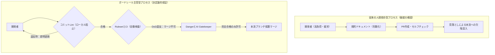
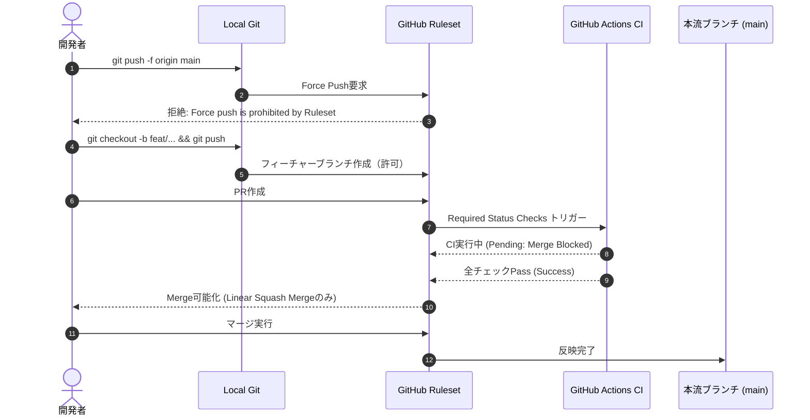
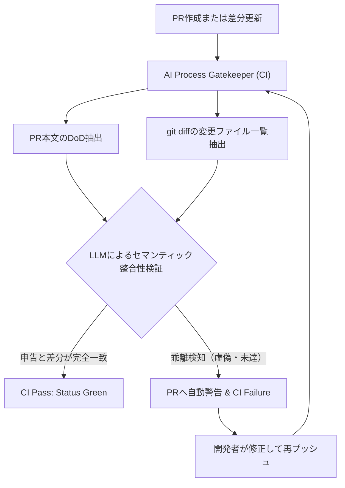
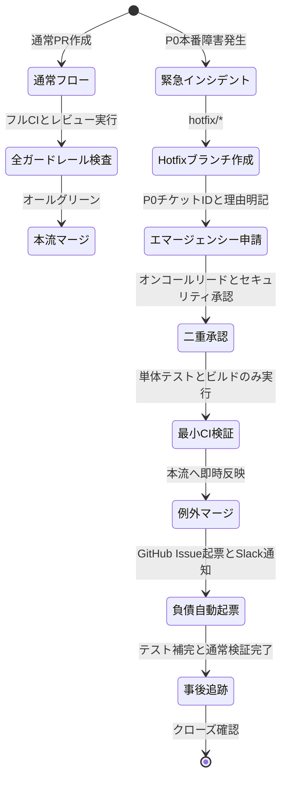

# 第12章：プロセスの「静的検証（Lint & ガードレール）」

ソフトウェア工学において「シフトレフト」という標語が叫ばれて久しい。コードを書いた後の結合テストや受入れテストではなく、単体テストやコミット前の静的コード解析によって欠陥を早期検出する思想である。しかし、なぜ私たちはこの優れた原則を「開発プロセスそのもの」に等しく適用してこなかったのだろうか。

どれほど綿密に定義された開発標準やPR（プルリクエスト）ガイドラインが存在しても、それが「開発者の善意」や「個人のチェックリスト目視」に依存している限り、過密スケジュールやヒューマンエラーによって確実に形骸化する。「うっかり忘れた」「急いでいたので後で修正するつもりだった」という言葉とともに、未検証コードのマージ、壊れたテスト、空欄だらけのPR説明文、トレーサビリティの欠落したコミットが本流ブランチへと雪崩れ込む。

本章では、開発プロセスそのものに静的検査（Lint）と自動防護壁（Guardrails）を張り巡らせ、「間違った状態ではコミットもプッシュもマージも物理的にできない世界」を機械的かつ決定論的に構築する技術体系を詳解する。

---

## 12.1 プロセスガードレールの思想：「人間を信じるのではなく、間違えようがない仕組みを信じる」

従来のプロセス品質管理における最大の誤謬は、「教育・指導によって人間の注意力や遵守意識を高めようとすること」である。認知心理学やシステム安全工学が証明している通り、疲労・時間的圧力・注意散漫に晒された人間がヒューマンエラーを完全に排除することは原理的に不可能である。

品質保証（QA）エンジニアやテクニカルリードが目指すべきは、「人間を疑うこと」でも「人間の善意に甘えること」でもなく、「エラーを犯すことが不可能な環境（ポカヨケ / Poka-yoke）」を開発インフラとして配備することである。



プロセスガードレールには、以下の4つの本質的原則が存在する：

1. **決定論的フィードバック（Deterministic Feedback）**: ルール違反は主観的な感情論ではなく、明確な終了コード（Exit Code 1）と修正ガイダンスによって即座に機械から突き返されなければならない。
2. **最短のフィードバックループ（Shift-Left to the Millisecond）**: 違反の検知は「レビュー時」ではなく「コミット時（ローカル）」、「マージ後」ではなく「PRオープン時（リモート）」に極限まで前倒しされる。
3. **心理的安全性の担保（Psychological Safety through Invariance）**: ガードレールが機能している現場では、形式的な指摘をする必要が消滅する。レビュー担当者は設計やロジックの本質的議論に集中できる。
4. **バイパスの透明化と監査証跡（Transparent Bypassing and Auditability）**: 緊急障害対応（Hotfix）等で例外的にガードレールを迂回する場合は、事後監査が可能なログと承認フローが不可分に結合されていなければならない。

---

## 12.2 GitHub Branch Protection & Rulesetの実践

GitHubにおけるブランチ保護は、かつての単純な「Branch Protection Rules」から、より粒度が細かく柔軟なポリシー統制が可能な「GitHub Rulesets」へと進化を遂げた。組織的な品質保証を実現するためには、リポジトリ層および組織（Organization）層で堅牢なRulesetをコード化（Configuration as Code）する必要がある。

### 必須とすべきガードレール要件

1. **直接プッシュの完全禁止（Restrict Creations and Updates）**: `main`, `production` ブランチに対する直接コミットおよびForce Push（`git push -f`）を全ユーザー（管理者を含む）に対して恒久的に遮断する。
2. **線形コミット履歴の強制（Require Linear History）**: 不必要なマージコミットの乱立を防ぎ、`git bisect` による障害原因の特定を容易にするため、Squash MergeまたはRebase Mergeを強制する。
3. **必須ステータスチェック（Required Status Checks）**: CIパイプライン（ビルド、単体テスト、静的解析、セキュリティスキャン、ドキュメントDoD検査）の成功（Success）をマージの絶対前提条件とする。
4. **最新ブランチの要求（Require Branches to be Up to Date Before Merging）**: 他のPRがマージされて本流が進んだ場合、リベースまたは最新の取り込みを行わない限りマージボタンを活性化させない。これにより、マージ時のセマンティックな衝突や競合欠陥を防ぐ。
5. **署名付きコミットの要求（Require Signed Commits）**: GPGまたはSSHキーによるコミット署名を必須化し、コミット作成者のなりすましを排除する。



---

## 12.3 コミットメッセージLintとPRテンプレートの自動検証

プロセスの静的検証における第一の防壁は、コミットメッセージとPRの記述そのものに対する検査である。

### 12.3.1 commitlintによるトレーサビリティの強制

コミットメッセージは、変更の文脈（なぜ、何を変更したのか、どのIssueに対応しているのか）を後世に伝える恒久的な設計ドキュメントである。`Conventional Commits` 規約を採用し、`husky` や `pre-commit` と連携した `commitlint` によって、不正なメッセージをコミットの瞬間にローカルで遮断する。

```javascript
// commitlint.config.js
module.exports = {
  extends: ['@commitlint/config-conventional'],
  rules: {
    'type-enum': [
      2,
      'always',
      [
        'feat',     // 新機能・原稿執筆
        'fix',      // バグ修正・誤字脱字修正
        'docs',     // ドキュメント整備
        'style',    // コードスタイル・フォーマット（動作に影響なし）
        'refactor', // リファクタリング
        'perf',     // パフォーマンス改善
        'test',     // テスト追加・修正
        'build',    // ビルドシステム・外部依存変更
        'ci',       // CI/CD設定変更
        'chore',    // その他雑務
        'revert'    // 変更の取り消し
      ]
    ],
    'subject-case': [2, 'never', ['upper-case']],
    'subject-full-stop': [2, 'never', '.'],
    'subject-empty': [2, 'never'],
    'type-empty': [2, 'never']
  }
};
```

### 12.3.2 PRテンプレートの必須フィールド静的検証

GitHubのデフォルト機能では、PRテンプレートに記述された項目が空欄のまま送信されてもシステムは警告を発しない。これを放置すると、Issue番号の未記載、影響範囲の未入力、チェックボックスの無視が常態化する。

これを防ぐため、GitHub Actions上でPR本文のMarkdown構文木を解析し、必須セクションの記入漏れを検出するCIワークフローを配備する。

```yaml
# .github/workflows/lint-pr-description.yml
name: Lint Pull Request Description

on:
  pull_request:
    types: [opened, edited, synchronize]

jobs:
  validate-pr:
    runs-on: ubuntu-latest
    steps:
      - name: Validate PR Body Structure
        uses: actions/github-script@v7
        with:
          script: |
            const body = context.payload.pull_request.body;
            if (!body) {
              core.setFailed('PR本文が空です。PRテンプレートの全項目を記入してください。');
              return;
            }

            const requiredSections = [
              '## 概要',
              '## 変更理由',
              '## テスト・検証内容'
            ];

            const missingSections = [];
            for (const section of requiredSections) {
              if (!body.includes(section)) {
                missingSections.push(section);
              }
            }

            if (missingSections.length > 0) {
              core.setFailed(`必須セクションが不足しています: ${missingSections.join(', ')}`);
            }

            // Issue紐付けチェック（Closes #xx または Fixes #xx）
            const issueLinkRegex = /(close|closes|closed|fix|fixes|fixed|resolve|resolves|resolved)\s+#[0-9]+/i;
            if (!issueLinkRegex.test(body)) {
              core.setFailed('Issueへのリンク（例: Closes #123）が含まれていません。トレーサビリティを確保してください。');
            }
```

---

## 12.4 PRサイズ・鮮度のガードレール：Dangerによる巨大PRと負債の防止

PRのサイズ（変更行数・ファイル数）と、コードレビューの品質および欠陥見落とし率には極めて強い正の相関がある。変更行数が500行を超えたPRのレビューは、実質的に「斜め読み」となり、重大なロジック欠陥やセキュリティホールが看過される原因となる。

オープンソースの自動レビューツール `Danger`（JavaScript / Ruby）を活用することで、PRのメタ情報、差分量、付随成果物の過不足を動的に監視し、基準を超過した変更に対して即座に警告（Warn）またはマージ阻止（Fail）を発動できる。

```javascript
// dangerfile.js
import { danger, warn, fail, message } from 'danger';

const pr = danger.github.pr;
const modifiedFiles = danger.git.modified_files;
const createdFiles = danger.git.created_files;
const allChangedFiles = [...modifiedFiles, ...createdFiles];

// 1. 巨大PRの検出と警告
const MAX_CHANGED_LINES = 500;
const totalLinesChanged = danger.github.pr.additions + danger.github.pr.deletions;
if (totalLinesChanged > MAX_CHANGED_LINES) {
  warn(`⚠️ このPRの変更行数は ${totalLinesChanged} 行です。500行を超える巨大PRはレビュー品質の著しい低下を招きます。PRの分割を検討してください。`);
}

// 2. 実装コード変更時のテストコード同根チェック
const hasAppChanges = allChangedFiles.some(file => file.startsWith('src/') || file.startsWith('lib/'));
const hasTestChanges = allChangedFiles.some(file => file.includes('test') || file.includes('spec'));

if (hasAppChanges && !hasTestChanges) {
  warn('⚠️ プロダクションコードが変更されていますが、テストコード（tests/ または spec/）の変更が含まれていません。テストの追加または更新が必要です。');
}

// 3. ドキュメントおよびCHANGELOGの更新チェック
const hasChangelog = allChangedFiles.includes('CHANGELOG.md');
if (hasAppChanges && !hasChangelog) {
  message('📝 ユーザーに影響する変更がある場合は、`CHANGELOG.md` への追記を忘れないでください。');
}

// 4. 原稿・マークダウンファイルのDoD静的検査
const manuscriptFiles = allChangedFiles.filter(file => file.startsWith('manuscript/') && file.endsWith('.md'));
for (const file of manuscriptFiles) {
  message(`📖 原稿ファイル \`${file}\` が更新されました。Commercial DoD基準がCIで検証されます。`);
}
```

上記の `dangerfile.js` をGitHub Actions上で自動実行し、PRへ検証結果コメントを投稿するためのセットアップ手順は以下の通りである。

```yaml
# .github/workflows/danger-pr-guard.yml
name: Danger PR Guardrail
on: [pull_request]

# 初回導入時のハマり防止：PRへのコメント投稿とステータス更新のため以下の権限スコープ明示が必須
permissions:
  contents: read
  pull-requests: write

jobs:
  danger:
    runs-on: ubuntu-latest
    steps:
      - uses: actions/checkout@v4
      - uses: actions/setup-node@v4
        with:
          node-version: '20'
      - run: npm install --no-save danger
      - name: Run Danger JS
        env:
          GITHUB_TOKEN: ${{ secrets.GITHUB_TOKEN }}
        run: npx danger ci --failOnErrors=true
```

※初回実行時のトラブルシューティング：近年のGitHub Actionsでは、リポジトリのデフォルト `GITHUB_TOKEN` 権限が読み取り専用（Read-only）に制限されているケースが多く見られます。そのまま `npx danger ci` を実行すると、`403 Resource not accessible by integration` エラーでコメント投稿に失敗するため注意してください。上記のようにワークフロー内に `permissions: pull-requests: write` を明示することで、初回から確実に動作させることができます。

---

## 12.5 AI確証工程：PR変更内容とDoDチェックボックスの乖離検知

プロセスの静的検証における最大の盲点の一つが、「PR作成者がチェックボックス（`[x]`）にチェックを入れているが、実際にはその作業を一切やっていない」という虚偽申告問題である。

例えば、PRテンプレートに `[x] 単体テストを実行し全件パスを確認した`、`[x] ドキュメントを最新化した` と記載されていながら、Gitの変更差分にはテストコードの修正もドキュメントファイルの更新も存在しないというケースは日常的に発生する。人間レビュアーはこれを突き合わせる作業に多大な認知リソースを浪費するか、あるいは「チェックがついているから大丈夫だろう」と盲目的に信じてスルーしてしまう。

この課題を解決するため、Git差分とPR本文のDoDチェックボックスを突合し、乖離を機械的に糾弾する「AI Process Gatekeeper」をCIパイプラインに組み込む。



### AI Gatekeeperの実装スクリプト

```python
# tools/ai_gatekeeper_check.py
import os
import sys
import subprocess
import json
import urllib.request

def get_git_diff():
    # mainブランチとの差分統計および変更ファイル名を取得
    result = subprocess.run(['git', 'diff', '--name-status', 'origin/main...HEAD'], capture_output=True, text=True, check=True)
    return result.stdout

def audit_consistency(pr_body, git_diff):
    api_key = os.environ.get('GEMINI_API_KEY')
    if not api_key:
        print('GEMINI_API_KEY is not set. Skipping AI Gatekeeper.')
        return True, 'Skipped'

    system_prompt = (
        'あなたは厳格なソフトウェア開発プロセス監査官（AI Gatekeeper）です。
'
        'PR本文に記載されたチェックリスト（DoD）と、実際のGit変更差分（ファイルリスト）を照合し、
'
        '虚偽のチェックや実態との乖離が存在しないかを厳格に検証してください。

'
        '【判定基準】
'
        '1. PRで「ドキュメント更新済み」にチェックがあるのに、*.md や docs/ の変更がない場合はFAIL。
'
        '2. 「テスト追加・実行済み」にチェックがあるのに、tests/ や *_test.* の変更がない場合はFAIL。
'
        '3. 疑わしい点が一切なく整合している場合のみ PASS と判定すること。'
    )

    user_content = f'【PR本文】:
{pr_body}

【Git変更ファイル一覧】:
{git_diff}'

    payload = {
        'contents': [
            {'role': 'user', 'parts': [{'text': f'{system_prompt}

{user_content}'}]}
        ],
        'generationConfig': {
            'response_mime_type': 'application/json',
            'response_schema': {
                'type': 'OBJECT',
                'properties': {
                    'verdict': {'type': 'STRING', 'enum': ['PASS', 'FAIL']},
                    'reasons': {'type': 'ARRAY', 'items': {'type': 'STRING'}},
                    'corrective_actions': {'type': 'ARRAY', 'items': {'type': 'STRING'}}
                },
                'required': ['verdict', 'reasons', 'corrective_actions']
            }
        }
    }

    url = f'https://generativelanguage.googleapis.com/v1beta/models/gemini-1.5-flash:generateContent?key={api_key}'
    req = urllib.request.Request(url, data=json.dumps(payload).encode('utf-8'), headers={'Content-Type': 'application/json'})
    
    try:
        with urllib.request.urlopen(req, timeout=15) as resp:
            res_data = json.loads(resp.read().decode('utf-8'))
            text_response = res_data['candidates'][0]['content']['parts'][0]['text']
            audit_result = json.loads(text_response)
            return audit_result['verdict'] == 'PASS', audit_result
    except (urllib.error.URLError, json.JSONDecodeError, KeyError, TimeoutError) as e:
        # LLM APIのレートリミットや一時障害時にCI全体を止めないための決定論的フォールバック
        print(f'[WARN] AI API call failed ({e}). Running deterministic fallback check...')
        has_test_diff = any('test' in line.lower() for line in git_diff.splitlines())
        claims_test = '[x] 単体テスト' in pr_body or '[x] テスト' in pr_body
        if claims_test and not has_test_diff:
            return False, {'verdict': 'FAIL', 'reasons': ['テスト実施にチェックがありますがテスト差分がありません（Fallback検知）']}
        return True, {'verdict': 'PASS', 'reasons': ['Fallback check passed']}

if __name__ == '__main__':
    pr_body = os.environ.get('PR_BODY', '')
    git_diff = get_git_diff()
    passed, detail = audit_consistency(pr_body, git_diff)
    if not passed:
        print(f'AI Gatekeeper Audit FAILED: {detail}')
        sys.exit(1)
    print('AI Gatekeeper Audit PASSED')
    sys.exit(0)
```

※JSON Modeスキーマ検証とリトライ設計の補足：Gemini APIの `response_schema`（Structured Outputs）を指定することで、出力形式の揺れは大幅に抑えられます。ただし巨大なPR差分を送信した際には、出力の途中切れ（`finishReason: MAX_TOKENS`）による `json.JSONDecodeError` や一時的な通信瞬断が発生することがあります。実運用では `git_diff` を先頭20,000文字にトランケートした上でタイムアウトを `15〜20秒` に設定します。さらにHTTP 429/503発生時には2秒・4秒の指数バックオフ（最大2回リトライ）を挟んでから上記の決定論的フォールバックへ移行する構成とすると、万全の可用性を担保できます。

---

## 12.6 緊急リリース（Hotfix）と例外バイパスの統制設計

ガードレールを導入する際、現場の開発者から必ず提起されるのが「深夜の重大本番障害時に、厳格なCIやガードレールが邪魔をして復旧が遅れたらどうするのか」という反論である。

この懸念に対して「例外のない完璧な厳格さ」を強要すると、開発者は裏道（個人の管理者権限を用いた強制的ルール解除など）を探し始め、結果としてプロセスそのものが形骸化する。優れたプロセスエンジニアリングとは、「例外運用（Hotfixバイパス）をあらかじめアーキテクチャとして設計し、その行使に対して極めて高い可視性と代償を課すこと」である。

### Hotfixバイパスの4段階統制

1. **専用ラベルまたはブランチ命名による一時的緩和**:
   - `hotfix/critical-*` ブランチまたは `hotfix-bypass` ラベルが付与されたPRに限り、時間のかかる一部のE2Eテストやドキュメント検証をスキップ可能とする。
2. **2名以上のエマージェンシー承認（Two-Person Rule）**:
   - 通常レビューは1名でよいが、例外バイパス時は「セキュリティリード」または「オンコール統括者」を含む2名以上の明示的承認を必須とする。
3. **インシデント起因Issueの強制紐付け**:
   - PagerDutyやOpsgenie、あるいは重大インシデント管理チケットのURLが指定されていない場合、例外パイプラインの実行を拒絶する。
4. **事後修復チケットの自動発行（Technical Debt Auto-Ticketing）**:
   - 例外バイパスによってマージが行われた瞬間に、GitHub Actionsが自動的に「【至急】Hotfixバイパスによる負債解消・テスト補完」というIssueを起票し、Slackの全社アラートチャンネルへ通知する。このチケットがクローズされるまで、次の通常リリースタグ作成をブロックする。



---

## 12.7 アンチパターン対比：形骸化するプロセス vs 機能するガードレール

プロセス品質管理の導入において、多くの組織が陥る失敗パターンと、その処方箋を対比表で整理する。

| 観点 | アンチパターン（形骸化するプロセス） | ベストプラクティス（機能するガードレール） |
| :--- | :--- | :--- |
| **ルールの伝達** | 膨大な社内Wikiに「開発規約」を記述し、新人に通読を義務付ける。 | Git Hooks（pre-commit）やRulesetで物理的にルール違反を遮断する。 |
| **レビューの役割** | レビュアーが「インデント」「コミットメッセージ」「PR記述」の指摘に忙殺される。 | 形式的ルールはすべてLintやCIが落とす。人間は設計・ビジネス価値のみを議論する。 |
| **PRの粒度** | 2週間分の作業が詰め込まれた3,000行のPRが提出され、誰も読まずにApproveする。 | DangerやBotが500行以上のPRに警告を発し、分割を強制する。 |
| **DoDの遵守** | PRのチェックボックスが単なる「通過儀礼」となり、ノーチェックで送信される。 | AI GatekeeperがGit差分と照合し、虚偽や未達のチェックを自動検知してリジェクトする。 |
| **緊急対応** | 管理者がGitHubの設定画面で一時的にBranch Protectionを解除し、戻し忘れる。 | 監査ログ付きのHotfix自動ワークフローを設計し、事後チケットを自動生成して追跡する。 |

---

## 12.8 実践ワークショップ：リポジトリ健全性のセルフアセスメント

読者のチームやリポジトリにおいて、プロセスガードレールがどの程度機能しているかを客観的に評価するためのチェックシートである。

### プロセス健全性スコアカード（各項目 0〜2点）

1. **ブランチ保護**:
   - `main` や `production` ブランチへの直接プッシュおよびForce Pushが完全に禁止されているか？
2. **必須CIのブロック力**:
   - テストやリントが1件でも失敗している状態では、誰も物理的にマージできないよう設定されているか？
3. **コミットメッセージの標準化**:
   - commitlint等のツールが導入され、不正なコミットメッセージがローカルで遮断されているか？
4. **PRサイズの監視**:
   - 変更量が大きすぎるPRに対して、自動的に警告や分割を促す仕組みが存在するか？
5. **PRテンプレートの記述検証**:
   - 必須セクションの未記入やIssueリンク漏れを、CIやBotが自動検出してブロックしているか？
6. **DoDと実態の突き合わせ**:
   - 「テスト実施」「ドキュメント更新」などの宣言が、実際のコード差分と一致しているか検証されているか？
7. **例外運用の監査可能性**:
   - 緊急時のバイパス運用がシステム化され、事後修復タスクが自動起票される仕組みがあるか？

- **合算スコアの診断**:
  - **12〜14点【卓越】**: プロセスがコードとして統制されており、ヒューマンエラーによる品質低下が極小化されている。
  - **8〜11点【発展途上】**: 基本的な保護はあるが、依然として人間の注意力や善意への依存が残存している。
  - **0〜7点【危険】**: プロセスが形骸化しており、いつ重大インシデントや品質破綻が起きてもおかしくない状態である。即時のガードレール導入が推奨される。

---

## 12.9 本章のまとめと次章への接続

本章で論じたプロセスの静的検証（Lint & ガードレール）は、高品質なソフトウェアを高速にデリバリーするための「不可逆な安全網」である。

- **人間を信じるのではなく、仕組みを信じる**: ルール違反は精神論で指導するのではなく、システムによって物理的に阻止する。
- **多層防壁の構築**: ローカルの `commitlint` から、GitHub Ruleset、Danger、AI Gatekeeperに至る多段の検証パイプラインを敷く。
- **例外の制御**: 緊急リリース（Hotfix）を排除するのではなく、透明化された例外レーンと事後負債回収を設計する。

しかし、静的検証によって「ルールに沿ったPR」が揃ったとしても、それだけでは「成果物の本質的な内容が本当に正しいか」までは保証できない。そこで次章（第13章）では、人間とAIが協調して成果物の妥当性を徹底的に吟味する「プロセスの動的検証（Review & Audit）」の極意へと歩を進める。
