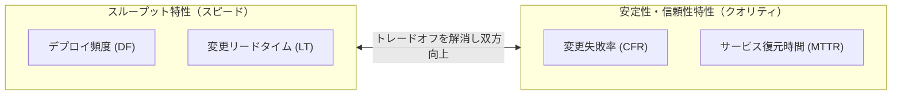
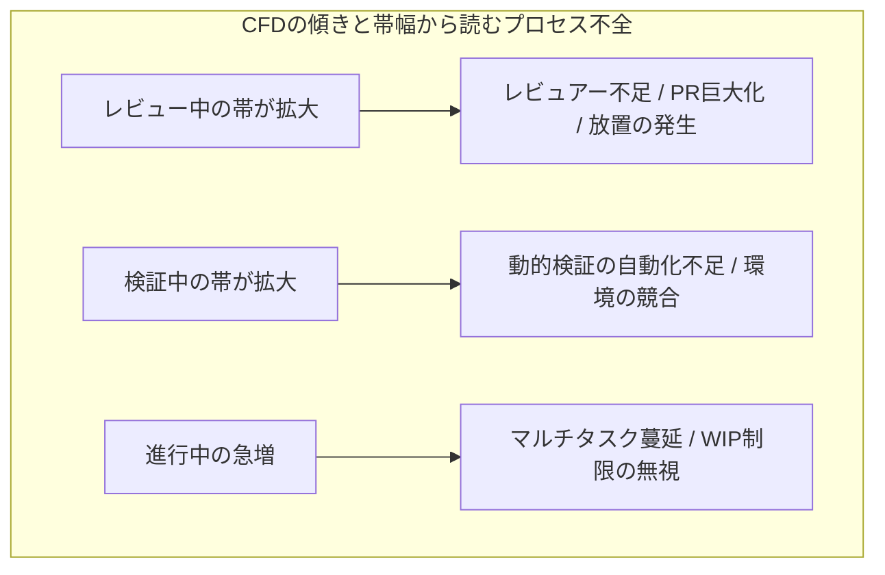
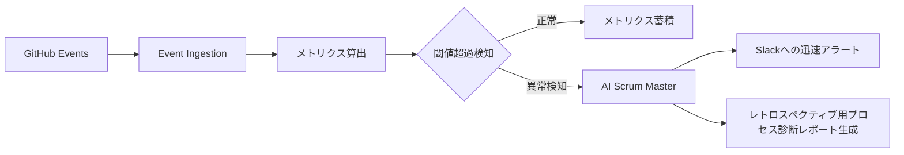

# 第13章：プロセスの「動的検証（メトリクス評価）」とリファクタリング

プログラムコードに静的解析と動的テストが存在するように、開発プロセスにも「静的検証（ガードレール・Lint）」と「動的検証（メトリクス評価・振る舞い分析）」の双方が不可欠である。第12章で構築した静的ガードレールが「ルール違反の混入を物理的に阻止する壁」であるならば、本章で論じる動的検証は「稼働中のプロセスが健全なスループットと品質を維持しているかを継続的に監視・診断する計装システム（Telemetry）」である。

どれほど厳格なRulesetやCIパイプラインを敷いても、開発プロセスの運用実態には必ず「歪み」が生じる。特定のエースエンジニアへのレビュー集中、PRオープン後の数日間に及ぶ放置、手戻りによるスプリント終盤の炎上、テスト自動化の恩恵を打ち消すマージ待ち行列――これらは静的Lintの網の目をすり抜け、組織の開発生産性とデリバリー品質を静かに侵食していく。

本章では、開発プロセスの実行結果を科学的・決定論的に測定し、フローの詰まりやボトルネックを特定して「プロセスそのものをリファクタリングする」ための体系的技法を解説する。

---

## 13.1 プロセスの動的実行結果を測る指標体系：DORA 4 Keysとフローメトリクス

開発プロセスの健全性を測定する上で、現代のデファクトスタンダードとなっているのが、DevOps Research and Assessment（DORA）が提唱した「4つの主要メトリクス（DORA 4 Keys）」およびフローフレームワークに基づく「フローメトリクス」である。

### 13.1.1 DORA 4 Keysの工学的解釈

DORA 4 Keysは、単なる生産性の指標ではなく、「プロセスが安定性とスピードを高い次元で両立できているか」を証明する品質保証メトリクスである。

1. **デプロイ頻度（Deployment Frequency）**: プロダクション環境へコードが反映される頻度。バッチサイズ（1回の変更量）の極小化度合いを直接反映する。
2. **変更リードタイム（Lead Time for Changes）**: コミットが作成されてから本番環境で正常に稼働するまでの所要時間。パイプラインとレビュープロセスの流暢性を示す。
3. **変更失敗率（Change Failure Rate / CFR）**: 本番デプロイ後に修正（ロールバックやHotfix）を要した割合。出荷前検証・確証プロセスの有効性を示す。
4. **サービス復元時間（Failed Deployment Recovery Time / MTTR）**: 本番障害が発生してからサービスが正常復帰するまでの時間。プロセスの回復力と可観測性を示す。



多くの失敗組織では「スピード（DF・LT）を上げると品質（CFR）が悪化する」という偽りの二項対立に陥る。しかし高業績チームのプロセスデータが証明しているのは、バッチサイズを極小化しテスト・プロセスの自動検証を徹底することによって、「スピードと品質は同時に向上する」という事実である。

---

## 13.2 累積フロー図（CFD）とサイクルタイム内訳分析

プロセスの動的ボトルネックを可視化する最も強力な計装ツールが、累積フロー図（Cumulative Flow Diagram / CFD）と、サイクルタイムの内訳分解である。

### 13.2.1 累積フロー図（CFD）による詰まりの早期検知

累積フロー図は、縦軸にタスク数、横軸に時間をプロットし、各ステータス（未着手・進行中・レビュー中・QA検証中・完了）のタスク累積推移を帯状に表現するグラフである。



CFDにおいて「平行に推移する帯」は安定した定常状態を示す。特定の帯の幅が急激に拡大している箇所は、その工程が下流に対するボトルネック（制約条件）となっていることを数学的に証明している。リトルの法則 $L = \lambda W$ （仕掛品数 ＝ スループット × リードタイム）が示す通り、工程内に滞留する仕掛品（WIP）が増加すれば、リードタイムは必然的に長期化する。

### 13.2.2 サイクルタイムの内訳分解プロトコル

PRがオープンされてからマージされるまでの総サイクルタイムを、以下の4つのフェーズに分解して計装する：

1. **コーディング時間（Coding Time）**: 最初のコミットからPRがオープンされるまでの時間。
2. **初回レビュー待機時間（Time to First Review）**: PRオープンから最初の人間またはBotによるレビューコメントがつくまでの時間（放置時間）。
3. **レビュー対話時間（Review Turnaround Time）**: 指摘に対する修正コミットのプッシュと再レビューの往復に要した時間。
4. **マージ待機時間（Time to Merge）**: 全てのApproveが揃い、CIが成功してから実際にマージボタンが押されるまでの時間。

実務上のボトルネックの80%以上は「実作業時間」ではなく「待機時間（放置時間）」に存在する。動的検証の主たる標的は、この沈黙のアイドリングタイムである。

---

## 13.3 レビュー停滞・手戻り頻発の根本原因分析プロトコル

動的メトリクスが異常値（例: 初回レビュー待機時間 > 24時間、レビュー往復回数 > 5回）を示した場合、QAリードおよびチームリーダーは即座に根本原因分析（RCA）プロトコルを発動しなければならない。

### 13.3.1 レビュー集中とサイロ化の測定

特定のシニアエンジニアやテックリードにレビュー負荷が極端に偏る「レビュアー単一障害点（SPOF）」は、組織全体のベロシティ低下とバーンアウトの元凶である。

GitHubのGraphQL APIを用いてPRレビュアーごとのアサイン数、承認数、レビューコメント数を抽出し、ジニ係数（不平等度指数）を算出する。ジニ係数が0.5を超える場合、知識のサイロ化とレビュー渋滞が発生していると判定する。なお、以下のスクリプトを実行する際は、環境変数 `GITHUB_TOKEN` に対象リポジトリのPR読み取り権限を持つトークンを設定しておく必要がある。具体的には、Fine-grained PATの場合は `Pull requests: Read-only`、Classic PATの場合は `repo` および `read:org` スコープを付与する。

```python
# tools/analyze_review_bottlenecks.py
import os
import json
import urllib.request
from collections import defaultdict

def compute_gini_coefficient(values):
    """レビュアーごとのレビュー件数リストからジニ係数（0.0=完全平等 〜 1.0=完全独占）を算出"""
    n = len(values)
    if n == 0 or sum(values) == 0:
        return 0.0
    sorted_vals = sorted(values)
    cumulative_Diff = sum((2 * i - n - 1) * val for i, val in enumerate(sorted_vals, 1))
    return cumulative_Diff / (n * sum(sorted_vals))

def fetch_pull_requests(owner, repo, token):
    gql_query = """
    query($owner: String!, $repo: String!) {
      repository(owner: $owner, name: $repo) {
        pullRequests(last: 100, states: MERGED) {
          nodes {
            number
            title
            reviews(first: 20) {
              nodes {
                author { login }
                state
              }
            }
          }
        }
      }
    }
    """
    req = urllib.request.Request(
        "https://api.github.com/graphql",
        data=json.dumps({"query": gql_query, "variables": {"owner": owner, "repo": repo}}).encode("utf-8"),
        headers={"Authorization": f"bearer {token}", "Content-Type": "application/json"}
    )
    with urllib.request.urlopen(req) as resp:
        return json.loads(resp.read().decode("utf-8"))

def calculate_review_metrics(data):
    prs = data["data"]["repository"]["pullRequests"]["nodes"]
    reviewer_counts = defaultdict(int)
    total_reviews = 0
    for pr in prs:
        reviewed_authors = set()
        for review in pr["reviews"]["nodes"]:
            author = review["author"]["login"] if review["author"] else "unknown"
            if author not in reviewed_authors:
                reviewer_counts[author] += 1
                reviewed_authors.add(author)
                total_reviews += 1
    print("=== レビュアー負荷分散分析 ===")
    for reviewer, count in sorted(reviewer_counts.items(), key=lambda x: x[1], reverse=True):
        ratio = (count / total_reviews) * 100 if total_reviews > 0 else 0
        print(f"User: {reviewer:15} | レビュー参加数: {count:3} 件 ({ratio:5.1f}%)")
    gini = compute_gini_coefficient(list(reviewer_counts.values()))
    print(f"レビュアー偏り指数（ジニ係数）: {gini:.3f} (0.50超でSPOF警告)")
```

---

## 13.4 レトロスペクティブを「プロセスのデバッグ」として機能させる技術

ふりかえり（レトロスペクティブ）が「単なる感想の言い合い」や「精神論の慰め合い」に形骸化している現場は枚挙にいとまがない。「今スプリントは大変でした」「次は気を引き締めましょう」という会話からプロセス改善が生まれることはない。

アジャイルにおけるふりかえりとは、「過去のスプリント実行ログという動的トレースを突き合わせ、プロセスに潜むバグを特定・修正するプロセスのデバッグ作業」でなければならない。

### プロセス・デバッグの4ステップ

1. **ファクトの計装（Instrumentation）**: スプリント内のDORA指標、リードタイム分布、例外マージ件数、障害発生件数をダッシュボードで投影する。
2. **異常波形の同定（Anomaly Identification）**: なぜ特定のチケットはレビューに長期間放置されたのか、なぜマージ直後にロールバックされたのかという異常事象に焦点を当てる。
3. **5 Whysによる構造的要因の掘り下げ**: 個人の注意力不足で片付けず、通知埋没やPRサイズ肥大化、環境不備といったプロセスの構造的欠陥まで掘り下げる。
4. **実行可能なガードレールの実装（Fixing the Process）**: 精神論ではなく、Dangerスクリプト追加やRuleset変更、テスト並列化など、コードや設定の改修としてコミットする。

---

## 13.5 AI確証実践：GitHubイベントログを常時分析するAIスクラムマスター

日々の開発イベント（コミット、PR作成、レビューコメント提出、CI失敗、マージ、Issue起票）は、GitHubのWebhookやイベントAPIを通じてストリーミングデータとして得られる。

このイベントログを常時監視し、プロセスの滞留や歪みをリアルタイムに検知して具体的なリファクタリング処方箋をSlackやPRに提案する「AI Scrum Master」を構築する。



### AI Scrum Masterの診断エンジン実装

```python
# tools/ai_scrum_master.py
import json
import urllib.request
import os

def generate_process_diagnosis(sprint_metrics):
    api_key = os.environ.get("GEMINI_API_KEY")
    if not api_key:
        return "AI Analysis Skipped: GEMINI_API_KEY is not set."

    system_prompt = (
        "あなたは世界トップクラスのアジャイル・プロセス工学の専門家（AI Scrum Master）です。\n"
        "提供されたスプリントの動的開発メトリクス（DORA指標、PR待機時間、レビュアー偏り等）を精査し、\n"
        "客観的なプロセス欠陥の診断結果と、次スプリントで導入すべき具体的・決定論的なリファクタリング施策を提示してください。\n\n"
        "【分析要件】\n"
        "1. ボトルネックが存在する工程（コーディング、レビュー待機、QA、デプロイ）を特定すること。\n"
        "2. 精神論を完全に排除し、ツール・ルール・自動化による解決策（ガードレール追加など）を提示すること。\n"
        "3. Markdown形式で出力すること。"
    )

    user_content = f"【スプリント実行メトリクス】:\n{json.dumps(sprint_metrics, ensure_ascii=False, indent=2)}"
    payload = {
        "contents": [
            {"role": "user", "parts": [{"text": f"{system_prompt}\n\n{user_content}"}]}
        ]
    }
    url = f"https://generativelanguage.googleapis.com/v1beta/models/gemini-1.5-flash:generateContent?key={api_key}"
    req = urllib.request.Request(url, data=json.dumps(payload).encode("utf-8"), headers={"Content-Type": "application/json"})
    with urllib.request.urlopen(req) as resp:
        result = json.loads(resp.read().decode("utf-8"))
        return result["candidates"][0]["content"]["parts"][0]["text"]
```

---

## 13.6 QA合否判定基準：プロセスの動的健全性クライテリア

ソフトウェアの品質保証（QA）と同様に、開発プロセスそのものに対しても明確な「合否判定（Pass/Fail Criteria）」を定義し、スプリントや四半期ごとのゲートとして運用する。

### プロセス動的検証の判定マトリクス

| 指標カテゴリ | 測定項目 | 合格基準（Pass） | 警告水準（Warn） | 不合格（Fail / 改善必須） |
| :--- | :--- | :--- | :--- | :--- |
| **スループット** | デプロイ頻度 | 週3回以上 | 週1回〜隔週1回 | 月1回未満（バッチ肥大化） |
| **スループット** | 変更リードタイム | 24時間以内 | 24時間〜72時間 | 72時間超（プロセス詰まり） |
| **安定性** | 変更失敗率 (CFR) | 5%未満 | 5%〜15% | 15%超（出荷前品質保証の機能不全） |
| **回復力** | サービス復元時間 (MTTR) | 1時間以内 | 1時間〜4時間 | 4時間超（オブザーバビリティ不足） |
| **フロー流暢性** | 初回レビュー待機時間 | 4時間以内 | 4時間〜12時間 | 12時間超（レビュー放置） |
| **負荷均等性** | レビュアー偏り (ジニ係数) | 0.35未満 | 0.35〜0.50 | 0.50超（特定個人への負荷集中・SPOF） |

合否判定において1項目でも「不合格（Fail）」となった場合、次スプリントの計画において新規機能開発の比率を抑制し、プロセスのリファクタリングおよび自動化整備に工数を強制配分する規律を設ける。

---

## 13.7 アンチパターン対比：形骸化するメトリクス vs 機能する動的検証

メトリクス測定を導入したものの、現場が疲弊し形骸化していく組織の典型例と、正しく機能するアプローチを対比する。

| 観点 | アンチパターン（監視と管理の道具） | ベストプラクティス（プロセスの動的検証） |
| :--- | :--- | :--- |
| **測定の目的** | 個人を評価・査定するため（コミット数やポイントによる査定）。グッドハートの法則により偽装が発生。 | チーム全体のプロセスのボトルネックやフローの詰まりを可視化し、システムを治すため。 |
| **指標の選定** | コード行数（LOC）やベロシティの絶対値。 | DORA 4 Keysおよび待機時間・フローメトリクス。 |
| **データの扱い** | 月次マネジメント報告でのみ使われ、現場の開発者は見ない。 | ダッシュボードやSlackでリアルタイムに可視化され、ふりかえりで即座に議論。 |
| **改善のアクション** | 「もっと早くレビューしましょう」という個人への精神的訓示。 | PR分割ルールの自動化、CI高速化、AI Gatekeeperの配備という仕組みの改修。 |

---

## 13.8 実践ワークショップ：自チームのプロセス・ボトルネック同定演習

読者のチームにおいて、プロセスの動的検証を即座に開始するためのワークショップ手順である。

### 演習ステップ

1. **直近20件のPRログの収集**:
   - 直近1ヶ月にマージされたPRの中から代表的な20件を抽出し、以下の3つの時刻を記録する。
     - $T_0$: 最初のコミット時刻
     - $T_1$: PRオープン時刻
     - $T_2$: 初回レビューコメント時刻
     - $T_3$: マージ時刻
2. **タイムラインの可視化**:
   - コーディング時間（$T_1 - T_0$）、放置時間（$T_2 - T_1$）、対話・CI時間（$T_3 - T_2$）の平均値および最大値を算出する。
3. **ボトルネック比率の算出**:
   - 総リードタイムに占める「放置時間」の割合を算出する。もし放置時間が全体の40%以上を占めている場合、最優先課題は自動化ではなくレビュープロトコルの見直しである。
4. **リファクタリング計画の策定**:
   - 分析結果に基づき、次スプリントで導入する「具体的なガードレール変更」を1つだけ決定し、リポジトリにIssueを起票する。

---

## 13.9 第III部の総括と第IV部への接続

第10章から本章（第13章）に至る「第III部：開発プロセス成果物のバリエーションと品質保証」では、ソフトウェア開発におけるプロセス成果物（Issue、PR、CIパイプライン、メトリクス）を第一級の品質保証対象として扱ってきた。

- **第10章**: ウォーターフォールからアジャイル、Shape Upに至る多様なプロセスにおける品質保証の違い。
- **第11章**: チケットやPRテンプレート、CI/CDパイプラインという「プロセス成果物」の厳密な仕様化。
- **第12章**: ルール違反を物理的に遮断するブランチ保護、commitlint、AI Gatekeeperによる「プロセスの静的検証」。
- **第13章**: DORA指標やフローメトリクスを用いてプロセスの詰まりを暴き、リファクタリングする「プロセスの動的検証」。

プロセスの確証基盤が強固に整った今、私たちは次の戦場へと進む。続く「第IV部：【前進】動的検証・シフトライト・セキュリティ確証」では、実際に稼働するプロダクトコードを対象とした高度なテスト技法、カオスエンジニアリング、シフトライト監視、そしてセキュリティ確証の最前線へと踏み込んでいく。
