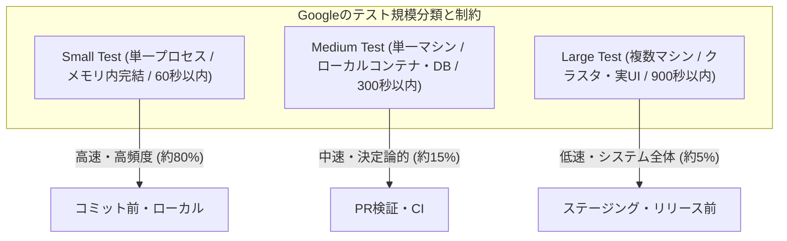
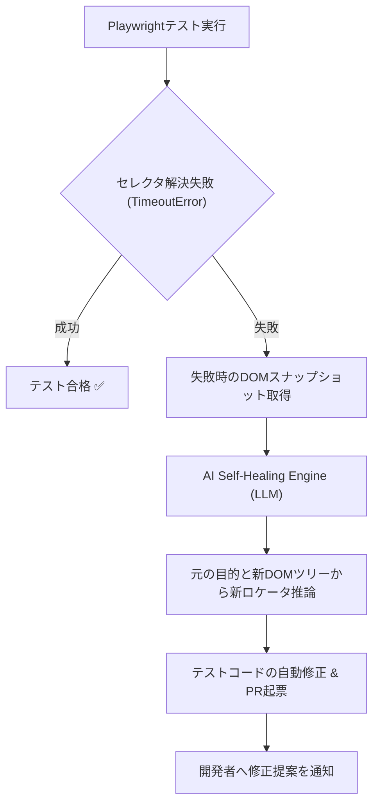

# 第14章：堅牢な自動テスト実行と「自己修復（Self-Healing）」E2E

ソフトウェアテスト自動化の歴史は、フレーキーテスト（Flaky Tests：不安定で実行ごとに合否が揺らぐテスト）との闘争の歴史である。自動テストスイートを意気揚々と構築したものの、コードの変更とは無関係にCIが赤くなり、いつしか誰もテスト結果を信じなくなり、「またテストが落ちたからリトライボタンを押しておこう」という荒廃した現場は世界中に溢れている。

特にブラウザを駆動するEnd-to-End（E2E）テストは、UI変更や非同期通信の揺らぎによって容易に破壊される。テストが壊れるたびに修正に追われ、保守コストが恩恵を上回ったとき、自動化は形骸化する。

本章ではGoogleのテスト規模分類を基盤とし、Testcontainersによる隔離環境の構築、Playwrightによる高信頼E2Eアーキテクチャ、そしてLLMを活用した「自己修復（Self-Healing）」テストの最前線までを網羅的に解説する。

---

## 14.1 テストピラミッド再考：GoogleのSmall/Medium/Largeテスト分類の実践

伝統的な「テストピラミッド（単体・結合・E2E）」は概念モデルとして優れているが、「結合テストとは何を指すのか」「どこまでが単体テストなのか」という定義論争を生みやすい。

Googleはこの曖昧さを排除するため、テスト対象のスコープではなく「テスト実行時に許容される外部リソースの制約」に基づいてテストを3つの規模に厳密に分類した（Google Testing Blog / Software Engineering at Google）。



### 各規模の工学的制約ルール

1. **Small Test（単一プロセス・高速）**:
   - スレッドは単一プロセス内で動作し、ネットワークアクセス（localhost含む）やディスクI/O、外部サブプロセス起動は一切禁止。
   - 実行時間はミリ秒単位であり、1テストあたり数ミリ秒〜数百ミリ秒で完了する。
   - 決定論的（Deterministic）であり、100万回実行しても結果は同一でなければならない。
2. **Medium Test（単一ホスト・実コンテナ結合）**:
   - ローカルホスト（localhost）内のネットワーク通信や、Dockerコンテナ（Testcontainers）、実DB、インメモリキャッシュとの結合を許可。
   - ただし外部インターネットへのアウトバウンド通信は禁止し、外部APIはローカルスタブ（WireMock等）で隔離する。
3. **Large Test（マルチホスト・フルスタックE2E）**:
   - 複数のマシン、ステージング環境、本物のUIブラウザ、サードパーティサンドボックスAPIを結合して実行。
   - システム全体としての統合動作やユーザーシナリオの最終検証を担う。

テストの信頼性を失わせる最大の原因は、「Smallで検証すべきロジックをLarge（E2E）で検証しようとすること」である。ビジネスルールの境界値テストはすべてSmallまたはMediumで完結させ、Largeは「コンポーネント同士が正しく配線されているか」のみを検証する設計が鉄則となる。

---

## 14.2 外部依存の完全隔離：TestcontainersとWireMockによる決定論的テスト環境

「共有テストDB」はフレーキーテストと環境不整合の最大の温床である。開発者Aのテストが投入したレコードを開発者Bのテストが変更し、ランダムにアサーションが失敗する光景は日常茶飯事である。テスト環境は「テストごとに独立して破棄・再生される決定論的な使い捨て環境」でなければならない。

### 14.2.1 Testcontainersによる真のDB結合テスト

インメモリDB（H2やSQLite）を用いた結合テストは、本番環境のRDBMS（PostgreSQLやMySQL）固有のJSON関数、ウインドウ関数、トランザクション分離レベルの違いによる偽陽性・偽陰性を生む。

`Testcontainers` を用いることで、テスト実行時にDockerコンテナとして本物のPostgreSQLインスタンスを自動起動し、テスト終了後に完全破棄する決定論的環境をコードで定義できる。

```python
# tests/conftest.py
import pytest
from testcontainers.postgres import PostgresContainer
import sqlalchemy

@pytest.fixture(scope="session")
def postgres_container():
    with PostgresContainer("postgres:16-alpine") as postgres:
        yield postgres

@pytest.fixture
def db_engine(postgres_container):
    engine = sqlalchemy.create_engine(postgres_container.get_connection_url())
    # テーブル作成とマイグレーション
    with engine.begin() as conn:
        conn.execute(sqlalchemy.text("CREATE TABLE users (id SERIAL PRIMARY KEY, email VARCHAR(255) UNIQUE);"))
    yield engine
    # テストごとにテーブルを破棄
    with engine.begin() as conn:
        conn.execute(sqlalchemy.text("DROP TABLE users CASCADE;"))
```

### 14.2.2 WireMockによる外部API障害シミュレーション

Stripe決済やSendGridメール送信などのサードパーティSaaSは、テスト環境から直接叩くべきではない。レートリミットや通信遅延、予期せぬダウンタイムによってテストが不安定化するためである。`WireMock` を用いて外部APIをローカルでスタブ化し、HTTP 500エラーやタイムアウトなどのエッジケースを決定論的に注入する。

### 14.2.3 大規模開発におけるコンテナ起動オーバーヘッドの削減とCIキャッシュ戦略

TestcontainersやWireMockコンテナは決定論的な隔離環境を実現する一方で、数百本のテストファイルごとに毎回コンテナのイメージプルと起動・破棄を繰り返すと、CIの実行時間が数分〜十数分へと肥大化する。大規模開発でこのオーバーヘッドを極小化するための鉄則は以下の3点である。

1. **セッションスコープ共有と高速トランケート**: 上記コード例のように、コンテナの起動自体は `scope="session"` でテスト実行全体につき1回のみとする。各テスト関数（`scope="function"`）の終了時にはコンテナを再起動せず、`TRUNCATE TABLE ... RESTART IDENTITY CASCADE` やトランザクションロールバックで数ミリ秒のうちにDB状態だけを初期化する。
2. **Testcontainers再利用モード（Reusable Containers）**: ローカル開発時や同一CIランナー内では、コンテナの再利用機能を活用する。環境変数 `TESTCONTAINERS_RYUK_DISABLED=true` や `.testcontainers.properties` の `testcontainers.reuse.enable=true` を設定し、起動済みコンテナへ再接続する。
3. **CIレイヤーでのDockerイメージ事前キャッシュ**: GitHub Actions等のエフェメラル環境では、毎回Docker Hubから数百MBのDBイメージを取得する通信時間がボトルネックとなる。そのため、GitHub Container Registry（GHCR）ミラーや `actions/cache`（または `services:` コンテナ機能）を併用し、イメージプル時間をゼロに近づける。

```yaml
# .github/workflows/integration-test-cache.yml（Testcontainers用DockerイメージキャッシュのCI構成例）
- name: Cache Docker images for Testcontainers
  uses: actions/cache@v4
  with:
    path: /tmp/docker-cache
    key: docker-pg16-${{ runner.os }}
- name: Load or Pull PostgreSQL Image
  run: |
    if [ -f /tmp/docker-cache/pg16.tar ]; then
      docker load -i /tmp/docker-cache/pg16.tar
    else
      mkdir -p /tmp/docker-cache && docker pull postgres:16-alpine
      docker save -o /tmp/docker-cache/pg16.tar postgres:16-alpine
    fi
```

---

## 14.3 Playwrightによる堅牢なE2Eテストアーキテクチャ

現代のE2Eテストフレームワークとして圧倒的な信頼性を誇るのが `Playwright` である。Chrome、Firefox、WebKitの完全なヘッドレス制御に加え、強力な自動待機（Auto-waiting）機構を備えている。

### 14.3.1 壊れないロケータ戦略：getByRoleの採用

E2Eテストが壊れる第一の理由は、「CSSクラス名」や「XPath」などの内部実装依存のセレクタを使用していることである。デザイン変更でクラス名が変わるたびにテストが赤くなる。

Playwrightでは、ユーザーの認知およびアクセシビリティツリー（ARIA）に基づくロケータ（Role-based Locators）を徹底的に使用する。なお本書では、バックエンド結合検証やAIスクリプトにはPython/pytestを採用し、ブラウザ駆動のE2E検証にはフロントエンド標準のTypeScript/Playwrightを採用する適材適所の言語ポリシーを採っている。

```typescript
// tests/e2e/checkout.spec.ts
import { test, expect } from '@playwright/test';

test('購入フローが正常に完了すること', async ({ page }) => {
  await page.goto('/products/1');

  // 壊れやすいアンチパターン: await page.click('.btn-primary.buy-now-v2');
  // 堅牢なベストプラクティス: ユーザー視点のアクセシビリティロールで取得
  await page.getByRole('button', { name: 'カートに追加' }).click();

  await page.getByRole('link', { name: 'カートを見る' }).click();
  await expect(page.getByRole('heading', { name: 'ショッピングカート' })).toBeVisible();

  await page.getByRole('button', { name: '注文を確定する' }).click();
  await expect(page.getByText('ご注文ありがとうございました')).toBeVisible();
});
```

### 14.3.2 Page Object Model（POM）とデータの独立性

画面の構造定義とテストシナリオを明確に分離するため、Page Object Model（POM）パターンを採用する。さらに、各テストケースは「実行時に固有のテストデータ（ランダムUUID付きユーザー等）」をAPI経由でセットアップし、テスト間のデータ競合を根本排除する。

---

## 14.4 ビジュアルリグレッションテストの実践とノイズ制御

機能的には正常に動いているが、CSSの崩れやボタンの重なりによってユーザーが操作不能になる不具合は、機能テストでは検知できない。これを発見するのがスナップショット比較によるビジュアルリグレッションテスト（Visual Regression Testing / VRT）である。

### VRTにおける3大ノイズ要因と制御策

1. **フォントレンダリングのOS差異**: CI環境（Linux）と開発者ローカル（macOS/Windows）でフォントアンチエイリアスが異なり、全画面で差分が出る。➔ Dockerコンテナ内で統一実行する。
2. **アニメーションとトランジション**: CSSアニメーション実行中にスクショが撮られると合否がブレる。➔ `page.emulateMedia({ reducedMotion: 'reduce' })` でアニメーションを無効化する。
3. **動的コンテンツ（日時・アバター等）**: 現在時刻やランダムデータが画面にあると毎回差分が出る。➔ `page.clock.setFixedTime()` による時刻固定と、マスク（Masking）指定を行う。

---

## 14.5 AI確証実践：DOM変更時のセレクタ自己修復（Self-Healing）

UIの大規模リニューアルやデザインシステムの刷新時、どれほど注意していてもE2Eテストのセレクタが意図せず壊れることがある。従来であればエンジニアがブラウザの開発者ツールを開き、新しいDOM構造を調べてテストコードを1行ずつ修正していた。

この作業を自律型AIに代行させるのが「自己修復テスト（Self-Healing E2E）」である。



### Self-Healing修正スクリプトの実装例

（※なお、14.3節のE2Eテスト本体はフロントエンド標準のTypeScript/Playwrightで記述していますが、以下のCI横断ユーティリティスクリプトは本書の共通基盤ポリシーに従い、標準ライブラリのみで環境非依存に動作するPythonで記述しています。TypeScriptプロジェクト単体で完結させる場合は、Playwrightのカスタムレポーター `Reporter.onTestEnd` 内でNode.jsの `fetch` を用いて同等のLLM呼び出しを実装できます。）

```python
# tools/self_healing_locator.py
import os
import json
import urllib.request

def repair_broken_locator(broken_locator, page_dom_snippet, target_intent):
    api_key = os.environ.get("GEMINI_API_KEY")
    if not api_key:
        return broken_locator

    prompt = (
        "あなたはE2Eテスト修復のスペシャリストです。\n"
        "以下の壊れたPlaywrightロケータと、最新のHTMLスナップショットから、\n"
        "同じ意図（ターゲット要素）を指し示す最も堅牢な新しいPlaywrightロケータ（getByRole等）を提案してください。\n\n"
        f"壊れたロケータ: {broken_locator}\n"
        f"テストの意図: {target_intent}\n"
        f"最新DOMスニペット:\n{page_dom_snippet}\n\n"
        '回答はJSON形式で {"new_locator": "page.getByRole(...)", "confidence": 0.95} としてください。'
    )

    payload = {
        "contents": [{"role": "user", "parts": [{"text": prompt}]}],
        "generationConfig": {"response_mime_type": "application/json"}
    }
    url = f"https://generativelanguage.googleapis.com/v1beta/models/gemini-2.5-flash:generateContent?key={api_key}"
    req = urllib.request.Request(url, data=json.dumps(payload).encode("utf-8"), headers={"Content-Type": "application/json"})
    with urllib.request.urlopen(req, timeout=15) as resp:
        res = json.loads(resp.read().decode("utf-8"))
        text = res["candidates"][0]["content"]["parts"][0]["text"]
        return json.loads(text)
```

※大規模SPAにおけるDOM肥大化とトークン上限への対策：現代のReactやNext.js等で構築された画面の `page.content()`（HTML全文）は容易に数十万文字に達し、そのままプロンプトに投入するとコンテキスト長の制限超過やAPIコストの高騰、推論精度の低下を招く。実務で `page_dom_snippet` を抽出する際は、`<script>` や `<style>`、`<svg>`、Base64画像、冗長なCSSクラス属性をBeautifulSoup等で事前にストリップ（軽量化）します。あるいはPlaywrightの `page.locator('main').ariaSnapshot()`（ARIAツリーのスナップショット）を取得して渡すことで、トークン量を95%以上削減しつつ `getByRole` の推論精度を劇的に高められます。

### 自己修復テストにおける「誤修復の自動マージ」を防ぐHuman-in-the-Loopガードレール

LLMによるセレクタ自己修復を運用する際、絶対に犯してはならない禁忌が**「AIが推論した新しいロケータでその場のテストを強引にPassさせ、無審査で本流ブランチへ自動コミットしてしまうこと」**である。たとえば「注文を確定する」ボタンがバグで画面から消滅しているのに、AIがハルシネーションを起こして隣にある「注文をキャンセルする」ボタンへロケータを勝手に書き換えてテストをGreenにしてしまえば、致命的な本番障害を見逃すことになる。

したがって、Self-Healingエンジンは以下の厳格なガードレール（Human-in-the-Loop）の下で運用しなければならない。

1. **メインCIは必ず一度Failさせる**: セレクタ解決に失敗した時点で、当該PRのCI自体は決定論的に失敗（Red）させる。
2. **別ブランチへの修復PR自動起票**: AIが推論した新ロケータ（確信度 `confidence >= 0.90` のものに限る）は、本流へ直接コミットしてはならない。代わりに `fix/self-heal-locator-xxx` という修正提案PRを自動起票し、変更前後のスクリーンショット差分と選択根拠をPR本文に添付する。
3. **人間の1クリック承認**: 開発者がPR上で「UIデザインの変更に伴う正当なロケータ更新である」ことを目視確認し、Approveしたときのみ本流へマージする。これにより、保守工数を9割削減しつつ、AIの暴走によるテストの骨抜きを100%防ぐことができる。

---

## 14.6 QA合否判定基準：自動テストスイートの品質クライテリア

自動テストそのものが健全であるかを評価するための、客観的合否判定マトリクスを策定する。

### 自動テスト健全性の判定マトリクス

| 規模区分 | 単一テスト実行時間上限 | スイート総実行時間 | フレーキー許容率 | リトライ回数制限 |
| :--- | :--- | :--- | :--- | :--- |
| **Small Test** | 50ミリ秒以内 | 60秒以内（並列） | 0.00%（完全決定論） | 0回（リトライ禁止） |
| **Medium Test** | 2秒以内 | 5分以内（コンテナ並列） | 0.1%未満 | 最大1回（CI上のみ） |
| **Large (E2E)** | 30秒以内 | 15分以内（並列シャード） | 0.5%未満 | 最大1回（隔離再試行） |

- **マージブロック制約**: CIパイプラインにおいて、SmallおよびMediumテストの失敗は1件たりとも許容されない（Pass率 100%）。Largeテストのリトライ成功時であっても、Flakyフラグを自動起票して技術的負債として追跡する。

---

## 14.7 アンチパターン対比：脆弱なテスト vs 堅牢な自動テスト

| 観点 | アンチパターン（壊れやすいテスト） | ベストプラクティス（堅牢なテスト） |
| :--- | :--- | :--- |
| **セレクタ設計** | `#app > div:nth-child(2) > .btn-primary` のような内部DOM依存。 | `page.getByRole('button', { name: '購入' })` のセマンティック指定。 |
| **待機処理** | `sleep(5000)` や `waitForTimeout` による固定秒待機。 | PlaywrightのAuto-waitingおよびWeb-first Assertion（toBeVisible等）。 |
| **テストデータ** | 共有DB内の既存ID（user_id=1）をテスト間で使い回す。 | テスト実行時に専用データをAPI経由でオンデマンド生成・後始末。 |
| **失敗の対応** | テストが赤くなったら中身を見ずにCIの再実行ボタンを押す。 | テストビデオ・トレースログ（Playwright Trace）を検証し根本原因を修正。 |

---

## 14.8 実践ワークショップ：Flakyテスト撲滅演習

### 演習手順

1. **ストレスリピートテストの実行**: 自チームのE2Eテストスイートから最も不安定なテストを1件選び、`npx playwright test --repeat-each 50` で50回連続実行する。
2. **失敗ログとトレースの解析**: 失敗した試行のPlaywright Trace Viewerを開き、「DOM要素のロード待ち」「非同期API通信の遅延」「データ競合」のいずれが原因かを特定する。
3. **ロケータとアサーションの改修**: 固定秒待機（sleep）を全廃し、`getByRole` と `expect(...).toBeVisible()` に置き換えて50回連続パスを達成する。

---

## 14.9 本章のまとめと次章への接続

テストの自動化とは、単に人間が手動で行っていた作業をスクリプトにするだけではない。「決定論的に動作し、高速で、メンテナンス不要な安全網」を設計・維持することである。

- **Googleの規模分類**: Small/Medium/Largeの制約を守り、ピラミッドの土台を堅牢にする。
- **隔離と独立性**: TestcontainersとWireMockで外部依存を完全遮断する。
- **Playwrightと自己修復**: アクセシビリティ主導のロケータ設計と、LLMによるDOM自己修復で保守コストを激減させる。

しかし、テスト環境で完璧に動作したシステムであっても、本番環境の混沌としたトラフィックや予期せぬインフラ障害の前には無力であることがある。そこで次章（第15章）では、本番環境を舞台とする「シフトライト検証（カナリアリリース・フィーチャートグル・カオスエンジニアリング）」の技術へと歩を進める。
