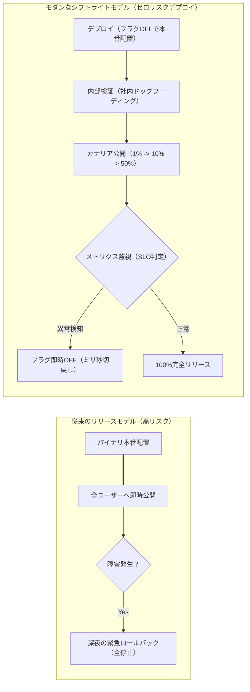
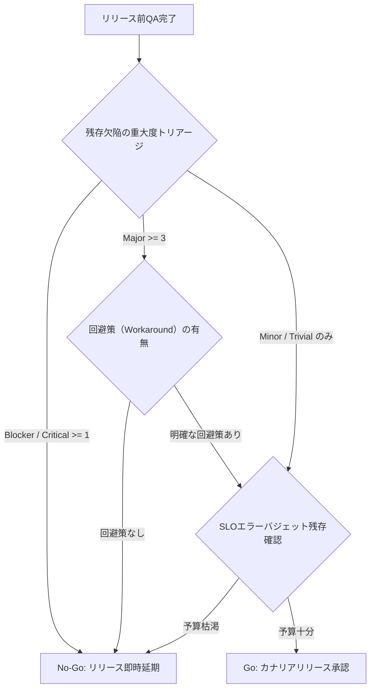

# 第15章：シフトライト：本番品質の検証とAIインシデント管理

「テスト環境では完璧に動いていたのですが、本番環境で障害が発生しました」――この弁明を経験したことのないソフトウェアエンジニアは存在しないだろう。ステージング環境や事前テストは、どれほど巨額の費用を投じて本番を模倣しようとも、本番環境が抱える「数百万の多様なユーザー行動」「予測不能な突発トラフィック」「複雑怪奇なデータ状態」「サードパーティSaaSの瞬断」を100%再現することは原理的に不可能である。

従来の品質保証（QA）は、リリース前にすべての欠陥を堰き止める「シフトレフト（ゲートキーピング）」に傾倒しがちであった。しかし真の品質保証とは、プレプロダクションでの検証を徹底した上で、なお本番に漏れ出る不確実性を手なずける「シフトライト（Shift-Right / Testing in Production）」と車の両輪を成して初めて完成する。

本章ではデプロイとリリースの完全分離、カナリア自動ロールバック、SREが提唱するSLI/SLOとエラーバジェットによる品質統制、そしてAIを活用したインシデント分析とポストモーテム自動化の全貌を詳解する。

---

## 15.1 シフトライトの概念：デプロイとリリースの完全分離

シフトライトを実践する上での最大のパラダイムシフトは、「デプロイ（Deploy：バイナリの配置）」と「リリース（Release：ユーザーへの公開）」を概念的・技術的に完全に切り離すことである。



### デプロイとリリースの差異

- **デプロイ（Deploy）**: 新しいコードやアーティファクトを本番サーバーやKubernetes Podに配置し、ヘルスチェックを通過させる行為。この時点ではフィーチャーフラグにより新機能は非活性化されており、一般ユーザーには1ビットの影響も及ばない。平日昼間に1日何十回でも安全に実行可能である。
- **リリース（Release）**: フィーチャーフラグを動的に切り替えることで、特定セグメントのユーザー（社内メンバー、ベータユーザー、1%のトラフィック）に対して新機能へのアクセスを段階的に解放するビジネス行為。

この2つが分離された瞬間、深夜や休日に実施されていた「恐怖の本番デプロイ作業」は完全に消滅する。

---

## 15.2 フィーチャーフラグとカナリアリリースの自動ロールバック設計

シフトライトを支える中核インフラが、フィーチャーフラグ（LaunchDarkly、Unleash等）と、サービスメッシュ（Istio、Argo Rollouts等）を組み合わせたカナリアリリースである。

### 15.2.1 Argo Rolloutsによるメトリクス駆動自動ロールバック

Kubernetesクラスタにおいて、新バージョン（Canary）へのトラフィック割り振りを1%から段階的に引き上げつつ、PrometheusやDatadogのメトリクス（エラー率・レイテンシ）を自動監視する設定例である。

```yaml
# kubernetes/rollout.yaml
apiVersion: argoproj.io/v1alpha1
kind: Rollout
metadata:
  name: payment-service
spec:
  replicas: 10
  strategy:
    canary:
      analysis:
        templates:
          - templateName: success-rate
        args:
          - name: service-name
            value: payment-service
      steps:
        - setWeight: 5
        - pause: { duration: 10m }
        - setWeight: 20
        - pause: { duration: 30m }
        - setWeight: 50
        - pause: { duration: 1h }
```

```yaml
# kubernetes/analysis-template.yaml
apiVersion: argoproj.io/v1alpha1
kind: AnalysisTemplate
metadata:
  name: success-rate
spec:
  metrics:
    - name: error-rate
      interval: 1m
      successCondition: result[0] <= 0.01
      failureLimit: 3
      provider:
        prometheus:
          address: http://prometheus.monitoring:9090
          query: |
            sum(rate(http_requests_total{status=~"5.*", service="payment-service"}[1m]))
            /
            sum(rate(http_requests_total{service="payment-service"}[1m]))
```

HTTP 5xxエラー率が1%を超えた回数が3回に達した瞬間、Argo Rolloutsは人間が気付く前にトラフィックを旧安定バージョン（Stable）へ瞬時に100%引き戻し、カナリアPodを隔離する。

### 15.2.2 偽陽性（False Positive）による過剰ロールバックの防止とフラグ負債のクリーンアップ規律

カナリア自動ロールバックを実運用に乗せる際、現場が直面する2つの落とし穴が「一時的なネットワーク瞬断や少数リクエスト時のスパイクによる偽陽性（誤ロールバック）」と「リリース完了後に放置されたフィーチャーフラグの負債化」である。これらを防ぐため、以下の2つの運用規律をパイプラインに組み込む。

1. **最小リクエスト数閾値と複合条件による偽陽性抑制**:
   深夜帯などで1分間のリクエスト総数がわずか5件しかない場合、たまたま1件の通信エラーが起きただけでエラー率が20%と算出され、不要なロールバックが発火してしまう。これを防ぐため、AnalysisTemplateのPrometheusクエリには必ず「最小母数ガード（例: `sum(rate(http_requests_total[1m])) > 10` かつエラー率 > 1%）」を設定する。さらに `interval: 1m` / `failureLimit: 3`（3分間連続で閾値超過した場合のみロールバック）という持続性条件を組み合わせることで、外形監視の瞬断等のノイズを完全に吸収する。
2. **フィーチャーフラグのTTL（有効期限）と自動クリーンアップ**:
   100%全開リリースが完了したにもかかわらずコード内に `if (featureFlags.isEnabled("new-checkout"))` の分岐を残し続けると、フラグの組み合わせ爆発によってテスト不能な技術的負債（Flag Debt）が蓄積する。フラグ作成時にはメタデータとして `expires_at`（原則30日以内）を必須定義させ、100%ロールアウトから14日経過したフラグはCIのLinter（またはAIリファクタリングBot）が検知し、旧コードパスごと削除するPRを自動生成するライフサイクルを徹底する。

---

## 15.3 SREに学ぶSLI / SLO策定とエラーバジェットによる品質統制

「品質は高ければ高いほどよい」という考え方は工学的に誤りである。100%の信頼性を達成するためのコストは指数関数的に増大し、イノベーションとデリバリースピードを完全に停止させる。SRE（Google発祥のSite Reliability Engineering）は、ユーザーが満足する品質境界を定量化する枠組みを提供した。

### 15.3.1 3大用語の定義

1. **SLI（Service Level Indicator / サービスレベル指標）**: サービスの信頼性を測定する客観的メトリクス（例: 過去30日間の全HTTPリクエスト中、正常（非5xx）かつ300ミリ秒以内に返却された割合）。
2. **SLO（Service Level Objective / サービスレベル目標）**: チームが合意したSLIの目標値（例: SLI >= 99.9%）。
3. **エラーバジェット（Error Budget）**: 100%とSLOの差分。許容される「不信頼性の予算」（例: SLOが99.9%なら、エラーバジェットは0.1%）。

### エラーバジェット・ポリシーの合意形成

エラーバジェットの真価は、「プロダクトマネージャー（機能開発優先）」と「エンジニア・SRE（安定性・品質優先）」の間の終わりのない対立を客観的に調停するガバナンスルールにある。

- **予算残あり**: 新機能の積極的デプロイ、実験的機能のリリース、挑戦的アーキテクチャ変更を許可。
- **予算枯渇（Burn Rate異常）**: 全員が新規機能開発を一時凍結。スプリントの全リソースを信頼性改善、テスト補強、インフラ堅牢化へ強制シフト。

---

## 15.4 残存バグトリアージと本番リリース判定基準（Go / No-Go）

完璧なゼロバグのソフトウェアは幻想である。リリース判定の焦点は「バグがゼロか」ではなく、「残存している既知バグの深刻度とビジネス影響が、リリース延期による機会損失を下回っているか」を決定論的にトリアージすることである。



### 欠陥深刻度（Severity）の判定マトリクス

| 重大度 | 定義 | 例 | リリース判定影響 |
| :--- | :--- | :--- | :--- |
| **Blocker (P0)** | データ損失、決済不可、セキュリティ侵害、サービス全停止。 | 注文ボタンを押すとDBがデッドロック。 | 1件でもあれば即座に No-Go。 |
| **Critical (P1)** | 主要機能の喪失。利用可能な代替手段・回避策が存在しない。 | CSVエクスポートが500エラーで失敗。 | 原則 No-Go。エグゼクティブ特認のみ例外。 |
| **Major (P2)** | 主要機能の一部不全だが、既知の回避手順が存在する。 | 検索フィルタの一部が効かないがリロードで解消。 | 3件未満かつ回避策周知で Go 判定可。 |
| **Minor (P3)** | 軽微な表示崩れ、UI文言の不整合、エッジケースの軽微な乱れ。 | 特定画面でアイコンが5pxズレる。 | リリース許容。次期スプリントで改修。 |

---

## 15.5 非難のないポストモーテム（Blameless Postmortem）の組織的運用

どんなに備えても本番障害は発生する。障害発生時に「誰がコードを書いたのか」「誰がレビューで見落としたのか」を犯人探し（Blame）する組織は急速に腐敗する。人間はミスを隠蔽するようになり、重大な欠陥が地下に潜るためである。

Google SREが提唱する「非難のないポストモーテム（Blameless Postmortem）」の前提は、「全員が善良でプロフェッショナルであり、当時のコンテキストにおいて最善の判断をした」と信じることである。問うべきは「誰がミスをしたか」ではなく、「どのシステムの防御壁が、なぜヒューマンエラーを防げなかったのか」である。

### ポストモーテムの必須記載項目

1. **インシデント概要**: 発生日時、検知日時、復旧日時、影響ユーザー数、損失SLO。
2. **詳細タイムライン**: 何分に何のアラートが鳴り、誰がどの操作を行い、いつ回復したか。
3. **根本原因（Root Cause / 寄与要因）**: 単一のトリガーではなく、複数の防御層のすり抜け要因。
4. **どこがうまくいったか（What went well）**: 迅速に機能した監視やロールバックの評価。
5. **アクションアイテム（Action Items）**: 二度と同じ原因で倒れないためのチケット一覧（担当者・期日・優先度必須）。

---

## 15.6 AI確証実践：ログとSlack会話からのポストモーテム自動合成

インシデント収束後のエンジニアは精神的にも肉体的にも疲弊し切っている。その状態で白紙のドキュメントからポストモーテムを作成するのは極めて重い負荷である。

Slackのインシデント専用チャンネル（`#inc-20261108-payment`）の会話ログと、Datadog/OpenTelemetryのアラートログをAIに投入し、客観的なタイムラインとポストモーテムドラフトを数秒で自動生成するアーキテクチャを導入する。

```python
# tools/generate_postmortem_ai.py
import os
import json
import urllib.request

def generate_postmortem_draft(slack_chat_history, monitoring_alerts):
    api_key = os.environ.get("GEMINI_API_KEY")
    if not api_key:
        return "GEMINI_API_KEY is not set."

    system_prompt = (
        "あなたはSREインシデント指揮官およびテクニカルライターです。\n"
        "Slackのインシデント対応チャットログと監視アラートから、\n"
        "Google SRE基準の完全な『非難のないポストモーテム（Blameless Postmortem）』ドラフトを生成してください。\n\n"
        "【必須セクション】\n"
        "1. エグゼクティブサマリー\n"
        "2. メトリクス影響（影響時間、影響ユーザー割合）\n"
        "3. 秒単位のイベントタイムライン（Slack発言時刻とアラート時刻を統合）\n"
        "4. 根本原因分析（5 Whys）\n"
        "5. 再発防止アクションアイテム（P0/P1/P2に分類）\n"
        "※個人名への非難は一切排除し、プロセスとシステムの不全に焦点を当てること。"
    )

    user_content = f"【Slack会話ログ】:\n{slack_chat_history}\n\n【監視アラートログ】:\n{monitoring_alerts}"
    payload = {
        "contents": [{"role": "user", "parts": [{"text": f"{system_prompt}\n\n{user_content}"}]}]
    }
    url = f"https://generativelanguage.googleapis.com/v1beta/models/gemini-1.5-flash:generateContent?key={api_key}"
    req = urllib.request.Request(url, data=json.dumps(payload).encode("utf-8"), headers={"Content-Type": "application/json"})
    with urllib.request.urlopen(req) as resp:
        res = json.loads(resp.read().decode("utf-8"))
        return res["candidates"][0]["content"]["parts"][0]["text"]
```

---

## 15.7 QA合否判定基準：シフトライト品質の判定マトリクス

本番環境での品質検証における、厳格な合否判定クライテリアを定める。

### シフトライト合否判定マトリクス

| 判定ポイント | 合格基準（Pass） | 不合格基準（Fail / 即時介入） |
| :--- | :--- | :--- |
| **Go / No-Go 判定** | P0/P1欠陥 0件、P2欠陥 3件未満（回避策あり）、エラーバジェット残 20%以上。 | P0欠陥 1件以上、またはエラーバジェット枯渇。即時リリース中止。 |
| **カナリア自動切戻し** | カナリアPodのエラー率 <= 0.1%、レイテンシp99 <= 500ms。 | 5xxエラー率 > 1%（1分間継続）で自動ロールバック発動。 |
| **ポストモーテム運用** | 重大インシデント収束後48時間以内にドラフト作成、5営業日以内にアクションチケット全起票。 | 1週間以上放置された場合、スプリントレビューにてエスカレーション。 |

---

## 15.8 アンチパターン対比：従来のリリース運用 vs シフトライト運用

| 観点 | アンチパターン（伝統的リリース） | ベストプラクティス（シフトライト） |
| :--- | :--- | :--- |
| **リリース手順** | 金曜深夜に全員集合し、手動でDB更新と全サーバー再起動を行う。 | 平日昼間にフィーチャーフラグOFFの状態で継続的デプロイ。 |
| **障害検知** | ユーザーからのクレーム電話やSNSの炎上で初めて障害に気付く。 | Argo RolloutsとPrometheusがSLO違反を検知し、数秒で自動切戻し。 |
| **品質の合意** | 「バグをゼロにしろ」という不毛な精神論と叱責。 | SLI/SLOとエラーバジェットに基づき、客観的に開発停止を判定。 |
| **障害ふりかえり** | 「誰がミスしたか」を追及し、始末書や再発防止誓約書を書かせる。 | 非難のないポストモーテムにより、システム防御網とAI自動化を強化。 |

---

## 15.9 実践ワークショップ：SLO策定とポストモーテム演習

### 演習ステップ

1. **クリティカルユーザージャーニー（CUJ）の特定**: 自社サービスで最も収益・ユーザー体験に直結するジャーニー（例: ログイン、カート決済）を1つ選定する。
2. **SLIとSLOの定義**: 「成功リクエスト数 / 全リクエスト数 >= 99.5%（月間）」という数式でSLOを策定する。
3. **擬似インシデントのポストモーテム作成**: 過去に発生したインシデントを1件選び、個人名を一切出さずに「タイムライン」「5 Whys」「プロセス防護アクション」をまとめたドラフトを作成する。

---

## 15.10 本章のまとめと次章への接続

シフトライトとは、事前テストの放棄ではなく、「テスト環境の限界を謙虚に認め、本番環境の可観測性と防御壁を最大化する工学的アプローチ」である。

- **デプロイとリリースの分離**: フィーチャーフラグにより、ビジネスリスクと技術リスクを切り離す。
- **メトリクス駆動の自動防護**: Argo Rollouts等により、人間が寝ている間でもSLO違反を自動ロールバックする。
- **心理的安全性と学習**: エラーバジェットと非難のないポストモーテムによって、失敗を組織の不可逆な資産へ昇華させる。

動的テストとシフトライトによって機能性と信頼性が確立された今、次に立ち塞がる脅威は「悪意ある外部からの攻撃」である。次章（第16章）では、シフトレフトとシフトライトの双方を貫く「DevSecOpsとセキュリティ・サプライチェーン確証」の深層へと切り込む。
