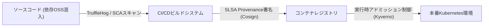
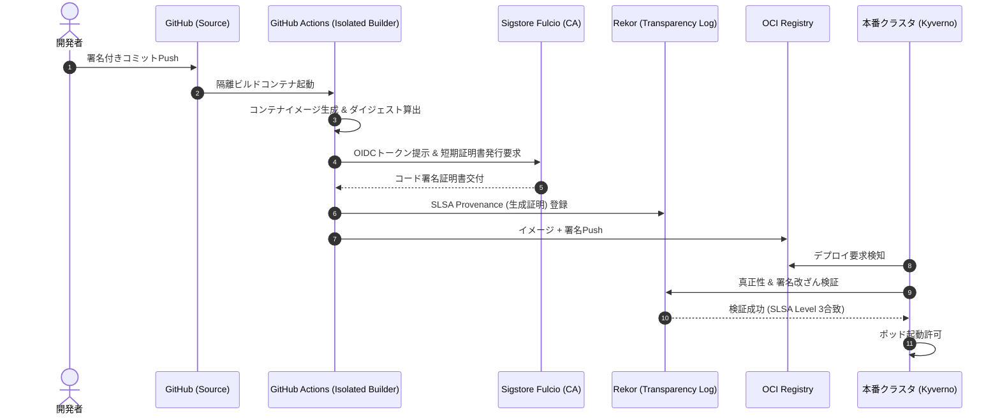

# 第16章：サプライチェーンセキュリティと継続的コンプライアンス（DevSecOps）

かつてセキュリティは、リリース直前に外部の専門家が侵入テスト（ペネトレーションテスト）を実施し、分厚いPDFレポートを突きつける「開発プロセスの最終ゲート」であった。しかし、現代のクラウドネイティブなソフトウェア開発において、この旧来のアプローチは完全に破綻している。毎週、毎日、あるいは毎時間デプロイされる現代のアプリケーションに対し、年に1回の手動診断は何の防護にもならない。

さらに致命的なのは、現代のソフトウェアの90%以上が「自社で書いたコード」ではなく「オープンソースソフトウェア（OSS）やサードパーティライブラリ」で構成されているという冷酷な現実である。Log4jの脆弱性（Log4Shell）やXZ Utilsに仕込まれた巧妙なバックドア事件が証明したように、自社のコードに1行の脆弱性がなくとも、依存しているたった1つのOSSパッケージが汚染されるだけで、システム全体が瞬時に制圧される。

本章では、セキュリティを独立したフェーズではなく開発プロセスそのものに不可逆的に埋め込む「DevSecOps」の実践として、ソフトウェア部品表（SBOM）の自動生成と継続監査、SLSAフレームワークへの適合、シークレット漏洩の機械的阻止、そしてAIを活用した依存性更新レビューの全容を解説する。

---

## 16.1 ソフトウェアサプライチェーンの脅威と品質保証の責務

国際標準化機構が定める品質特性規格 ISO/IEC 25010 において、セキュリティ（Security）は信頼性や機能適合性と並ぶ第一級の「製品品質」として位置付けられている。機密性・完全性・真正性が損なわれたプロダクトは、どれほど高機能で洗練されたUIを備えていても「不良品」である。

サプライチェーン攻撃は、コードのリポジトリ、ビルドシステム、配布パイプラインの各結節点を標的とする。



品質保証（QA）チームの責務は、「単体テストの合否」を確認することと同様に、「ビルド成果物がどのソースコードから、改ざんされずに生成されたかという真正性（Provenance）」を決定論的に確証することに拡張されなければならない。

---

## 16.2 SBOMの自動生成とSyft/Grypeによる継続監査

物理的な製造業において全構成部品の原産地証明（BOM）が義務付けられているのと同様に、ソフトウェア産業でも「ソフトウェア部品表（SBOM）」の添付が法規制により急速に義務化されている。

代表的な標準フォーマットとして、Linux Foundationが推進する `SPDX` と、OWASPが主導する `CycloneDX` が存在する。

### SyftとGrypeによるCIパイプラインの自動化

オープンソースツールの `Syft`（SBOM生成）と `Grype`（脆弱性スキャナ）を組み合わせることで、ビルド成果物（Dockerイメージ等）から全依存関係を抽出し、既知の脆弱性データベース（NVD、GitHub Advisory Database）と照合してCIをブロックする。

```yaml
# .github/workflows/sbom-audit.yml
name: Security Supply Chain Audit

on:
  pull_request:
    branches: [main]

jobs:
  sbom-vulnerability-scan:
    runs-on: ubuntu-latest
    steps:
      - uses: actions/checkout@v4

      - name: Build Container Image
        run: docker build -t app:local .

      - name: Generate SBOM (CycloneDX)
        uses: anchore/sbom-action@v0
        with:
          image: app:local
          format: cyclonedx-json
          output-file: sbom.cyclonedx.json

      - name: Scan Vulnerabilities with Grype
        uses: anchore/scan-action@v3
        with:
          sbom: sbom.cyclonedx.json
          fail-build: true
          severity-cutoff: high # HighおよびCritical脆弱性でCIを遮断
```

---

## 16.3 SLSAフレームワークへの適合とCosign署名

SBOMによって構成部品が判明しても、「そのコンテナイメージが、本当にGitHub上のあのコミットからCIによってビルドされたものか？」という疑問は残る。攻撃者がコンテナレジストリの認証情報を奪い、悪意あるイメージにすり替えるリスクが存在するためである。

Googleが主導する `SLSA（Supply-chain Levels for Software Artifacts）` は、ビルド成果物の完全性を保証するためのセキュリティフレームワークである。

### SLSAサプライチェーン整合性モデル



### SLSA Level 3達成のためのCosign署名

Sigstoreプロジェクトの `Cosign` を利用し、OIDC（OpenID Connect）連携による鍵不要（Keyless）署名をCI/CD上で実行する。なぜ従来のPGP署名のように「秘密鍵の生成・保管・ローテーション」が一切不要になるのでしょうか。それはビルド実行時にGitHub Actionsが発行する身分証（OIDCトークン）を認証局（Sigstore Fulcio）へ提示し、**「わずか10分間だけ有効な使い捨ての署名証明書」を発行して署名した直後に、秘密鍵をメモリ上から即座に破棄する**からである。「有効期間中（その10分間のうち）に本当に正規のCIで署名が行われた」という事実と公開鍵証明書は、改ざん不能な公開透明性ログ（Rekor）にタイムスタンプ付きで永久刻印されるため、後からデプロイ時に秘密鍵を使わずとも真正性を100%数学的に検証できる。これにより、Kubernetesのアドミッションコントローラ（Kyverno等）で「GitHub Actionsの正規ワークフローで署名されたイメージのみ起動を許可する」という決定論的防御が実現する。

※なお、SLSA Level 3が要求する「隔離されたエフェメラル（使い捨て）ビルド環境」について、GitHub Actionsの標準ランナー（`ubuntu-latest` 等）はジョブごとにクリーンなVMが新規起動・破棄されるため標準で要件を満たしている。一方、セルフホステッドランナーを利用する場合は、ビルド間でキャッシュやファイルが残留して改ざん経路とならないよう注意が必要である。必ずActions Runner Controller（ARC）を用い、Kubernetes上で「1ジョブ1Podの使い捨てコンテナ」として起動する構成としなければならない。

```bash
# GitHub ActionsのOIDCトークンを用いて署名を実行
cosign sign --yes ghcr.io/myorg/myapp:v1.2.0

# デプロイ環境での署名検証
cosign verify ghcr.io/myorg/myapp:v1.2.0 \
  --certificate-identity "https://github.com/myorg/myapp/.github/workflows/release.yml@refs/heads/main" \
  --certificate-oidc-issuer "https://token.actions.githubusercontent.com"
```

---

## 16.4 シークレット混入防止のプリコミットとCIガードレール

GitHubやGitLabに誤ってAWS秘密鍵、DBパスワード、APIトークンをコミットしてしまう「シークレット漏洩」は、企業にとって致命的な侵害インシデントに直結する。パブリックリポジトリにコミットされた秘密鍵は、わずか数秒でクローラーに検知され悪用される。

シークレットの流出を防ぐ上で最も重要な鉄則は、「リモートリポジトリにプッシュされた後に対処するのでは遅すぎる」という点である。一度でもGitHubにプッシュされたシークレットは、Git履歴の書き換えを行っても、外部のクローラーによって既に収集されている危険性が極めて高い。防護網は「コミット前のローカル（pre-commit）」と「プッシュ受付時のサーバーサイド（pre-receive hook）」、そして「CIパイプライン（プルリクエスト検査）」という3層の多重防壁で構築する。

オープンソースの高性能検知エンジン TruffleHog は、800種類以上の既知シークレット形式に対応する正規表現と、高エントロピー文字列の統計的検出を組み合わせ、さらには検出した認証情報が「実際に有効（Live）であるか」を各プロバイダAPIへ安全に問い合わせて真偽を判定する能力を持つ。これにより、テスト用のダミーキーによる大量の誤検知に悩まされることなく、真の脅威のみを決定論的に遮断できる。

オープンソースの検知エンジン `TruffleHog` を用いて、エントロピー解析および正規表現により、コミット前のローカル（pre-commit）およびCIの両レイヤーで物理的に遮断する。

```yaml
# .pre-commit-config.yaml
repos:
  - repo: https://github.com/trufflesecurity/trufflehog
    rev: v3.63.11
    hooks:
      - id: trufflehog
        name: TruffleHog Secret Scanner
        entry: trufflehog git file://. --since-commit HEAD --only-verified --fail
        language: system
        stages: [pre-commit]
```

### ツール群の段階的導入コストと「誤検知（False Positive）の嵐」を抑えるチューニング知見

Syft、Grype、Cosign、TruffleHogという4大ツールを初めて現場に導入する際、全ツールを初日からブロッキング設定で一斉投入すると「誤検知（False Positive）と修正不能な古い脆弱性アラートの嵐」によって開発が完全停止し、現場の強い反発を招く。挫折を防ぐための現実的なチューニングの鉄則は以下の3点である。

1. **TruffleHogは必ず `--only-verified` から開始する**: 単なる高エントロピー文字列（UUIDやテスト用ハッシュ）まで遮断すると開発者が疲弊するため、まずはプロバイダAPIで「実際に有効な鍵」と確証されたものだけをブロックする。
2. **Grypeの `--only-fixed` オプションと `.grype.yaml` 除外の活用**: OSベースイメージに含まれる「修正パッチがまだ存在しない脆弱性（Won't Fix）」でCIを止めないよう、`--only-fixed`（修正済みが存在する脆弱性のみ遮断）を指定する。また、到達不能な脆弱性は有効期限付きで `.grype.yaml` の `ignore` リストに登録する。
3. **段階的ロールアウト（TruffleHog ➔ Syft/Grype ➔ Cosign）**: まずは導入コストがほぼゼロのTruffleHog（Week 1）から開始する。次にSBOM可視化とGrype監査（Week 2）を導入し、最後にKubernetes環境側の整備を伴うCosign署名検証（Month 2）へと段階的に引き上げることで、最小の摩擦でSLSA Level 3へ到達できる。

---

## 16.5 AI確証実践：Dependabot更新PRのAIセキュリティ精査

DependabotやRenovateを導入すると、毎週数十件の依存関係更新PRが起票される。しかし「どのPRに破壊的変更があるか」「どのPRが潜在的悪意を含んでいるか」を目視で確認する負荷は凄まじく、やがて開発者は差分を見ずにマージするか、あるいはPRを放置するようになる。

この課題を解決するため、依存ライブラリのリリースノート、Gitコミットログ、差分ASTを自動取得し、リスクと破壊的変更を要約してレビューコメントを自動投稿する「AI Dependency Reviewer」を構築する。

```python
# tools/ai_dependency_reviewer.py
import os
import json
import urllib.request

def audit_dependency_update(package_name, old_version, new_version, release_notes, diff_stat):
    api_key = os.environ.get("GEMINI_API_KEY")
    if not api_key:
        return "AI Review Skipped."

    system_prompt = (
        "あなたはDevSecOpsエンジニアおよびソフトウェアアーキテクトです。\n"
        "OSSパッケージのバージョンアップ情報から、潜在的なセキュリティリスク、破壊的変更（Breaking Changes）、\n"
        "および既存コードへの影響度を精査し、開発者が安全にマージできるかを判定してください。\n\n"
        "【出力スキーマ】\n"
        "- risk_level: LOW / MEDIUM / HIGH / CRITICAL\n"
        "- breaking_changes: 破壊的変更の箇条書き\n"
        "- recommendation: MERGE_SAFE / MANUAL_TEST_REQUIRED / BLOCK\n"
        "- summary: 開発者向け要約文"
    )

    user_content = f"パッケージ: {package_name} ({old_version} -> {new_version})\n\n差分統計:\n{diff_stat}\n\nリリースノート:\n{release_notes}"

    payload = {
        "contents": [{"role": "user", "parts": [{"text": f"{system_prompt}\n\n{user_content}"}]}],
        "generationConfig": {"response_mime_type": "application/json"}
    }
    url = f"https://generativelanguage.googleapis.com/v1beta/models/gemini-2.5-flash:generateContent?key={api_key}"
    req = urllib.request.Request(url, data=json.dumps(payload).encode("utf-8"), headers={"Content-Type": "application/json"})
    with urllib.request.urlopen(req, timeout=15) as resp:
        res = json.loads(resp.read().decode("utf-8"))
        return json.loads(res["candidates"][0]["content"]["parts"][0]["text"])

def post_github_pr_comment(repo: str, pr_number: int, review_json: dict):
    """AIの審査結果JSONを整形し、GitHub REST API経由でPRへ自動コメント投稿する糊代関数"""
    gh_token = os.environ.get("GITHUB_TOKEN")
    if not gh_token:
        print(json.dumps(review_json, ensure_ascii=False, indent=2))
        return
    body_md = (
        f"### 🛡️ AI Dependency Security Review\n"
        f"- **Risk Level**: `{review_json.get('risk_level')}`\n"
        f"- **Recommendation**: **{review_json.get('recommendation')}**\n"
        f"- **Summary**: {review_json.get('summary')}\n"
    )
    api_url = f"https://api.github.com/repos/{repo}/issues/{pr_number}/comments"
    req = urllib.request.Request(
        api_url,
        data=json.dumps({"body": body_md}).encode("utf-8"),
        headers={"Authorization": f"Bearer {gh_token}", "Accept": "application/vnd.github+json"},
        method="POST"
    )
    urllib.request.urlopen(req, timeout=10)

if __name__ == "__main__":
    # GitHub Actions上で Dependabot PR の環境変数を受け取って審査＆コメント投稿まで一気通貫で実行
    result = audit_dependency_update(
        package_name=os.environ.get("DEP_PACKAGE", "urllib3"),
        old_version=os.environ.get("DEP_OLD_VER", "1.26.0"),
        new_version=os.environ.get("DEP_NEW_VER", "2.2.1"),
        release_notes=os.environ.get("DEP_RELEASE_NOTES", "Removed deprecated TLSv1.0 support."),
        diff_stat=os.environ.get("DEP_DIFF_STAT", "requirements.txt | 2 +-")
    )
    if isinstance(result, dict) and os.environ.get("GITHUB_REPOSITORY") and os.environ.get("PR_NUMBER"):
        post_github_pr_comment(os.environ["GITHUB_REPOSITORY"], int(os.environ["PR_NUMBER"]), result)
```

※上記のサンプルは、追加パッケージなしでどのCI環境でも即座に動作するよう標準ライブラリ（`urllib.request`）で記述している。実務で依存管理されたコンテナから実行する場合は、公式の `google-genai` SDKや `requests` ライブラリ（`HTTPAdapter(max_retries=3)` 付き）を用いることで、リトライや例外処理をより簡潔に記述できる。

---

## 16.6 QA合否判定基準：DevSecOps品質クライテリア

セキュリティとサプライチェーンに関する客観的合否判定マトリクスを策定する。

### セキュリティ品質判定マトリクス

| 検査領域 | 合格基準（Pass） | 警告水準（Warn） | 不合格（Fail / マージ即時遮断） |
| :--- | :--- | :--- | :--- |
| **既知の脆弱性 (SCA)** | Critical/High脆弱性 0件 | Medium脆弱性 3件以下（改修計画あり） | CVSS 7.0以上の未対応脆弱性が1件でも存在。 |
| **シークレット漏洩** | 漏洩検知 0件 | 該当なし | 有効な秘密鍵やトークンの平文混入を検知。 |
| **サプライチェーン完全性** | SLSA Level 2以上、Cosign署名完備 | ビルドログのみ保持 | 署名なし、または未検証レジストリからの取得。 |
| **SBOM整備** | ビルド成果物ごとにCycloneDX形式を出力 | 最新タグのみ出力 | SBOMファイルが存在しない。 |

---

## 16.7 アンチパターン対比：従来のセキュリティ vs DevSecOps

| 観点 | アンチパターン（ゲートキーパー型） | ベストプラクティス（DevSecOps） |
| :--- | :--- | :--- |
| **診断タイミング** | リリース直前に数週間かけて専門部署が診断。 | コミット時、PR作成時、ビルド時にCIで毎コミット自動検査。 |
| **脆弱性対応** | 200ページのPDFレポートを受け取り、開発現場が絶望して放置。 | GrypeとDependabotが個別PRとして起票し、AIが修正パッチを提案。 |
| **構成把握** | 「本番環境にどのOSSのどのバージョンが入っているか」を誰も知らない。 | SyftによるSBOM生成が全ビルドで自動化され、全社カタログ化。 |
| **シークレット管理** | Git履歴に秘密鍵を誤コミットし、コミットを上書きして誤魔化す。 | TruffleHogがローカルで遮断。万一漏洩時は即座にAPIで鍵失効。 |

---

## 16.8 実践ワークショップ：リポジトリのセキュリティ・ポスチャ監査演習

### 演習手順

1. **TruffleHogによる全履歴シークレットスキャン**: `trufflehog git file://. --only-verified` をローカルで実行し、過去のGit履歴に生きているシークレットが残存していないか検証する。
2. **SyftによるSBOM抽出とGrype検証**: 自チームのメイン成果物から `syft . -o json | grype` を実行し、既知のCritical/High脆弱性が存在しないかを可視化する。
3. **CIセキュリティパイプラインのコード化**: 上記の検証ステップをGitHub Actionsワークフローに組み込み、CVSS 7.0以上の脆弱性混入時にマージが遮断されることをPRで確認する。

---

## 16.9 第IV部の総括と第V部への接続

第14章から本章（第16章）に至る「第IV部：動的検証・シフトライト・セキュリティ品質」では、稼働するソフトウェアを包括的に確証する多重防護体系を構築してきた。

- **第14章**: Testcontainersによる決定論的隔離環境と、Playwrightによる自己修復E2Eテスト。
- **第15章**: デプロイとリリースの完全分離、カナリア自動切戻し、SLI/SLOと非難のないポストモーテム。
- **第16章**: SBOM自動生成、SLSA完全性署名、シークレット遮断、AIによるサプライチェーン確証。

ここまでの議論は、入力に対して決定論的に振る舞う「従来の決定論的ソフトウェア」を前提としていた。しかし、現代のプロダクト開発において最も急速に普及し、かつ最も品質管理が困難な領域が「機械学習・大規模言語モデル（LLM）を組み込んだAIプロダクト」である。続く「第V部：【最前線】AIプロダクト品質とLLMアプリケーションの確証」では、確率的かつ非決定論的に振る舞うAIをどのようにテストし、評価し、安全性を保証するかという未知のフロンティアへ足を踏み入れる。
