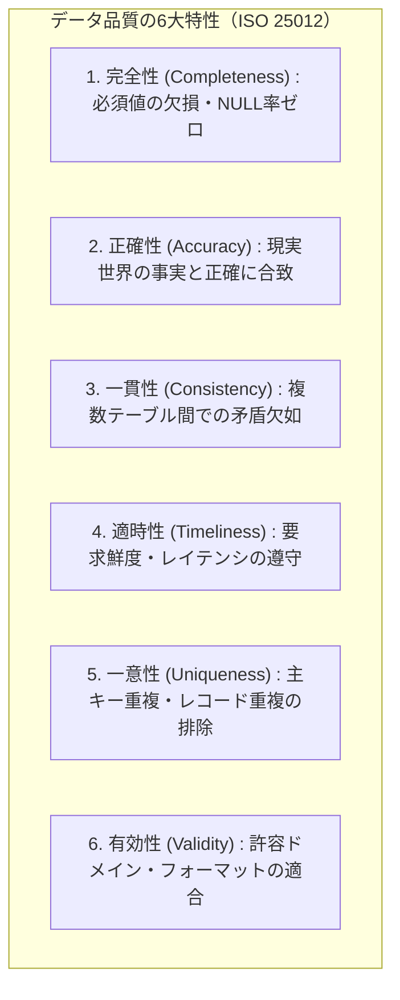
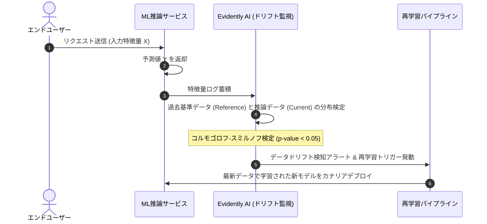

# 第17章：データ品質と機械学習パイプラインの検証（Data & ML Quality）

「プログラムコードには一切のバグがなく、単体テストも全件合格している。しかし、本番システムが完全に誤った予測を出力し、巨額の損失をもたらした」――これは機械学習（ML）やデータ分析基盤を組み込んだ現代のプロダクトにおいて、最も頻発する悪夢である。従来のソフトウェア工学が「コードの正しさ」を保証してきたのに対し、AIプロダクトの挙動は「コード」と「入力されるデータ」の積によって決定される。

ガベージイン・ガベージアウト（Garbage In, Garbage Out）の格言通り、入力データに欠損、異常値、あるいは統計的分布の歪み（ドリフト）が生じれば、いかに精緻にチューニングされたモデルであっても容易に破綻する。そして恐ろしいことに、データ起因の欠陥は実行時エラー（NullPointerException等）を発生させず、静かに不正な数値をユーザー画面へ流し込み続ける。

本章ではデータ品質を第一級のテスト対象とし、Great Expectationsによるテスト自動化、Evidently AIによるドリフト監視、特徴量の再現性保証、そしてAIを活用したデータ自己修復パイプラインを体系化する。

---

## 17.1 データ品質の6大特性とISO 25012

データ品質を科学的に管理するために、国際規格 ISO/IEC 25012（データ品質モデル）およびDAMA-DMBOKが定義する「データ品質の6大特性」をテスト設計の評価軸として採用する。



### 各特性に対する客観的アサーション

1. **完全性**: `user_id` や `created_at` などの必須カラムにNullが存在しないこと。
2. **正確性**: 年齢カラムに負数（-5）や非現実的な数値（300）が含まれていないこと。
3. **一貫性**: 注文テーブルの総額が、注文明細テーブルの小計＋送料と厳密に一致していること。
4. **適時性**: イベント発生時刻とパイプライン取り込み時刻の乖離が5分以内であること。
5. **一意性**: 同一トランザクションIDのレコードが複数存在しないこと。
6. **有効性**: 郵便番号が正規表現 `^\d{3}-\d{4}$` に合致し、メールアドレスの形式がRFCに準拠していること。

---

## 17.2 Great Expectationsによるデータパイプラインテスト自動化

コードに対して `pytest` や `JUnit` を書くのと全く同じ感覚で、データに対してアサーション（Expectations）を定義するオープンソースのデファクトスタンダードが `Great Expectations` である。

### 17.2.1 データスイートの定義とCI実行

ETL（抽出・変換・格納）パイプラインの各結節点において、データフレームやSQLテーブルに対して期待値（Expectation）を宣言的に記述する。

```python
# pipeline/validate_orders.py
import great_expectations as gx
import pandas as pd
import sys

def validate_incoming_orders(df: pd.DataFrame):
    context = gx.get_context()
    data_source = context.data_sources.add_pandas("pandas_source")
    data_asset = data_source.add_dataframe_asset("orders_asset")
    batch_definition = data_asset.add_batch_definition_whole_dataframe("batch_def")
    batch = batch_definition.get_batch(batch_parameters={"dataframe": df})

    suite = context.suites.add(gx.ExpectationSuite(name="orders_quality_suite"))

    # 1. 完全性チェック: order_id は null 禁止
    suite.add_expectation(
        gx.expectations.ExpectColumnValuesToNotBeNull(column="order_id")
    )

    # 2. 一意性チェック: order_id はユニーク
    suite.add_expectation(
        gx.expectations.ExpectColumnValuesToBeUnique(column="order_id")
    )

    # 3. 有効性チェック: total_amount は 0 以上 1,000,000 円以内
    suite.add_expectation(
        gx.expectations.ExpectColumnValuesToBeBetween(column="total_amount", min_value=0, max_value=1000000)
    )

    # 4. カテゴリ有効性チェック: status は指定値のみ
    suite.add_expectation(
        gx.expectations.ExpectColumnValuesToBeInSet(
            column="status",
            value_set=["PENDING", "PAID", "SHIPPED", "CANCELLED"]
        )
    )

    validation_results = batch.validate(suite)
    if not validation_results.success:
        print("❌ データバリデーション失敗: 不正なレコードが検出されました。")
        sys.exit(1)
    print("✅ 全てのデータ品質Expectationsをパスしました。")
```

このバリデーションをAirflowやPrefect、GitHub Actionsのパイプラインに埋め込むことで、不正データのDWH（データレイク）への流入を境界で物理的に遮断する。なお、Great Expectationsはバージョンアップが速く、旧来のV2 API（`Dataset` 継承方式）と最新のV3 / GX Core 1.0以降で記述が大きく異なる。上記のコードは最新のFluent Data Sources方式（`context.data_sources.add_pandas` 等）に準拠している。そのため、環境構築時は `requirements.txt` で `great_expectations>=1.0.0` のようにメジャーバージョンを厳密にピン留めすることが必須である。

---

## 17.3 本番稼働後の品質劣化：データドリフトと概念ドリフトの監視

静的テストをクリアして本番投入されたモデルであっても、時間の経過とともに予測精度は確実に劣化する。現実世界の変化によってデータの統計的性質が変化するためである。



### ドリフトの2分類

1. **データドリフト（共変量シフト / Covariate Shift）**: 入力特徴量 $P(X)$ の分布が変化すること。例: 若年層向けだったECサイトにシニア層が急増し、平均年齢や閲覧時間帯の分布が大きくシフトする。
2. **概念ドリフト（Concept Drift）**: 入力と出力の関係性 $P(Y \mid X)$ が変化すること。例: パンデミックの発生によって、同じ検索キーワード（マスク、旅行）に対するユーザーの購買行動の意味合いが根本から変容する。

オープンソースの `Evidently AI` を用いて、コルモゴロフ-スミルノフ検定（KS検定）や母比率の差の検定を日次で自動実行し、有意水準 $p < 0.05$ で分布差を検知した場合に自動アラートを発報する。

---

## 17.4 特徴量エンジニアリングとモデル学習の再現性・監査証跡

AIシステムの品質保証における最大の障壁の一つが、「モデルの再現性（Reproducibility）」である。数ヶ月前にデプロイされたモデルがどのようなデータ、どのようなハイパーパラメータ、どのようなコードで学習されたのかが追跡できない場合、障害時のデバッグや規制当局への説明は不可能となる。

特徴量ストア（Feature Store）の採用は、学習時と推論時における特徴量計算の乖離（Training-Serving Skew）を防ぐ上で決定的な役割を果たす。オフラインのバッチ学習で用いた集計SQLと、オンライン推論APIで実行したリアルタイム計算ロジックにわずかでも差異が存在すれば、モデルは学習時と異なる世界を観測することになり、性能が劇的に崩壊する。

MLflowやDVC（Data Version Control）、あるいはFeastのような特徴量ストアを活用し、以下の4要素を不可分に紐付けてコミットハッシュとともに記録・監査する：

1. **データバージョン**: 学習に用いた生データの不変スナップショット（S3/GCSハッシュ）。
2. **コードバージョン**: 特徴量変換ロジックと学習スクリプトのGitコミットハッシュ。
3. **環境定義**: PythonライブラリやCUDAバージョンを含むDockerコンテナダイジェスト。
4. **パラメータと評価メトリクス**: シード値、ハイパーパラメータ、検証データに対するAUC・F1スコア。

---

## 17.5 AI確証実践：スキーマ不整合と異常値パターンのAI自己修復

上流の提携先システムやスクレイピング対象のWebサイトで予告なくカラム名が変更されたり、フォーマットが変わったりすることでデータパイプラインが停止することがある。

LLMを用いてスキーマの差分をセマンティックに推論し、自動でカラムマッピングや型キャストルールを修正してパイプラインを救済する「AI Data Pipeline Self-Healing」を構築する。

```python
# tools/ai_schema_healer.py
import os
import json
import urllib.request

def repair_broken_schema(target_schema, incoming_columns_sample):
    api_key = os.environ.get("GEMINI_API_KEY")
    if not api_key:
        return "AI Schema Repair Skipped."

    system_prompt = (
        "あなたはデータエンジニアリングおよびスキーマ解決のスペシャリストです。\n"
        "パイプラインが期待する正規スキーマと、上流から届いた未定義のカラム名・サンプル値を突合し、\n"
        "最適なカラムマッピング（リネーム・型変換ルール）をJSONで提案してください。\n\n"
        "【出力スキーマ】\n"
        "{\n"
        "  "mapping": {"incoming_col": "expected_col"},\n"
        "  "transformations": {"incoming_col": "cast_or_regex_rule"},\n"
        "  "confidence": 0.95\n"
        "}"
    )

    user_content = f"【期待するスキーマ】:\n{json.dumps(target_schema)}\n\n【届いたデータサンプル】:\n{json.dumps(incoming_columns_sample)}"
    payload = {
        "contents": [{"role": "user", "parts": [{"text": f"{system_prompt}\n\n{user_content}"}]}],
        "generationConfig": {"response_mime_type": "application/json"}
    }
    url = f"https://generativelanguage.googleapis.com/v1beta/models/gemini-1.5-flash:generateContent?key={api_key}"
    req = urllib.request.Request(url, data=json.dumps(payload).encode("utf-8"), headers={"Content-Type": "application/json"})
    with urllib.request.urlopen(req) as resp:
        res = json.loads(resp.read().decode("utf-8"))
        return json.loads(res["candidates"][0]["content"]["parts"][0]["text"])
```

ただし、本番パイプラインでLLMによるスキーマ自動修復を運用する際は、悪意ある外部入力データ（カラム名等に仕込まれたプロンプトインジェクション）や、ハルシネーションによる誤ったカラム結合（例：`user_id` と `order_id` の取り違え）に対する安全弁が不可欠である。したがって、LLMの出力はあらかじめ定義した許可リスト（ホワイトリスト化された型変換関数のみ）で厳格にバリデーションする。さらに、確信度（`confidence`）が閾値（0.95）未満の場合や金額・決済系の重要カラムが変化した場合は自動適用せず、退避テーブル（Dead Letter Table）へ生データを隔離した上でデータエンジニアへSlack通知するフォールバック処理を必ず組み込むこと。

---

## 17.6 QA合否判定基準：データ＆MLパイプライン品質クライテリア

データおよびMLパイプラインにおける客観的合否判定マトリクスを策定する。

### データ品質判定マトリクス

| 検査領域 | 合格基準（Pass） | 警告水準（Warn） | 不合格（Fail / パイプライン停止） |
| :--- | :--- | :--- | :--- |
| **完全性・一意性** | 主キーNull率 0.0%、重複率 0.0% | 該当なし | 1件でもNullまたは重複が存在。 |
| **ドメイン妥当性** | Great Expectations Pass率 100% | 警告アサーション 5%未満 | クリティカルExpectationの失敗。 |
| **データドリフト** | ドリフト検知特徴量 0件（p >= 0.05） | 1〜2件の特徴量でドリフト検知 | 3件以上のコア特徴量でドリフト（再学習必須）。 |
| **パイプライン遅延** | SLA（例: 毎朝6時完了）遵守 | SLAから15分以内の遅延 | SLA超過による後続システム未更新。 |

---

## 17.7 アンチパターン対比：従来のデータ運用 vs 現代のデータ品質保証

| 観点 | アンチパターン（破綻するデータ基盤） | ベストプラクティス（データ品質エンジニアリング） |
| :--- | :--- | :--- |
| **検証タイミング** | DWHにデータを格納した後、BIダッシュボードが壊れて気付く。 | データ取り込み境界でGreat Expectationsが自動検証・遮断。 |
| **劣化の検知** | ユーザーから「最近レコメンドがおかしい」と苦情が来て発覚。 | Evidently AIが日次で分布検定を行い、事前予測で再学習。 |
| **スキーマ変更** | 上流の変更でバッチがエラー停止し、深夜に手作業でSQL修正。 | セマンティックAIマッピングにより、軽微なカラム変更を自動解決。 |
| **再現性** | 「当時のモデルがなぜこの出力になったか」が二度と再現できない。 | DVCとMLflowでデータ・コード・環境を完全バージョン固定。 |

---

## 17.8 実践ワークショップ：Great Expectationsによるデータテスト作成演習

### 演習手順

1. **サンプルCSVの準備**: 自社プロダクトの主要データ（ユーザー、注文、ログ等）から100行のサンプルCSVを抽出する。
2. **ExpectationSuiteの定義**: 「Null禁止」「数値範囲」「許可カテゴリ一覧」の3つのバリデーションルールを記述する。
3. **意図的な異常データの混入と検知**: CSVに意図的に重複行やマイナスの金額を混入させ、バリデーションスクリプトが即座にExit Code 1で異常終了することを確認する。

---

## 17.9 本章のまとめと次章への接続

データ品質管理とは、単なるデータベースの制約チェックではなく、「非決定論的システムに確証を与えるための絶対的前提条件」である。

- **6大特性の計装**: 完全性・正確性・一意性などをGreat Expectationsでコード化する。
- **継続的ドリフト監視**: Evidently AIにより、静かな精度の劣化を統計検定で捉える。
- **再現性と追跡性**: MLflowやDVCによって、監査可能なMLパイプラインを確立する。

しかし、データ品質が保証されたとしても、近年の生成AI（LLM）アプリケーションには「ハルシネーション（嘘の生成）」「プロンプトインジェクション」「出力の確率的不確実性」という独自の難題が立ちはだかる。次章（第18章）では、LLMアプリケーション品質の最前線である「LLM-as-a-Judge・RAG評価・AI安全性」の確証技術へと歩を進める。
