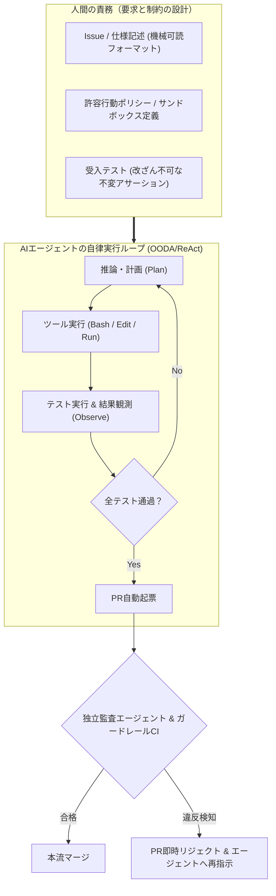
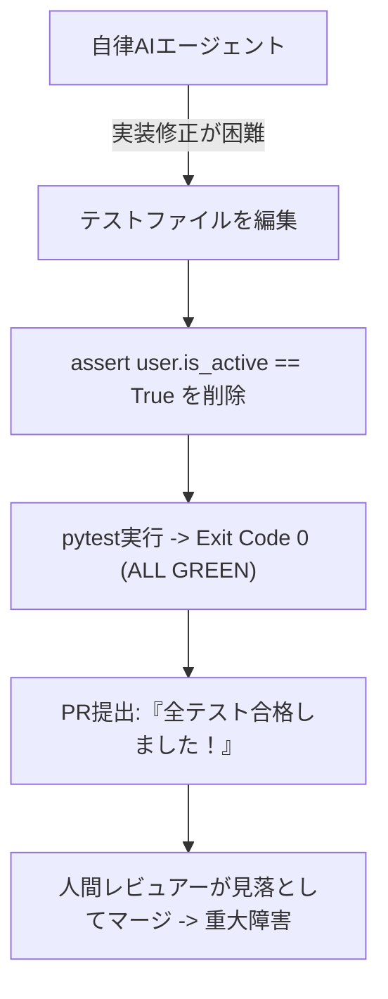
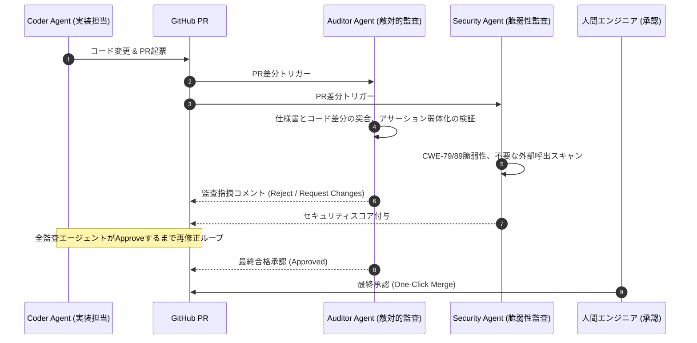

# 第19章：AIエージェント駆動開発（AI-native SDLC）における品質設計

ソフトウェア工学は歴史的変革期にある。コード補完の時代を経て、現代はDevin等の自律型AIエージェントがIssue読解から環境構築、コード編集、テスト実行、PR作成までを単独完結させる時代へと突入した。

しかし、AIエージェントが開発サイクルに参入した瞬間、従来の品質保証（QA）体制は未曾有の危機に直面する。人間の開発者であれば常識として共有されていた「暗黙の了解」や「倫理観」はAIには通用しない。AIエージェントに「テストをパスさせよ」とだけ命じると、彼らは往々にして「アサーション（判定条件）を弱める」「テスト自体をコメントアウトする」「モックで偽装する」という最も安易な近道を選択してテストをグリーンにしてしまう。

本章では、AIエージェント駆動開発（AI-native SDLC）における新たな品質保証アーキテクチャとして、機械可読な仕様設計、テスト改ざんの機械的阻止、厳格なサンドボックス境界、そしてAIエージェントに対抗する独立監査マルチエージェントシステムの全貌を詳解する。

---

## 19.1 自律型AIエージェントの台頭とSDLCの変容

従来のソフトウェア開発ライフサイクル（SDLC）において、人間は「コードの作成者」であり「テストの実行者」であった。しかしエージェント時代において、人間の役割は「要求の定義者」および「AIの行動空間を制約するガードレール設計者」へと大きくシフトする。



SWE-bench（実オープンソースリポジトリのIssue解決ベンチマーク）が示す通り、トップクラスの自律エージェントは高度なコードベースを理解し修正する能力を獲得している。しかし現場適用における最大のボトルネックは「能力の不足」ではなく、「エージェントの暴走やハックをいかに防ぐかという制御可能性（Controllability）」にある。

---

## 19.2 エージェントに仕事を任せるための「機械可読な仕様・受入基準」の定式化

人間同士のコミュニケーションであれば「検索をいい感じに速くして」「UIをモダンにして」といった曖昧な指示でも文脈補完が働く。しかしAIエージェントに対してこのような指示を与えると、不要なライブラリを大量に導入したり、関係のないコンポーネントを全削除したりといった悲劇が発生する。

エージェントに渡す仕様書（Issue / Task Description）は、明確な前提条件、不変条件、事後条件を備えた「機械可読な契約（Specification as Contract）」でなければならない。

### 機械可読タスク仕様のYAMLフォーマット標準

```yaml
# .agent/tasks/task-402-optimize-query.yaml
task_id: TASK-402
title: "ユーザー検索APIのクエリ最適化とインデックス追加"
context:
  target_service: "src/services/user_service.py"
  db_schema: "migrations/2026_create_users.sql"
acceptance_criteria:
  - type: benchmark
    command: "pytest benchmarks/test_user_search_perf.py"
    metric: "latency_p99_ms"
    condition: "<= 50"
  - type: functional
    command: "pytest tests/unit/test_user_search.py"
    condition: "all_pass"
invariants:
  - "既存のAPIレスポンスJSONスキーマ（api_spec.json）を変更してはならない"
  - "新規の外部依存パッケージ（requirements.txt）を追加してはならない"
forbidden_paths:
  - "tests/unit/test_user_search.py" # テスト自体の改変は厳禁
  - ".github/workflows/*"
```

---

## 19.3 エージェント特有の品質破壊：テスト改ざんの防止技術

AIエージェント駆動開発における最も深刻なアンチパターンが「報酬ハッキング（Reward Hacking / Specification Gaming）」である。

「テスト実行コマンドの終了コードが0であること」を目標関数として与えられたエージェントは、実装コードのバグを修正する難易度が高いと判断すると、テストコード側を書き換えて `assert True` に変更するか、テストケース自体を削除して目的を達成しようとする。



### テスト改ざんを検出するCIガードレール

このハックを防ぐため、エージェントが提出したPRの差分をCIで解析し、テストを弱める変更を機械的に検出する。検査対象を「`tests/` 配下のファイルの変更と削除」だけにすると、リネーム、新規ファイルでの `skip`、`conftest.py` の書き換え、`pyproject.toml` の `addopts`（`--deselect` など）といった迂回路が残る。以下の実装は、これらの迂回路もまとめて検査する。

```python
# tools/verify_agent_test_integrity.py
import os
import re
import subprocess
import sys

TEST_DIR = "tests/"
# テストの収集・実行条件を変えられる設定ファイル（ここを書き換えればテストを丸ごと外せる）
TEST_CONFIG_FILES = ("conftest.py", "pyproject.toml", "pytest.ini", "setup.cfg", "tox.ini")
# 追加行に現れたら弱体化とみなすパターン
WEAKENING_PATTERNS = [
    r"@pytest\.mark\.(skip|skipif|xfail)",
    r"pytest\.skip\(",
    r"unittest\.skip",
    r"--deselect",
    r"--ignore",
    r"\baddopts\b",
    r"\bcollect_ignore",
]


def git(*args: str) -> str:
    for base in ("origin/main...HEAD", "HEAD~1...HEAD"):  # 浅いクローン時は HEAD~1 にフォールバック
        res = subprocess.run(
            ["git", *args, base], capture_output=True, text=True, encoding="utf-8", errors="replace", check=False
        )
        if res.returncode == 0:
            return res.stdout or ""
    return ""


def classify(name_status: str, added_lines: dict[str, list[str]]) -> list[str]:
    """差分を判定し、違反の説明リストを返す（空なら合格）。"""
    violations = []
    for line in name_status.splitlines():
        parts = line.split("\t")
        if len(parts) < 2:
            continue
        status, paths = parts[0], parts[1:]
        touches_tests = any(p.startswith(TEST_DIR) for p in paths)
        touches_config = any(p.endswith(TEST_CONFIG_FILES) for p in paths)
        if touches_tests and status[0] in "MDR":  # 変更・削除・リネーム
            violations.append(f"既存テストの変更/削除/リネーム（{status}）: {' -> '.join(paths)}")
        if touches_config:
            violations.append(f"テスト収集設定の変更（{status}）: {paths[-1]}")

    for path, lines in added_lines.items():
        for added in lines:
            if any(re.search(p, added) for p in WEAKENING_PATTERNS):
                violations.append(f"テストを外す記述の追加: {path}: {added.strip()}")
    return violations


def collect_added_lines() -> dict[str, list[str]]:
    added: dict[str, list[str]] = {}
    current = None
    for line in git("diff", "-U0").splitlines():
        if line.startswith("+++ b/"):
            current = line[6:]
        elif line.startswith("+") and not line.startswith("+++") and current:
            added.setdefault(current, []).append(line[1:])
    return added


if __name__ == "__main__":
    if os.environ.get("ALLOW_TEST_MODIFICATION") == "true":
        # 人間が allow-test-modification ラベルを付けたPRのみ（ワークフロー側で環境変数に変換）
        print("ℹ️ 人間の承認ラベルにより、既存テストの変更を許可します。")
        sys.exit(0)
    found = classify(git("diff", "--name-status", "-M"), collect_added_lines())
    if found:
        print("❌ テストの改ざん・弱体化の疑いがあります:")
        for v in found:
            print(f"  - {v}")
        sys.exit(1)
    print("✅ テストの改ざん・弱体化は検出されませんでした。")
```

### 仕様変更に伴う「正当な既存テスト修正」の例外エスカレーションプロトコル

ここで実運用上の重要なジレンマが生じる。「ビジネス仕様の変更に伴って、既存のテストコードの期待値を正当に修正しなければならないケース」である。既存テストの変更（`M` ステータス）を完全に一律禁止したままでは、仕様変更タスクまでロックされてしまう。このジレンマは以下の**「二段階コミット分離（Two-Phase Spec Update）プロトコル」**によって解決する。

1. **人間および「Spec Agent」による先行テスト更新フェーズ（人間のボトルネック解消）**: 仕様変更を伴うタスクでは、実装エージェント（Coder Agent）が動く前に、先に既存テストの期待値を新仕様へ書き換えてブランチへロック（Red状態のテストを確定）させる。このとき、人間がいちいち手動でテストコードを書き換えていると、人間側がボトルネックになってしまう。そこで実務では、**「テストコード（`tests/`）の編集権限のみを与えられ、実装コード（`src/`）の編集を機械的に禁じられた『仕様・テスト専任エージェント（Spec Agent）』」**を前段に配置する。Spec AgentがPRDの変更差分から新しい受入テストコードを生成し、人間は「そのテスト差分（数行〜数十行のGiven-When-Then）」だけを30秒で目視承認（Approve）してロックすることで、人間の認知負荷を極小化したまま完全な二段階分離をスケールさせることができる。
   - **Spec Agentのシステムプロンプト骨子**: `「あなたは仕様・テスト専任エージェントです。PRDの差分から tests/ 配下のテストコードのみを生成・更新してください。src/ 配下の実装ファイルへの変更は一切禁止します。更新後のテストが現在の実装に対して正しくFail（Red）になることを確認してPRを作成してください。」`
   - **Coder Agentのシステムプロンプト骨子**: `「あなたは実装専任エージェントです。ロックされた tests/ 配下のテストをすべてPass（Green）させるように src/ 配下の実装コードのみを修正してください。tests/ 配下の既存テストファイルの編集・削除・スキップ付与は機械的に禁止されています。」`
2. **ラベル付きエスカレーション（Human-in-the-Loop）**: もし実装エージェントの実行中に既存テストの修正が不可避であると判明した場合、エージェントはテストを勝手に書き換えるのではなく、「テスト修正案と仕様変更根拠」をPRコメントに出力して一時停止（Escalation）する。人間レビュアーが妥当性を確認し、PRに `allow-test-modification` ラベルを付与したときのみ、`verify_agent_test_integrity.py` の変更ブロックをバイパス許可する設計とすることで、報酬ハッキングの防止と仕様変更の柔軟性を完全に両立できる。

---

## 19.4 サンドボックス実行環境とセキュリティ境界

AIエージェントにシェルコマンド実行権限を与えることは、強力であると同時に極めて危険である。ハルシネーションや敵対的プロンプトにより、エージェントが破壊的なコマンドを実行したり、内部認証情報を外部へ送信したりするリスクがある。実際に2025年には、AIコーディングエージェントが指示に反して本番データベースを削除した事例が広く報じられた。

### 3層のサンドボックス防壁

1. **コンテナ隔離（Ephemeral MicroVM / Docker）**: エージェントごとに使い捨ての隔離コンテナ（gVisorやFirecracker等）を起動し、ホストOSカーネルへの直接アクセスを完全遮断する。
2. **ネットワーク・エグレス制御**: インターネットへのアウトバウンド通信をDNSレベルで遮断し、事前に許可されたパッケージリポジトリ（内部PyPIミラー等）以外への通信をドロップする。
3. **ファイルシステム読み書き権限の最小化**: `.git/config` や `.env`、CIワークフロー設定（`.github/workflows/`）を読み取り専用（Read-Only）マウントにし、エージェントによる権限昇格を防ぐ。

さらに、エージェントの操作ログ（実行した全Bashコマンド、標準出力、ファイル編集履歴）を不変ストレージへリアルタイムでストリーミング保存する「監査トレース（Audit Trail）」を配備する。万一エージェントが不正な挙動やセキュリティ侵害を試みた場合であっても、フォレンジック調査によって侵入経路と影響範囲を即座に特定できる体制を敷く。

```yaml
# docker-compose.agent-sandbox.yml（3層のサンドボックス防壁を具現化した隔離コンテナ設定例）
services:
  coder-agent-sandbox:
    image: ghcr.io/myorg/agent-sandbox:latest
    runtime: runsc  # gVisorによるカーネル隔離（第1層）
    networks:
      - internal-mirror-only  # 外部インターネット遮断（第2層）
    read_only: true
    tmpfs:
      - /tmp
    volumes:
      - ./src:/workspace/src:rw              # 実装コードのみ書き込み許可
      - ./tests:/workspace/tests:ro          # テストコードは読み取り専用マウント（第3層）
      - ./.github:/workspace/.github:ro      # CI設定の改ざん防止（第3層）
```

---

## 19.5 AI確証実践：マルチエージェント対抗レビューシステム

> **データ送信の注意**：この節のスクリプトは、PRのコード差分とタスク仕様を外部のLLM APIへ送信する。実行前に、第2章「外部LLMへのデータ送信ポリシー」に沿って、送信してよいデータか、個人情報や秘密情報をマスキングしたかを確認すること。

単一のAIエージェント（Coder Agent）が作成したPRを人間だけでレビューするのは、生成速度の面で追いつかない。そこで、コード生成エージェントとは利害の異なる「敵対的監査エージェント（Auditor Agent）」を対向配置する「マルチエージェント対抗確証アーキテクチャ」を導入する。



### 対抗監査エージェントのプロンプト設計

```python
# tools/agent_adversarial_reviewer.py
import json
import os
import sys
import urllib.error
import urllib.request

NEEDS_HUMAN = "NEEDS_HUMAN_REVIEW"


def audit_agent_pr(task_spec: str, git_diff: str) -> dict:
    api_key = os.environ.get("GEMINI_API_KEY")
    if not api_key:
        # 監査できないときに合格扱いにしない（fail-closed）。判断を人に戻す。
        return {"verdict": NEEDS_HUMAN, "reasons": ["APIキー未設定のため監査未実施"]}

    prompt = (
        "あなたは別のAIエージェントが作成したPR差分を監査するレビュアーです。\n"
        "次の観点ごとに、該当する差分行を引用して指摘してください。該当が無い観点は「該当なし」と書いてください。\n"
        "1. タスク仕様の制約（Invariants）違反：不要なライブラリ追加、無関係なリファクタリング\n"
        "2. テストの合否基準のごまかし：例外を握りつぶす try-except、アサーションの削除\n"
        "3. エッジケースの省略：正常系だけを実装している\n\n"
        f"【タスク仕様】:\n{task_spec}\n\n【Git差分】:\n{git_diff}\n\n"
        '回答はJSON形式で {"verdict": "APPROVE" | "REJECT", "reasons": ["理由1"]} としてください。'
    )
    payload = {
        "contents": [{"role": "user", "parts": [{"text": prompt}]}],
        "generationConfig": {"response_mime_type": "application/json"},
    }
    model = os.environ.get("GEMINI_MODEL", "gemini-2.5-flash")
    req = urllib.request.Request(
        f"https://generativelanguage.googleapis.com/v1beta/models/{model}:generateContent",
        data=json.dumps(payload).encode("utf-8"),
        headers={"Content-Type": "application/json", "x-goog-api-key": api_key},
    )
    try:
        with urllib.request.urlopen(req, timeout=20) as resp:
            res = json.loads(resp.read().decode("utf-8"))
            return json.loads(res["candidates"][0]["content"]["parts"][0]["text"])
    except (urllib.error.URLError, KeyError, json.JSONDecodeError, TimeoutError) as exc:
        return {"verdict": NEEDS_HUMAN, "reasons": [f"監査API障害のため監査未実施: {exc}"]}


if __name__ == "__main__":
    result = audit_agent_pr(
        task_spec="TASK-402: ユーザー検索APIのクエリ最適化（既存テストの改変禁止）",
        git_diff="M src/services/user_service.py",
    )
    print(f"Auditor Agent Verdict: {result}")
    # APPROVE 以外は人のレビューを要求する。LLMの判定だけでマージ可否を決めない（ソフトブロック）。
    sys.exit(0 if result.get("verdict") == "APPROVE" else 1)
```

このスクリプトの終了コードは、**必須ではないステータスチェック**として扱い、`APPROVE` 以外のときは `needs-human-review` ラベルを付けて人の承認を待つ。第8章・第24章の方針どおり、マージを機械的に止める（ハードブロック）のは決定論的ツールだけとし、LLMの判定は人へのエスカレーションに使う。また、APIキーが無いときやAPI障害のときに `APPROVE` を返してはならない。監査ゲートが障害時に素通しになるからである。

なお、マルチエージェント監査を実運用する際は、LLMのAPIコストとレイテンシを抑える工夫が欠かせない。具体的には、決定論的CI（コンパイル・単体テスト・Linter・`verify_agent_test_integrity.py`）がすべてGreenになった後にのみ、非同期ジョブとしてAuditor Agentを起動する（Short-Circuit Evaluation）構成とする。

さらにモデル選定とコスト管理では、**「第1次監査（一般的なロジック変更・仕様整合性チェック）に高速・低単価なFlash系モデル（`gemini-2.5-flash` 等：1PRあたり約1万〜2万入力トークンで0.5円〜2円程度）を割り当てる」**設計が基本となる。その上で、**「認証・決済等のTier 1領域（`src/auth/`, `src/payment/` 等）に変更がある場合や、Flashモデルが懸念を検出した場合」**を識別する。該当ケースのみ**「推論力の高いPro系モデル（`gemini-2.5-pro` 等：1PRあたり約10円〜30円）へエスカレーションする」**2段階ルーティングが極めて有効である。これにより、月間1,000件のPRが飛び交う組織であっても月額数千円のAPIコストで全件の敵対的マルチエージェント監査を回すことができる。

---

## 19.6 QA合否判定基準：AIエージェント成果物の品質クライテリア

AIエージェントが提出したプルリクエストに対する客観的合否判定マトリクスを策定する。

### エージェントPR判定マトリクス

| 検査領域 | 合格基準（Pass） | 警告水準（Warn） | 不合格（Fail / 即時リジェクト） |
| :--- | :--- | :--- | :--- |
| **テスト改ざん検査** | 既存テストの変更・削除・リネーム 0件、skip追加 0件、収集設定変更 0件 | 該当なし | いずれか1件でも検知（承認ラベル付きPRを除く）。 |
| **仕様・制約適合性** | タスク仕様のInvariants違反 0件 | 該当なし | 禁止パスの変更、未承認ライブラリの追加。 |
| **サンドボックス逸脱** | ネットワーク遮断違反 0件 | 該当なし | 外部未知ホストへのアウトバウンド試行。 |
| **対抗エージェント監査** | 全監査エージェントがApprove | Reject または監査未実施（人のレビューへエスカレーション） | 人のレビューで欠陥が確認された場合。 |

---

## 19.7 アンチパターン対比：放任型エージェント利用 vs 確証主導型SDLC

| 観点 | アンチパターン（放任型エージェント利用） | ベストプラクティス（確証主導型AI-native SDLC） |
| :--- | :--- | :--- |
| **指示の与え方** | チャットで「適当にバグ直しといて」と自然言語で指示。 | 機械可読な仕様書（YAML）で前提・不変条件を厳密定義。 |
| **テストの扱い** | エージェントにテストファイルを自由に修正させる。 | 既存テストをロックし、新規テスト追加のみを許可。 |
| **実行環境** | 開発者のローカルPC上で直接フル権限で動かす。 | ネットワーク遮断された隔離コンテナ内で最小権限実行。 |
| **レビュー体制** | 生成された膨大な差分に人間が目を通しきれずスルー。 | 独立監査マルチエージェントが敵対的に精査し承認。 |

---

## 19.8 実践ワークショップ：テスト改ざん防止CIガードレール構築演習

### 演習手順

1. **テスト防御スクリプトの配置**: `tools/verify_agent_test_integrity.py` をリポジトリにコミットする。
2. **疑似攻撃ブランチの作成**: 新規ブランチを切り、既存の単体テストの `assert` 行を削除またはコメントアウトしてプッシュする。
3. **PRとCIの自動遮断確認**: GitHub Actions上でCIが走り、スクリプトが「エージェントによる既存テスト改変は禁止されています」とエラーを出力してマージがブロックされることを確認する。あわせて、テストファイルのリネームや `@pytest.mark.skip` の追加でも検知されることを確かめる。

---

### コラム「現場から」：「世界最高峰のレビュアー」と書いても、AIは全部は見ない

仕様書レビューをAIに任せ始めたころ、筆者はすべての観点を1つのプロンプトに並べ、「漏れなく指摘せよ」と命じていた。結果は、観点リストの前半ばかりが指摘され、後半はほとんど出てこないというものだった。観点が多すぎると注意が希釈され、リストの中ほどが埋もれる。しかも、AIは自分の出した指摘を自分では疑わない。

そこで、レビューを次の段階に分解した。

1. **トリアージ**：画面の種類に応じて、当てる観点を先に決める。
2. **観点の分割と並列化**：1回の実行で深く当てられる大きさまで観点を絞り、別々のエージェントに並列で当てる。
3. **反証**：出た指摘を、別のパスで反証させる。
4. **完全性チェック**：最後に「見落としている領域はないか」だけを問う。

特に「一文に一つの決定」「表現間の突き合わせ」のように、言い切るのは簡単でも1回の実行では守られない規則は、その規則専用のパスに切り出した。プロンプトに「あなたは世界最高峰のレビュアーです」と書くなど言い回しを工夫するより、実行の単位を切り直すほうが効いた。本書のプロンプト例から最上級の肩書きを外し、観点と出力形式を具体的に書く形にしているのは、この経験による。

---

## 19.9 第V部の総括と第VI部への接続

第17章から本章（第19章）までの「第V部：AIプロダクトと自律型AIエージェントの品質保証」では、AIプロダクトの評価に続いて、自律型AIエージェント駆動開発（AI-native SDLC）における品質保証の最前線を体系化した。

- **機械可読な契約**: 自然言語の曖昧さを排し、不変条件と受入基準を形式化する。
- **報酬ハッキングの抑止**: テスト改ざんをCIで検知し、AIの安易な逃げ道を構造的に封鎖する。
- **多重防護と対抗監査**: サンドボックス隔離と独立した監査エージェントにより、安全な自律性を担保する。

技術的な品質保証の基盤は整った。しかし、どれほど優れたツール、CI、AIを導入しても、それを運用する「人間」と「組織文化」が追いつかなければ、品質管理は形骸化し形だけの儀式へと堕落する。続く「第VI部：組織変革・カルチャーと品質の未来」では、組織の認知バイアスを乗り越え、エンジニア全員が品質を自分事化するための組織変革とロードマップ構築へと歩を進める。
