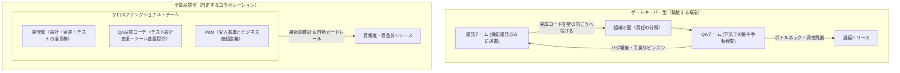
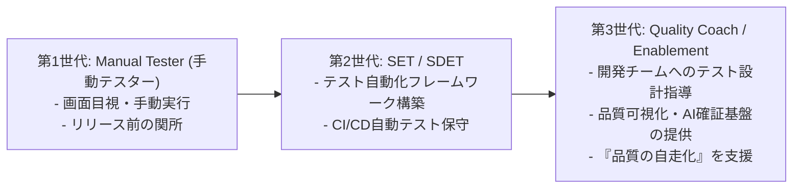

# 第20章：「全員品質（Whole-Team Approach）」を実現する組織モデル

「品質のことは、QAチームに任せてありますから」――この言葉が開発組織の誰かの口から漏れた瞬間、その組織の品質改善の歩みは停止する。どれほど最新のCI/CDパイプラインを導入し、テスト自動化ツールを揃え、AIエージェントを配備しても、「作る人（開発者）」と「検査する人（QA）」が分離されている限り、組織構造そのものが品質の最大のボトルネックとなる。

開発者は「どうせQAがバグを見つけてくれるだろう」と無意識にテストを省略し、QAはスプリント終盤に雪崩れ込む大量の未検証コードを前に徹夜で手動テストを回す。そして本番障害が発生すれば「なぜQAは見落としたのか」と責め立てられる――この「最後の砦（ゲートキーパー）モデル」は、開発者を無責任にし、QAエンジニアを疲弊させ、組織のデリバリー速度を著しく減速させる。

本章では、アジャイル品質の根幹思想である「全員品質（Whole-Team Approach to Quality）」への組織変革の道筋を論じる。QAエンジニアが自ら手を下してテストする職種から、開発チームが自走してテストと品質保証を行えるよう支援する「品質コーチ（Quality Coach / QAイネーブラー）」へと進化する組織設計とカルチャー醸成の実践体系を詳解する。

---

## 20.1 「最後の砦」モデルの構造的破綻

従来のウォーターフォール型あるいは擬似アジャイル開発において、QA組織はリリース判定の「関所（ゲート）」として機能してきた。しかし、この構造には3つの不可避な構造的欠陥が内在している。



### ゲートキーパーモデルが引き起こす3大病理

1. **モラルハザード（責任の外部化）**: 「バグ出しはQAの仕事」という認識が開発者に定着し、セルフテストやエッジケースの考慮が疎かになる。
2. **フィードバックの長大化**: バグが発見されるのが実装から数週間後になるため、コンテキストスイッチのコストが膨大になり、修正工数が数倍に跳ね上がる。
3. **スケーラビリティの限界**: 開発者の人数が増えるほどQAチームがボトルネックとなり、リリースサイクルが数ヶ月単位へと長期化する。

### 「テストを投げる側」と「受ける側」の心理的分断

最後の砦モデルにおける最も根深い悲劇は、開発者とQAの間に生じる「感情的な対立」である。開発者にとってQAは「リリースの邪魔をする厄介者」に見え、QAにとって開発者は「乱雑なコードを平気で押し付けてくる無責任な人々」に見える。この心理的分断が存在する限り、どれほど立派な品質向上スローガンを掲げても、組織の一体感や心理的安全性が醸成されることはない。全員品質への転換とは、この感情的な分断を解消し、両者が同じテーブルでプロダクト価値を追求するための組織的リハビリテーションでもある。

---

## 20.2 QAの進化系：テスターからSET、そして品質コーチへ

高品質を高速に実現しているグローバルテック企業において、QAエンジニアのロールは過去15年間で劇的な進化を遂げてきた。



### 各世代のミッションとKPIの違い

| 世代 | 主たるミッション | 典型的なKPI | 開発者との関係 |
| :--- | :--- | :--- | :--- |
| **第1世代: 手動テスター** | バグをできる限り多く検出し、不完全なリリースの門番となる。 | 検出バグ件数、テストケース消化率。 | 敵対的（見つける側 vs 隠す側）。 |
| **第2世代: SET / SDET** | テスト自動化を推進し、リグレッションテストを高速化する。 | テスト自動化率、CI実行時間短縮率。 | 分業（コード書く人 vs 自動テスト書く人）。 |
| **第3世代: 品質コーチ** | 開発チームが自律的に品質を作り込める能力（ケイパビリティ）を育成する。 | 開発者のテスト自走率、DORA指標、変更失敗率。 | 協調的・教育的パートナー（品質のメンター）。 |

品質コーチの究極の目標は、「QAエンジニアが直接テストをしなくても、開発チームが高い品質を当たり前に維持できる状態をつくること」である。

---

## 20.3 国内外メガベンチャーの組織変革事例

全員品質への移行に成功した代表的企業の組織構造を分析する。

### 1. Spotifyの品質モデル（Embedded QA & Chapter）

Spotifyが公開した組織モデル（Kniberg & Ivarsson, *Scaling Agile @ Spotify*, 2012）では、独立した従来型QA部門への依存を脱却した。各スクワッド（Squad）内に品質専門家を組み込む「Embedded QA」と、横断的な「QA Chapter（職能チャプター）」のマトリクス構造を採用している。QAは下流の手動テスト請負人ではなく、スプリントプランニングでの受入基準策定や開発者へのテスト手法支援を担い、QAチャプターが組織全体のツール基盤やベストプラクティスを共有する。

### 2. SmartHRやメルカリのQAイネーブルメント実践

日本のSaaS・メガベンチャー各社でも、専任QAが全機能を手動テストする体制の限界から「QAイネーブルメント組織」への転換が進んでいる。代表的な一次事例として、SmartHR Tech BlogでのQAイネーブルメント実践報告や、Mercari EngineeringでのQA Automation / Enablingチームの取り組みが公開されている。QAが手動テストの実行を請け負うことを原則禁止とし、開発者が自らテスト設計を行い、テストコードをコミットするための「テスト設計ワークショップ」「ドメイン品質ガイドライン」「Playwright自動化テンプレート」を社内プロダクトとして開発・提供している。

### 各社の組織変革から抽出される共通成功パターン

これらの先行企業に共通しているのは、「QAの仕事を開発者に押し付けた（丸投げした）」のではなく、「開発者が気持ちよくテストできるインフラを徹底的に整備した」という点である。

具体的には以下の3つの投資が先行して行われている：

1. **CI実行速度の極限短縮**: テスト結果が30分も返ってこない環境では開発者はテストを書かなくなる。並列化やコンテナ最適化により、フィードバックループを5分以内に短縮した。
2. **テストデータ生成の共通基盤**: 複雑なドメインモデル（従業員データ、課金履歴、在庫状態など）をコード1行でオンデマンド生成できるファクトリツールをQAが内製提供した。
3. **テスト設計スキルの標準化**: 境界値分析やデシジョンテーブルといったテストエンジニアリングの基礎技法を、全エンジニアの必須研修カリキュラムとして定着させた。

---

## 20.4 開発者が自発的に品質を作り込むカルチャーの醸成

組織構造を変えるだけでは全員品質は機能しない。開発者が「テストコードを書くのが楽しい」「品質にこだわる方が開発が圧倒的に速い」と心から実感できるカルチャー（文化）の醸成が不可欠である。

### カルチャー変革のための4つの打ち手

1. **心理的安全性の徹底担保**: バグを出した個人を責めるのではなく、システムとプロセスの不備をチームで改善する「非難のない文化（Blameless）」を経営・マネジメント層が率先して実践する。
2. **品質チャンピオン制度**: 各開発チームからローテーションで「品質チャンピオン」を選任し、スプリント内の品質改善タスクやテストリファクタリングを主導させる。
3. **テスト駆動開発（TDD）ペアプロ・モブワークショップと「最初の1歩目の挫折リカバリー」**: シニアエンジニアや品質コーチが開発者とペアを組み、テストファーストでコードを書く体験を日常業務の中でOJTとして浸透させる。これまで開発者がテストを一切書いてこなかった現場（自走率0%）から90%以上へ移行する際、ほぼ確実に踏む最初の失敗談（アンチパターン）がある。それが**「第1週目にいきなり既存の複雑なDB密結合コントローラーのテストを書かせようとして、モック設定だけで3時間ハマり、『やはりテストは生産性が落ちるだけだ』と開発者が心を折ってしまうケース」**である。この初期挫折からリカバリーする鉄則は、最初の2週間は既存レガシーコードのテストを一切禁止し、外部依存を1つも持たない「純粋関数（金額計算や日付フォーマット等のユーティリティ）」だけを対象に、1日45分の「ストロングスタイル・モブプログラミング」を実施することである。品質コーチがナビゲーターとしてテスト観点を口頭で指示し、開発者がドライバーとして手を動かして「5分で最初の1本目のテストがGreenになる快感」を伴走支援することで、アレルギー反応を起こさずにテスト習慣を定着させることができる。
4. **品質改善の可視化と表彰**: 「今スプリントで最もflakyテストを退治した人」「変更リードタイムを最も短縮した施策」など、見えにくい品質活動を全員で賞賛する場（Quality Award）を設ける。

### 「品質可視化ダッシュボード」による透明性の担保

全員品質を文化として定着させるための強力な触媒が、開発者自身がいつでも確認できる「品質可視化ダッシュボード」である。

テストカバレッジの推移、CI成功率、flakyテスト発生件数、DORA指標（変更リードタイム・変更失敗率）をリアルタイムに可視化し、レトロスペクティブでチーム全員で振り返る。具体的な可視化スタックとしては、CIのJUnit XMLやカバレッジ出力を **Datadog CI Visibility** や **Grafana（＋BigQuery）**、またはOSSの **Apache DevLake** や **Codecov** に連携する構成が代表的である。そこからSlackへ週次サマリを自動配信する仕組みを作ると、現場への定着が劇的に進む。この際、最も留意すべきは「個人のコミット数やテスト作成数を比較しない」ことである。指標が個人の評価に結びついた瞬間、グッドハートの法則により「意味のない無価値なアサーション」が量産され、文化は崩壊する。メトリクスは常に「チームのプロセスを改善するための羅針盤」として運用されなければならない。

---

## 20.5 AI確証実践：社内品質ポリシーを常時コーチングするAI Quality Coach

どれほど優れた品質ガイドラインが存在しても、膨大な社内Wikiに埋もれていては読まれない。開発者がPRを作成したりIssueを起票した瞬間、社内の過去の障害事例やドメインルールを想起させ、テスト観点を対話形式で助言する「AI Quality Coach」をリポジトリ専属で配備する。

```python
# tools/ai_quality_coach.py
import os
import json
import urllib.error
import urllib.request

def provide_quality_coaching(pr_title, pr_diff, domain_rules):
    api_key = os.environ.get("GEMINI_API_KEY")
    if not api_key:
        return "Quality Coach Skipped."

    system_prompt = (
        "あなたは社内専属のシニア品質コーチ（AI Quality Coach）です。\n"
        "開発者を威圧・叱責することなく、温かいペアプログラミング相手として、\n"
        "PRの変更差分から見落とされがちなエッジケース、境界値、非機能要件（性能・セキュリティ）のテスト観点を問いかけてください。\n\n"
        "【対話ルール】\n"
        "1. 一方的にダメ出しをするのではなく、『〜のケースについてどう考えましたか？』と内省を促すこと。\n"
        "2. 社内固有のドメインルール（過去の障害事例）を引用して具体的にアドバイスすること。\n"
        "3. ハルシネーションや過剰なノイズ指摘で開発者を疲弊させないよう、確信度が高く致命傷になり得る観点【最大3点まで】に厳選し、すでにテストコード内でカバーされている観点は絶対に指摘しないこと（ノイズ抑制メカニズム）。\n"
        "4. Markdown形式で励ましのメッセージとともに回答すること。"
    )

    user_content = f"PRタイトル: {pr_title}\n\nコード差分:\n{pr_diff}\n\n社内品質ルール:\n{domain_rules}"
    payload = {
        "contents": [{"role": "user", "parts": [{"text": f"{system_prompt}\n\n{user_content}"}]}]
    }
    url = "https://generativelanguage.googleapis.com/v1beta/models/gemini-2.5-flash:generateContent"
    req = urllib.request.Request(
        url,
        data=json.dumps(payload).encode("utf-8"),
        headers={"Content-Type": "application/json", "x-goog-api-key": api_key},
    )
    try:
        with urllib.request.urlopen(req, timeout=15) as resp:
            res = json.loads(resp.read().decode("utf-8"))
            return res["candidates"][0]["content"]["parts"][0]["text"]
    except (urllib.error.URLError, json.JSONDecodeError, KeyError, IndexError, TimeoutError) as e:
        # APIタイムアウトやレスポンス形式異常時にCIジョブをクラッシュさせないための堅牢な例外ハンドリング
        print(f"[WARN] AI Quality Coach API call skipped due to error: {e}")
        return "AI Quality Coachは一時的にスキップされました。標準のテスト観点チェックリストを確認してください。"


if __name__ == "__main__":
    pr_title = os.environ.get("PR_TITLE", "feat: クーポン割引計算ロジックの追加")
    pr_diff = os.environ.get("PR_DIFF", "+ def apply_coupon(total, discount): return max(0, total - discount)")
    domain_rules = "決済金額は0円未満になってはならず、同一クーポンの二重適用を排他制御すること。"
    print(provide_quality_coaching(pr_title, pr_diff, domain_rules))
```

---

### GitHub Actionsと連携したAI Quality Coachの自動実行

PRオープン時に自動でコード差分を解析し、品質コーチングコメントを投稿するワークフローのコード例である。

```yaml
# .github/workflows/ai-quality-coach.yml
name: AI Quality Coach

on:
  pull_request:
    types: [opened, synchronize]

jobs:
  coach:
    runs-on: ubuntu-latest
    steps:
      - uses: actions/checkout@11bd71901bbe5b1630ceea73d27597364c9af683 # v4.2.2
      - name: Run AI Quality Coach
        env:
          GEMINI_API_KEY: ${{ secrets.GEMINI_API_KEY }}
          PR_TITLE: ${{ github.event.pull_request.title }}
        run: |
          python tools/ai_quality_coach.py
```

※実運用におけるAPIコスト・レートリミット制御の注意点：`synchronize`（追加プッシュ）のたびに毎回AI Quality Coachを呼び出すと、細かな修正コミットを連打した際にレートリミット（HTTP 429）に達したり、PR欄がボットの長文で埋まったりする恐れがある。本番運用では、① GitHub Actionsの `concurrency` 設定で古い実行を自動キャンセルし、② ドラフトPR（`draft == true`）の間はスキップして `Ready for review` 時のみ実行する。さらに、③ 既存のボットコメントがある場合は新規投稿ではなく上書き更新（Update Comment）する設計とすることで、APIコストと開発者体験（DevEx）を高次元で両立できる。

## 20.6 QA合否判定基準：全員品質組織の健全性クライテリア

組織が「全員品質」へと正しく移行できているかを評価するための、客観的合否判定マトリクスを策定する。

### 全員品質組織の評価マトリクス

| 評価カテゴリ | 合格水準（Pass / 自走状態） | 警告水準（Warn） | 不合格（Fail / 依存体質） |
| :--- | :--- | :--- | :--- |
| **テストコード自走率** | 開発者起票PRの 90%以上にテストコード同根 | 70%〜90% | 70%未満（QA頼みのコード提出）。 |
| **QAボトルネック率** | スプリント内のQA待ち待機時間 < 10% | 10%〜25% | 25%超（QAが関所として詰まっている）。 |
| **テスト設計の主体** | 開発者が受入基準・テスト観点を自ら作成 | QAがレビュー・補正 | QAがゼロから仕様書を読み解いて作成。 |
| **変更失敗率 (CFR)** | 5%未満を継続維持 | 5%〜15% | 15%超（開発者の品質意識機能不全）。 |

---

## 20.7 アンチパターン対比：形骸化するQA改革 vs 真の全員品質

| 観点 | アンチパターン（失敗するQA改革） | ベストプラクティス（全員品質組織） |
| :--- | :--- | :--- |
| **QAの呼称変更** | 単に「テスター」の肩書を「QAエンジニア」に変えただけで業務は下流手動テストのまま。 | QAを品質コーチへと再定義し、開発者のテスト設計自走を支援。 |
| **テスト責任の所在** | 「全員品質」を口実にQAを全廃し、テストコードを書かない開発者に丸投げして品質崩壊。 | ガードレールとCI基盤、テスト教育を先行配備した上で責任を統合。 |
| **バグ発生時の対応** | 「誰がミスしたか」「QAはなぜ見逃したか」の犯人探し。 | Blameless Postmortemにより、プロセスの不備を全員で修正。 |
| **評価・昇進基準** | 開発者の評価基準が「機能リリースのスピード」のみで、テストや品質は無評価。 | テスト品質、運用信頼性、保守性への貢献をエンジニア評価の柱に設定。 |

---

## 20.8 実践ワークショップ：自チームのQA依存度診断演習

### 演習手順

1. **直近10件のPRチェック**: 直近マージされた機能開発PRを10件開き、「開発者自身が書いたテストコードが含まれているか」を集計する（テスト自走率の算出）。
2. **QAボトルネック測定**: PRが「開発完了」となってから「QA完了（リリース可能）」となるまでの所要時間を算出し、リードタイム全体に占める割合を計測する。
3. **品質イネーブルメント計画の策定**: 自チームにおいて、QAが手動で行っている作業（例: ステージングでの結合確認）を自動化または開発者セルフチェックに移行するためのアクションアイテムを1つ決定する。

---

## 20.9 本章のまとめと次章への接続

全員品質（Whole-Team Approach）とは、QAエンジニアの不要論ではなく、「QAの専門性を最大化するための組織的レバレッジ」である。

- **下流テストからの脱却**: 最後の砦モデルを解体し、開発者が品質のオーナーシップを握る。
- **品質コーチへの進化**: QAはテスト実行者から、教育・ツール基盤・AIコーチングを提供するイネーブラーへ。
- **カルチャーと仕組みの統合**: 心理的安全性と自動ガードレールを両輪として全員品質を定着させる。

組織文化の変革方針が定まった今、次に必要なのは「この変革をどのような順序で、現場の摩擦を抑えながら具現化していくか」という現実的な設計図である。次章（第21章）では、レガシーシステムや肥大化した組織を全員品質へと導く「段階的品質成熟度ロードマップ」の描き方を詳解する。
