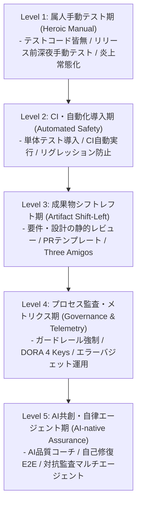
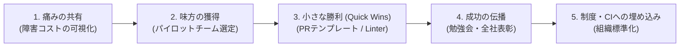

# 第21章：品質変革ロードマップ：明日からあなたの現場で始める第一歩

「この本に書かれていることは理想的だし、確かに素晴らしい。しかし、ウチの現場はレガシーコードだらけで、テストコードもCIもなく、目の前の機能開発と障害対応で手一杯だ。どこから手をつければいいのか途方に暮れる」――本書を読み進めてきた読者から、このような声が聞こえてくるのはごく自然なことである。

品質変革における最大の失敗要因は、「最初から完璧な理想形（フルオートメーション・AI確証・全員品質）を一気に実現しようとして自爆すること」である。成熟度の階段を一度に3段も4段も飛ばして登ることはできない。現場の心理的許容量を超えた急激な変革は、激しい反発と疲弊を生み、結果として以前よりも酷いカオスを招く。

本章では、混沌としたレガシー現場から世界水準の品質エンジニアリング組織へと脱皮するための「品質成熟度モデル（Level 1〜Level 5）」を提示し、現場の抵抗を乗り越えるチェンジマネジメント手法、明日から一人でも始められるクイックウィン、そして経営陣を説得する品質ROIの語り方を網羅的に解説する。

---

## 21.1 品質成熟度モデル（Level 1〜Level 5）：自チームの現在地を知る

変革を始めるための第一歩は、自分たちの組織が今どの成熟度フェーズに位置しているかを客観的に直視することである。



### 各成熟度レベルの診断と脱出条件

1. **Level 1：属人手動テスト期（カオスからの脱却）**:
   - *実態*: テストコードはほぼゼロ。スプレッドシートの手順書を見ながら目視テストを行い、特定のエースエンジニアの勘に依存。
   - *脱出条件*: GitHub Actions等のCI基盤を構築し、最も壊れやすいコアロジックに対して1本だけでも自動単体テストを導入すること。
2. **Level 2：CI・自動化導入期（回帰の恐怖からの解放）**:
   - *実態*: CIで単体テストやLinterが動いているが、テストが壊れると放置されがち（Flaky問題）。E2Eテストはまだ手動。
   - *脱出条件*: CIでのテストPassをマージ必須条件とし、TestcontainersによるDB隔離環境を整備すること。
3. **Level 3：成果物シフトレフト期（要件・仕様の確証）**:
   - *実態*: 実装後のバグは減ったが、要件の食い違いや手戻りが頻発。PRの粒度が巨大化。
   - *脱出条件*: Three Amigosによる事前合意と、PRテンプレートの必須化、PRサイズ上限のルール化。
4. **Level 4：プロセス監査・メトリクス駆動期（科学的管理）**:
   - *実態*: プロセスルールは整ったが、運用の形骸化や特定レビュアーへの偏りが発生。
   - *脱出条件*: DORA指標のダッシュボード可視化と、GitHub Rulesetによる物理的ガードレール強制。
5. **Level 5：AI共創・自律エージェント協調期（究極の自己進化と現実的境界線）**:
   - *実態*: 人間とAIエージェントが協調して高速にデリバリーを行う。
   - *目指す姿*: LLM-as-a-Judgeや自己修復E2E、対抗監査マルチエージェントによる自律的確証ループの完成。
   - *現場の現実解とAIの限界線*: ただし、Level 5は「人間が不要になるSF的な完全無人化」を意味するのではない。現在のLLMはドメイン固有の暗黙知や複雑なビジネス上の政治的トレードオフ、未知のアーキテクチャ境界を自律判断することはできず、放置すればハルシネーションや報酬ハッキングを引き起こす。したがって、現場におけるLevel 5の現実解とは、**「定型的なテスト生成・セレクタ修復・一次監査の80%をAIエージェントに委譲しつつ、不変条件（決定論的アンカー）の設計と最終的なビジネス妥当性の責任は人間が厳格に握り続ける『Human-on-the-Loop（人間統制下の自律化）』」**である。また、Level 1〜2の組織がいきなりLevel 5のAIエージェントを導入しても、土台となるCIやテスト環境がないため確実に破綻する。まずはLevel 3〜4の決定論的ガードレールを固めることが、AIの能力を解放するための絶対条件となる。

---

## 21.2 現場の抵抗を乗り越えるチェンジマネジメント

品質変革を推し進めようとすると、現場から必ず激しい抵抗（「そんな暇はない」「面倒くさい」「今のままで回っている」）が発生する。ジョン・コッターの企業変革プロセスを応用し、心理的摩擦を最小化する戦略を採る。



### チェンジマネジメントの3大鉄則

1. **全社一斉展開を絶対に避ける**: 最初は最も理解のある、あるいは最も課題感の強い「1つのチーム（または1つのリポジトリ）」に絞ってパイロット運用する。
2. **痛みを数字で語る**: 「テストがないと不安です」という感情論ではなく、「先月は障害対応と手戻りに合計84人時を費やし、新機能開発が2週間遅延しました」とファクトを突きつける。
3. **クイックウィン（即効性のある小さな成功）を祝う**: 導入したその日から効果が実感できる軽量な施策から着手し、「確かに楽になった！」という成功体験を周囲に見せつける。

### 「抵抗勢力」を味方に変える共感型アプローチ

変革時に最も強硬に反対するのは、往々にして「現在のシステムを最も深く理解し、過去の障害対応で傷だらけになってきたベテランエンジニア」である。彼らの抵抗の裏には「新しいツールを導入して、また別のトラブルが増えたら現場が持たない」という強い危機感が存在する。

彼らを「抵抗勢力」として排除・敵対視するのではなく、最初のヒアリング相手として「今のシステムのどこが一番つらいですか？」「どの障害対応が一番二度とやりたくないですか？」とリスペクトを持って問いかける。彼らの最大の痛みを解消するツール（例: 夜間アラートを半減させるカナリア監視）を最初のターゲットとして選定することで、最強の反対者は最強の推進者へと変貌する。

---

## 21.3 明日できる3つの具体的一歩（Quick Wins）

大掛かりな予算も経営陣の承認も不要で、明日の朝から一人でも始められる3つの施策である。

### 1. PRテンプレート（`.github/pull_request_template.md`）の配備

所要時間30分。PRの概要、変更理由、テスト確認項目のチェックボックスを定義するだけで、レビューの往復回数が半減する。

#### 実践設定例：即日配備可能なPRテンプレート

```markdown
<!-- .github/pull_request_template.md -->
## 概要（What & Why）
- どのような変更を行ったか、およびその背景・目的を簡潔に記載してください。

## 関連Issue
- Closes #

## テスト・検証内容
- [ ] 単体テストを追加または更新した（またはテスト不要な理由：______）
- [ ] ローカル環境で動作確認を完了した
- [ ] 既存機能への破壊的変更がないことを確認した

## レビュアーへの特記事項
- 特に重点的に見てほしい点があれば記載してください。
```

### 2. コミット時静的解析（pre-commit / Linter）の導入

所要時間1時間。フォーマッタや基本的なLinterをCIに組み込み、インデントやコードスタイルの不毛な議論を人間レビューから完全追放する。

### 3. 次のスプリントでの「ミニThree Amigos」試行

所要時間15分。次のチケットに着手する前、PdM、開発者、QA（またはテスター）の3名で「受入基準（何をテストすれば合格か）」をホワイトボードで3行書き出してから実装に入る。

---

## 21.4 品質投資のROIをステークホルダーに説明するコミュニケーション術

「テストを書く暇があったら、もっと新機能を作ってくれ」というビジネスサイドからの圧力に対し、エンジニアはどう立ち向かうべきか。

### 欠陥コスト増大の法則（Rule of Ten）の活用

IBMのシステム科学研究所やBohmのソフトウェア工学研究が証明している通り、欠陥の修正コストは工程が進むごとに指数関数的に増大する。

| 欠陥の検出フェーズ | 相対修正コスト比 | 実務的なインパクト |
| :--- | :--- | :--- |
| **要件・設計（Three Amigos）** | **1x（基準値）** | 仕様書の文言修正（数分で完了）。 |
| **コーディング・単体テスト (CI)** | **5x〜10x** | ローカルコード修正と再コミット（数時間）。 |
| **結合・ステージング検証 (QA)** | **15x〜40x** | 手戻りチケット起票、再現手順調査、再デプロイ（数日）。 |
| **本番リリース後 (障害対応)** | **100x〜200x** | 緊急Hotfix、データ修復、顧客謝罪、補償、レピュテーション損失（数週間）。 |

「テストコードを書くことは、開発速度を遅くすることではない。本番障害という100倍のコストを前払いで1%のコストに圧縮する、最も高利回りな投資である」という論理で説得する。

### 定量的品質ROIの算出モデル（経営陣へのプレゼンシート）

品質投資の正当性を証明するために、以下の標準的なROI数式を用いて年間削減コストを試算する。

$$ \text{年間削減コスト} = N_{\text{bug}} \times (T_{\text{prod}} - T_{\text{shift-left}}) \times C_{\text{hourly}} + L_{\text{business}} $$

- $N_{\text{bug}}$: 年間に本番流出する重大インシデント件数（例: 20件）
- $T_{\text{prod}}$: 本番障害時の平均復旧・修正工数（例: 40人時）
- $T_{\text{shift-left}}$: CI・レビュー時での早期発見修正工数（例: 2人時）
- $C_{\text{hourly}}$: エンジニア平均時給（例: 8,000円）
- $L_{\text{business}}$: サービス停止に伴う直接的売上機会損失・顧客補償額

例えば、年間20件のインシデントのうち半分の10件をCIとレビューで事前に抑止できた場合：

$$ 10 \times (40 - 2) \times 8,000 = 3,040,000 \text{円} $$

エンジニアの純粋な工数削減だけで年間300万円以上、事業停止損失を含めれば数千万円規模の経済的リターンが即座に証明できる。

- **巨大モノリス環境における補正（$T_{\text{prod}}$ の増大）**: 技術的負債が極度に蓄積した密結合モノリス環境では、1箇所の修正が予期せぬ箇所の破壊を招くため、本番障害時の修正コストは基準値の300倍以上に膨れ上がる。
- **初期イニシャルコストの誠実な計上**: 初期のモック剥がしやテスト環境整備には一時的な先行投資が発生するため、初年度はイニシャルコストを差し引いた段階的ROIを提示すると経営陣に対してより誠実な説得となる。

さらにCEOや事業責任者（BizDev/PdM）の心を決定的に動かすには、数式の右辺にある事業損失 $L_{\text{business}}$ を**「チャーンレート（解約率）」「LTV（顧客生涯価値）」「CVR」といった経営KPIの言葉に直結させて語ること**が極めて効果的である。たとえば「決済やログイン周りのP0障害が年に3回発生すると、法人顧客の月次チャーンレートが0.4%悪化し、LTV換算で年間4,500万円のARR（年間経常収益）が永久に失われます。この品質投資は単なるエンジニアの作業効率化ではなく、**解約率を抑えてLTVとARRを防衛するための最も確実な事業投資**なのです」と提示することで、経営会議での予算承認率は劇的に跳ね上がる。

---

## 21.5 AI確証実践：自チーム専用ロードマップ自動生成プロンプト

チームの抱える課題と技術スタックを入力するだけで、明日から3ヶ月間の具体的な品質改善ロードマップを出力するAIプロンプトである。

```python
# tools/generate_quality_roadmap.py
import os
import json
import urllib.error
import urllib.request

def generate_roadmap(team_context, current_challenges):
    api_key = os.environ.get("GEMINI_API_KEY")
    if not api_key:
        return "Roadmap Generator Skipped."

    system_prompt = (
        "あなたは世界的な品質戦略コンサルタントです。\n"
        "提供されたチームの現状（技術スタック、組織規模、直面する課題）を診断し、\n"
        "品質成熟度モデル（Level 1〜5）に基づき、無理のない3ヶ月間の段階的変革ロードマップを策定してください。\n\n"
        "【出力構成】\n"
        "1. 現在の成熟度レベル診断とボトルネック\n"
        "2. Month 1（クイックウィン）：明日着手する3つの施策\n"
        "3. Month 2（基盤構築）：CI・自動テスト・プロセスルールの配備\n"
        "4. Month 3（カルチャー定着）：メトリクス監視と全員品質への移行\n"
        "5. 経営陣への投資対効果（ROI）プレゼン骨子"
    )

    user_content = f"チーム情報: {team_context}\n\n現状の課題: {current_challenges}"
    payload = {
        "contents": [{"role": "user", "parts": [{"text": f"{system_prompt}\n\n{user_content}"}]}]
    }
    url = f"https://generativelanguage.googleapis.com/v1beta/models/gemini-2.5-flash:generateContent?key={api_key}"
    req = urllib.request.Request(url, data=json.dumps(payload).encode("utf-8"), headers={"Content-Type": "application/json"})
    try:
        # LLM APIのタイムアウトやレートリミット（HTTP 429）発生時にハングアップしないようタイムアウトと例外捕捉を設定
        with urllib.request.urlopen(req, timeout=20) as resp:
            res = json.loads(resp.read().decode("utf-8"))
            return res["candidates"][0]["content"]["parts"][0]["text"]
    except (urllib.error.HTTPError, urllib.error.URLError, TimeoutError, KeyError) as e:
        return f"[WARN] AI API呼び出しエラー（レートリミットまたはタイムアウト: {e}）。標準テンプレートからMonth 1（PRテンプレート・Linter導入）を開始してください。"
```

---

## 21.6 QA合否判定基準：品質成熟度レベル移行クライテリア

組織が次の成熟度レベルへ昇格したと判定するための客観的クライテリアである。

### 成熟度昇格判定マトリクス

| 移行ステップ | 昇格合格基準（Pass） | 留年判定（Fail / 現行レベルに留まる） |
| :--- | :--- | :--- |
| **Level 1 ➔ Level 2** | 主要機能の単体テストがCIで常時パス、PR時の自動実行完了。 | テストがローカルでしか動かない、またはCIが赤のまま放置。 |
| **Level 2 ➔ Level 3** | 全PRでテンプレート遵守率 100%、受入基準の事前合意定着。 | PR本文が空欄、仕様の齟齬による手戻りがスプリントごとに発生。 |
| **Level 3 ➔ Level 4** | GitHub Rulesetで直接プッシュ完全遮断、DORA指標が自動計測。 | ルール違反が口頭注意のみで物理的ガードレールが存在しない。 |
| **Level 4 ➔ Level 5** | AI品質ゲート（LLM審査・自己修復）が日常的に機能（実装詳細は第12章12.5節のAI Gatekeeperや第18章・第19章のマルチエージェント監査、第24章の決定論的アンカーを参照）。 | AIツールが導入されたが誰も結果を見ずにスルーしている。 |

---

## 21.7 アンチパターン対比：失敗する品質運動 vs 成功する漸進的改革

| 観点 | アンチパターン（失敗する品質運動） | ベストプラクティス（成功する漸進的変革） |
| :--- | :--- | :--- |
| **変革のスピード** | トップダウンで全社一斉に「来月から全員TDD必須」とお触れを出す。 | 1チームでパイロット成功事例を作り、横展開する。 |
| **ツールの導入** | 高価なエンタープライズツールを契約し、使いこなせず放置。 | オープンソースのCLIやGitHub標準機能からスモールスタート。 |
| **ステークホルダー** | ビジネスサイドに無断で開発速度を落とし、対立を激化させる。 | 障害コスト削減のROIを定量データで示し、味方に巻き込む。 |
| **継続性** | 熱心なリーダーが異動・退職した瞬間に元の属人運用へ逆戻り。 | ガードレール（CI・Ruleset）としてコード化し不可逆にする。 |

---

## 21.8 実践ワークショップ：自チームの3ヶ月変革ロードマップ策定演習

### 演習手順

1. **成熟度レベルの自己診断**: 21.1節のチェックシートをもとに、自チームの現状レベル（Level 1〜5）を判定する。
2. **最初のクイックウィンの決定**: 21.3節の中から、明日午前中に完了できる施策（PRテンプレート等）を1つ選び、Issueを起票する。
3. **3ヶ月マイルストーンの起草**: 次の成熟度レベルへ昇格するための3ヶ月のマイルストーン（月ごとの目標）を書き出し、次回のレトロスペクティブでチームに提案する。

---

## 21.9 第VII部の総括と第VIII部への接続

第20章および本章（第21章）に至る「第VII部：組織変革・カルチャーと品質の未来」では、品質を単なる技術の問題ではなく「人間と組織の力学」として捉え直し、全員品質への変革ロードマップを敷いてきた。

- **第20章**: 最後の砦モデルを解体し、QAをイネーブラー（品質コーチ）へと再定義する。
- **第21章**: 成熟度5段階モデルに基づき、チェンジマネジメントとROI説明で組織を前進させる。

しかし、現実のビジネスとプロジェクトマネジメントの世界には、教科書通りの理想論だけでは乗り切れない冷酷なトレードオフ（予算不足、納期逼迫、レガシーシステム、政治的制約）が常に渦巻いている。続く本書の最終部「第VIII部：【リアリズム】現場の泥臭い現実とトレードオフの克服」では、綺麗事を一切脱ぎ捨て、泥臭い現実世界の中で品質を死守するための実践的サバイバルガイドへと突入する。
