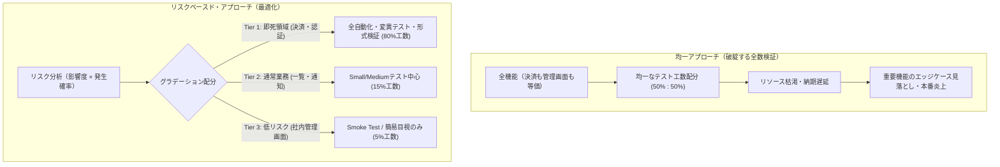
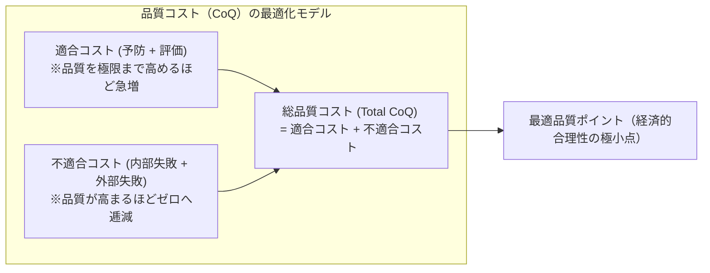

# 第22章：リスクベースド・テスティングと品質コスト（CoQ）の最適化

ソフトウェアエンジニアリングにおける最も危険な幻想は、「すべてを完全に検証できる」という全数テスト信仰である。入力値の組み合わせ、OSやブラウザの環境差異、非同期タイミング、同時実行トランザクション――現代の複雑な分散システムにおいて、テストケースの組み合わせは容易に天文学的数字（$10^{20}$ 以上）に達する。全数テストを志向することは、無限の予算と時間を要求し、プロジェクトを確実に破綻へと導く。

品質保証（QA）の本質とは、「バグをゼロにすること」ではなく、「限られた有限のリソース（時間・予算・人員）の中で、ビジネスを破滅させる致命的なリスクを極小化すること」である。全機能に均一な100点のテストを強要するのではなく、領域ごとのリスク密度に応じて検証強度を動的にグラデーションさせる「リスクベースド・アプローチ」こそが、実務を救う唯一の工学的リアリズムである。

本章では、ジュランやファイゲンバウムが提唱した「品質コスト（Cost of Quality / CoQ）」理論に基づき、過剰品質と品質不足の狭間にある最適バランスを数学的に解明する。さらに、リスクマトリクス（発生確率 × 影響度）の構築法、即死領域（決済・認証）と低リスク領域の検証強度設計、そして機械学習を活用したPredictive Test Selection（予測的テスト選択）の最前線までを網羅的に解説する。

---

## 22.1 全数検証の不可能性と「検証強度のグラデーション」

ソフトウェアテスト工学の第一定理は、「テストは欠陥が存在することを示すことはできるが、欠陥が存在しないことを証明することはできない（ダイクストラ）」である。

未熟なチームほど「すべての画面、すべてのAPIに対して均等にテストコードを書き、手動テストを網羅しよう」とする。その結果、社内管理画面のボタン配置の確認に何時間も費やし、最も肝心な決済処理や権限認可のエッジケースの検証が時間切れでスルーされるという致命的な本末転倒が起きる。



---

## 22.2 品質コスト（CoQ: Cost of Quality）の構造と最適化曲線

品質投資の議論において、「品質を高めるとコストが増える」という主張と「品質を高めるとコストが減る」という主張がしばしば対立する。この混乱を解消するのが、近代品質管理の金字塔である「品質コスト（CoQ）」フレームワークである。

### CoQの4大分類

1. **予防コスト（Prevention Costs / 適合コスト）**:
   - 欠陥の混入そのものを未然に防ぐためのコスト。要件定義時のThree Amigos、アーキテクチャ設計レビュー、ペアプログラミング、エンジニア教育、Linter/CIガードレールの構築。
2. **評価コスト（Appraisal Costs / 適合コスト）**:
   - 作成された成果物が基準を満たしているかを検査・測定するためのコスト。単体テスト実行、E2E自動テスト、探索的テスト、セキュリティスキャン、外部監査。
3. **内部失敗コスト（Internal Failure Costs / 不適合コスト）**:
   - 本番出荷前に発見された欠陥の修正に伴うコスト。CI失敗時のリトライ、手戻りによる再コーディング、結合環境でのバグトリアージ、デプロイブロック。
4. **外部失敗コスト（External Failure Costs / 不適合コスト）**:
   - 本番リリース後に顧客の手元で発覚した欠陥による損失。深夜緊急Hotfix、データベース修復、顧客サポート対応、損害賠償、ユーザー離脱、株価下落、社会的信用失墜。



工学的な真実は「予防コスト（Shift-Left）への投資は、外部失敗コストという巨大な損失を指数関数的に削減するが、ある閾値を超えて100%完全無欠のゼロバグを目指すと、今度は評価コストが指数関数的に爆発する」ということである。我々が目指すべきは、総品質コストが最小となる「最適品質ポイント（Economic Balance Point）」である。

---

## 22.3 リスクベースド・テスティング（RBT）：リスクマトリクスの作成

どの機能にどの程度のテスト工数を投じるべきかを客観的に決定するため、「リスクスコア（Risk Exposure）」を数式化して合意する。

$$ \text{Risk Score} = \text{Severity（影響度: 1〜5）} \times \text{Likelihood（発生確率: 1〜5）} $$

### リスクマトリクスと検証強度の決定

| 影響度 \ 発生確率 | 1: 極めて稀（<1%） | 2: 低い（1〜10%） | 3: 中程度（10〜30%） | 4: 高い（30〜60%） | 5: 確実（>60%） |
| :--- | :--- | :--- | :--- | :--- | :--- |
| **5: 致命的 (即死)** | Tier 2 (スコア5) | Tier 1 (スコア10) | **Tier 1 (スコア15)** | **Tier 1 (スコア20)** | **Tier 1 (スコア25)** |
| **4: 重大 (主要機能失活)** | Tier 3 (スコア4) | Tier 2 (スコア8) | Tier 2 (スコア12) | **Tier 1 (スコア16)** | **Tier 1 (スコア20)** |
| **3: 中度 (回避策あり)** | Tier 3 (スコア3) | Tier 3 (スコア6) | Tier 2 (スコア9) | Tier 2 (スコア12) | Tier 2 (スコア15) |
| **2: 軽微 (表示・UI)** | Tier 3 (スコア2) | Tier 3 (スコア4) | Tier 3 (スコア6) | Tier 3 (スコア8) | Tier 2 (スコア10) |
| **1: 些細 (軽微な違和感)** | Tier 3 (スコア1) | Tier 3 (スコア2) | Tier 3 (スコア3) | Tier 3 (スコア4) | Tier 3 (スコア5) |

### Tier区分ごとの決定論的検証基準

- **Tier 1（最高リスク: スコア15以上）**: 単体カバレッジ100%、境界値・デシジョンテーブル網羅、PlaywrightによるE2E自動化、セキュリティスキャン必須、二重レビュー必須。
- **Tier 2（中リスク: スコア8〜14）**: 主要ロジックの単体テスト必須、API結合テスト、変更時リグレッション確認。
- **Tier 3（低リスク: スコア7以下）**: 基本的なSmoke Test（画面表示確認）のみ。単体テストは任意とし、不具合発生時に事後テスト追加。

### 小規模チーム・スタートアップが今日から導入する「ライト版（2区分）」の第一歩

5×5の厳密なリスクマトリクスを作る時間がない小規模チームやシード期のスタートアップでは、最初から3段階のスコアリングを行う必要はない。まずはホワイトボードに**「もしここが壊れたら会社が潰れる・警察や金融庁に怒られる・顧客のお金が消える機能（Tier 1：決済・認証・課金・PII）」を3つだけ書き出し、それ以外の全機能を「Tier 2/3（迅速に直せば許容される領域）」とみなす「二極化ライト版」**からスタートしてほしい。このわずか15分の仕分けだけで、「管理画面のCSS崩れチェックに追われて、決済の二重課金テストが漏れる」という最悪の悲劇を今日から即座に防ぐことができる。

---

## 22.4 即死領域 vs 低リスク領域の実践的グラデーション設計

具体的なプロダクトにおける境界線の引き方を定義する。

### 1. 即死領域（Deadly Zone / Zero-Tolerance）

- **対象**: クレジットカード決済、暗号資産送金、認証・認可トークン検証、個人情報（PII）エクスポート、医療データ更新。
- **設計方針**: 「1件のバグも許されない」。変異テスト（Mutation Testing）を用いてテストコード自体の欠陥検出力を測定し、Testcontainersで実DBを使いロールバック処理まで徹底的に叩く。

### 即死領域を守る究極の手法：変異テスト（Mutation Testing）

Tier 1の即死領域において、カバレッジ100%は「単にコード行が実行された」ことを意味するに過ぎず、「欠陥を本当に検知できるテストになっているか」は保証されない。

例えば、以下のような無意味なテストであってもカバレッジは100%を記録してしまう：

```python
from app.billing import process_payment


def test_payment_processing():
    result = process_payment(amount=1000, user_id=42)
    # アサーションが欠落している、または甘すぎる
    assert result is not None
```

これに対抗するのが、テストコード自身の品質をテストする「変異テスト（Mutation Testing / Mutmut, Stryker等）」である。実装コード内の演算子を自動的に反転（`>` を `<` に、`+` を `-` に、`and` を `or` に変更）させた「変異体（Mutant）」を意図的に数百パターン生成し、テストスイートを実行する。

- **Kill（変異体殺害）**: 実装コードが破壊されたことで、テストが正しく赤（Fail）になった状態。正常なテストコード。
- **Survive（変異体生存）**: 実装コードが破壊されたにもかかわらず、テストが緑（Pass）のまま通過した状態。テストのアサーションが不十分である致命的証拠。

Tier 1領域では、単なるコードカバレッジではなく「変異スコア（Mutation Score: 殺害率）80%以上」を完了条件（DoD）として課すことで、アサーションの空洞化を科学的・決定論的に根絶する。

ただし、変異テストは数百個の変異体ごとにテストを反復実行するため、リポジトリ全体に対して毎回実行するとCI時間が数時間に膨れ上がり導入に挫折しやすい。大規模リポジトリで運用する実践的Tipsとして、**「PRごとのCIでは『Tier 1領域（`src/payment/`, `src/auth/` 等）のうち、当該PRで変更された差分ファイル（`git diff`）』に限定して変異テストを実行する」**構成を推奨する。そして**「Tier 1全域のフルスキャンは夜間（Nightly）バッチに分離する」**というハイブリッド運用を採ることで、PRのフィードバックを2分以内に保ったまま即死領域の鉄壁な防御を維持できる。

> **[コラム] リポジトリ規模別の変異テスト実行時間とCIコストの目安**
>
> - **全体フル実行（アンチパターン）**: 単体テスト3,000件・コード5万行のリポジトリ全域で変異体8,000個を総当たり実行すると、**約180分〜240分**を要しPRゲートとして完全に破綻する。
> - **Tier 1差分限定実行（推奨プラクティス）**: PRで変更されたTier 1の1〜2ファイル（変異体30〜50個）に絞り、さらに該当行を通過するテストのみ（`perTest` カバレッジ解析）を実行すれば、大規模リポジトリでも**約45秒〜90秒**で完了する。

### 2. 通常業務領域（Business Critical / Tier 2）の現実的マネジメント

多くのプロダクト機能（商品一覧表示、カート追加、レビュー投稿、メール通知など）は、このTier 2に該当する。

- **設計方針**: ここでの目標は「100%の完全性」ではなく「開発速度と安定性の高度なバランス」である。ユニットテストでビジネスロジックの境界値を固めつつ、結合テストは代表的な正常系・異常系ハッピーパスに絞り込む。
- **リソース配分**: 新規機能開発時にテスト作成に割く工数は全体の20〜30%を目安とし、過剰なモック化によるメンテナンスコストの肥大化を避ける。
- **Flakyテストの許容度**: Tier 2のテストが不安定化した場合は、即座にクランタイン（隔離）し、メインブランチのマージを不必要にブロックさせない規律を徹底する。

### 2. 低リスク領域（Tolerable Zone / Fast-Delivery）

- **対象**: 社内CS向け管理画面の検索フィルタ、マーケティングLPの文言、新機能のA/Bテスト用バナー。
- **設計方針**: 「万一バグが出ても即座にHotfixまたはフラグOFFで切り戻せば実害は極小」。テスト作成に時間をかけるより、フィーチャートグルとSentryによる即時検知を優先し、爆速でデプロイする。

---

## 22.5 AI確証実践：Predictive Test Selection（予測的テスト選択）

リポジトリが数万行・数十万行に成長すると、全テストの実行時間は数十分に達し、開発速度を麻痺させる。

MetaやGoogleが実践しているのが、Gitの変更差分（ASTトポロジー）と過去のテスト失敗履歴から、関連するテストケースのみを機械学習で予測・選別して実行する `Predictive Test Selection` である。

```python
# tools/predictive_test_selection.py
import os
import sys
import subprocess
import json
import urllib.request
from pathlib import Path

def get_changed_files(base_ref: str = "origin/main") -> list[str]:
    res = subprocess.run(["git", "diff", "--name-only", f"{base_ref}...HEAD"], capture_output=True, text=True, check=False)
    return [line.strip() for line in res.stdout.splitlines() if line.strip()]

def select_optimal_tests(changed_files: list[str]) -> list[str]:
    if not changed_files:
        return []

    # 1. 決定論的マッピング（変更されたモジュール名に対応するテストファイルを高速特定）
    selected = set()
    for f in changed_files:
        p = Path(f)
        if p.parts and p.parts[0] == "tests" and p.suffix == ".py":
            selected.add(f)
        elif p.suffix == ".py":
            candidate = Path("tests/unit") / f"test_{p.name}"
            if candidate.exists():
                selected.add(str(candidate))

    # 2. LLMによるセマンティック依存推論（APIキー設定時）
    api_key = os.environ.get("GEMINI_API_KEY")
    if api_key:
        all_tests = [str(p) for p in Path("tests").rglob("test_*.py")]
        prompt = (
            "あなたはCIテスト最適化エンジンです。\n"
            "以下のGit変更ファイル一覧と全テストファイル一覧から、影響を受ける可能性が高いテストファイルのみを選別してください。\n\n"
            f"変更ファイル: {json.dumps(changed_files)}\n"
            f"全テスト候補: {json.dumps(all_tests)}\n\n"
            '回答はJSON配列形式 ["tests/unit/test_auth.py", ...] のみを出力してください。'
        )
        payload = {
            "contents": [{"role": "user", "parts": [{"text": prompt}]}],
            "generationConfig": {"response_mime_type": "application/json"}
        }
        url = f"https://generativelanguage.googleapis.com/v1beta/models/gemini-2.5-flash:generateContent?key={api_key}"
        req = urllib.request.Request(url, data=json.dumps(payload).encode("utf-8"), headers={"Content-Type": "application/json"})
        try:
            with urllib.request.urlopen(req, timeout=15) as resp:
                res_data = json.loads(resp.read().decode("utf-8"))
                ai_picks = json.loads(res_data["candidates"][0]["content"]["parts"][0]["text"])
                selected.update(t for t in ai_picks if Path(t).exists())
        except Exception as e:
            print(f"[WARN] AI test selection fallback ({e})", file=sys.stderr)

    return sorted(selected) if selected else ["tests/unit"]

if __name__ == "__main__":
    changed = get_changed_files()
    target_tests = select_optimal_tests(changed)
    print(f"🎯 選別された実行対象テスト: {target_tests}")
    # OSのコマンドライン引数長上限（ARG_MAX）超過や、対象テストが0件（Exit Code 5: No tests collected）の
    # エッジケースでも安全にハンドリングできるよう実行を制御する
    rc = subprocess.call(["pytest", *target_tests[:200]])
    sys.exit(0 if rc in (0, 5) else rc)
```

### Predictive Test Selectionをプロダクション運用する際のセキュリティ・コスト・安全性ガードレール

上記スクリプトを本番CIパイプラインで運用する際は、LLM（Gemini API）連携部分と決定論的フォールバックに関して以下の3つの運用規律を設けることで、セキュリティとコストの暴走を防ぐことができる。

1. **APIキーの保護とフォークPRでの決定論的フォールバック**: 外部フォークからのPRや `GEMINI_API_KEY` が未設定・レートリミット超過の環境では、ステップ1の「決定論的なGit差分ファイル名マッピング（空の場合は `tests/unit` 全件実行）」へ自動フォールバックする。これにより、APIキーの外部露出リスクとCI停止をゼロにする。
2. **プロンプト投入ファイル数の上限キャップ（トークン制限対策）**: テストファイル数が数千件規模になると、`all_tests` リストだけでトークン長が増大しAPIコストが嵩むため、ディレクトリプレフィックスやASTのimportグラフで一次フィルタリングした上位100候補のみをLLMへ渡す。
3. **マージ直前（Merge Queue）でのフルスイート実行**: AIによるテスト間引きは、あくまで「機能ブランチでの高速フィードバック用（1〜2分）」と位置付ける。`main` ブランチへの最終マージ時（GitHub Merge Queue）およびTier 1（即死領域）変更時には必ず全テストスイートを実行する二段構えとすることで、予測漏れ（False Negative）によるバグ流出を100%防ぐことができる。

---

## 22.6 QA合否判定基準：リスクベースド品質クライテリア

リスクベースド・テスティングにおける合否判定マトリクスを策定する。

### リスク判定マトリクス

| リスク区分 | 単体テスト要件 | E2E / 結合要件 | マージブロック条件 |
| :--- | :--- | :--- | :--- |
| **Tier 1 (即死領域)** | カバレッジ >= 95%、変異スコア >= 80% | 決定論的E2E必須、障害注入試験パス | 単体/結合テスト失敗 0件（1件でもFail即遮断）。 |
| **Tier 2 (通常業務)** | カバレッジ >= 70% | 主要ハッピーパス結合テスト | 未知の回帰欠陥がないこと。 |
| **Tier 3 (低リスク)** | 任意（重要ロジックのみ） | Smoke Test（死活確認）のみ | 基本表示に重大なクラッシュがないこと。 |

---

## 22.7 アンチパターン対比：全数検証の幻想 vs リスクベースド実践

| 観点 | アンチパターン（全数検証の幻想） | ベストプラクティス（リスクベースド・テスティング） |
| :--- | :--- | :--- |
| **テストの優先度** | すべての機能、すべての画面を平等に100%テストしようとする。 | 即死領域に工数の80%を集中投下し、低リスク領域は間引く。 |
| **CI実行時間** | 肥大化したE2Eテストが2時間かかり、開発者がCIを待たなくなる。 | Predictive Test Selectionにより差分関連テストを5分で完了。 |
| **バグへの態度** | 軽微な表示崩れでリリースを全面凍結し、ビジネス機会を逃す。 | リスクマトリクスに基づき、Tier 3バグを許容してリリース。 |
| **品質コスト意識** | 「品質は金で買える」または「品質はお金がかかる」の二者択一。 | CoQ理論に基づき、予防・評価・失敗コストの最適最小点を追求。 |

---

## 22.8 実践ワークショップ：自社プロダクトのリスクTier分類演習

### 演習手順

1. **機能インベントリの洗い出し**: 自社プロダクトの主要機能・画面を10〜15件リストアップする。
2. **影響度（Severity）と発生確率のスコアリング**: 各機能に対し、1〜5点でスコアリングを行い、リスクスコアを算出する。
3. **Tier 1〜Tier 3の境界線引き**: 「どこからが即死領域（Tier 1）か」をチームおよびPdMと議論し、テスト自動化とレビュー強度のルールを明文化する。

---

## 22.9 本章のまとめと次章への接続

リスクベースド・テスティングとは、品質の手抜きではなく、「有限の世界において最大の成果を勝ち取るための高度な資源配分戦略」である。 これにより、限られた開発期間とリソースの中で最大のビジネス成果と信頼性を両立させることが可能となる。

- **全数検証の放棄**: 均一な100点主義を捨て、リスクマトリクスで濃淡をつける。
- **CoQの最適化**: 予防・評価・失敗コストのトータルバランスを科学的に管理する。
- **技術的間引き**: 即死領域は鉄壁に防護しつつ、Predictive Selection等でCIを高速に維持する。

しかし、どれほど精緻にリスクマトリクスと品質メトリクスを設計しても、それを組織の「目標ノルマ」として運用した瞬間、人間やAIは本質的な品質向上ではなく「数値のハック」へと走り始める。次章（第23章）では、この「グッドハートの法則（Goodhart's Law）」によるメトリクス形骸化と官僚化を防ぐための組織心理学・ペアメトリクス設計へと歩を進める。
