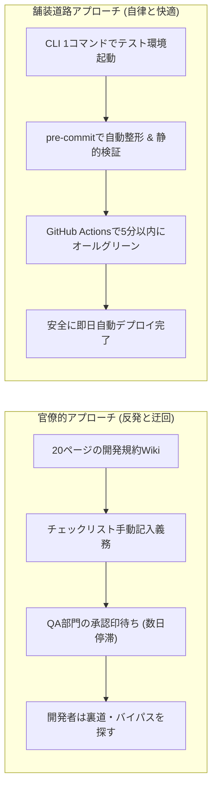
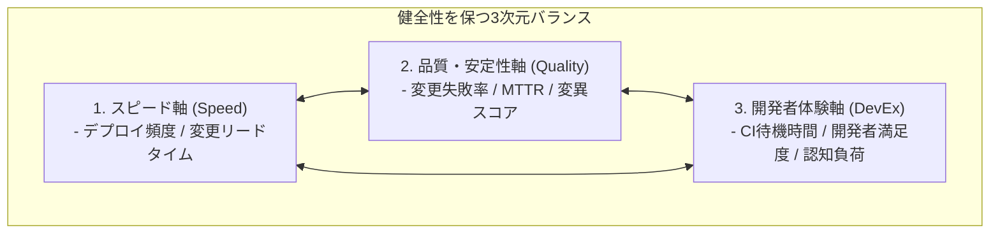

# 第23章：Goodhartの法則との戦い ―― メトリクスハックと官僚化を防ぐ組織心理学

「カバレッジ80%を達成せよ。未達のPRはマージを許可しない」――ある日、マネジメント層から下されたこの至上命令に対し、開発現場は何をしただろうか。彼らは週末返上で熱心にテストケースを設計しただろうか。答えは否である。現場のエンジニアたちは、アサーションを1行も含まない「ただ関数を呼び出すだけの空虚なテスト」を量産し、わずか数時間でカバレッジ85%を達成して見せた。数字上は完璧な品質改善が報告されたが、その翌週、本番環境はかつてない規模の障害で炎上した。

「ある指標が目標になった瞬間、それはもはや良い指標ではなくなる」。経済学者チャールズ・グッドハートが喝破したこの「グッドハートの法則」は、ソフトウェア品質管理の歴史において最も頻繁に繰り返されてきた組織心理学的トラップである。

品質メトリクスを不用意に設定すると、人間は「本質的な品質向上」ではなく「指標を達成するための最も安易なゲーム攻略（ハック）」に全知能を傾けるようになる。本章では、開発現場で起きるメトリクスハックの生態を解剖し、単一指標の罠を打ち消す「ペアメトリクス（相殺指標）」、ルールを罰則ではなく「舗装された道路（Paved Path）」にする設計原則、そしてAIを活用した空洞化検知技術を詳解する。

---

## 23.1 グッドハートの法則の解剖学：カバレッジノルマが生んだ悲劇

なぜ知的で誠実なはずのソフトウェアエンジニアが、意味のないダミーテストを書いてしまうのか。それは彼らが不真面目だからではなく、「システムのインセンティブ設計が狂っているから」である。


### 現場で日常的に行われる4大メトリクスハック

1. **嘘カバレッジ（Assertion-Free Testing）**: テスト関数の中で対象メソッドを呼び出すだけで、戻り値や状態変化を `assert` しない。実行行数（Line Coverage）だけが稼がれ、バグ検知力はゼロ。
2. **DoDノールック全チェック**: PRテンプレートのチェックボックス（`[x]`）を内容も見ずに全選択して送信する。形骸化したチェックリストの典型。
3. **PR分割ハック（ベロシティ稼ぎ）**: 「PRサイズ上限400行」というルールに対し、1つの完結した機能を不自然に5つに分割し、単体ではビルドも通らないPRを乱立させて消化ポイントを偽装する。
4. **バグの地下潜伏（Bug Hiding）**: 「バグ検出件数」や「残存不具合数」でペナルティを課されるため、開発者が軽微なバグをチケット起票せず、個人のローカルコミットでこっそり直して隠蔽する。

メトリクスハックの根本原因は、現場の悪意ではなく「無理な目標に対する現場の生存本能」である。達成不可能な目標を課された人間は、生き残るために最も抵抗の少ない抜け道を探す。したがって、ハックを根絶する唯一の道は、現場を取り締まることではなく、インセンティブ構造そのものを健全に再設計することである。

---

## 23.2 ルールを「罰則」ではなく「舗装された道路（Paved Path）」にする

組織がメトリクスハックに直面した際、最悪の対応は「ルールをさらに厳しくし、違反者を取り締まる監視官を置くこと（官僚化 / Bureaucracy）」である。ルールが増えるほど開発者の認知負荷は増大し、イノベーションは窒息する。

NetflixやSpotifyが提唱する「舗装された道路（Paved Road / Paved Path）」アプローチは、発想を180度転換する。「ルールを守らせる」のではなく、「最も安全で高品質なやり方が、開発者にとって最も楽で心地よい状態をつくる」のである。



### Paved Pathの3大設計原則

1. **デフォルトの安全性（Secure by Default）**: 特別な努力をしなくても、標準のプロジェクトテンプレートを使うだけでセキュリティやテスト基盤が最初から組み込まれている。
2. **最短の摩擦（Frictionless DevEx）**: 正しいプロセスに従う方が、自己流でやるよりも圧倒的に開発スピードが速くなる。
3. **強制ではなく推奨（Opt-outable with Justification）**: どうしても標準から外れる必要がある場合は例外を認めるが、その理由とリスクを明記させる。

### 「舗装道路」を支えるプラットフォームエンジニアリング

Paved Pathを具現化する組織モデルとして急速に台頭しているのが「プラットフォームエンジニアリング（Platform Engineering）」である。

専任のプラットフォームチームが、開発者向けの「内部開発プラットフォーム（Internal Developer Platform / IDP）」を製品（Product）として開発する。開発者が新しいマイクロサービスを立ち上げる際、Backstage等のポータルからテンプレートを選択するだけで、以下の品質要素が最初から全自動でプロビジョニングされる：

1. **GitHub Actions CI/CDパイプライン**: 静的解析、単体テスト、セキュリティスキャン、ビルド、デプロイが設定済み。
2. **決定論的テスト環境**: Testcontainersやローカルスタブが最初から組み込まれたリポジトリ構成。
3. **オブザーバビリティの初期設定**: OpenTelemetryによる分散トレースやDatadogダッシュボード、SLI/SLOアラートの自動配備。

開発者は「品質のために余計な作業をする」のではなく、「提供された一番楽なレールに乗るだけで、自然と最高水準の品質が担保される」。これが官僚化を粉砕するプラットフォームエンジニアリングの神髄である。

---

## 23.3 ペアメトリクス（相殺指標）の導入原則

メトリクスを運用する上での絶対の鉄則は、「単一の指標を単独で追わない」ことである。指標は必ず「互いに緊張関係（トレードオフ）にある相殺指標」とペアで計測されなければならない。

### 代表的なペアメトリクスの組み合わせ

| 主指標（アクセル） | 相殺指標（ブレーキ） | 相乗効果・得られる規律 |
| :--- | :--- | :--- |
| **デプロイ頻度 (DF)** | **変更失敗率 (CFR)** | 頻度を上げるために雑なコードを流すハックを、失敗率の上昇で抑止する（DORAの真髄）。 |
| **行カバレッジ (Line Coverage)** | **変異スコア (Mutation Score)** | アサーションなしの嘘カバレッジを、変異体殺害率の低さで即座にあぶり出す。 |
| **PRマージ速度 (Cycle Time)** | **レビュー指摘密度 (Comments/PR)** | 誰も差分を見ずにノールックApproveする怠慢を、レビュー対話密度で牽制する。 |
| **機能リリース数 (Velocity)** | **エラーバジェット消費率 (Burn Rate)** | 納期優先の突貫工事による信頼性破壊を、エラーバジェット枯渇による開発停止で防ぐ。 |

2つの指標がバランスよく保たれているとき、初めてプロセスは「真の健全性」を獲得する。

なお、エンジニアが数名〜十数名規模のスタートアップや、計測基盤がまだ整っていないリソース制約の厳しい組織においては、最初から上記の4ペア（8指標）をすべて同時に計測しようとしてはならない。最小構成のスタートガイド（優先順位）として、まずはGitHubの標準ログとCIの終了ステータスだけで今日からゼロコストで自動算出できる**第1優先ペア「デプロイ頻度（DF）× 変更失敗率（CFR）」**の1組だけから導入を開始してほしい。その後、コードレビューの滞留や手戻りが課題になってきた段階で**第2優先ペア「PRサイクルタイム × レビュー指摘密度」**を追加し、決済などのコア領域が固まった段階で**第3優先ペア「行カバレッジ × 変異スコア」**へと段階的に広げるのが、計測疲れを起こさない鉄則である。

### グッドハートの法則を無力化する「3次元メトリクス空間」

ペアメトリクスをさらに進化させ、「スピード（Speed）」「品質・安定性（Quality）」「開発者体験（DevEx）」の3つの直交する軸でダッシュボードを構成する。



どれか1つの軸を無理に伸ばそうとすると、他の2つの軸に必ず歪みが生じる。例えば、スピードを焦って品質を犠牲にすれば「品質軸」が赤くなり、逆に官僚的な承認フローを増やして品質を守ろうとすれば「DevEx軸」と「スピード軸」が崩壊する。実務のDatadogやGrafanaでこの3次元空間を運用する際は、ダッシュボード画面を3カラムに分割する。左列に「Speed（デプロイ頻度・PRサイクルタイム）」、中央列に「Quality（CFR・MTTR・変異スコア）」、右列に「DevEx（CI待ち時間・開発者満足度）」を並べて常時表示させる。これにより、「今月はデプロイ頻度が上がったが、右列のCI待ち時間が15分に悪化している」といった軸間のトレードオフ歪みを一目で察知できる。この3軸の健全な均衡を保ち続けることこそが、エンジニアリングマネージャーとテックリードの真の責務である。

### マネジメント層や既存QA部門へ「ペアメトリクスとPaved Path」を提案・交渉する移行パス

現場のエンジニアが「カバレッジ80%の単一ノルマをやめてペアメトリクスにしましょう」と正面から経営層やQA部門に具申しても、「テストを手抜きする気か」と誤解されて却下されることがある。組織政治の壁を突破するための最も効果的な交渉戦術は、**「既存のノルマ指標を否定せず、『経営陣が最も恐れる本番障害リスクの早期検知指標』として相殺指標を横に並べる（併記する）こと」**である。

具体的には、月次報告レポートにおいて「行カバレッジ85%達成」のすぐ隣に「ただし重要決済モジュールの変異スコアは42%であり、テストのすり抜けリスクが残存」「レビュー待機による変更リードタイムの悪化が週18時間発生」というペアデータを添えて提出する。その上で、「承認印の手動チェックをGitHub ActionsのPaved Path（自動ゲート）に置き換えれば、監査証跡を100%残しつつリリース速度を2倍にできます」と提案する。このように「統制の強化（ガバナンス）」と「速度向上（ビジネス利益）」の双方を満たす形にパッケージングすることで、管理部門の合意をスムーズに勝ち取ることができる。

---

## 23.4 AI確証実践：形骸化したテストとハックを暴く「健全性アナライザー」

人間レビュアーが「アサーションの存在しない空洞テスト」や「意味のないPR分割」を肉眼で見破るのは困難である。AST（抽象構文木）解析とLLMを組み合わせ、リポジトリに潜むメトリクスハックを自動検出するスクリプトをCIに配備する。

### AST解析による空洞テストの自動摘発メカニズム

カバレッジ計測ツール（Coverage.pyやIstanbulなど）が「行カバレッジ」を測定する仕組みは、単純にインタプリタやランタイムがそのコード行を実行したかどうかの動的トレース（`sys.settrace` 等）を記録するだけである。したがって、戻り値を無視して関数を実行するだけのテストであっても、カバレッジ計測エンジンからは「完全にテストされた」と見なされる。

AST（抽象構文木）解析では、テスト関数の構文ツリーを走査し、以下の2つのいずれかが必ず含まれているかを決定論的に検証する：

1. **Assert文ノード（`ast.Assert`）**: Pythonの標準的なアサーション構文。
2. **検証用メソッド呼び出し（`ast.Call`）**: `unittest.TestCase` のアサーションメソッド（`assertEqual` 等）、モックライブラリの検証（`assert_called_once` 等）、および例外の検証（`pytest.raises`）。第1章と同じく、`pytest.raises` も有効な検証として数える。

このいずれのノードも含まないテスト関数を発見した場合、CIパイプラインは即座にExit Code 1で異常終了し、PRをブロックする。これにより、カバレッジノルマが生み出す「嘘カバレッジ」の混入を機械的に検出できる。なお、このAST解析アプローチはPython以外の言語でも容易に構築できる。TypeScript環境では `ts-morph` やESLintの `jest/expect-expect` ルール、Go言語では標準の `go/ast` パッケージや `testifylint` を用いることで、全く同様にアサーション欠落や形骸化テストを機械的に摘発できる。

```python
# tools/detect_fake_coverage.py
import ast
import sys
import glob

def is_verification_call(node) -> bool:
    """関数名（属性名）で検証呼び出しを判定する。ast.dump の文字列検索は使わない。"""
    if not isinstance(node, ast.Call):
        return False
    func = node.func
    name = func.attr if isinstance(func, ast.Attribute) else getattr(func, "id", "")
    return name.startswith("assert") or name in {"raises", "warns", "expect"}


def audit_test_file(file_path):
    with open(file_path, encoding="utf-8") as f:
        tree = ast.parse(f.read())

    hollow_tests = []
    for node in ast.walk(tree):
        if isinstance(node, ast.FunctionDef) and node.name.startswith("test_"):
            # 関数内の全構文をスキャンし、assert 文が存在するか確認
            has_assert = any(isinstance(n, ast.Assert) for n in ast.walk(node))
            # assertEqual / assert_called_once などの検証メソッド、および pytest.raises を検証として数える
            has_verify = any(is_verification_call(n) for n in ast.walk(node))
            if not has_assert and not has_verify:
                hollow_tests.append(node.name)

    return hollow_tests

def audit_semantic_mock_abuse_with_llm(test_code: str, api_key: str) -> dict:
    """ASTでは見抜けない『assert True』や『モック自身が返した固定値をそのままassertするだけの意味のないテスト』をLLMでセマンティック摘発"""
    import json
    import urllib.request
    prompt = (
        "以下のテストコードを精査し、グッドハートの法則による『形骸化ハック』がないかJSONで判定してください。\n"
        "- 摘発対象1: テスト対象関数自体をモック化し、モックの戻り値をそのまま assert しているトートロジー（同語反復）\n"
        "- 摘発対象2: assert result is not None や assert True のみで業務ロジックの正しさを一切検証していない偽装\n\n"
        f"```python\n{test_code}\n```\n"
        '出力形式: {"is_hollow_hack": true/false, "reason": "理由"}'
    )
    req = urllib.request.Request(
        "https://generativelanguage.googleapis.com/v1beta/models/gemini-2.5-flash:generateContent",
        data=json.dumps({"contents": [{"role": "user", "parts": [{"text": prompt}]}], "generationConfig": {"response_mime_type": "application/json"}}).encode("utf-8"),
        headers={"Content-Type": "application/json", "x-goog-api-key": api_key},
    )
    with urllib.request.urlopen(req, timeout=15) as resp:
        res = json.loads(resp.read().decode("utf-8"))
        return json.loads(res["candidates"][0]["content"]["parts"][0]["text"])

def main():
    import os
    enable_llm = "--llm-audit" in sys.argv
    api_key = os.environ.get("GEMINI_API_KEY", "")

    all_hollow = {}
    semantic_hacks = {}

    for test_file in glob.glob("tests/**/*.py", recursive=True):
        hollow = audit_test_file(test_file)
        if hollow:
            all_hollow[test_file] = hollow
        elif enable_llm and api_key:
            # AST検査を通過したファイルに対し、CLIオプション --llm-audit 指定時はセマンティックモック偽装検査を実行
            with open(test_file, encoding="utf-8") as f:
                verdict = audit_semantic_mock_abuse_with_llm(f.read(), api_key)
            if verdict.get("is_hollow_hack"):
                semantic_hacks[test_file] = verdict.get("reason", "Semantic mock abuse detected")

    if all_hollow or semantic_hacks:
        if all_hollow:
            print("❌ 嘘カバレッジ（アサーションなしテスト）を検出しました:")
            for f, tests in all_hollow.items():
                print(f"  {f}: {tests}")
        if semantic_hacks:
            print("❌ セマンティック形骸化ハック（トートロジー・恒真アサーション）を検出しました:")
            for f, reason in semantic_hacks.items():
                print(f"  {f}: {reason}")
        sys.exit(1)
    print("✅ 全てのテスト関数に有効なアサーションが存在します。")

if __name__ == "__main__":
    main()
```

---

## 23.5 QA合否判定基準：メトリクス運用の健全性クライテリア

チームのメトリクス運用が健全であるかを評価するための客観的クライテリアを定義する。

### メトリクス健全性マトリクス

| 検査領域 | 合格基準（Pass） | 警告水準（Warn） | 不合格（Fail / ハック発生） |
| :--- | :--- | :--- | :--- |
| **アサーション健全性** | 空洞テスト率 0.0% | 該当なし | assert のないテストが1件でも存在（CI即遮断）。 |
| **変異スコア乖離** | カバレッジとの乖離 <= 20% | 乖離 20〜35% | カバレッジ90%なのに変異スコア50%未満（嘘カバレッジ）。 |
| **PR対話健全性** | 1PRあたり平均コメント数 >= 2 | 平均コメント数 1〜2 | コメント0件での即Approveが全体の50%超（形骸化）。 |
| **DoD実行健全性** | AI Gatekeeperによる乖離 0件 | 軽微な記述漏れ | チェックボックスと実際のGit差分に明らかな虚偽。 |

---

## 23.6 アンチパターン対比：管理主義の罠 vs 健全なメトリクス運用

| 観点 | アンチパターン（管理主義・ノルマ） | ベストプラクティス（自律的ペアメトリクス） |
| :--- | :--- | :--- |
| **指標の使い方** | 個人の査定やボーナス査定に直結させる。 | チームのシステムとプロセスの健康診断にのみ使う。 |
| **未達時の対応** | 「なぜ達成できないのか」と詰問し、反省文を書かせる。 | 「仕組みのどこに無理があるか」をレトロスペクティブで議論。 |
| **ルールの形態** | 膨大な社内規定Wikiと、手動の承認スタンプリレー。 | pre-commitとGitHub ActionsによるPaved Path（自動化）。 |
| **指標の構成** | カバレッジ80%やベロシティなどの単一指標。 | 速度と安定性、カバレッジと変異スコアのペアメトリクス。 |

---

## 23.7 実践ワークショップ：自チームのメトリクスハック監査演習

### 演習手順

1. **空洞テストスキャンの実行**: `tools/detect_fake_coverage.py` を自社リポジトリに対して実行し、アサーションのないテストが存在しないか調査する。
2. **ペアメトリクス対比表の作成**: 現在チームで追っている主要指標（KPI）を書き出し、それと拮抗する相殺指標が設定されているか検証する。
3. **Paved Pathへの置き換え検討**: 現在手動で行われているルール（例: コミット規約の目視確認）を、CLIツールやGit Hooksで自動化するアイデアを1つ選定する。

---

## 23.8 本章のまとめと次章への接続

グッドハートの法則との戦いとは、技術の問題である以上に「人間の認知と組織力学への深い洞察」を要求する工学的挑戦である。

- **ノルマ主義の放棄**: 指標を評価に使った瞬間、偽装が始まり品質は死ぬ。
- **ペアメトリクスによる抑止**: 速度と品質、カバレッジと変異スコアを対置させ、ハックを無力化する。
- **Paved Pathの思想**: 監視と罰則ではなく、最も楽で心地よい自動化レールを敷く。

人間の組織におけるメトリクスハックを防ぐ知恵を得た今、私たちが次に直面するのは「自律型AIエージェントによる報酬ハッキングとAI同士の共謀（Collusion）」という新たな脅威である。コードを書くAIとそれを審査するAIが互いに忖度し、見せかけの合格を量産する閉じたループをどう断ち切るか。次章（第24章）では、AI確証の限界を突破する「決定論的アンカー（Deterministic Anchors）」の技術へと歩を進める。
