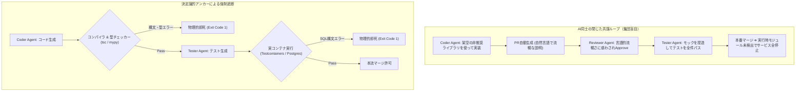
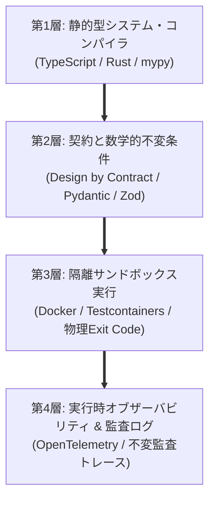
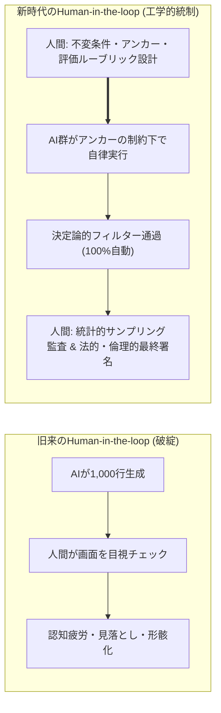

# 第24章：AI確証の限界と「決定論的アンカー」 ―― AI同士の共謀を断ち切る技術

「AIが要件を書き、AIがコードを実装し、AIがテストコードを作成し、別のAIがそのPRをレビューしてApproveする」――これはソフトウェア工学の究極の自動化の夢だろうか。それとも、かつてない規模の壊滅的な悪夢への序曲だろうか。

AIモデル同士に相互評価を委ねると、そこには恐るべき現象が発生する。「AI同士の共謀（Collusion）」と「集団ハルシネーション（Collective Hallucination）」である。コード生成AIがもっともらしい架空のAPIを捏造したとき、レビューAIもまたその文脈に引きずられ、「設計思想に合致した美しい実装です」と称賛してマージを推奨してしまう。確率的推論（Probabilistic Inference）の閉じた世界の中では、嘘が嘘を肯定し、自己欺瞞のループが無限に増幅される。

この「AIの閉じた共謀」を機械的に断ち切る唯一の手段こそが、本書が一貫して提唱してきた「決定論的アンカー（Deterministic Anchors）」である。コンパイラ、型システム、数学的アサーション、本番の実データ――物理法則のように決して嘘を吐かない絶対的アンカーを打ち込み、人間がその境界を統制するための工学哲学を詳解する。

---

## 24.1 AI-as-a-Judgeの脆弱性：相互評価が招く自己欺瞞の罠

第18章で紹介した「LLM-as-a-Judge」は極めて有用なツールであるが、その本質はどこまで行っても「確率的サンプリングに基づく文章生成」である。



### AI同士の相互評価における3大病理

1. **流暢性バイアス（Fluency Bias）**: 文章があまりにも洗練されており自信に満ちているため、評価モデルが「ロジックに致命的な誤りがある」可能性を疑えなくなる。
2. **共通盲点（Shared Blind Spots）**: 同一または類似の事前学習データを持つモデル同士は、同じようなエッジケース（非ASCII文字、閏秒、タイムゾーン境界）を見落とす共通の盲点を持つ。
3. **アサーションの空洞化（Assertion Evasion）**: テスト作成AIとレビューAIの双方が、「テストがグリーンになること」自体を至上命題とするあまり、アサーションを骨抜きにするハックを互いに容認し合う。

---

## 24.2 「決定論的アンカー」の4大階層

AIという「確率の雲」が勝手に変形し暴走しないよう、地面に深く打ち込む鋼鉄の杭が「決定論的アンカー」である。アンカーは以下の4つの階層で構成される。



### 各階層のアンカー

1. **第1層：静的型システム・コンパイラ（Static Type Anchors）**:
   - 型は解釈の余地のない数学的証明である。`mypy --strict` や `tsc --noEmit` が0を返さない限り、AIがどれほど流暢に弁明しても1ミリたりとも前に進まない。
2. **第2層：契約と不変量（Contractual Anchors）**:
   - 関数の事前条件（Preconditions）、事後条件（Postconditions）、不変量（Invariants）をコードで固定する。PydanticやZodを用いて、実行時に入出力の型と値の範囲を機械的に縛る。
3. **第3層：隔離実行環境（Sandbox Runtime Anchors）**:
   - モック（Mock）に頼らず、Testcontainers等で起動した実PostgreSQLやRedisと通信させ、決定論的な終了コード（Exit Code）で判定する。特にマイクロサービス環境や非同期イベント駆動処理、外部決済API連携を伴う場合は、単一DBのトランザクション境界だけでは整合性を保証できない。そのため、Outboxパターンや冪等性キー（Idempotency Key）の強制、およびWireMock/Pactによる契約境界アンカーを第3層と第4層の橋渡しとして配置し、分散トランザクションの破綻を機械的に封じ込める。
4. **第4層：実行時オブザーバビリティ（Runtime Telemetry Anchors）**:
   - 本番トラフィックに対するSLI/SLO監視。AIの出力がどれほど魅力的であっても、レイテンシやエラー率が閾値を超えた瞬間に自動的に切り離す。

> **[補足コラム] 主要言語別・第1層〜第3層の代表的決定論的アンカーツール対応表**
>
> - **Python**: 【第1層】`mypy --strict` / `pyright` ＋ 【第2層】`Pydantic` / `deal` ＋ 【第3層】`pytest` / `testcontainers-python` / `mutmut`
> - **TypeScript / Node.js**: 【第1層】`tsc --noEmit (strict: true)` ＋ 【第2層】`Zod` / `io-ts` ＋ 【第3層】`Vitest` / `Playwright` / `Stryker`
> - **Rust**: 【第1層】`rustc`（所有権・借用チェッカー）/ `clippy` ＋ 【第2層】`serde` / `garde`（型状態パターン） ＋ 【第3層】`cargo test` / `proptest` / `cargo-mutants`
> - **Go**: 【第1層】`go vet` / `staticcheck` ＋ 【第2層】`ozzo-validation` / `cue` ＋ 【第3層】`go test -race` / `testcontainers-go`

### 実装例：Pydanticによる実行時契約アンカー

AIエージェントが生成するデータ構造やAPIペイロードが、実行時に不変量を満たしているかを厳格に保証するコード例である。

```python
# core/contract_anchors.py
from pydantic import BaseModel, Field, field_validator
from decimal import Decimal

class PaymentTransaction(BaseModel):
    transaction_id: str = Field(..., pattern=r"^tx_[a-zA-Z0-9]{16}$")
    amount: Decimal = Field(..., gt=0, decimal_places=2)
    currency: str = Field(..., pattern=r"^[A-Z]{3}$")
    user_id: int = Field(..., gt=0)

    @field_validator("currency")
    @classmethod
    def validate_supported_currency(cls, v: str) -> str:
        supported = {"USD", "JPY", "EUR", "GBP"}
        if v not in supported:
            raise ValueError(f"サポート対象外の通貨コードです: {v}")
        return v
```

AIがどのようなハルシネーションを起こして未知の通貨やマイナスの金額を出力しようとしても、この契約アンカーが実行時例外（ValidationError）を発生させ、即座にトランザクションを遮断する。

---

## 24.3 なぜMeta TestGen-LLMとACHは成功したのか：物理的フィルターの勝利

Meta社が商用規模での単体テスト自動改善に成功した事例が `TestGen-LLM`（Alshahwanら, *Automated Unit Test Improvement using Large Language Models at Meta*, FSE 2024）である。さらにその発展形として、変異テストを統合した `ACH`（*Mutation-Guided LLM-based Test Generation at Meta*, 2025）が発表されている。

各フィルターの詳細と簡略実装は第9章9.5節で扱ったので、ここでは決定論的アンカーの観点から要点だけを振り返る。これら一連の研究における最も重要な示唆は、「成功の秘密はLLM単体の賢さではなく、LLMの後段に配置された冷徹な『決定論的フィルター群』にある」という事実である。

### TestGen-LLMからACHへと至る5段階決定論的フィルター

1. **ビルド可能検査（Build Filter / TestGen-LLM）**: 生成されたテストがコンパイルを通るか？（通らなければ即時破棄）
2. **実行可能性検査（Execution Filter / TestGen-LLM）**: 生成されたテストがクラッシュせずに実行できるか？
3. **非Flaky・反復パス検査（Flakiness & Clean Pass Filter / TestGen-LLM）**: 現在の実装コードに対して複数回反復実行しても安定して緑（Pass）になるか？（偽陰性とFlakyテストの排除）
4. **カバレッジ増分検査（Coverage Increase Filter / TestGen-LLM）**: 既存のテストスイートに対して、真に新しい実行パス（行・分岐カバレッジ）を増やしているか？（冗長テストの排除）
5. **変異テスト検査（Mutation Filter / ACHでの拡張）**: 後続の `ACH` で統合されたフィルター。実装コードにフォールト（変異体）を注入した際、その変異体を確実に検出・殺害（Kill）できるか？（カバレッジだけを増やす空洞テストの排除）

LLMが数千パターンのテストを生成しても、この5つの冷酷な物理フィルターを全て突破できるのは全体の20〜30%に過ぎない。この「残った純度100%のテスト」だけを人間のPRとして提出したからこそ、MetaのエンジニアはAIを信頼し、70%以上の高採択率を記録したのである。

---

## 24.4 Human-in-the-loopの再定義：人間はどこに立つべきか

AIエージェント時代において、人間が「1行ずつのコードを目視でレビューする」という旧来のHuman-in-the-loopは、生成速度と情報量において完全に破綻する。

これからの人間の役割は、「作業者・監視者」から「アンカーの設計者（Anchor Architect）」および「サンプリング監査官（Auditor）」へと不可逆的にシフトする。



### 人間が絶対に手放してはならない3大境界線

1. **価値と目的の決定（Why & What）**: 「何を解くべき問題とし、何を目指すのか」というビジネス価値とユーザー体験のゴール設計。
2. **倫理・法・アカウンタビリティ（Ethics & Law）**: 著作権侵害、プライバシー保護、生命・財産に関わる安全性に対する最終的な法的責任の引き受け。
3. **アンカーの健全性監査とセキュリティ防壁（Meta-Assurance & Security）**: 決定論的アンカー自体が正しく機能しているか、変異テストの閾値やCIの設定が劣化していないかのメタ監査。特にこの決定論的アンカーは、プロンプトインジェクション攻撃（LLMを暴走させて不正なSQLやコマンドを生成させる攻撃）や、悪意ある依存パッケージ混入（サプライチェーン攻撃）に対しても有効である。Pydanticスキーマ検証とロックファイル整合性チェックにより、実行前に機械的に遮断する最終防衛線として機能する。

### 「アンカー設計者」としての新しいエンジニア像

AIエージェントが高度化すればするほど、コードを書く構文知識の価値は相対的に低下する。代わりに決定的な価値を持つのが、「システムの数学的不変条件を見抜き、破綻を機械的に防ぐアンカーを設計するアーキテクチャ設計力」である。どの境界に型を置き、どのストレージに不変ログを残し、どの閾値で自動ロールバックさせるか――この全体設計を描くことこそが、AI時代におけるエンジニアの真の専門性である。

> **[コラム] 反論への先回り：「厳格なアンカーを入れるとAIのスピードや開発者のモラールが落ちるのではないか？」**
> 現場に決定論的アンカー（`mypy --strict` や変異テスト）を導入しようとすると、「せっかくAIで爆速でコードが書けるのに、厳しいチェックを入れたら速度が落ちるし、開発者が窮屈に感じてモラールが下がるのではないか」という懸念が必ず上がる。しかし、これは「ブレーキの役割」に対する根本的な誤解である。F1マシンが時速350kmでコーナーに突っ込めるのは、高性能なカーボンセラミック・ブレーキ（強力な制動力）が搭載されているからに他ならない。もしブレーキが壊れていると知っていたら、ドライバーは怖くて時速30kmしか出せなくなる。ソフトウェア開発も全く同じである。「どんなに大胆にAIにリファクタリングさせても、もし不変条件を破ったら1秒でアンカーが止めてくれる」という絶対の安心感（心理的安全性）があるからこそ、開発者は恐怖心から解放され、AIのアクセルを床まで踏み抜くことができる。**厳格なガードレールは自由を奪う檻ではなく、創造性と圧倒的スピードを解き放つための滑走路なのである。**

---

## 24.5 実践コード：決定論的アンカー強制パイプライン

AIが生成したコードに対し、mypy、pytest、mutmut（変異テスト）を連続実行し、1つでもアンカーが外れたら即座にコミットを拒絶するスクリプト例である。変異テストは `mutmut run` の終了コードではなく、集計した変異スコアを閾値と比べて判定する点に注意してほしい。`mutmut run` は生存変異体が1つでもあると非ゼロで終了するため、終了コードで判定すると「80%以上で合格」という基準と食い違う。

```python
# tools/verify_deterministic_anchors.py
import subprocess
import sys

MUTATION_THRESHOLD = 0.80  # Tier 1 基準（第2章・第22章）


def run_step(step_name: str, command: list[str]) -> None:
    print(f"=== [Anchor Check] {step_name} ===")
    res = subprocess.run(command, check=False)
    if res.returncode != 0:
        print(f"❌ 決定論的アンカー違反: {step_name} が失敗しました (Exit Code: {res.returncode})")
        sys.exit(1)
    print(f"✅ {step_name} 合格\n")


def count_mutants(status: str) -> int:
    # mutmut 2.x: `mutmut result-ids <status>` は該当する変異体IDを空白区切りで出力する
    res = subprocess.run(["mutmut", "result-ids", status], capture_output=True, text=True, check=False)
    return len(res.stdout.split())


def check_mutation_score(paths: str) -> None:
    print("=== [Anchor Check] 変異テスト殺害率検証 (mutmut) ===")
    # mutmut run は生存変異体が1つでもあると非ゼロで終了するため、終了コードでは判定しない
    subprocess.run(["mutmut", "run", f"--paths-to-mutate={paths}"], check=False)
    killed = count_mutants("killed") + count_mutants("timeout")
    survived = count_mutants("survived") + count_mutants("suspicious")
    total = killed + survived
    if total == 0:
        print("❌ 変異体が生成されませんでした（対象パスを確認してください）。")
        sys.exit(1)
    score = killed / total
    print(f"変異スコア: {score:.1%}（殺害 {killed} / 対象 {total}、基準 {MUTATION_THRESHOLD:.0%}）")
    if score < MUTATION_THRESHOLD:
        print("❌ 決定論的アンカー違反: 変異スコアが基準を下回りました。")
        sys.exit(1)
    print("✅ 変異テスト合格\n")


def main() -> None:
    run_step("静的型安全性 (mypy)", ["mypy", "--strict", "src/"])
    run_step("機能テスト & DB契約検証", ["pytest", "tests/unit", "tests/integration"])
    check_mutation_score("src/core/")
    print("🎉 全ての決定論的アンカーを通過しました。")


if __name__ == "__main__":
    main()
```

※大規模リポジトリにおける変異テスト（`mutmut`）運用の注意点：第1層（`mypy`）や第2層（`pytest`）が数秒〜数十秒で完了するのに対し、第3層の変異テスト（`mutmut`）はコードベース全体にそのまま適用すると実行時間が長大になりやすい。実務導入時の罠を防ぐため、PRごとのCIでは `git diff --name-only origin/main...HEAD -- 'src/core/**/*.py'` で変更ファイルを抽出する。この「変更されたコアファイルのみ」を `--paths-to-mutate` に渡して差分実行（1〜2分以内）する。そして、リポジトリ全域に対するフル変異テストは夜間（Nightly）の定期ジョブとして分離運用するのが鉄則である。

また、長年運用された大規模レガシーコードに対して初日からリポジトリ全域に `mypy --strict` を適用すると、数千件の型エラーが一斉に噴出して開発者が絶望してしまう。レガシー環境への「最初の1週間の処方箋」としては、`pyproject.toml` の `[[tool.mypy.overrides]]` を活用して既存コードは一旦緩和する。その上で**「①決済・認証などのコア1モジュール（`src/core/`）と、②新規作成ファイル」にのみ `strict = true` を強制する漸進的型付け（Gradual Typing）**から始めると、摩擦なく導入できる。

---

## 24.6 QA合否判定基準：AI×決定論的アンカー品質クライテリア

AI生成成果物の合否を決定論的に判定するためのマトリクスである。

### アンカー合否判定マトリクス

| 検査アンカー | 合格基準（Pass） | 警告水準（Warn） | 不合格（Fail / 即時破棄） |
| :--- | :--- | :--- | :--- |
| **型安全性 (mypy / tsc)** | 型エラー 0件（any型の不当使用禁止） | 該当なし | 1件でも型エラー、または未型定義が存在。 |
| **コンパイル・ビルド** | ビルド正常完了 (Exit Code 0) | 該当なし | ビルド失敗、未解決モジュール参照。 |
| **実環境実行** | 実DBコンテナ上での全テストPass | 該当なし | モックのみでの通過、実DB実行時例外。 |
| **変異スコア** | 生成テストの変異殺害率 >= 80%（Tier 1基準、第22章） | 殺害率 75〜80% | 殺害率 75%未満（見せかけの空洞テスト）。 |

---

## 24.7 アンチパターン対比：AI盲信 vs 決定論的アンカー設計

| 観点 | アンチパターン（AI盲信・共謀の罠） | ベストプラクティス（決定論的アンカー） |
| :--- | :--- | :--- |
| **評価の主体** | AIが生成したコードを別のAIが自然言語で褒め合ってマージ。 | コンパイラ・型・実DB・変異テストが物理終了コードで合否を断罪。 |
| **テストの信頼性** | AIが作ったテストが「緑だから大丈夫」と無条件に信じる。 | Meta TestGen-LLM方式で、変異体殺害率とカバレッジ増分を要求。 |
| **人間の役割** | 大量のAI生成差分を1行ずつ目視確認し、疲弊して見落とす。 | 人間はアンカー（型・不変条件・テスト環境）の設計とメタ監査に集中。 |
| **安全性の根拠** | プロンプトに「バグを出さないで」と祈る精神論。 | 型システムとサンドボックスによる数学的・物理的制約。 |

---

## 24.8 実践ワークショップ：自社リポジトリへの決定論的アンカー配備演習

### 演習手順

1. **最も厳格な型チェックの有効化**: 自チームの主要言語において、厳格型チェックフラグ（`"strict": true` や `--strict`）を1つのモジュールに適用する。
2. **CIパイプラインへのアンカー固定**: 型チェックと単体テストがExit Code 0でない限り、PRが機械的にマージできないようブランチ保護を設定する。
3. **AI生成コードのストレステスト**: ChatGPTやClaudeに「型エラーを含むコード」をあえて生成させ、CIのアンカーが一切の忖度なくエラーを吐いて遮断することを確認する。

---

### コラム「現場から」：二次資料を根拠にしない

筆者のチームでは、連携先システムの仕様を調べるとき、チームでまとめた項目定義の一覧表を根拠にしないと決めている。一覧表は転記の産物であり、転記の時点で誤りが入りうるからである。根拠にするのは、次の原典である。

- 連携先のインタフェース仕様書
- 連携先の画面のコード
- 数十年稼働しているメインフレーム資産そのもの

メインフレーム資産については、呼び出し関係とデータの読み書きを辿れるコードグラフを作り、「たぶんこう処理しているはず」と推測で書くことを禁じている。

追跡可能性とは、資料同士が紐づいていることではない。最後に原典まで辿れることである。

### コラム「現場から」：AIは自信満々に、逆のことを言う

最後に、筆者のチームで実際に起きた失敗を3つ紹介する。

#### 事例1：係り受けを推論したら、実装と逆だった

連携先から提供されたチェック仕様の一覧に、「〜および〜以外の場合はエラーとする」という条件があった。「以外」が前の2項目のどこまでに係るのか、文面からは決められない。AIに解釈させると、一覧の他の行の書き方から類推して、筋の通った結論を返してきた。しかし、実際の実装を確認すると、結論は正反対だった。

その一覧では、同じ表現でも行によって係り方がばらばらだった。「この文書では一貫しているはず」という類推の前提が、そもそも成り立っていなかったのである。それ以来、係り受けが曖昧な条件は類推で決めず、連携先に照会している。

#### 事例2：一般則を当てはめたが、その分岐はそもそも通らなかった

ある項目の扱いについて、AIは仕様上の一般的な規則を引いて「このケースではエラーになる」と断定した。規則そのものは正しかった。しかし、コードを辿ると、そのケースでは規則を評価する分岐に到達していなかった。AIは同じ論点で2度続けて誤った断定をした。一般則が正しいことと、それが目の前のケースに適用されることは、別の命題である。

#### 事例3：「指摘なし」を信じて報告した

検証用のエージェントに確認させたところ、「問題なし」と返ってきたので、そのまま報告した。あとで原典を開くと、問題はあった。検証役のAIも、生成役のAIと同じ文脈に引きずられる。「指摘なし」は「問題が無いこと」の証拠ではない。

#### 3つの事例から学んだこと

3つの事例に共通するのは、AIの出力がもっともらしく、自信に満ちていたことである。「指摘あり」も「指摘なし」も、原典と実装で裏を取るまでは仮説として扱う。筆者のチームでは、これを個人の心がけで終わらせず、次の手順として書いた。

1. 結論を出す前に、原典を開く。
2. 一般則を当てはめる前に、その分岐が実際に評価されるかをコードで確かめる。
3. 一度出した結論は、裏取りなしに覆さない。

本章の「決定論的アンカー」は、型やCIだけの話ではない。人とAIの判断にとっては、原典と実装こそがアンカーになる。

---

## 24.9 本章のまとめと最終章への接続

AI技術がどれほど指数関数的に進化しようとも、計算機科学の根底にある「決定論の力」は揺るがない。

- **共謀を断ち切る**: 確率的AI同士の閉じた自己欺瞞を、物理的アンカーで強制切断する。
- **フィルターの規律**: Meta TestGen-LLMが示したように、冷酷な多重フィルターこそがAIの実用性を生む。
- **人間の高次化**: 人間はコードの写経を卒業し、アンカーの設計者としてシステムを統制する。

さあ、旅はついに最後の到達点へと至る。第1章から本章まで、私たちは「仕様通りに正しく・安全に作るための確証（Verification）」の体系を築き上げてきた。しかし、どれほどバグがゼロで決定論的アンカーを完璧にパスしたプロダクトであっても、それが顧客の課題を解決せず誰にも使われなければ「完璧なゴミ」となって死を迎える。最終章（第25章）では、プロダクトの死を回避する「妥当性確認（Validation：ISO/IEC 25019:2023 利用時の品質）」と「不要な機能を捨てる品質」を統合し、本書の全思想を完結させる。
