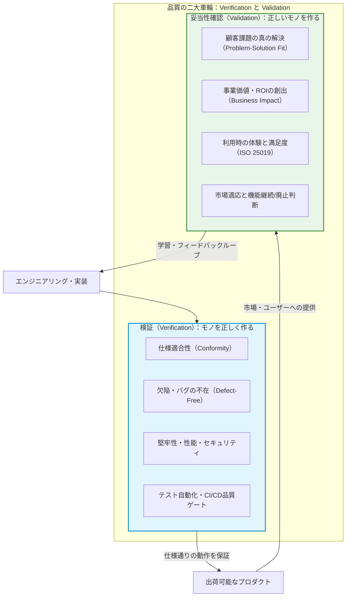
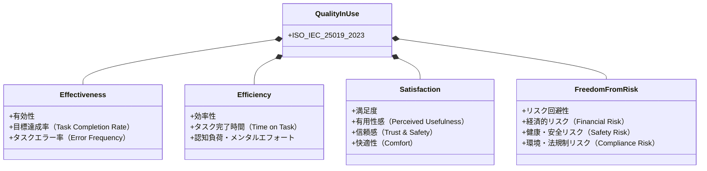
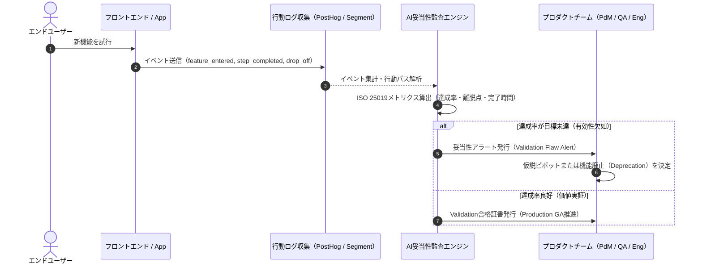
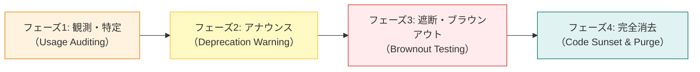

# 第25章：プロダクトの死と妥当性確認（Validation） ―― 完璧なゴミを作らないための仮説検証品質

「バグは1つもない。テストカバレッジは95%を超え、CIパイプラインは常にオールグリーン、静的解析の指摘もゼロ。だが、リリース後にアクセスログを確認すると、誰一人としてその機能を使っていない――」

これは、架空の寓話ではありません。世界中のアジャイルチームやウォーターフォール開発の現場で、今この瞬間にも繰り返されているソフトウェア工学最大の悲劇です。

どれほど数学的に正しく、どれほどアーキテクチャが洗練され、どれほど堅牢に動作しようとも、誰の課題も解決せず、誰にも愛されないソフトウェアは、工学的には「完璧に構築されたゴミ（Perfect Garbage）」に過ぎません。

本書の締めくくりとなる本章では、ソフトウェア工学における永遠の命題である「モノを正しく作る（Verification）」と「正しいモノを作る（Validation）」の境界を解き明かし、プロダクトが直面する「死」を回避するための妥当性確認（Validation）の品質規律を徹底的に論じます。

さらに、国際規格 ISO/IEC 25019:2023（利用時の品質モデル）の実践、仮説検証サイクルとQAの統合、使われない機能を安全に葬り去る「機能を捨てる品質」、そしてAIエージェント時代にエンジニアとQAが果たすべき真の責務について体系化します。

---

## 25.1 ソフトウェア工学の究極の問い：Verification vs Validation

ソフトウェアテストや品質保証の古典的名著において、バリー・ベーム（Barry Boehm）は極めて簡潔かつ本質的な対比を提示しました。

- **検証（Verification）**: "Are we building the product right?"（我々はモノを正しく作っているか？）
- **妥当性確認（Validation）**: "Are we building the right product?"（我々は正しいモノを作っているか？）

多くの開発組織において、QA（品質保証）やテストエンジニアの主戦場は「Verification」でした。仕様書通りに動くか、境界値で例外が発生しないか、負荷に耐えられるか、セキュリティホールがないか。これらはすべて「モノを正しく作る」ための工学的規律です。

しかし、激動する市場環境や、AIによってソフトウェア製造コストが劇的に低下した現代において、最大の事業リスクは「不具合」ではなく「無価値」です。



### なぜ「完璧なゴミ」が量産されるのか

完璧なゴミが生まれるメカニズムには、組織的な心理バイアスと構造的欠陥が潜んでいます。

1. **サンクコスト効果と機能愛着**:
   開発チームが何ヶ月も心血を注いで設計・実装した機能に対して、愛着が湧くのは自然な感情です。「これだけ苦労して作ったのだから、ユーザーも使ってくれるはずだ」という認知バイアスが、冷酷なデータ（使われていないという事実）から目を背けさせます。
2. **「完了の定義（DoD）」のスコープ停止**:
   多くのチームのDoDは「本番環境に正常デプロイされ、エラー率が閾値以下であること」で終わっています。つまり、「リリースした瞬間」に品質保証の職務が完了したとみなされ、「リリース後に顧客がどのような価値を得たか」を検証する責任が誰のロールにも定義されていません。
3. **仕様書信仰と受託マインド**:
   「要求仕様書に書いてあったから作った」「PdM（プロダクトマネージャー）が承認したから正しい」という受託的思考停止です。仕様書は顧客価値の「仮説」に過ぎず、真実ではありません。真実は、本番環境のユーザー行動ログと事業KPIの中にしか存在しません。

---

## 25.2 利用時の品質（ISO/IEC 25019:2023）の実践評価

プロダクトの妥当性を主観的な感覚ではなく、工学的なメトリクスとして客観測定するために国際規格が策定されました。それが **ISO/IEC 25019:2023**（SQaRE - Quality-in-use model）です。

ISO/IEC 25010のシステム品質モデル（機能適合性、信頼性、保守性など）が「製品そのものの内部・外部特性」を規定するのに対し、ISO/IEC 25019は「特定の利用状況下で特定のユーザーが特定の目標を達成する際の品質」を定義します。

### ISO/IEC 25019 の4大特性と測定メトリクス



1. **有効性（Effectiveness）**:
   ユーザーが意図したタスクを正確かつ完全に達成できる度合い。
   - *測定メトリクス*: 目標達成率（タスク完了数 ÷ 開始数）、クリティカルエラー発生率。
2. **効率性（Efficiency）**:
   ユーザーが目標を達成する際に消費する資源（時間、労力、認知的負荷）の妥当性。
   - *測定メトリクス*: 平均タスク所要時間、無駄な画面遷移数、AI支援による入力短縮率。
3. **満足度（Satisfaction）**:
   プロダクトを利用する過程および結果に対して、ユーザーが抱く実質的な充足感や信頼性。
   - *測定メトリクス*: CSAT（顧客満足度調査）、SUS（システムユーザビリティスケール）、NPS（正味推奨者スコア）。
4. **リスク回避性（Freedom from Risk）**:
   利用によってユーザーや組織の経済的状態、人間関係、法的立場に予期せぬ損害を与えない度合い。
   - *測定メトリクス*: 誤操作による財務損失発生件数、プライバシー漏洩ヒヤリハット件数。

---

## 25.3 仮説検証サイクルと品質保証の統合

妥当性確認（Validation）をアジャイルな開発プロセスに組み込むためには、プロダクトの企画段階から本番運用に至るまで、「仮説」を検証するゲートウェイを設ける必要があります。

### プレトタイピングとプロトタイプの品質規律

アルバート・サヴォイア（Alberto Savoia）が提唱した「プレトタイピング（Pretotyping）」は、1行のコードも書く前に「そもそも人々がそれを欲しがるか？」を最速でテストする手法です。

- **メカニカル・ターク型**: 表向きは全自動AIシステムに見せかけ、裏側で人間が手作業で処理して需要を測定する。
- **フェイクドア型**: 存在しない機能のボタンを配置し、クリックしたユーザーに「現在開発中です。事前登録しますか？」と表示して関心度を測定する。

QAチームは、これらの検証活動を「邪道」と排斥するのではなく、「究極のValidation品質保証」としてテスト計画に統合しなければなりません。

### プレトタイピング・フェイクドアにおける倫理的配慮とクローズドB2B環境でのValidation手法

ただし、フェイクドアやプレトタイピングを実践する際は、**「ユーザーの信頼を毀損するダークパターン（欺瞞的UI）やプライバシー侵害に陥らないための倫理的ガードレール」**が不可欠です。決済画面や医療・金融手続きの直前で「実はこの機能はまだ存在しません」と表示すれば、ユーザーは騙されたと感じてブランドへの信頼（ISO 25019の満足度・リスク回避性）は地に落ちます。フェイクドアを実施する際は、①「ベータ機能ラボ（先行プレビュー枠）」であることを明示して期待値を誠実にコントロールすること、②クリックイベントの集計時は個人情報（PII）や入力フォームの機密データを一切保存せず、匿名化された関心度カウントのみを取得すること、を絶対の品質規律として守ってください。

また、「オンプレミスや閉域網で稼働するレガシーなB2Bエンタープライズ環境であり、セキュリティ制約上エンドユーザーの行動テレメトリ（PostHogやGoogle Analytics等）を外部送信できない」という現場も少なくありません。そのようなクローズド環境におけるValidationは、以下の3つの代替アプローチで実践します。

1. **監査ログ・DB状態遷移からの間接Validation**: 外部SaaSへイベントを送れなくとも、アプリケーションDB内の「機能別テーブルのレコード生成数」を集計するスクリプトを同梱する。月次メンテナンス時に匿名化統計サマリログを確認することで、どの機能が実際に業務で使われているかを定量把握できる。
2. **カスタマーサクセス（CS）・導入支援チームとの合同ヒアリングループ**: B2Bではユーザー数が限定されている強みを活かし、リリース後30日目にCS担当者とQAが顧客の運用担当者へ15分の「利用時品質インタビュー」を実施する。業務時間が実際に何分短縮されたか、Excelの手作業に戻っていないかを直接確認する。
3. **ステージング環境での実業務リハーサル（UAT観察）**: 受入テスト（UAT）を単なる「仕様書通りの打鍵確認」で終わらせない。顧客の現場担当者にマニュアルなしで実業務シナリオを遂行してもらい、手が止まった箇所（UX摩擦）を記録する思考発話法（Think-Aloud Protocol）をValidationゲートとして組み込む。



---

## 25.4 「機能を捨てる品質」：デッドコードとゾンビ機能の撲滅

ソフトウェア開発において最も勇気を要し、かつ最も品質に貢献する行為は「機能を追加すること」ではなく「不要な機能を削除すること」です。

利用率が0.1%にも満たない機能、いわゆる「ゾンビ機能」を放置することは、以下の致命的な品質劣化をもたらします。

1. **認知的オーバーヘッドの増大**: 全ての開発者がコードを読む際、使われない機能のクラスやテーブル定義を理解・考慮しなければならず、開発速度が減速する。
2. **回帰バグの温床**: ライブラリアップグレードやフレームワーク更新の際、使われない機能のテストが落ち、無駄な保守工数が発生する。
3. **攻撃面の拡大（Attack Surface）**: 放置されたAPIエンドポイントや古い認証ロジックが、セキュリティ侵害の侵入経路となる。

### 機能削除（Deprecation & Sunset）の4フェーズプロセス



1. **フェーズ1（観測・特定）**:
   過去90日間のアクティブ利用率がDAU/MAUの0.5%未満の機能を検知。
2. **フェーズ2（事前アナウンス）**:
   利用しているごく少数のユーザーに対してUI上で代替手段と廃止スケジュールを通知。
3. **フェーズ3（ブラウンアウト・テストと心理的摩擦を最小化するアナウンス文面）**:
   機能をいきなり消すのではなく、特定の時間帯だけ意図的に機能を無効化（フィーチャーフラグでOFF）し、問い合わせや重大な苦情が発生しないかを実験する。この際、ユーザーの心理的動揺やクレームを防ぐため、UIバナーや通知メールでは単に「機能を廃止します」と突き放すのではなく、**「【重要なお知らせ】より高速で安全な『新・一括エクスポート機能（v2）』への統合に伴い、旧CSV出力機能は○月○日をもって提供を終了いたします。今後は画面右上の『新エクスポート』ボタンよりワンクリックで同等のデータを取得いただけます（なお、完全終了に先立ち、○月○日の14:00〜16:00に一時停止テストを実施いたします）」**と案内する。このように、「①上位互換となる代替手段への具体的な誘導」「②統合によるユーザーメリット」「③計画的な一時停止（ブラウンアウト）の事前予告」の3点セットを必ず添えるのが親切なプロダクト運用の鉄則である。
4. **フェーズ4（コード・テーブル完全パージ）**:
   ブランチを切り、バックエンド、フロントエンド、DBマイグレーションから対象コードを物理的に削除。PRでレビューしマージする。

---

## 25.5 実装例：利用実態ログとAI妥当性監査パイプライン

ユーザー行動ログから「価値の出ていない機能（ゾンビ候補）」を自動検出し、ISO 25019の利用時品質メトリクスに基づいて機能廃止または改善提案のGitHub Issueを起票するPythonスクリプトの実装例です。

```python
# tools/audit_product_validation.py
import json
import math
from dataclasses import dataclass
from typing import List, Dict, Any

@dataclass
class FeatureUsageMetric:
    feature_id: str
    feature_name: str
    total_users_exposed: int
    started_count: int
    completed_count: int
    avg_duration_sec: float
    error_count: int

    @property
    def adoption_rate(self) -> float:
        # 機能採用率: 利用開始数 / 全接触ユーザー数
        return (self.started_count / self.total_users_exposed) if self.total_users_exposed > 0 else 0.0

    @property
    def completion_rate(self) -> float:
        # ISO 25019 有効性: タスク完了率 (完了数 / 開始数)
        return (self.completed_count / self.started_count) if self.started_count > 0 else 0.0

    @property
    def task_error_rate(self) -> float:
        # エラー率: エラー発生数 / 開始数
        return (self.error_count / self.started_count) if self.started_count > 0 else 0.0


class ProductValidationAuditor:
    def __init__(self, min_adoption_threshold: float = 0.02, min_completion_threshold: float = 0.60):
        self.min_adoption_threshold = min_adoption_threshold
        self.min_completion_threshold = min_completion_threshold

    def evaluate_features(self, metrics: List[FeatureUsageMetric]) -> Dict[str, Any]:
        results = {
            "healthy_features": [],
            "ux_friction_candidates": [],
            "zombie_sunset_candidates": []
        }

        for m in metrics:
            summary = {
                "feature_id": m.feature_id,
                "name": m.feature_name,
                "adoption_rate": f"{m.adoption_rate * 100:.2f}%",
                "completion_rate": f"{m.completion_rate * 100:.2f}%",
                "avg_duration": f"{m.avg_duration_sec:.1f}s"
            }

            # 判定ロジック
            if m.adoption_rate < self.min_adoption_threshold:
                # 誰にも使われていない -> ゾンビ機能候補（廃止検討）
                results["zombie_sunset_candidates"].append(summary)
            elif m.completion_rate < self.min_completion_threshold:
                # 使おうとはしているが完了できない -> UX摩擦・有効性欠如（改善要）
                results["ux_friction_candidates"].append(summary)
            else:
                # 健全に価値を提供中
                results["healthy_features"].append(summary)

        return results


def fetch_metrics_from_db_or_api(dsn: str) -> List[FeatureUsageMetric]:
    """実運用でのデータ取得イメージ：DWH（BigQuery / PostgreSQL）やPostHog APIから直近30日の機能別集計を取得する接続アダプタ"""
    # [連携パターン1: BigQuery / PostgreSQL のイベントテーブルから直接SQL集計する場合]
    # query = """
    #   SELECT feature_id, ANY_VALUE(feature_name) AS feature_name,
    #          COUNT(DISTINCT CASE WHEN event_type = 'feature_exposed' THEN user_id END) AS total_users_exposed,
    #          COUNT(DISTINCT CASE WHEN event_type = 'feature_started' THEN user_id END) AS started_count,
    #          COUNT(DISTINCT CASE WHEN event_type = 'feature_completed' THEN user_id END) AS completed_count,
    #          AVG(CASE WHEN event_type = 'feature_completed' THEN duration_sec END) AS avg_duration_sec,
    #          COUNTIF(event_type = 'feature_error') AS error_count
    #   FROM `my_project.analytics.user_events` WHERE event_timestamp >= TIMESTAMP_SUB(CURRENT_TIMESTAMP(), INTERVAL 30 DAY)
    #   GROUP BY feature_id
    # """
    # [連携パターン2: PostHog HogQL API / Query Endpoint を用いてSaaSから直接JSON取得する場合]
    # PostHogのQuery APIエンドポイント（/api/projects/<project_id>/query/）へ {"query": {"kind": "HogQLQuery", "query": query}} をPOST送信
    return []


if __name__ == "__main__":
    # 実環境では os.environ.get("ANALYTICS_DB_DSN") があれば fetch_metrics_from_db_or_api() を呼び出し、未設定時はモックで検証
    mock_metrics = [
        FeatureUsageMetric("feat_ai_summary", "AI自動要約機能", 10000, 4200, 3900, 12.4, 45),
        FeatureUsageMetric("feat_legacy_csv_export", "レガシー独自形式CSV出力", 10000, 15, 8, 140.2, 3),
        FeatureUsageMetric("feat_bulk_approval", "一括承認ワークフロー", 10000, 1800, 750, 88.0, 310)
    ]

    auditor = ProductValidationAuditor()
    report = auditor.evaluate_features(mock_metrics)

    print("=== ISO/IEC 25019 プロダクト妥当性（Validation）監査レポート ===")
    print(f"健全な機能数: {len(report['healthy_features'])}")
    print(f"UX摩擦・有効性欠如（要改善）: {len(report['ux_friction_candidates'])}")
    for f in report["ux_friction_candidates"]:
        print(f"  - [{f['feature_id']}] {f['name']} (完了率: {f['completion_rate']})")
    print(f"ゾンビ機能（廃止・削除推奨）: {len(report['zombie_sunset_candidates'])}")
    for f in report["zombie_sunset_candidates"]:
        print(f"  - [{f['feature_id']}] {f['name']} (採用率: {f['adoption_rate']})")
```

### GitHub Actions による定期妥当性監査と自動Issue起票ワークフロー

本番ログを毎週分析し、妥当性基準を満たさない機能に対して自動的に警告Issueを発行するCIワークフローです。

```yaml
# .github/workflows/weekly-product-validation.yml
name: Weekly Product Validation & Sunset Audit

on:
  schedule:
    # 毎週月曜 09:00 JST (00:00 UTC)
    - cron: '0 0 * * 1'
  workflow_dispatch:

permissions:
  contents: read
  issues: write

jobs:
  audit-validation:
    runs-on: ubuntu-latest
    steps:
      - name: Checkout repository
        uses: actions/checkout@v4

      - name: Set up Python
        uses: actions/setup-python@v5
        with:
          python-version: '3.11'

      - name: Run Product Validation Audit
        env:
          ANALYTICS_API_KEY: ${{ secrets.PRODUCT_ANALYTICS_API_KEY }}
        run: |
          python tools/audit_product_validation.py > validation_report.txt
          cat validation_report.txt

      - name: File Issue for Deprecation Candidates
        uses: actions/github-script@v7
        with:
          script: |
            const fs = require('fs');
            const report = fs.readFileSync('validation_report.txt', 'utf8');
            if (report.includes('ゾンビ機能（廃止・削除推奨）: 0')) {
              console.log('No deprecation candidates found.');
              return;
            }
            await github.rest.issues.create({
              owner: context.repo.owner,
              repo: context.repo.repo,
              title: '🔍 [週次監査] 未利用・価値不達機能の妥当性確認と削除検討',
              body: `## ISO/IEC 25019 プロダクト妥当性監査結果\n\n\`\`\`text\n${report}\n\`\`\`\n\nチームで確認し、機能改善（仮説ピボット）またはコード削除（Sunset）のスケジュールを確定してください。`,
              labels: ['quality:validation', 'technical-debt']
            });
```

---

## 25.6 現場のアンチパターンと改善マトリクス

| 観点 | アンチパターン（失敗の罠） | 改善策（あるべき姿） |
| :--- | :--- | :--- |
| **品質保証の目的** | 「テストを全部通して、仕様通りに動かすこと」をゴールとする。 | 「ユーザーが課題を解決し、事業価値を享受すること」をゴールとする。 |
| **利用時品質の評価** | 顧客の苦情（クレーム）が来ないことをもって満足度が高いと錯覚する。 | ISO 25019に基づき、タスク完了率や離脱率などの客観メトリクスを常時可視化する。 |
| **仮説検証の扱い** | 「とりあえず全機能を作ってリリースしてから考えよう」とフル実装する。 | プレトタイピングやフィーチャーフラグによる段階的ロールアウトで、最少コストで需要を検証する。 |
| **不要機能の扱い** | 「いつか使うかもしれないから」と使われないUIやエンドポイントを残し続ける。 | 定期的な機能監査を行い、利用率基準を下回るコードを積極的に削除（コードの終活）する。 |
| **QAエンジニアの立ち位置** | 仕様書の受領者として、開発工程の最後に動作テストだけを行う。 | プロダクトディスカバリーから参画し、価値仮説の検証設計やメトリクス計測をリードする。 |

---

## 25.7 【QA合否判定・基準】プロダクト妥当性確認ゲートウェイ

プロダクトおよび各新機能が、Verification（仕様適合）だけでなくValidation（価値妥当性）をパスしているかを厳格に判定するクライテリア表です。

| 検査領域 | 判定メトリクス・客観基準 | 合格条件（Pass） | 不合格条件（Fail / 要アクション） |
| :--- | :--- | :--- | :--- |
| **有効性（Effectiveness）** | 主目標タスク完了率（Task Completion Rate） | **≥ 75.0%** | **< 60.0%**（UI/UX致命的摩擦・仮説再設計） |
| **効率性（Efficiency）** | 競合・従来手作業に対するタスク所要時間短縮率 | **≥ 30.0% 短縮** | 従来比短縮なし、または操作複雑化 |
| **満足度（Satisfaction）** | CSAT（満足度スコア）またはSUSユーザビリティ評点 | CSAT ≥ 4.0 / SUS ≥ 70 | CSAT < 3.0 / SUS < 50（強い不満） |
| **機能生存（Deprecation）** | リリース後60日時点での機能採用率（Adoption Rate） | **≥ 5.0%（DAU比）** | **< 0.5%**（機能削除プロセスの即時発動） |
| **統計的有意性（A/B Test）** | 主要コンバージョン指標の有意差検定 | **p値 < 0.05 達成** | p値 ≥ 0.05（差なし判定、ベースライン維持） |

---

## 25.8 章末演習課題：チームの「機能の終活」と妥当性監査シート

自社プロダクトの健全性を保ち、「完璧なゴミ」の堆積を防ぐための実践演習です。翌週のスプリント計画や品質レビューミーティングで実施してください。

### 演習1：プロダクト機能の断捨離（Sunset）マトリクス作成

自社リポジトリまたは管理画面から、過去半年間の機能一覧を抽出し、以下のマトリクスを完成させてください。

1. **アクティブ率の測定**: 全画面・全主要機能のMAU利用率をアナリティクスツール（Google Analytics, PostHog, Mixpanel等）で算出する。
2. **ゾンビ機能の特定**: 利用率が全体の1%未満、かつ最終更新から1年以上経過している機能を3つ特定する。
3. **削除計画の立案**: 特定した3つの機能について、事前アナウンス日、ブラウンアウト（無効化）実施日、コード完全削除（Purge）PR作成日を決定する。

### 演習2：ISO/IEC 25019 に基づく新機能Validation計画書

次回リリース予定の重要機能について、以下の項目をチーム（PdM、エンジニア、QA）で合意してください。

| 監査項目 | 記入ガイドライン・質問 | 自チームの合意内容（記入欄・記入例） |
| :--- | :--- | :--- |
| **1. 対象機能名** | 今回リリース・監査する機能は何か？ | （例：AI議事録自動要約＆ToDo抽出ボタン） |
| **2. 解決する真の課題** | ユーザーのどの痛みを解消する仮説か？ | （例：会議後の議事録清書に毎回30分かかっている苦痛の解消） |
| **3. 有効性（ISO 25019）** | 何をもってタスク完了とみなすか？ | （例：要約生成後に「Slackへ共有」または「保存」が押された割合 ≥ 75%） |
| **4. 効率性（ISO 25019）** | 従来比でどれだけ時間を短縮するか？ | （例：ボタン押下から共有完了までの平均所要時間 ≤ 60秒） |
| **5. 30日後存続基準** | リリース30日後の採用率の合格ラインは？ | （例：対象画面訪問ユーザーのうち週次利用率 ≥ 10.0%） |
| **6. 撤退・削除基準** | 未達時にいつ・どう廃止（Sunset）するか？ | （例：60日時点で利用率1%未満ならブラウンアウトを経てコード完全削除） |

---

## 25.9 結び：AI時代のエンジニアとQAが目指すべき「真のプロダクト品質」

本書の全25章を通じて、私たちはソフトウェア品質管理のあらゆる地平を旅してきました。

古典的なテスト設計技法から、ウォーターフォール・スクラム・Shape Upなどの開発プロセス、アーキテクチャ設計レビュー、セキュリティや性能の非機能要件、Shift-LeftとShift-Right、そして生成AIによる自動確証と決定論的アンカーに至るまで――。

いまや、AIの登場によってコードを書くこと自体の敷居は限りなくゼロに近づいています。仕様書を与えれば、数秒で数千行のコードと単体テストが生成される時代です。

しかし、だからこそ問われます。

> 「そのコードは、本当に作られるべきものなのか？」

どれほどAIが高度化しようとも、「顧客の痛みを誰よりも深く理解し、何を作るべきで、何を捨てるべきかを決断する責任」を、AIに丸投げすることはできません。

真の品質管理（Quality Assurance）とは、単にバグを摘出する警察官になることではありません。プロダクトがユーザーと社会に寄り添い、真の価値を届けているかを最後まで見届け、証明し続ける「価値の伴走者（Assurance Partner）」であることです。

Verification（モノを正しく作る技術）という強固な翼と、Validation（正しいモノを作る情熱）という鋭い羅針盤を手に、未知の未来へ進むすべてのエンジニアとQAの皆様に、本書が確かな道標となることを心より願っています。
